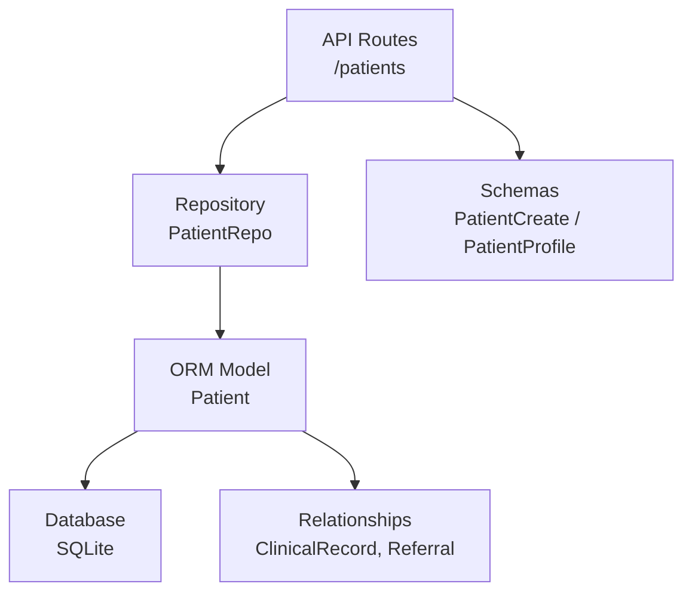
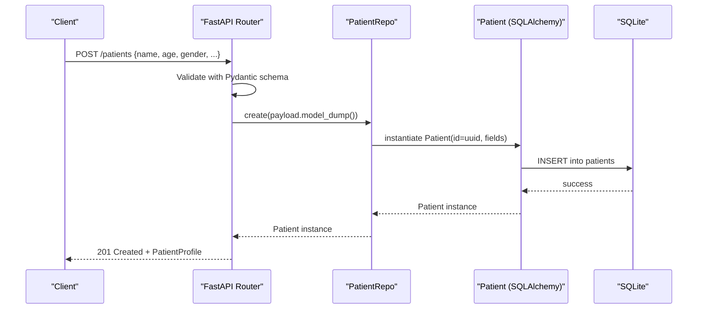
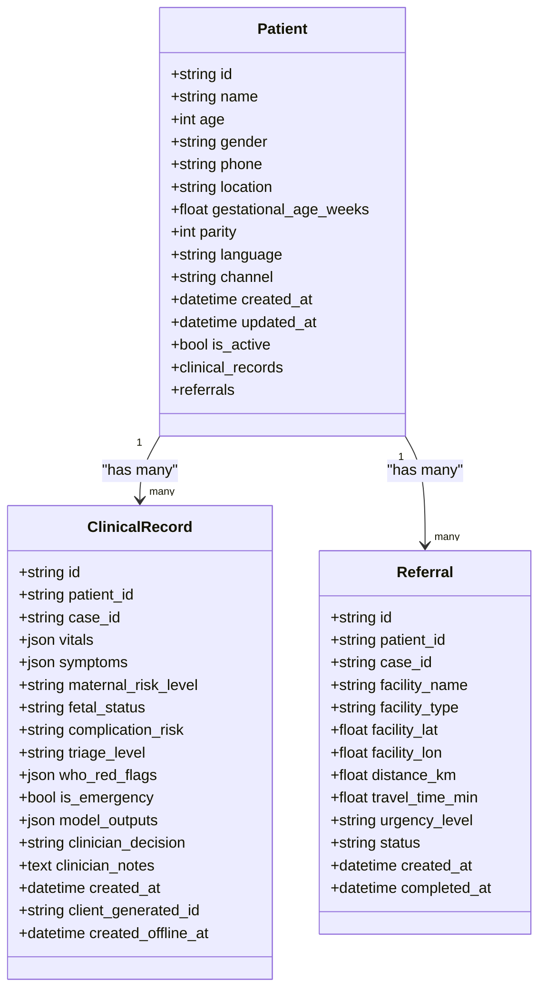
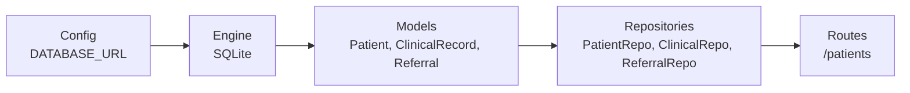

# Patient Entity

<cite>
**Referenced Files in This Document**
- [models.py](file://backend/db/models.py)
- [patient.py](file://backend/schemas/patient.py)
- [patients.py](file://backend/api/routes/patients.py)
- [repositories.py](file://backend/db/repositories.py)
- [config.py](file://backend/config.py)
</cite>

## Table of Contents
1. [Introduction](#introduction)
2. [Project Structure](#project-structure)
3. [Core Components](#core-components)
4. [Architecture Overview](#architecture-overview)
5. [Detailed Component Analysis](#detailed-component-analysis)
6. [Dependency Analysis](#dependency-analysis)
7. [Performance Considerations](#performance-considerations)
8. [Troubleshooting Guide](#troubleshooting-guide)
9. [Conclusion](#conclusion)
10. [Appendices](#appendices)

## Introduction
This document provides detailed documentation for the Patient entity used by MaaHifazat AI, a maternal health system designed to support care pathways in rural Pakistan. It explains the Patient data model, field semantics and validation, relationships with related entities, UUID-based identity strategy, and practical examples for creating, updating, and querying patients via the API. The goal is to make the Patient entity understandable for both technical and non-technical stakeholders involved in building or operating the system.

## Project Structure
The Patient entity spans several layers:
- Data model definition (SQLAlchemy ORM)
- Request/response schemas (Pydantic)
- Repository layer (CRUD operations)
- API routes (HTTP endpoints)
- Configuration (database settings)

**Diagram sources**
- [patients.py:44-96](file://backend/api/routes/patients.py#L44-L96)
- [repositories.py:9-29](file://backend/db/repositories.py#L9-L29)
- [models.py:11-28](file://backend/db/models.py#L11-L28)
- [patient.py:31-46](file://backend/schemas/patient.py#L31-L46)

**Section sources**
- [models.py:11-28](file://backend/db/models.py#L11-L28)
- [patient.py:31-46](file://backend/schemas/patient.py#L31-L46)
- [patients.py:44-96](file://backend/api/routes/patients.py#L44-L96)
- [repositories.py:9-29](file://backend/db/repositories.py#L9-L29)
- [config.py:23-24](file://backend/config.py#L23-L24)

## Core Components
- Patient ORM model defines the persistent schema and relationships.
- Pydantic schemas define input validation and response shape.
- Repository encapsulates database operations.
- API routes expose HTTP endpoints for patient management.

Key responsibilities:
- Enforce data types and constraints at the schema layer.
- Persist and retrieve patient records using SQLAlchemy.
- Provide consistent JSON responses for clients.

**Section sources**
- [models.py:11-28](file://backend/db/models.py#L11-L28)
- [patient.py:31-46](file://backend/schemas/patient.py#L31-L46)
- [repositories.py:9-29](file://backend/db/repositories.py#L9-L29)
- [patients.py:44-96](file://backend/api/routes/patients.py#L44-L96)

## Architecture Overview
The Patient workflow involves request validation, repository operations, and ORM persistence.

**Diagram sources**
- [patients.py:44-53](file://backend/api/routes/patients.py#L44-L53)
- [repositories.py:13-17](file://backend/db/repositories.py#L13-L17)
- [models.py:11-28](file://backend/db/models.py#L11-L28)
- [config.py:23-24](file://backend/config.py#L23-L24)

## Detailed Component Analysis

### Patient Entity Fields and Business Logic
Below is a field-by-field explanation grounded in the codebase. Each field includes its type, default behavior, and business rationale.

- id
  - Type: String (UUID)
  - Default: Generated via gen_uuid()
  - Purpose: Unique primary key for each patient record
  - Validation: Enforced by ORM; uniqueness guaranteed by UUID generation
  - Notes: Used for stable references across ClinicalRecord and Referral

- name
  - Type: String
  - Required: Yes (not nullable)
  - Purpose: Identifies the patient
  - Validation: Must be provided on creation

- age
  - Type: Integer
  - Optional: Yes
  - Purpose: Captures patient age
  - Validation: Constrained by schema to reasonable range for maternal health contexts

- gender
  - Type: String
  - Default: "female"
  - Purpose: Indicates patient gender; defaults to female for maternal health focus
  - Validation: Enumerated values supported by schema

- phone
  - Type: String
  - Optional: Yes
  - Purpose: Contact information for follow-up and communication

- location
  - Type: String
  - Optional: Yes
  - Purpose: Geographic context for routing referrals and local care coordination

- gestational_age_weeks
  - Type: Float
  - Optional: Yes
  - Purpose: Tracks pregnancy stage for risk assessment and triage
  - Validation: Constrained by schema to plausible ranges for gestation

- parity
  - Type: Integer
  - Optional: Yes
  - Purpose: Number of prior pregnancies; informs risk profiles

- language
  - Type: String
  - Default: "ur"
  - Purpose: Preferred language for communication; defaults to Urdu for local context

- channel
  - Type: String
  - Default: "app"
  - Purpose: Indicates how the patient was registered (e.g., app, web, clinic)

- created_at
  - Type: DateTime
  - Default: Current UTC time
  - Purpose: Records when the patient was first created

- updated_at
  - Type: DateTime
  - Behavior: Automatically updated on modifications
  - Purpose: Tracks last modification time

- is_active
  - Type: Boolean
  - Default: True
  - Purpose: Soft flag to indicate active status for filtering and reporting

These definitions are implemented in the ORM model and validated through Pydantic schemas. Defaults and constraints ensure consistency across the system.

**Section sources**
- [models.py:11-28](file://backend/db/models.py#L11-L28)
- [patient.py:31-46](file://backend/schemas/patient.py#L31-L46)

### Relationships with ClinicalRecord and Referral
The Patient entity maintains bidirectional relationships with ClinicalRecord and Referral using SQLAlchemy back_populates.

- ClinicalRecord
  - Foreign key: patient_id references patients.id
  - Relationship: One-to-many from Patient to ClinicalRecord
  - Use case: Stores clinical assessments, vitals, symptoms, and model outputs per patient

- Referral
  - Foreign key: patient_id references patients.id
  - Relationship: One-to-many from Patient to Referral
  - Use case: Tracks facility referrals, urgency, and status for patient care pathways

**Diagram sources**
- [models.py:11-28](file://backend/db/models.py#L11-L28)
- [models.py:30-68](file://backend/db/models.py#L30-L68)

**Section sources**
- [models.py:11-28](file://backend/db/models.py#L11-L28)
- [models.py:30-68](file://backend/db/models.py#L30-L68)

### UUID Generation Strategy
- Implementation: gen_uuid() returns a stringified UUID v4
- Usage: Primary keys for Patient, ClinicalRecord, Referral, and other entities
- Rationale:
  - Distributed-safe identifiers without centralized sequence servers
  - Avoids sequential ID exposure that could reveal system scale or ordering
  - Supports offline-first scenarios where IDs must be generated locally before sync
  - Reduces collision risk across multiple nodes or services

Note: While the ORM model sets default=gen_uuid, the repository also explicitly generates UUIDs during create operations. This ensures consistent identifier generation across paths.

**Section sources**
- [models.py:8-13](file://backend/db/models.py#L8-L13)
- [repositories.py:13-17](file://backend/db/repositories.py#L13-L17)

### API Endpoints and Examples
The API exposes standard CRUD operations for patients.

- Create Patient
  - Endpoint: POST /patients
  - Input: PatientCreate schema (name required, age constrained, gender enumerated, optional fields for contact and clinical context)
  - Output: PatientProfile with persisted fields including timestamps

- List Patients
  - Endpoint: GET /patients?skip=...&limit=...
  - Output: Paginated list of PatientProfile objects

- Get Patient
  - Endpoint: GET /patients/{patient_id}
  - Output: Single PatientProfile or 404 if not found

- Update Patient
  - Endpoint: PUT /patients/{patient_id}
  - Input: PatientCreate schema (partial updates supported by repository update)
  - Output: Updated PatientProfile or 404 if not found

Example usage patterns:
- Creating a new patient with minimal required fields and optional demographics
- Retrieving a specific patient by UUID
- Listing patients with pagination for dashboards
- Updating patient details such as phone, location, or gestational age

**Section sources**
- [patients.py:44-96](file://backend/api/routes/patients.py#L44-L96)
- [patient.py:31-46](file://backend/schemas/patient.py#L31-L46)

### Sample Patient Records
Typical structures for maternal health patients in rural Pakistan settings include:
- Demographics: name, age, gender (often female), language (Urdu), channel (app)
- Contact: phone number for outreach and follow-up
- Location: village or district for referral routing
- Clinical context: gestational_age_weeks and parity to inform risk assessment

These fields align with the Patient schema and reflect common data captured during intake in low-resource environments.

[No sources needed since this section describes typical data structures conceptually]

## Dependency Analysis
The Patient entity depends on configuration for database connectivity and integrates with related entities through foreign keys.

**Diagram sources**
- [config.py:23-24](file://backend/config.py#L23-L24)
- [models.py:11-68](file://backend/db/models.py#L11-L68)
- [repositories.py:9-65](file://backend/db/repositories.py#L9-L65)
- [patients.py:44-96](file://backend/api/routes/patients.py#L44-L96)

**Section sources**
- [config.py:23-24](file://backend/config.py#L23-L24)
- [models.py:11-68](file://backend/db/models.py#L11-L68)
- [repositories.py:9-65](file://backend/db/repositories.py#L9-L65)
- [patients.py:44-96](file://backend/api/routes/patients.py#L44-L96)

## Performance Considerations
- Pagination: The list endpoint supports skip and limit parameters to avoid large result sets
- Indexing: Case-level queries use indexed fields in related models; consider indexing frequently queried patient fields if needed
- UUID overhead: String UUIDs are larger than integers but provide distributed safety; acceptable trade-off for scalability and security
- Database engine: SQLite is suitable for development and small deployments; production may require a more robust engine

[No sources needed since this section provides general guidance]

## Troubleshooting Guide
Common issues and resolutions:
- 404 Not Found: Occurs when retrieving or updating a patient with an invalid or non-existent ID
- Validation errors: Ensure all required fields are present and within allowed ranges per schema
- Duplicate IDs: Should not occur due to UUID generation; verify repository and ORM do not override IDs unintentionally
- Timezone handling: Timestamps use UTC; ensure client applications handle timezone conversions appropriately

**Section sources**
- [patients.py:75-80](file://backend/api/routes/patients.py#L75-L80)
- [patient.py:31-46](file://backend/schemas/patient.py#L31-L46)

## Conclusion
The Patient entity in MaaHifazat AI provides a robust foundation for managing maternal health records with clear field semantics, validation, and relationships to clinical and referral workflows. The use of UUIDs ensures scalable, secure identification across distributed systems. The API offers straightforward CRUD operations suitable for integration with mobile apps, web interfaces, and backend services. For deployment in rural Pakistan healthcare settings, the design supports essential demographic and clinical data capture while enabling future enhancements for localization and advanced analytics.

[No sources needed since this section summarizes without analyzing specific files]

## Appendices

### Field Reference Summary
- id: UUID string, primary key
- name: String, required
- age: Integer, optional, constrained by schema
- gender: String enum, default "female"
- phone: String, optional
- location: String, optional
- gestational_age_weeks: Float, optional, constrained by schema
- parity: Integer, optional
- language: String, default "ur"
- channel: String, default "app"
- created_at: DateTime, auto-set on creation
- updated_at: DateTime, auto-updated on changes
- is_active: Boolean, default True

**Section sources**
- [models.py:11-28](file://backend/db/models.py#L11-L28)
- [patient.py:31-46](file://backend/schemas/patient.py#L31-L46)