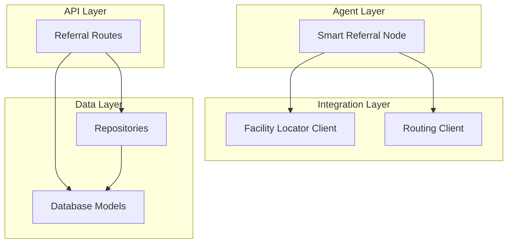
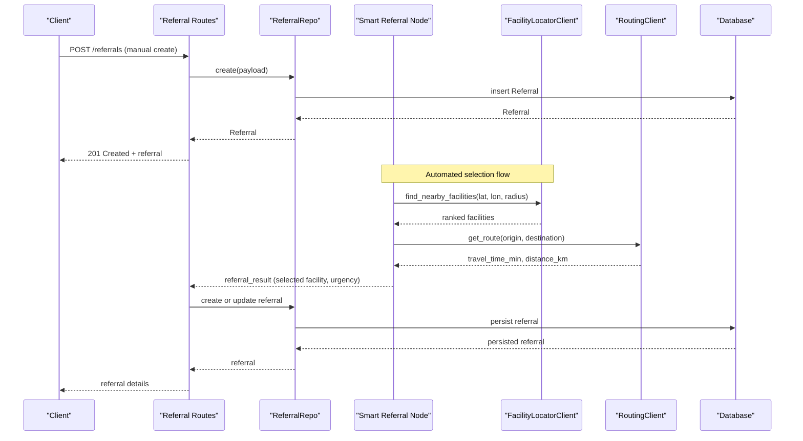
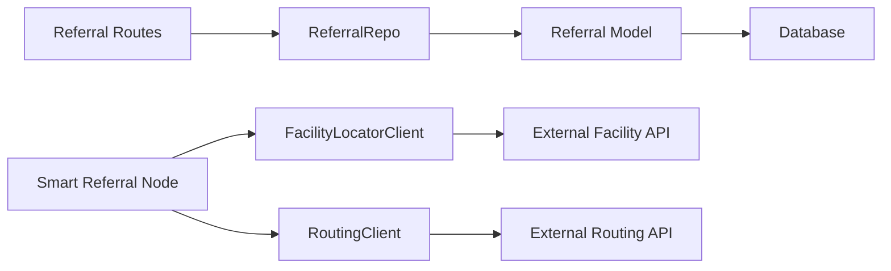

# Referral Entity

<cite>
**Referenced Files in This Document**
- [models.py](file://backend/db/models.py)
- [referral.py](file://backend/schemas/referral.py)
- [referrals.py](file://backend/api/routes/referrals.py)
- [repositories.py](file://backend/db/repositories.py)
- [smart_referral.py](file://backend/agents/nodes/smart_referral.py)
- [facility_locator.py](file://backend/integrations/facility_locator.py)
- [routing_client.py](file://backend/integrations/routing_client.py)
</cite>

## Table of Contents
1. Introduction
2. Project Structure
3. Core Components
4. Architecture Overview
5. Detailed Component Analysis
6. Dependency Analysis
7. Performance Considerations
8. Troubleshooting Guide
9. Conclusion

## Introduction
This document explains the Referral entity used to manage healthcare facility referrals within the smart referral system. It covers all fields, geographic data storage using latitude/longitude coordinates and distance calculations, referral lifecycle states, urgency levels, relationships with the Patient entity, and integration points with the facility locator and routing services. It also provides examples for creating referrals, updating statuses, and selecting optimal facilities based on patient needs and location.

## Project Structure
The referral feature spans several layers:
- Data model definition (ORM)
- API routes for CRUD operations
- Repository layer for database access
- Smart referral agent that orchestrates facility discovery and routing
- Integration clients for facility search and route estimation

**Diagram sources**
- [referrals.py:60-126](file://backend/api/routes/referrals.py#L60-L126)
- [smart_referral.py:11-118](file://backend/agents/nodes/smart_referral.py#L11-L118)
- [facility_locator.py:7-69](file://backend/integrations/facility_locator.py#L7-L69)
- [routing_client.py:8-71](file://backend/integrations/routing_client.py#L8-L71)
- [models.py:52-68](file://backend/db/models.py#L52-L68)
- [repositories.py:49-65](file://backend/db/repositories.py#L49-L65)

**Section sources**
- [referrals.py:1-126](file://backend/api/routes/referrals.py#L1-L126)
- [smart_referral.py:1-136](file://backend/agents/nodes/smart_referral.py#L1-L136)
- [facility_locator.py:1-69](file://backend/integrations/facility_locator.py#L1-L69)
- [routing_client.py:1-71](file://backend/integrations/routing_client.py#L1-L71)
- [models.py:1-115](file://backend/db/models.py#L1-L115)
- [repositories.py:1-125](file://backend/db/repositories.py#L1-L125)

## Core Components
- Referral ORM model defines persistent fields including identifiers, geographic data, urgency, status, and timestamps.
- Schemas define request/response contracts for referrals and facility information.
- API routes expose endpoints to create referrals, list/filter them, retrieve by ID, and update status.
- Repository abstracts database operations for referrals.
- Smart referral agent integrates facility locator and routing to select optimal facilities and compute travel metrics.
- Facility locator client returns nearby healthcare facilities with capabilities and distances.
- Routing client estimates travel time and distance between patient and facility locations.

Key responsibilities:
- Store and query referral records with geographic and temporal metadata.
- Provide APIs for manual referral creation and status updates.
- Automate facility selection and urgency determination via smart referral logic.
- Compute distance and travel time using geospatial math and routing service.

**Section sources**
- [models.py:52-68](file://backend/db/models.py#L52-L68)
- [referral.py:7-27](file://backend/schemas/referral.py#L7-L27)
- [referrals.py:21-126](file://backend/api/routes/referrals.py#L21-L126)
- [repositories.py:49-65](file://backend/db/repositories.py#L49-L65)
- [smart_referral.py:11-118](file://backend/agents/nodes/smart_referral.py#L11-L118)
- [facility_locator.py:7-69](file://backend/integrations/facility_locator.py#L7-L69)
- [routing_client.py:8-71](file://backend/integrations/routing_client.py#L8-L71)

## Architecture Overview
The smart referral workflow integrates multiple components to recommend and record the best facility for a patient:

**Diagram sources**
- [referrals.py:60-126](file://backend/api/routes/referrals.py#L60-L126)
- [smart_referral.py:11-118](file://backend/agents/nodes/smart_referral.py#L11-L118)
- [facility_locator.py:14-69](file://backend/integrations/facility_locator.py#L14-L69)
- [routing_client.py:16-59](file://backend/integrations/routing_client.py#L16-L59)
- [repositories.py:49-65](file://backend/db/repositories.py#L49-L65)

## Detailed Component Analysis

### Referral Entity Model
The Referral entity stores referral records with the following fields:
- id: Primary key identifier
- patient_id: Foreign key linking to Patient
- case_id: Optional case identifier
- facility_name: Name of the referred facility
- facility_type: Type of facility (e.g., hospital, clinic, health_center)
- facility_lat: Latitude of the facility
- facility_lon: Longitude of the facility
- distance_km: Distance from patient to facility
- travel_time_min: Estimated travel time in minutes
- urgency_level: One of routine, urgent, emergency
- status: One of pending, accepted, in_transit, completed, cancelled
- created_at: Timestamp when referral was created
- completed_at: Timestamp when referral was completed

Relationships:
- Belongs to Patient via patient_id; Patient has a one-to-many relationship with Referral.

Geographic data storage:
- Latitude and longitude are stored as floating-point numbers to support precise location-based queries and distance calculations.

Urgency levels:
- routine: Non-urgent cases
- urgent: High-risk maternal or fetal conditions requiring prompt attention
- emergency: Immediate life-threatening situations

Status lifecycle:
- pending: Newly created referral awaiting action
- accepted: Facility or care team has accepted the referral
- in_transit: Patient is en route to the facility
- completed: Referral process finished at the facility
- cancelled: Referral was canceled before completion

**Section sources**
- [models.py:52-68](file://backend/db/models.py#L52-L68)
- [referrals.py:21-52](file://backend/api/routes/referrals.py#L21-L52)

### API Endpoints for Referrals
- Create referral: Accepts payload with patient_id, optional case_id, facility details, geographic coordinates, distance, travel time, and urgency level. Returns created referral.
- List referrals: Supports filtering by urgency and status with pagination.
- Get referral by ID: Retrieves a specific referral.
- Update referral status: Updates status field for a given referral ID.

Error handling:
- Returns 404 if referral not found during retrieval or status update.

**Section sources**
- [referrals.py:60-126](file://backend/api/routes/referrals.py#L60-L126)

### Repository Layer
- ReferralRepo provides methods to create referrals, fetch by ID, and update status.
- Uses asynchronous SQLAlchemy session for non-blocking database operations.

**Section sources**
- [repositories.py:49-65](file://backend/db/repositories.py#L49-L65)

### Smart Referral Agent
Responsibilities:
- Determine required capabilities (emergency, NICU, maternity) based on clinical risk and fetal results.
- Find nearby facilities using FacilityLocatorClient with radius adjusted by urgency.
- Rank facilities by capability match and distance, penalizing high-load facilities.
- Estimate travel time and distance using RoutingClient.
- Determine urgency level based on emergency flag and maternal risk.
- Build referral result including selected facility, route info, and estimated travel time.

Output includes:
- referral_case_id
- urgency_level
- ranked_facilities
- selected_facility
- route_info
- estimated_travel_time_min
- capabilities_needed

**Section sources**
- [smart_referral.py:11-118](file://backend/agents/nodes/smart_referral.py#L11-L118)

### Facility Locator Integration
- FacilityLocatorClient finds nearby healthcare facilities within a specified radius.
- Returns facility objects with identifiers, names, types, coordinates, distances, capabilities, and current load.
- Includes stub implementation returning mock facilities near Peshawar.

Usage in smart referral:
- Called with patient lat/lon and radius (larger for emergencies).
- Results are scored and ranked to select the best facility.

**Section sources**
- [facility_locator.py:7-69](file://backend/integrations/facility_locator.py#L7-L69)

### Routing Integration
- RoutingClient estimates travel time and distance between origin and destination coordinates.
- Uses Haversine formula to calculate straight-line distance and applies average speeds per mode (driving, walking, ambulance).
- Provides route summary and waypoints.

Distance calculation method:
- Haversine formula computes great-circle distance between two lat/lon points.

Travel time estimation:
- Computed as distance divided by average speed, converted to minutes.

**Section sources**
- [routing_client.py:8-71](file://backend/integrations/routing_client.py#L8-L71)

### Schemas and Contracts
- FacilityInfo schema describes facility attributes including capabilities and load.
- ReferralResult schema captures outcome of smart referral including selected facility and urgency.

These schemas standardize data exchanged between components and APIs.

**Section sources**
- [referral.py:7-27](file://backend/schemas/referral.py#L7-L27)

## Dependency Analysis
Component relationships and coupling:
- ReferralRoutes depend on ReferralRepo for persistence and return standardized referral dictionaries.
- SmartReferralNode depends on FacilityLocatorClient and RoutingClient to gather and compute facility data.
- FacilityLocatorClient and RoutingClient are external integrations with configurable base URLs and timeouts.
- Database models define relationships between Patient and Referral.

Potential circular dependencies:
- None detected; dependencies are layered and unidirectional.

External dependencies:
- HTTPX for async HTTP requests in integration clients.
- Math library for geospatial calculations.

Interface contracts:
- API payloads validated by Pydantic models.
- Repository methods accept and return typed dictionaries and ORM instances.

**Diagram sources**
- [referrals.py:60-126](file://backend/api/routes/referrals.py#L60-L126)
- [repositories.py:49-65](file://backend/db/repositories.py#L49-L65)
- [models.py:52-68](file://backend/db/models.py#L52-L68)
- [smart_referral.py:11-118](file://backend/agents/nodes/smart_referral.py#L11-L118)
- [facility_locator.py:7-69](file://backend/integrations/facility_locator.py#L7-L69)
- [routing_client.py:8-71](file://backend/integrations/routing_client.py#L8-L71)

**Section sources**
- [referrals.py:1-126](file://backend/api/routes/referrals.py#L1-L126)
- [repositories.py:1-125](file://backend/db/repositories.py#L1-L125)
- [models.py:1-115](file://backend/db/models.py#L1-L115)
- [smart_referral.py:1-136](file://backend/agents/nodes/smart_referral.py#L1-L136)
- [facility_locator.py:1-69](file://backend/integrations/facility_locator.py#L1-L69)
- [routing_client.py:1-71](file://backend/integrations/routing_client.py#L1-L71)

## Performance Considerations
- Asynchronous I/O: All database and HTTP calls use async patterns to reduce latency.
- Radius tuning: Emergency referrals expand search radius to increase facility options.
- Scoring algorithm: Balances capability match and proximity while penalizing high-load facilities to avoid bottlenecks.
- Travel time estimation: Uses simplified speed assumptions; consider integrating real-time traffic data for accuracy.
- Pagination: Listing endpoints support skip/limit to handle large datasets efficiently.

[No sources needed since this section provides general guidance]

## Troubleshooting Guide
Common issues and resolutions:
- Referral not found: Ensure referral_id exists before updating status; API returns 404 if missing.
- Invalid status values: Only allow transitions within defined states; validate incoming status strings.
- Geographic coordinate errors: Validate latitude (-90 to 90) and longitude (-180 to 180) before calling routing or locator.
- Facility locator failures: Check base URL configuration and network connectivity; fallback to default mock data if needed.
- Routing client timeouts: Increase timeout or retry logic; verify origin/destination coordinates are valid.

Operational checks:
- Verify database connections and session management.
- Monitor integration client responses for errors and log audit entries.
- Use listing filters to diagnose stuck referrals or incorrect urgency levels.

**Section sources**
- [referrals.py:97-126](file://backend/api/routes/referrals.py#L97-L126)
- [smart_referral.py:120-136](file://backend/agents/nodes/smart_referral.py#L120-L136)
- [facility_locator.py:14-69](file://backend/integrations/facility_locator.py#L14-L69)
- [routing_client.py:16-59](file://backend/integrations/routing_client.py#L16-L59)

## Conclusion
The Referral entity provides a robust foundation for managing healthcare facility referrals with clear geographic data storage, well-defined urgency levels, and a structured lifecycle. The smart referral system integrates facility discovery and routing to optimize facility selection based on patient needs and location. The API exposes straightforward endpoints for manual operations, while the agent automates complex decision-making. Proper validation, error handling, and performance considerations ensure reliable operation in production environments.

[No sources needed since this section summarizes without analyzing specific files]