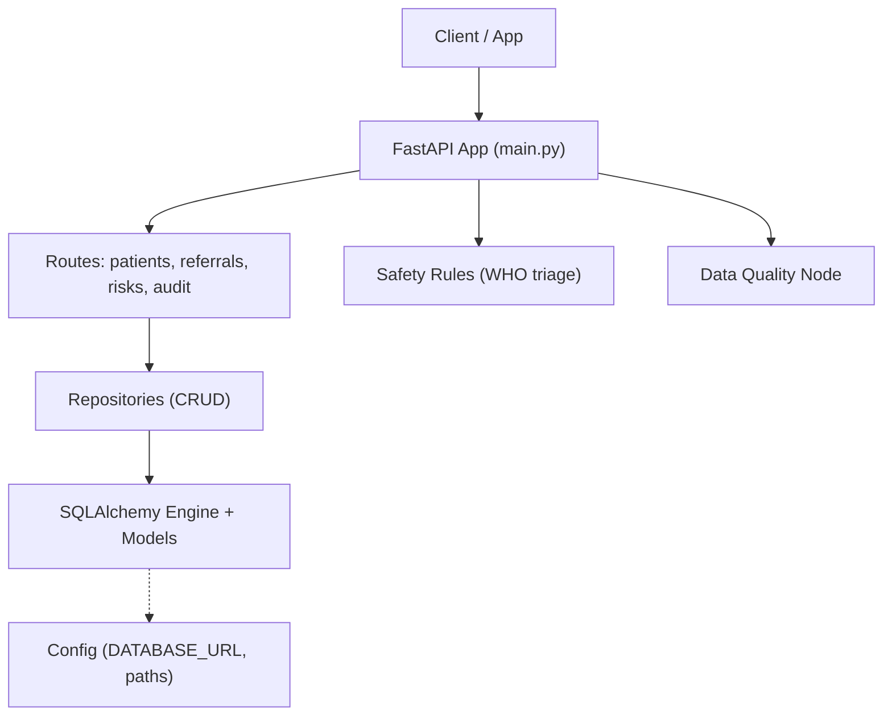
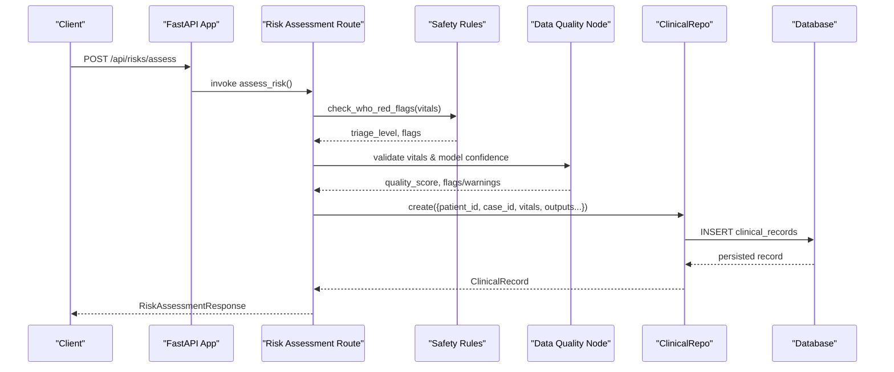
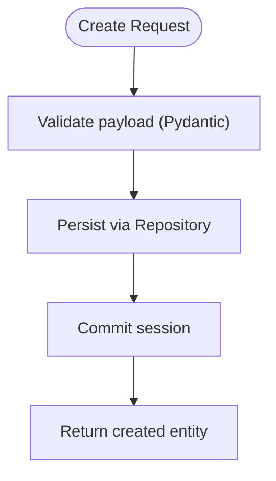
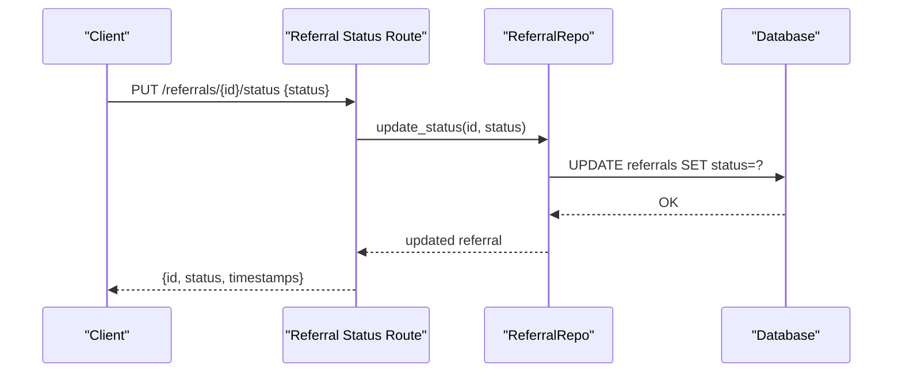
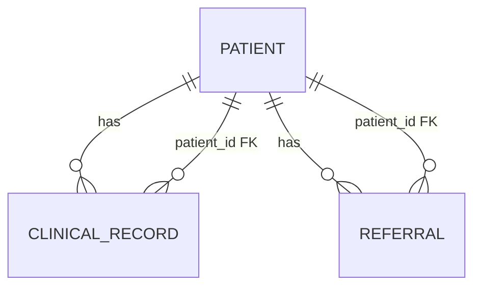
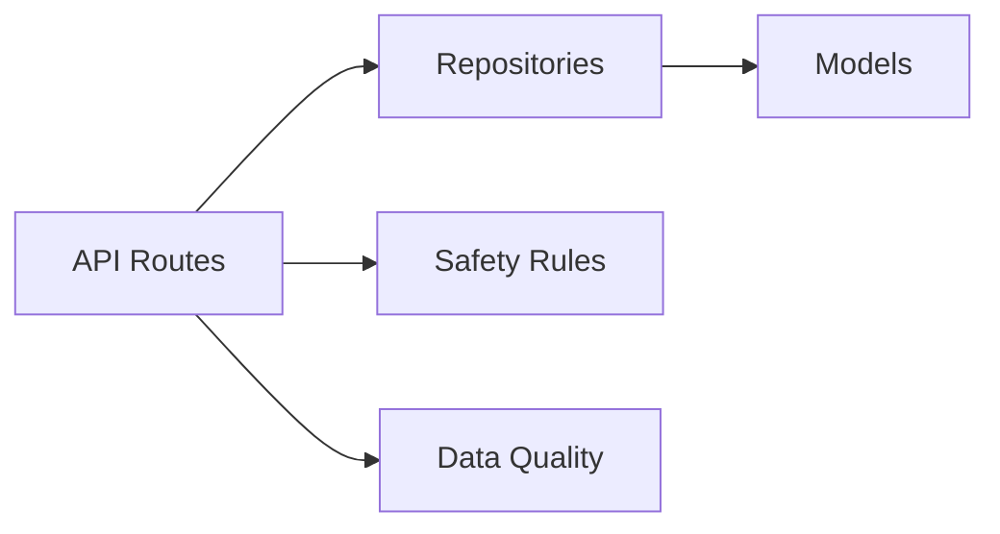

# Data Lifecycle and Management

<cite>
**Referenced Files in This Document**
- [models.py](file://backend/db/models.py)
- [repositories.py](file://backend/db/repositories.py)
- [engine.py](file://backend/db/engine.py)
- [config.py](file://backend/config.py)
- [main.py](file://backend/api/main.py)
- [patients.py](file://backend/api/routes/patients.py)
- [referrals.py](file://backend/api/routes/referrals.py)
- [risks.py](file://backend/api/routes/risks.py)
- [audit.py](file://backend/api/routes/audit.py)
- [patient.py](file://backend/schemas/patient.py)
- [data_quality.py](file://backend/agents/nodes/data_quality.py)
- [safety_rules.py](file://safety_rules.py)
</cite>

## Table of Contents
1. Introduction
2. Project Structure
3. Core Components
4. Architecture Overview
5. Detailed Component Analysis
6. Dependency Analysis
7. Performance Considerations
8. Troubleshooting Guide
9. Conclusion
10. Appendices

## Introduction
This document describes the data lifecycle management for MaaHifazat AI, covering creation, updates, deletion strategies, retention and archival, offline synchronization, backup and recovery, migration and versioning, validation and sanitization, quality assurance, privacy and compliance considerations for healthcare data. It is grounded in the repository’s database models, repositories, API routes, configuration, and safety/validation components.

## Project Structure
The backend exposes a FastAPI application that initializes the database and ML model registry at startup. Data entities are modeled with SQLAlchemy ORM and accessed via async repositories. API routes implement CRUD operations and orchestrate inference and safety checks, persisting results to the database. Configuration centralizes paths, database URL, and feature flags.

**Diagram sources**
- [main.py:22-64](file://backend/api/main.py#L22-L64)
- [engine.py:10-36](file://backend/db/engine.py#L10-L36)
- [config.py:23-47](file://backend/config.py#L23-L47)
- [patients.py:44-96](file://backend/api/routes/patients.py#L44-L96)
- [referrals.py:60-125](file://backend/api/routes/referrals.py#L60-L125)
- [risks.py:61-148](file://backend/api/routes/risks.py#L61-L148)
- [audit.py:21-87](file://backend/api/routes/audit.py#L21-L87)

**Section sources**
- [main.py:22-64](file://backend/api/main.py#L22-L64)
- [engine.py:10-36](file://backend/db/engine.py#L10-L36)
- [config.py:23-47](file://backend/config.py#L23-L47)

## Core Components
- Database models define persistent entities: Patient, ClinicalRecord, Referral, AgentStateRecord, AuditLog, ModelVersion, FileRecord. They include timestamps, JSON fields for complex payloads, and relationships between entities.
- Repositories provide async CRUD operations over these models using SQLAlchemy sessions.
- API routes expose endpoints for creating, reading, updating, and listing records; they integrate inference and safety checks and persist outcomes.
- Configuration manages database URL and runtime settings.
- Safety rules implement deterministic WHO-based triage logic.
- Data quality node validates input ranges and model confidence, producing flags and warnings.

**Section sources**
- [models.py:11-114](file://backend/db/models.py#L11-L114)
- [repositories.py:9-124](file://backend/db/repositories.py#L9-L124)
- [patients.py:44-96](file://backend/api/routes/patients.py#L44-L96)
- [referrals.py:60-125](file://backend/api/routes/referrals.py#L60-L125)
- [risks.py:61-148](file://backend/api/routes/risks.py#L61-L148)
- [audit.py:21-87](file://backend/api/routes/audit.py#L21-L87)
- [safety_rules.py:72-167](file://safety_rules.py#L72-L167)
- [data_quality.py:25-183](file://backend/agents/nodes/data_quality.py#L25-L183)

## Architecture Overview
The system follows a layered architecture:
- Presentation layer: FastAPI routes handle HTTP requests and responses.
- Service layer: Repositories encapsulate persistence logic.
- Domain layer: Models represent core entities and relationships.
- Cross-cutting: Safety rules and data quality nodes enforce clinical and data integrity constraints.

**Diagram sources**
- [risks.py:61-148](file://backend/api/routes/risks.py#L61-L148)
- [safety_rules.py:72-167](file://safety_rules.py#L72-L167)
- [data_quality.py:25-183](file://backend/agents/nodes/data_quality.py#L25-L183)
- [repositories.py:31-47](file://backend/db/repositories.py#L31-L47)
- [models.py:30-50](file://backend/db/models.py#L30-L50)

## Detailed Component Analysis

### Data Creation Patterns
- Patients: Created via POST /api/patients, validated by Pydantic schemas, persisted through PatientRepo.create.
- Clinical records: Created during risk assessment, capturing vitals, model outputs, triage level, emergency flag, and timestamps.
- Referrals: Created manually or via workflows, with status transitions supported by dedicated update endpoint.
- Audit logs: Written for agent actions and data quality checks, enabling traceability.
- Model versions: Registered when new models are trained and evaluated, tracking metrics and features.
- Files: Metadata recorded for uploaded artifacts linked to cases.

**Diagram sources**
- [patients.py:44-53](file://backend/api/routes/patients.py#L44-L53)
- [repositories.py:13-17](file://backend/db/repositories.py#L13-L17)
- [risks.py:100-121](file://backend/api/routes/risks.py#L100-L121)
- [referrals.py:60-69](file://backend/api/routes/referrals.py#L60-L69)
- [audit.py:21-87](file://backend/api/routes/audit.py#L21-L87)

**Section sources**
- [patients.py:44-96](file://backend/api/routes/patients.py#L44-L96)
- [risks.py:61-148](file://backend/api/routes/risks.py#L61-L148)
- [referrals.py:60-125](file://backend/api/routes/referrals.py#L60-L125)
- [audit.py:21-87](file://backend/api/routes/audit.py#L21-L87)
- [repositories.py:13-17](file://backend/db/repositories.py#L13-L17)

### Update Mechanisms
- Patients: PUT /api/patients/{patient_id} updates existing records after existence check.
- Referrals: PUT /api/referrals/{referral_id}/status transitions state machine values (pending, accepted, in_transit, completed, cancelled).
- Clinical records: Updated indirectly via new assessments; current implementation creates new records per case_id.

**Diagram sources**
- [referrals.py:111-125](file://backend/api/routes/referrals.py#L111-L125)
- [repositories.py:63-64](file://backend/db/repositories.py#L63-L64)

**Section sources**
- [patients.py:83-96](file://backend/api/routes/patients.py#L83-L96)
- [referrals.py:111-125](file://backend/api/routes/referrals.py#L111-L125)
- [repositories.py:23-25](file://backend/db/repositories.py#L23-L25)

### Deletion Strategies
- No explicit delete endpoints are implemented in the analyzed routes. Soft deletes can be introduced using boolean flags on entities (e.g., is_active on Patient) and filtering queries accordingly.
- For audit logs and historical records, append-only patterns are recommended to preserve provenance.

[No sources needed since this section provides general guidance]

### Data Retention Policies and Archival
- Current models do not include explicit retention or archival policies. Implementations should add:
  - Retention windows per entity type (e.g., keep clinical records for X years).
  - Archival jobs that move older records to cold storage and remove from active tables.
  - Purge routines for temporary or transient data (e.g., agent states beyond workflow lifetime).
- Use indexes on timestamps and case identifiers to optimize archival queries.

[No sources needed since this section provides general guidance]

### Cleanup Processes
- Session cleanup: The engine commits or rolls back sessions automatically within dependency context.
- Error handling: Global exception handler returns structured errors and logs details.
- Audit trails: Data quality and agent steps log errors and outcomes for post-mortem analysis.

**Section sources**
- [engine.py:23-31](file://backend/db/engine.py#L23-L31)
- [main.py:83-100](file://backend/api/main.py#L83-L100)
- [data_quality.py:185-200](file://backend/agents/nodes/data_quality.py#L185-L200)

### Offline Sync Capabilities
- Schema support: ClinicalRecord includes client_generated_id and created_offline_at fields to support offline-first workflows.
- PatientScreening schema includes client_generated_id and created_offline_at for offline submissions.
- Conflict resolution strategy (recommended):
  - Use client_generated_id to upsert records on reconnect.
  - Compare created_offline_at vs server-side created_at to resolve conflicts.
  - Merge non-conflicting fields; escalate conflicting changes to clinician review.
- Implementation notes:
  - On sync, detect duplicates by client_generated_id.
  - If duplicate exists, apply conflict resolution policy (latest timestamp wins or merge).
  - Mark synced records and clear offline markers.

**Section sources**
- [models.py:30-50](file://backend/db/models.py#L30-L50)
- [patient.py:49-56](file://backend/schemas/patient.py#L49-L56)

### Backup and Recovery
- Database URL points to SQLite in development; production should use a managed relational database with automated backups.
- Recommended procedures:
  - Scheduled snapshots of the database file or logical dumps.
  - Offsite replication for disaster recovery.
  - Restore procedures validated periodically.
- Artifact and model files:
  - Versioned artifacts under artifacts directory; maintain immutable copies per model version.
  - Store metadata (metrics, features) in ModelVersion table for traceability.

**Section sources**
- [config.py:23-24](file://backend/config.py#L23-L24)
- [models.py:94-104](file://backend/db/models.py#L94-L104)

### Data Migration and Version Management
- ModelVersion table tracks model_name, version, file_path, metrics, features, activation status, and registration time.
- Migration approach:
  - Introduce schema migrations via an ORM migration tool.
  - Backward-compatible changes where possible; deprecate fields gradually.
  - Record migration history in audit logs.

**Section sources**
- [models.py:94-104](file://backend/db/models.py#L94-L104)

### Data Validation Rules and Sanitization
- Input validation:
  - Pydantic schemas enforce ranges for vitals and patient attributes.
  - Enumerations constrain gender and other categorical fields.
- Data quality node:
  - Validates vital ranges, flags anomalies, checks model confidence thresholds, and computes a quality score.
  - Produces flags and warnings for downstream handling.
- Sanitization:
  - Ensure JSON fields contain expected structures; reject malformed inputs early.
  - Normalize units and formats (e.g., timestamps ISO 8601).

**Section sources**
- [patient.py:14-40](file://backend/schemas/patient.py#L14-L40)
- [data_quality.py:25-183](file://backend/agents/nodes/data_quality.py#L25-L183)

### Quality Assurance Measures
- Safety rules:
  - Deterministic WHO-based triage overrides ML scores when red flags are present.
  - Provides clinical rationale and recommended actions.
- Model confidence checks:
  - Data quality node evaluates per-model confidence and flags low-confidence predictions.
- Auditability:
  - Audit logs capture agent actions, inputs/outputs summaries, confidence, duration, and errors.

**Section sources**
- [safety_rules.py:72-167](file://safety_rules.py#L72-L167)
- [data_quality.py:25-183](file://backend/agents/nodes/data_quality.py#L25-L183)
- [audit.py:21-87](file://backend/api/routes/audit.py#L21-L87)

### Privacy, Anonymization, and Compliance
- PII handling:
  - Patient names and phone numbers are stored; ensure encryption at rest and in transit.
  - Access controls restrict sensitive fields to authorized roles.
- Anonymization techniques:
  - For analytics and research datasets, strip direct identifiers and generalize quasi-identifiers.
  - Maintain separate anonymized views or datasets.
- Compliance considerations:
  - Follow healthcare regulations (e.g., HIPAA/GDPR equivalents) for consent, minimization, and purpose limitation.
  - Audit access to PHI; retain minimal necessary data.
  - Provide data subject rights mechanisms (access, correction, deletion) via admin interfaces.

[No sources needed since this section provides general guidance]

## Dependency Analysis
Entities and their relationships:

**Diagram sources**
- [models.py:11-68](file://backend/db/models.py#L11-L68)

Repository dependencies:

**Diagram sources**
- [repositories.py:9-124](file://backend/db/repositories.py#L9-L124)
- [patients.py:44-96](file://backend/api/routes/patients.py#L44-L96)
- [referrals.py:60-125](file://backend/api/routes/referrals.py#L60-L125)
- [risks.py:61-148](file://backend/api/routes/risks.py#L61-L148)
- [safety_rules.py:72-167](file://safety_rules.py#L72-L167)
- [data_quality.py:25-183](file://backend/agents/nodes/data_quality.py#L25-L183)

**Section sources**
- [models.py:11-114](file://backend/db/models.py#L11-L114)
- [repositories.py:9-124](file://backend/db/repositories.py#L9-L124)

## Performance Considerations
- Use pagination on list endpoints to limit result sets.
- Index frequently queried fields (case_id, patient_id, timestamps).
- Prefer async I/O for database operations and external integrations.
- Cache frequent reads where appropriate (e.g., model registry health).
- Avoid large JSON payloads in hot paths; consider partitioning or archiving.

[No sources needed since this section provides general guidance]

## Troubleshooting Guide
- Unhandled exceptions return structured JSON errors with path and detail.
- Database session rollback on errors ensures consistency.
- Audit logs help diagnose agent behavior and data quality issues.
- Data quality node produces actionable flags and warnings for invalid inputs or low-confidence models.

**Section sources**
- [main.py:83-100](file://backend/api/main.py#L83-L100)
- [engine.py:23-31](file://backend/db/engine.py#L23-L31)
- [audit.py:21-87](file://backend/api/routes/audit.py#L21-L87)
- [data_quality.py:185-200](file://backend/agents/nodes/data_quality.py#L185-L200)

## Conclusion
MaaHifazat AI implements robust data lifecycle management through well-defined models, async repositories, and validated API routes. Safety rules and data quality checks ensure clinical integrity and reliability. While offline sync fields exist, full conflict resolution and archival/retention policies require additional implementation. Strong auditability, versioning, and validation practices support compliance and operational excellence.

## Appendices

### Entity Lifecycle Summary
- Create: Patients, ClinicalRecords, Referrals, AuditLogs, ModelVersions, FileRecords via repositories.
- Read: List and get endpoints with filters and pagination.
- Update: Patient updates and referral status transitions.
- Delete: Not implemented; recommend soft deletes and append-only audit.

**Section sources**
- [patients.py:44-96](file://backend/api/routes/patients.py#L44-L96)
- [referrals.py:60-125](file://backend/api/routes/referrals.py#L60-L125)
- [risks.py:61-148](file://backend/api/routes/risks.py#L61-L148)
- [audit.py:21-87](file://backend/api/routes/audit.py#L21-L87)