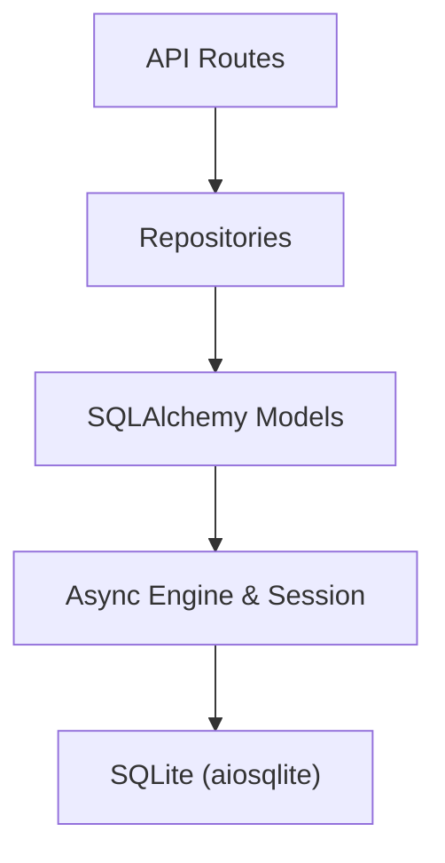
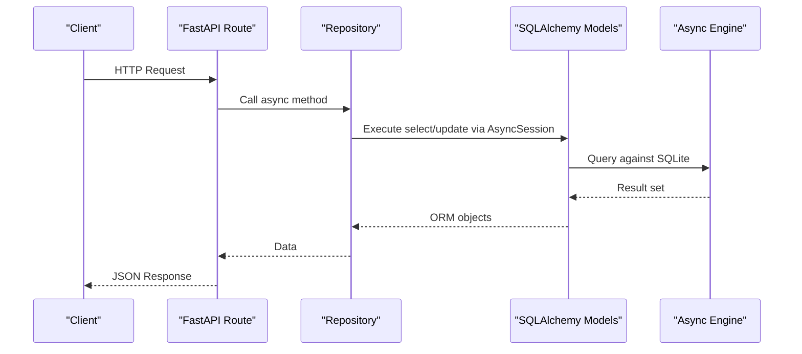
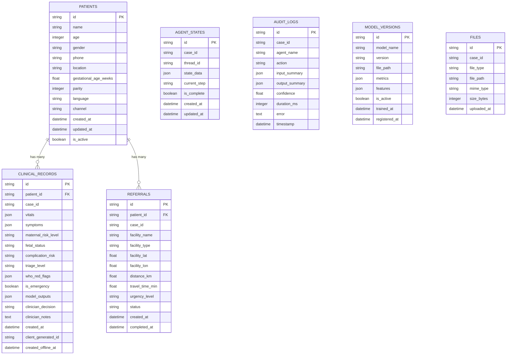
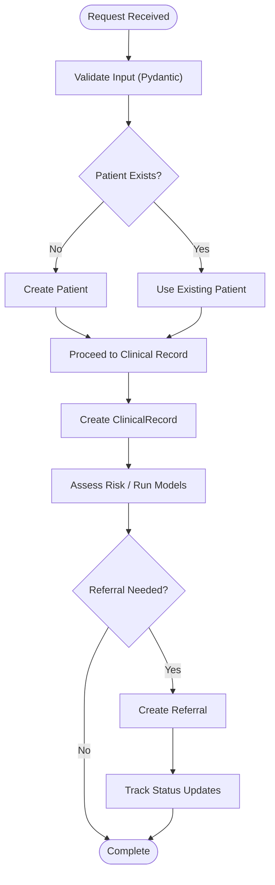
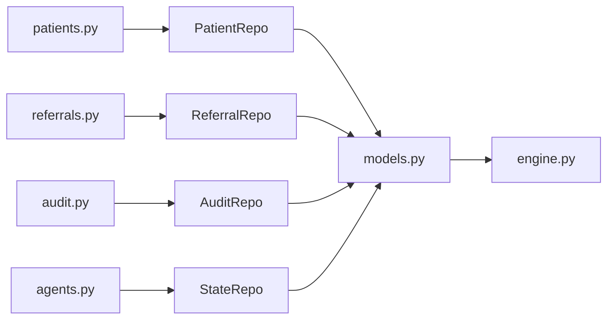

# Database Design

<cite>
**Referenced Files in This Document**
- [models.py](file://backend/db/models.py)
- [repositories.py](file://backend/db/repositories.py)
- [engine.py](file://backend/db/engine.py)
- [config.py](file://backend/config.py)
- [patients.py](file://backend/api/routes/patients.py)
- [referrals.py](file://backend/api/routes/referrals.py)
- [audit.py](file://backend/api/routes/audit.py)
- [agents.py](file://backend/api/routes/agents.py)
- [patient.py](file://backend/schemas/patient.py)
- [referral.py](file://backend/schemas/referral.py)
</cite>

## Table of Contents
1. Introduction
2. Project Structure
3. Core Components
4. Architecture Overview
5. Detailed Component Analysis
6. Dependency Analysis
7. Performance Considerations
8. Troubleshooting Guide
9. Conclusion
10. Appendices

## Introduction
This document describes the MaaHifazat AI database schema and data access layer. It focuses on seven core tables: Patients, ClinicalRecords, Referrals, AgentStates, AuditLogs, ModelVersions, and FileRecords. It explains entity relationships, primary and foreign keys, indexes, constraints, validation rules, and how the repository pattern and async-first design are implemented with SQLAlchemy ORM. It also outlines data lifecycle management, retention considerations, backup strategies, migration approaches, security measures, privacy requirements, and access control mechanisms.

## Project Structure
The database layer is organized into three main modules:
- Models: SQLAlchemy declarative models for all seven entities
- Repositories: Async-first repository classes encapsulating CRUD operations per entity
- Engine: Async SQLAlchemy engine, session factory, dependency injection, and table initialization

**Diagram sources**
- [engine.py:10-18](file://backend/db/engine.py#L10-L18)
- [repositories.py:9-125](file://backend/db/repositories.py#L9-L125)
- [models.py:11-115](file://backend/db/models.py#L11-L115)

**Section sources**
- [engine.py:1-37](file://backend/db/engine.py#L1-L37)
- [models.py:1-115](file://backend/db/models.py#L1-L115)
- [repositories.py:1-125](file://backend/db/repositories.py#L1-L125)

## Core Components
- Patient: Demographics, contact info, pregnancy details, lifecycle flags
- ClinicalRecord: Vitals, symptoms, risk assessments, model outputs, clinician decisions
- Referral: Facility details, urgency level, status tracking
- AgentStateRecord: Workflow execution state and audit trail for agent runs
- AuditLog: System activity logging across agents and processes
- ModelVersion: ML model metadata including metrics and feature sets
- FileRecord: Uploaded documents and media associated with cases

Key characteristics:
- All tables use UUID string primary keys generated at creation time
- Foreign key references from ClinicalRecord and Referral to Patient
- Indexes on frequently queried fields such as case_id and thread_id
- JSON columns store complex structures like vitals, symptoms, model outputs, and state snapshots
- Timestamps track creation and updates where applicable

**Section sources**
- [models.py:11-115](file://backend/db/models.py#L11-L115)

## Architecture Overview
The system uses an async-first architecture with FastAPI routes delegating to repositories that operate over SQLAlchemy async sessions. The engine configures an aiosqlite connection and provides a dependency-injected session for each request.

**Diagram sources**
- [engine.py:23-31](file://backend/db/engine.py#L23-L31)
- [repositories.py:9-125](file://backend/db/repositories.py#L9-L125)
- [models.py:11-115](file://backend/db/models.py#L11-L115)

**Section sources**
- [engine.py:1-37](file://backend/db/engine.py#L1-L37)
- [patients.py:44-97](file://backend/api/routes/patients.py#L44-L97)
- [referrals.py:60-126](file://backend/api/routes/referrals.py#L60-L126)

## Detailed Component Analysis

### Entity Relationship Diagram

**Diagram sources**
- [models.py:11-115](file://backend/db/models.py#L11-L115)

### Primary Keys, Foreign Keys, and Indexes
- Primary keys: All tables use string UUIDs generated by a helper function
- Foreign keys:
  - clinical_records.patient_id references patients.id
  - referrals.patient_id references patients.id
- Indexes:
  - clinical_records.case_id
  - referrals.case_id
  - agent_states.case_id
  - agent_states.thread_id
  - audit_logs.case_id
  - files.case_id

These indexes support efficient lookups by case identifiers and workflow threads.

**Section sources**
- [models.py:30-115](file://backend/db/models.py#L30-L115)

### Constraints and Validation Rules
- Not-null constraints:
  - patients.name
  - clinical_records.patient_id
  - referrals.patient_id
  - agent_states.case_id
  - audit_logs.agent_name
  - audit_logs.action
  - model_versions.model_name
  - model_versions.version
- Defaults:
  - patients.gender defaults to female
  - patients.language defaults to ur
  - patients.channel defaults to app
  - referrals.urgency_level defaults to routine
  - referrals.status defaults to pending
  - model_versions.is_active defaults to True
  - agent_states.is_complete defaults to False
  - clinical_records.is_emergency defaults to False
- Pydantic validation (input schemas):
  - VitalsInput enforces ranges for blood pressure, heart rate, temperature, respiratory rate, blood sugar, gestational age
  - SymptomEntry enforces severity values
  - PatientCreate enforces age range and gender enum
  - ReferralCreate enforces urgency_level values
  - ReferralStatusUpdate enforces status transitions via application logic

Note: While Pydantic validates incoming requests, additional server-side validation or database-level checks can be added for stricter enforcement.

**Section sources**
- [models.py:11-115](file://backend/db/models.py#L11-L115)
- [patient.py:14-57](file://backend/schemas/patient.py#L14-L57)
- [referral.py:21-28](file://backend/schemas/referral.py#L21-L28)
- [referrals.py:21-35](file://backend/api/routes/referrals.py#L21-L35)

### Repository Pattern Implementation
Each entity has a dedicated repository class that encapsulates async CRUD operations using SQLAlchemy’s AsyncSession. This isolates data access logic from API routes and promotes testability and reuse.

- PatientRepo: create, get_by_id, update, list_all
- ClinicalRepo: create, get_by_case_id, get_by_patient
- ReferralRepo: create, get_by_id, update_status
- AuditRepo: log, get_by_case, get_recent
- StateRepo: save_state, get_latest
- ModelRepo: register, get_active
- FileRepo: create, get_by_case

All methods accept dictionaries or primitive types and return ORM instances or lists, keeping the API layer clean.

**Section sources**
- [repositories.py:9-125](file://backend/db/repositories.py#L9-L125)

### Async-First Design
- Engine uses aiosqlite with create_async_engine
- Sessions are created via async_sessionmaker with expire_on_commit=False to avoid unnecessary reloads
- Dependency get_db yields an AsyncSession per request and commits on success or rolls back on exceptions
- Repositories and routes are fully async, enabling high-performance concurrent operations

**Section sources**
- [engine.py:10-31](file://backend/db/engine.py#L10-L31)
- [patients.py:44-97](file://backend/api/routes/patients.py#L44-L97)
- [referrals.py:60-126](file://backend/api/routes/referrals.py#L60-L126)

### SQLAlchemy ORM Usage
- DeclarativeBase used for Base class
- Relationships defined between Patient and its children (ClinicalRecord, Referral)
- JSON columns store flexible payloads (vitals, symptoms, model outputs, state snapshots)
- Text columns for free-form notes and errors
- DateTime columns with default timestamps for auditability

**Section sources**
- [models.py:1-115](file://backend/db/models.py#L1-115)

### Data Flow Patterns
- Patient intake: API creates Patient via PatientRepo; subsequent records reference this patient
- Clinical assessment: ClinicalRecord created with patient_id and case_id; includes JSON vitals and model outputs
- Referral workflow: Referral created with patient_id and case_id; status transitions tracked
- Agent orchestration: AgentStateRecord persists workflow state per case/thread; AuditLog records actions and outcomes
- Model registry: ModelVersion stores metadata for active/inactive models
- File uploads: FileRecord associates uploaded artifacts with a case

[No sources needed since this diagram shows conceptual workflow, not actual code structure]

## Dependency Analysis
The data access dependencies flow from API routes to repositories to models to the async engine.

**Diagram sources**
- [patients.py:44-97](file://backend/api/routes/patients.py#L44-L97)
- [referrals.py:60-126](file://backend/api/routes/referrals.py#L60-L126)
- [audit.py:21-88](file://backend/api/routes/audit.py#L21-L88)
- [agents.py:62-114](file://backend/api/routes/agents.py#L62-L114)
- [repositories.py:9-125](file://backend/db/repositories.py#L9-L125)
- [models.py:11-115](file://backend/db/models.py#L11-L115)
- [engine.py:10-31](file://backend/db/engine.py#L10-L31)

**Section sources**
- [repositories.py:9-125](file://backend/db/repositories.py#L9-L125)
- [models.py:11-115](file://backend/db/models.py#L11-L115)
- [engine.py:10-31](file://backend/db/engine.py#L10-L31)

## Performance Considerations
- Asynchronous I/O: Using aiosqlite and async sessions reduces blocking and improves concurrency
- Indexing: case_id and thread_id indexes optimize frequent queries by workflow context
- Pagination: List endpoints support limit and offset to prevent large result sets
- JSON storage: Flexible but may increase query complexity; consider denormalization for hot paths if needed
- Connection pooling: Ensure appropriate pool settings for production databases when migrating from SQLite
- Batch operations: For bulk writes, consider batching inserts/updates within transactions

[No sources needed since this section provides general guidance]

## Troubleshooting Guide
Common issues and resolutions:
- Missing or invalid patient_id: Ensure patient exists before creating related records; handle 404 responses appropriately
- Invalid vitals ranges: Pydantic validation will reject out-of-range inputs; adjust client inputs or expand ranges if clinically justified
- Referral status mismatches: Validate status transitions server-side; ensure only allowed transitions are applied
- Audit log retrieval performance: Current implementation fetches recent logs and filters in Python; add SQL filtering for large datasets
- Database initialization: Use init_db to create tables; verify DATABASE_URL configuration

Operational tips:
- Enable DEBUG mode to echo SQL statements during development
- Wrap long-running workflows in transactions to maintain consistency
- Log errors with sufficient context in AuditLog entries

**Section sources**
- [patients.py:69-97](file://backend/api/routes/patients.py#L69-L97)
- [referrals.py:97-126](file://backend/api/routes/referrals.py#L97-L126)
- [audit.py:21-88](file://backend/api/routes/audit.py#L21-L88)
- [engine.py:33-37](file://backend/db/engine.py#L33-L37)

## Conclusion
The MaaHifazat AI database schema provides a robust foundation for managing patient data, clinical records, referrals, agent states, audit logs, model versions, and file records. The repository pattern and async-first design promote clean separation of concerns and high-performance concurrent operations. With careful indexing, validation, and operational practices, the system supports reliable healthcare workflows while maintaining extensibility and clarity.

[No sources needed since this section summarizes without analyzing specific files]

## Appendices

### Data Lifecycle Management
- Creation: Entities are created via repositories with validated input; timestamps recorded automatically
- Updates: Some entities support updates (e.g., Patient, Referral status); ensure idempotency and audit trails
- Deletion: Soft deletes via flags (e.g., is_active) recommended for compliance and traceability
- Archival: Move older records to archive tables or cold storage based on retention policies

### Retention Policies
- Audit logs: Retain for regulatory periods; implement periodic cleanup or archival jobs
- Clinical records: Retain per medical record policies; consider anonymization for analytics
- Agent states: Keep latest state per case; purge historical states after completion
- Model versions: Retain active and recent inactive versions; archive old models with metadata

### Backup Strategies
- Regular backups of SQLite file or database instance
- Point-in-time recovery planning for critical data
- Offsite replication for disaster recovery
- Test restore procedures periodically

### Migration Approaches
- Use Alembic or similar tooling for schema migrations
- Version control all migration scripts
- Apply migrations in CI/CD pipelines with rollback plans
- Back up data before applying migrations

### Security Measures and Privacy Requirements
- Access control: Enforce role-based access via JWT middleware; restrict sensitive endpoints to admin/clinician roles
- Encryption: Encrypt sensitive fields at rest and in transit; use HTTPS everywhere
- Auditability: Log access and changes; ensure tamper-evident logs
- Compliance: Follow local regulations for health data protection; minimize data collection to necessary fields
- Secrets management: Store secrets (e.g., JWT secret) securely; avoid hardcoding in source

**Section sources**
- [audit.py:21-88](file://backend/api/routes/audit.py#L21-L88)
- [agents.py:62-114](file://backend/api/routes/agents.py#L62-L114)
- [config.py:23-30](file://backend/config.py#L23-L30)