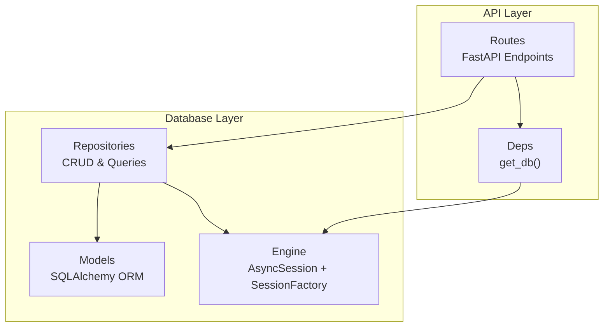
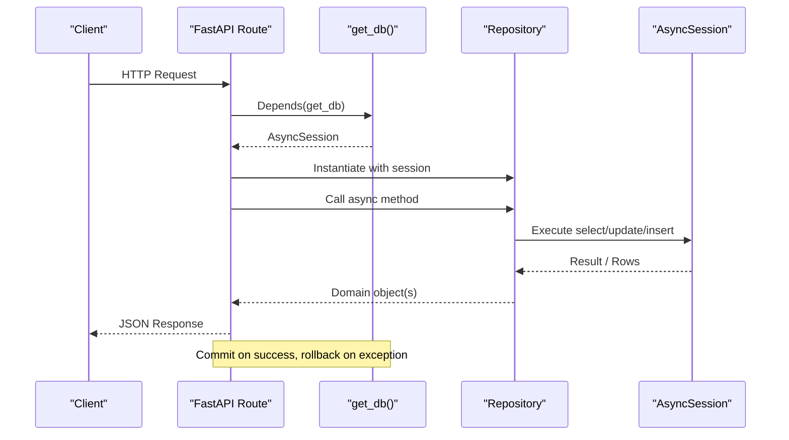
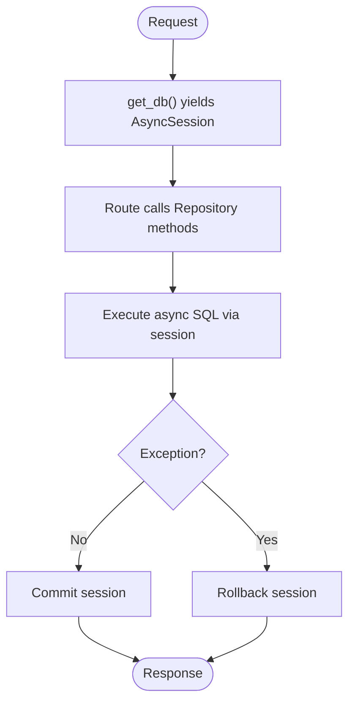
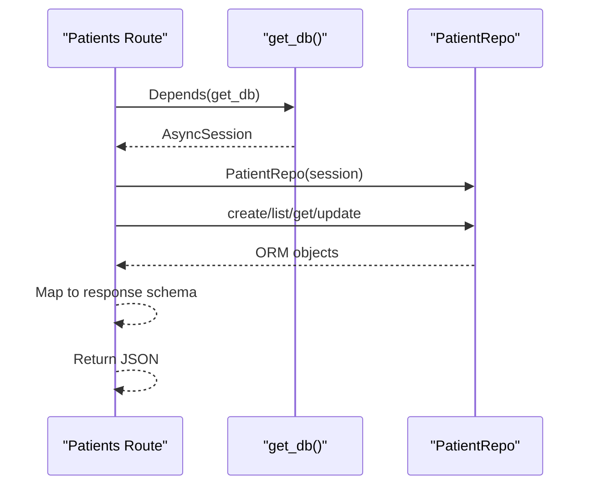
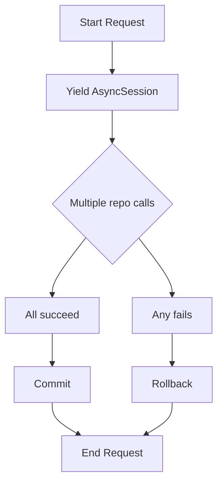
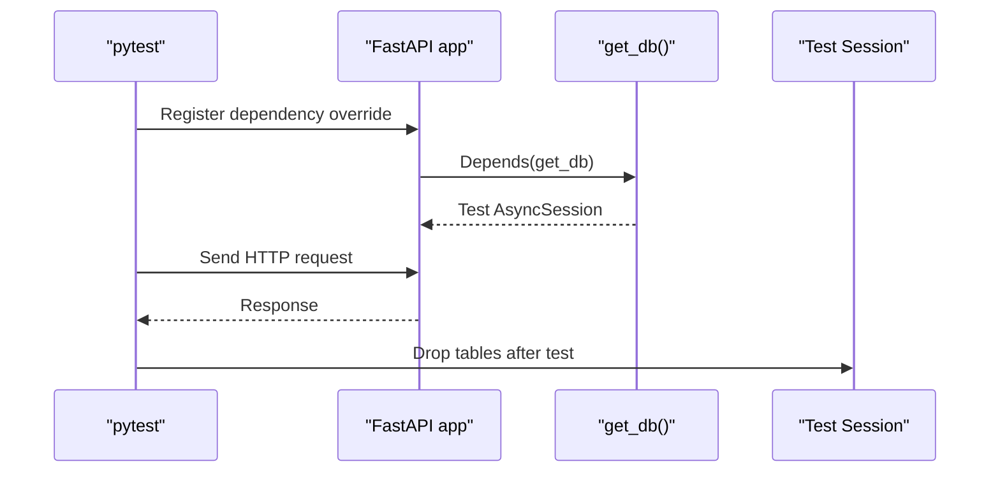
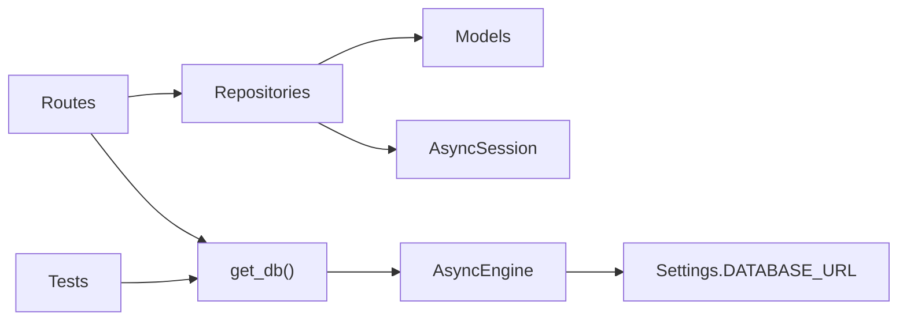

# Repository Pattern Implementation

<cite>
**Referenced Files in This Document**
- [repositories.py](file://backend/db/repositories.py)
- [engine.py](file://backend/db/engine.py)
- [models.py](file://backend/db/models.py)
- [config.py](file://backend/config.py)
- [deps.py](file://backend/api/deps.py)
- [patients.py](file://backend/api/routes/patients.py)
- [analytics.py](file://backend/api/routes/analytics.py)
- [audit.py](file://backend/api/routes/audit.py)
- [referrals.py](file://backend/api/routes/referrals.py)
- [risks.py](file://backend/api/routes/risks.py)
- [conftest.py](file://backend/tests/conftest.py)
</cite>

## Table of Contents
1. [Introduction](#introduction)
2. [Project Structure](#project-structure)
3. [Core Components](#core-components)
4. [Architecture Overview](#architecture-overview)
5. [Detailed Component Analysis](#detailed-component-analysis)
6. [Dependency Analysis](#dependency-analysis)
7. [Performance Considerations](#performance-considerations)
8. [Troubleshooting Guide](#troubleshooting-guide)
9. [Conclusion](#conclusion)
10. [Appendices](#appendices)

## Introduction
This document explains the repository pattern implementation in MaaHifazat AI’s database layer. It focuses on how repositories provide a clean abstraction over SQLAlchemy async operations, separating business logic from data access concerns. The design is async-first to enable high-performance concurrent operations using SQLAlchemy’s async engine and sessions. You will find details on CRUD methods, complex queries, transaction management via dependency injection, testing strategies with dependency overrides, and performance considerations such as query optimization, batching, and caching.

## Project Structure
The database layer is organized into three primary modules:
- Models: ORM definitions for all entities (patients, clinical records, referrals, audit logs, model versions, files).
- Engine: Async SQLAlchemy engine, session factory, and lifecycle helpers.
- Repositories: Per-entity repository classes that encapsulate CRUD and domain-specific queries.

**Diagram sources**
- [engine.py:10-18](file://backend/db/engine.py#L10-L18)
- [models.py:11-115](file://backend/db/models.py#L11-L115)
- [repositories.py:9-124](file://backend/db/repositories.py#L9-L124)
- [deps.py:16-24](file://backend/api/deps.py#L16-L24)
- [patients.py:44-96](file://backend/api/routes/patients.py#L44-L96)

**Section sources**
- [engine.py:10-18](file://backend/db/engine.py#L10-L18)
- [models.py:11-115](file://backend/db/models.py#L11-L115)
- [repositories.py:9-124](file://backend/db/repositories.py#L9-L124)
- [deps.py:16-24](file://backend/api/deps.py#L16-L24)
- [patients.py:44-96](file://backend/api/routes/patients.py#L44-L96)

## Core Components
- Async Engine and Session Factory: Configured with an async driver and a session maker that disables automatic expiration after commit to reduce reload overhead.
- Base Declarative Model: Central base class used by all ORM models.
- Repository Classes: One per entity or bounded context, exposing async methods for create, read, update, delete (where applicable), and domain-specific queries.
- Dependency Injection: FastAPI dependencies yield an AsyncSession per request, ensuring isolated transactions and automatic commit/rollback.

Key responsibilities:
- Engine: Connection pooling, echo logging, and table initialization.
- Models: Schema definition, relationships, and indexes.
- Repositories: Encapsulated data access with clear method signatures and consistent error propagation.
- API Deps: Provide scoped sessions and ensure transaction boundaries.

**Section sources**
- [engine.py:10-18](file://backend/db/engine.py#L10-L18)
- [engine.py:23-31](file://backend/db/engine.py#L23-L31)
- [models.py:11-115](file://backend/db/models.py#L11-L115)
- [repositories.py:9-124](file://backend/db/repositories.py#L9-L124)
- [deps.py:16-24](file://backend/api/deps.py#L16-L24)

## Architecture Overview
The system follows a layered architecture:
- Routes receive requests, authenticate, and depend on get_db to obtain an AsyncSession.
- Routes instantiate repository instances with the injected session.
- Repositories execute async SQLAlchemy statements against models.
- Sessions are committed on success or rolled back on exceptions.

**Diagram sources**
- [deps.py:16-24](file://backend/api/deps.py#L16-L24)
- [patients.py:44-96](file://backend/api/routes/patients.py#L44-L96)
- [repositories.py:9-124](file://backend/db/repositories.py#L9-L124)
- [engine.py:23-31](file://backend/db/engine.py#L23-L31)

## Detailed Component Analysis

### Repository Classes and Methods
Each repository encapsulates data access for a specific domain concept. All methods are async and operate on an injected AsyncSession.

- PatientRepo
  - create(data): Inserts a new patient record and flushes to persist IDs.
  - get_by_id(patient_id): Fetches a single patient by ID.
  - update(patient_id, data): Updates fields and returns refreshed instance.
  - list_all(limit, offset): Paginated listing ordered by creation time.

- ClinicalRepo
  - create(data): Inserts a clinical record.
  - get_by_case_id(case_id): Retrieves a record by case identifier.
  - get_by_patient(patient_id): Lists records for a patient, newest first.

- ReferralRepo
  - create(data): Creates a referral.
  - get_by_id(referral_id): Fetches a referral by ID.
  - update_status(referral_id, status): Updates status atomically.

- AuditRepo
  - log(agent_name, action, case_id=None, **kwargs): Appends an audit entry.
  - get_by_case(case_id): Ordered history for a case.
  - get_recent(limit): Recent audit entries.

- StateRepo
  - save_state(case_id, thread_id, state_data, current_step): Persists agent state snapshot.
  - get_latest(case_id): Latest state for a case.

- ModelRepo
  - register(data): Registers a model version.
  - get_active(model_name): Retrieves active model version.

- FileRepo
  - create(data): Records file metadata.
  - get_by_case(case_id): Lists files for a case.

```mermaid
classDiagram
class PatientRepo {
+create(data) Patient
+get_by_id(patient_id) Patient?
+update(patient_id, data) Patient?
+list_all(limit, offset) Patient[]
}
class ClinicalRepo {
+create(data) ClinicalRecord
+get_by_case_id(case_id) ClinicalRecord?
+get_by_patient(patient_id) ClinicalRecord[]
}
class ReferralRepo {
+create(data) Referral
+get_by_id(referral_id) Referral?
+update_status(referral_id, status) void
}
class AuditRepo {
+log(agent_name, action, case_id, **kwargs) AuditLog
+get_by_case(case_id) AuditLog[]
+get_recent(limit) AuditLog[]
}
class StateRepo {
+save_state(case_id, thread_id, state_data, current_step) AgentStateRecord
+get_latest(case_id) AgentStateRecord?
}
class ModelRepo {
+register(data) ModelVersion
+get_active(model_name) ModelVersion?
}
class FileRepo {
+create(data) FileRecord
+get_by_case(case_id) FileRecord[]
}
```

**Diagram sources**
- [repositories.py:9-124](file://backend/db/repositories.py#L9-L124)

**Section sources**
- [repositories.py:9-124](file://backend/db/repositories.py#L9-L124)

### Async Engine and Session Management
- Engine configuration uses an async driver and exposes an AsyncSessionLocal factory with expire_on_commit disabled to avoid unnecessary reloads.
- get_db yields a session per request and ensures commit on success or rollback on failure.
- init_db creates tables at startup using the declarative base.

**Diagram sources**
- [engine.py:10-18](file://backend/db/engine.py#L10-L18)
- [engine.py:23-31](file://backend/db/engine.py#L23-L31)
- [deps.py:16-24](file://backend/api/deps.py#L16-L24)

**Section sources**
- [engine.py:10-18](file://backend/db/engine.py#L10-L18)
- [engine.py:23-31](file://backend/db/engine.py#L23-L31)
- [deps.py:16-24](file://backend/api/deps.py#L16-L24)

### Repository Usage Patterns in Routes
Routes demonstrate typical usage:
- Inject AsyncSession via get_db.
- Instantiate repository with the session.
- Call async repository methods.
- Convert ORM objects to response schemas.

Examples:
- Patients routes use PatientRepo for create, list, get, and update.
- Analytics routes combine multiple repositories for aggregated data.
- Audit routes use AuditRepo for retrieval.
- Referrals routes use ReferralRepo for CRUD and status updates.
- Risks routes use ClinicalRepo for risk-related queries.

**Diagram sources**
- [patients.py:44-96](file://backend/api/routes/patients.py#L44-L96)
- [deps.py:16-24](file://backend/api/deps.py#L16-L24)
- [repositories.py:9-29](file://backend/db/repositories.py#L9-L29)

**Section sources**
- [patients.py:44-96](file://backend/api/routes/patients.py#L44-L96)
- [analytics.py:36-38](file://backend/api/routes/analytics.py#L36-L38)
- [audit.py:36-36](file://backend/api/routes/audit.py#L36-L36)
- [referrals.py:67-119](file://backend/api/routes/referrals.py#L67-L119)
- [risks.py:101-133](file://backend/api/routes/risks.py#L101-L133)

### Transaction Management
- Each request obtains a fresh AsyncSession via get_db.
- Successful execution commits; any exception triggers rollback.
- This ensures atomicity across multiple repository calls within a single request.

**Diagram sources**
- [deps.py:16-24](file://backend/api/deps.py#L16-L24)
- [engine.py:23-31](file://backend/db/engine.py#L23-L31)

**Section sources**
- [deps.py:16-24](file://backend/api/deps.py#L16-L24)
- [engine.py:23-31](file://backend/db/engine.py#L23-L31)

### Testing with Dependency Injection and Mocking
- Tests override get_db to inject an in-memory SQLite session, isolating tests from production data.
- Fixtures create tables before each test and drop them afterward.
- This approach enables integration tests without mocking repositories directly, while still allowing unit tests to mock repository interfaces if needed.

**Diagram sources**
- [conftest.py:16-34](file://backend/tests/conftest.py#L16-L34)
- [conftest.py:42-55](file://backend/tests/conftest.py#L42-L55)

**Section sources**
- [conftest.py:16-34](file://backend/tests/conftest.py#L16-L34)
- [conftest.py:42-55](file://backend/tests/conftest.py#L42-L55)

## Dependency Analysis
- Routes depend on get_db for session lifecycle and on repositories for data access.
- Repositories depend on models and the injected AsyncSession.
- Engine depends on configuration for DATABASE_URL and DEBUG settings.
- Tests depend on overriding get_db to isolate the database.

**Diagram sources**
- [deps.py:16-24](file://backend/api/deps.py#L16-L24)
- [repositories.py:9-124](file://backend/db/repositories.py#L9-L124)
- [engine.py:10-18](file://backend/db/engine.py#L10-L18)
- [config.py:23-24](file://backend/config.py#L23-L24)
- [conftest.py:16-34](file://backend/tests/conftest.py#L16-L34)

**Section sources**
- [deps.py:16-24](file://backend/api/deps.py#L16-L24)
- [repositories.py:9-124](file://backend/db/repositories.py#L9-L124)
- [engine.py:10-18](file://backend/db/engine.py#L10-L18)
- [config.py:23-24](file://backend/config.py#L23-L24)
- [conftest.py:16-34](file://backend/tests/conftest.py#L16-L34)

## Performance Considerations
- Async-first design: Using SQLAlchemy’s async engine and sessions allows concurrent I/O-bound operations, improving throughput under load.
- Query optimization:
  - Use selective filters and ordering in repository methods (e.g., order by created_at with limit/offset for pagination).
  - Leverage indexes defined on frequently queried columns (e.g., case_id, timestamps).
- Batch operations:
  - For bulk inserts or updates, consider using session.add_all or bulk update statements to reduce round trips.
  - Current repositories perform single-row operations; batch variants can be added where appropriate.
- Caching strategies:
  - Introduce application-level caches (e.g., in-memory or Redis) for read-heavy, stable data like model versions or facility lists.
  - Cache results of expensive queries behind keys based on parameters (e.g., patient_id, case_id).
- Connection pooling:
  - Tune pool size and timeout parameters in create_async_engine for your workload and database capacity.
  - Monitor connection usage and adjust settings to prevent exhaustion under concurrency.
- Reduce reload overhead:
  - expire_on_commit=False avoids reloading detached objects, reducing memory churn.

[No sources needed since this section provides general guidance]

## Troubleshooting Guide
Common issues and resolutions:
- Session not committed: Ensure get_db completes successfully so commit is invoked; check for unhandled exceptions that trigger rollback.
- Stale objects after commit: With expire_on_commit=False, objects remain attached; if you need fresh reads, re-query or refresh explicitly.
- Database URL misconfiguration: Verify DATABASE_URL in settings; incorrect URLs cause engine creation failures.
- Missing indexes: Slow queries may indicate missing indexes on filtered columns (e.g., case_id); add indexes to models and migrate.
- Concurrency errors: Under high load, tune pool sizes and timeouts; monitor for lock contention.

**Section sources**
- [deps.py:16-24](file://backend/api/deps.py#L16-L24)
- [engine.py:10-18](file://backend/db/engine.py#L10-L18)
- [config.py:23-24](file://backend/config.py#L23-L24)

## Conclusion
MaaHifazat AI’s repository pattern cleanly separates business logic from data access through async-first SQLAlchemy repositories. Dependency injection manages session lifecycles and transactions, enabling robust, testable code. The design supports scalable concurrent operations and can be extended with batch operations and caching for further performance gains.

[No sources needed since this section summarizes without analyzing specific files]

## Appendices

### Configuration Reference
- DATABASE_URL: Defines the async database connection string.
- DEBUG: Controls SQL echo for debugging.

**Section sources**
- [config.py:23-24](file://backend/config.py#L23-L24)
- [config.py:47-47](file://backend/config.py#L47-L47)