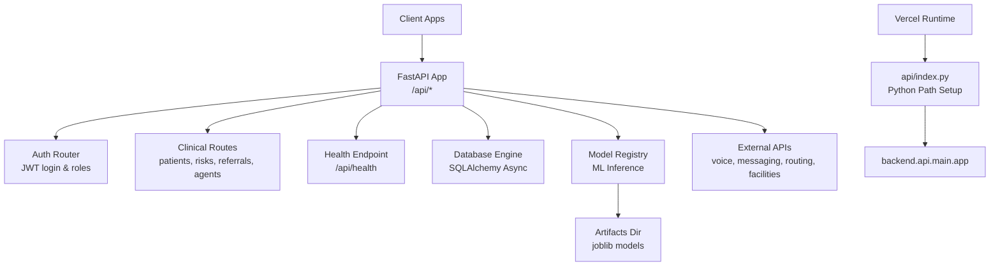
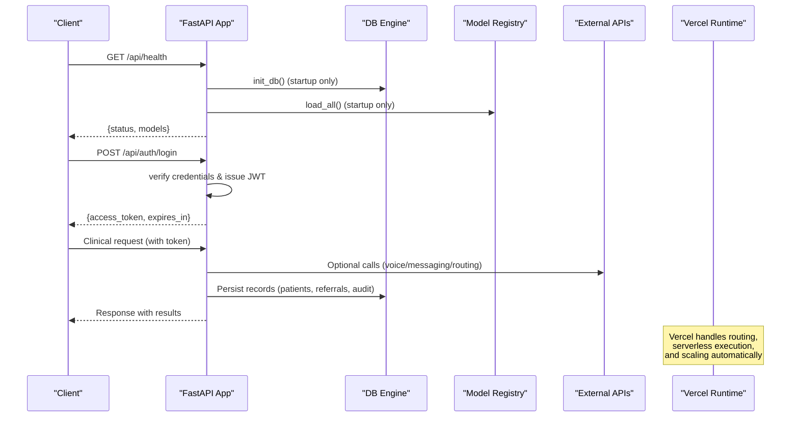
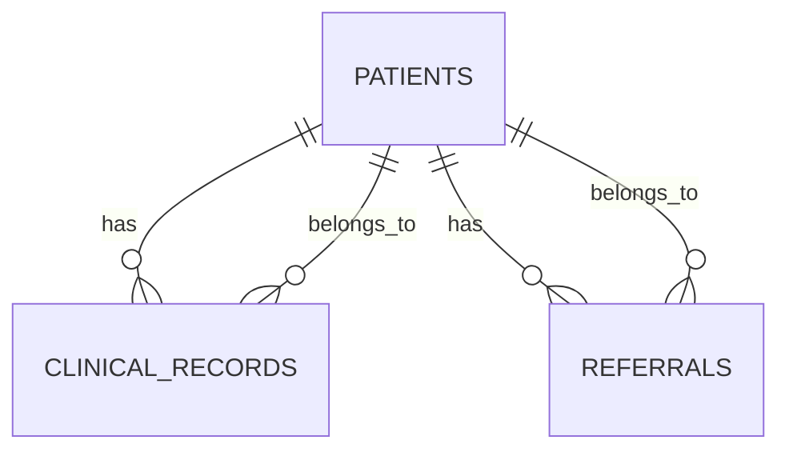
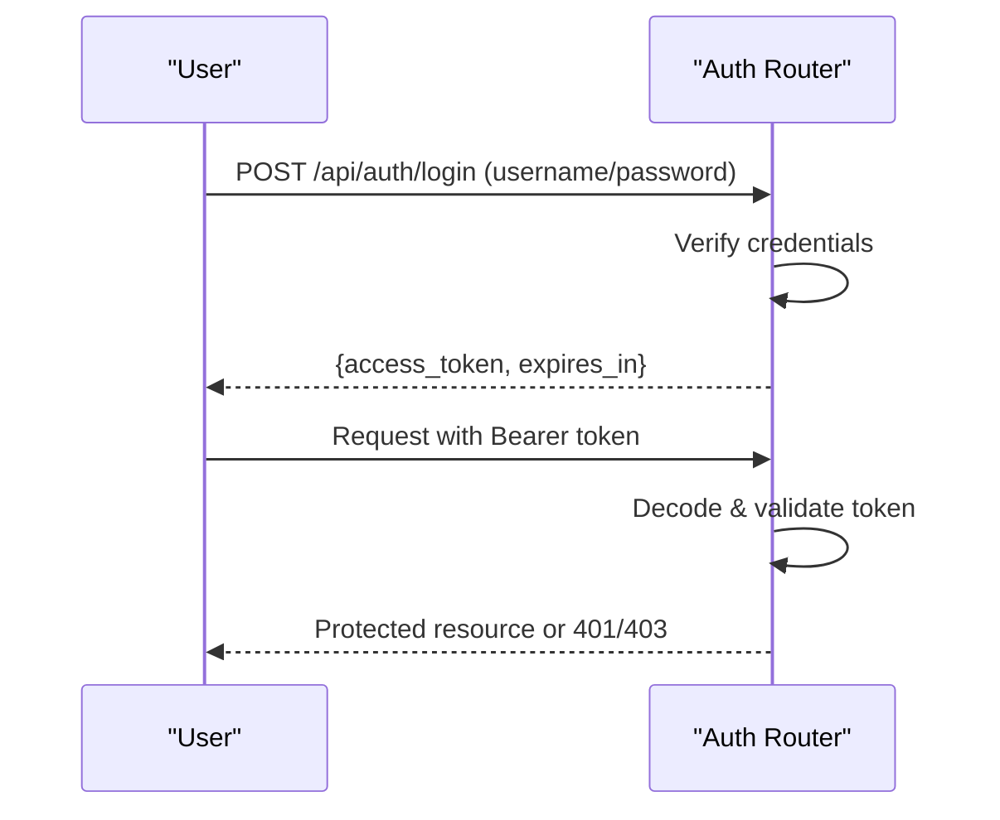
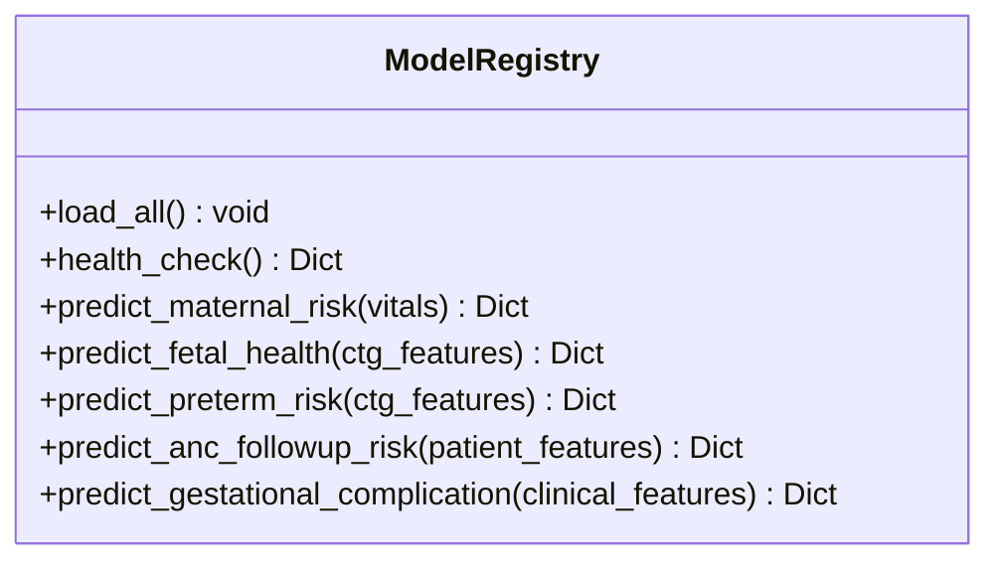
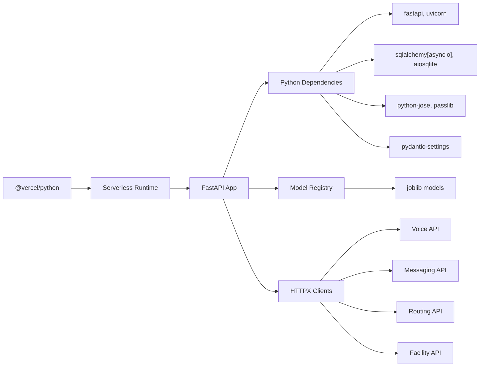

# Deployment and Operations

<cite>
**Referenced Files in This Document**
- [main.py](file://backend/api/main.py)
- [config.py](file://backend/config.py)
- [engine.py](file://backend/db/engine.py)
- [models.py](file://backend/db/models.py)
- [inference.py](file://backend/services/inference.py)
- [auth.py](file://backend/api/auth.py)
- [requirements-backend.txt](file://requirements-backend.txt)
- [requirements.txt](file://requirements.txt)
- [vercel.json](file://vercel.json)
- [index.py](file://api/index.py)
</cite>

## Update Summary
**Changes Made**
- Added Vercel serverless deployment section with configuration details
- Updated environment configuration section to include Vercel-specific settings
- Enhanced deployment options to include serverless architecture
- Added Python path configuration for Vercel runtime
- Updated troubleshooting guide with serverless-specific issues

## Table of Contents
1. [Introduction](#introduction)
2. [Project Structure](#project-structure)
3. [Core Components](#core-components)
4. [Architecture Overview](#architecture-overview)
5. [Detailed Component Analysis](#detailed-component-analysis)
6. [Dependency Analysis](#dependency-analysis)
7. [Performance Considerations](#performance-considerations)
8. [Troubleshooting Guide](#troubleshooting-guide)
9. [Conclusion](#conclusion)
10. [Appendices](#appendices)

## Introduction
This document provides production-grade deployment and operations guidance for MaaHifazat AI, an AI-powered maternal and fetal health platform. It covers containerization with Docker, orchestration with Kubernetes, cloud deployment options including Vercel serverless deployment, environment configuration, secret management, scaling for high availability, monitoring and logging, backup and disaster recovery, database maintenance, system administration, security hardening, network configuration, compliance considerations, model updates, system upgrades, incident response, offline deployment strategies, and troubleshooting.

## Project Structure
MaaHifazat AI is a FastAPI-based backend that:
- Exposes REST APIs under /api with OpenAPI docs at /api/docs and /api/redoc
- Initializes the database and loads ML models at startup
- Provides authentication via JWT and role-based access control
- Integrates external services (voice, messaging, routing, facility lookup) via configurable endpoints
- Persists clinical records, referrals, audit logs, model versions, and files to a relational database
- Supports Vercel serverless deployment with proper Python path configuration



**Diagram sources**
- [main.py:22-64](file://backend/api/main.py#L22-L64)
- [main.py:108-115](file://backend/api/main.py#L108-L115)
- [main.py:122-134](file://backend/api/main.py#L122-L134)
- [engine.py:10-18](file://backend/db/engine.py#L10-L18)
- [inference.py:51-101](file://backend/services/inference.py#L51-L101)
- [config.py:7-54](file://backend/config.py#L7-L54)
- [index.py:1-12](file://api/index.py#L1-L12)
- [vercel.json:1-30](file://vercel.json#L1-L30)

**Section sources**
- [main.py:1-135](file://backend/api/main.py#L1-L135)
- [config.py:1-59](file://backend/config.py#L1-L59)
- [engine.py:1-37](file://backend/db/engine.py#L1-L37)
- [inference.py:1-141](file://backend/services/inference.py#L1-L141)
- [index.py:1-12](file://api/index.py#L1-L12)
- [vercel.json:1-30](file://vercel.json#L1-L30)

## Core Components
- Application entrypoint and lifecycle management: initializes DB and loads models on startup; exposes health endpoint and global exception handling.
- Configuration: centralized settings for paths, secrets, external APIs, and app metadata using Pydantic BaseSettings with .env support.
- Database: async SQLAlchemy engine and session management; auto-creates tables at startup.
- Authentication: JWT-based login and role enforcement; MVP user store for development.
- Inference service: singleton ModelRegistry that loads multiple ML artifacts and provides prediction helpers with fallbacks.
- **Vercel Serverless Support**: Dedicated entrypoint with Python path configuration for serverless runtime compatibility.

**Section sources**
- [main.py:22-64](file://backend/api/main.py#L22-L64)
- [main.py:83-115](file://backend/api/main.py#L83-L115)
- [config.py:7-59](file://backend/config.py#L7-L59)
- [engine.py:10-37](file://backend/db/engine.py#L10-L37)
- [auth.py:65-115](file://backend/api/auth.py#L65-L115)
- [inference.py:51-141](file://backend/services/inference.py#L51-L141)
- [index.py:1-12](file://api/index.py#L1-L12)

## Architecture Overview
The runtime architecture centers around a single FastAPI process that:
- Starts up by initializing the database and loading all ML models
- Serves REST endpoints for patients, risks, referrals, agents, alerts, audit, analytics
- Enforces authentication and authorization via JWT
- Calls external integrations as configured
- Logs structured information and exposes a health check
- **Supports both traditional server deployment and Vercel serverless architecture**



**Diagram sources**
- [main.py:22-64](file://backend/api/main.py#L22-L64)
- [main.py:108-115](file://backend/api/main.py#L108-L115)
- [auth.py:125-146](file://backend/api/auth.py#L125-L146)
- [engine.py:33-37](file://backend/db/engine.py#L33-L37)
- [inference.py:68-101](file://backend/services/inference.py#L68-L101)
- [index.py:1-12](file://api/index.py#L1-L12)

## Detailed Component Analysis

### Application Lifecycle and Health
- Startup runs database initialization and model loading; failures are logged but do not block startup in development mode.
- Global exception handler returns structured JSON errors and logs stack traces.
- Health endpoint reports overall status and per-model availability.
- **Vercel Compatibility**: The application uses lifespan context manager which works seamlessly with serverless environments.

```mermaid
flowchart TD
Start(["Process Start"]) --> InitDB["Initialize DB"]
InitDB --> LoadModels["Load ML Models"]
LoadModels --> Ready{"All OK?"}
Ready --> |Yes| Serve["Serve Requests"]
Ready --> |No| LogWarn["Log warnings (non-fatal)"]
Serve --> Health["GET /api/health"]
Health --> Return["Return status + models"]
Note at bottom: Works on both<br/>traditional servers and<br/>Vercel serverless
```

**Diagram sources**
- [main.py:22-45](file://backend/api/main.py#L22-L45)
- [main.py:83-115](file://backend/api/main.py#L83-L115)

**Section sources**
- [main.py:22-45](file://backend/api/main.py#L22-L45)
- [main.py:83-115](file://backend/api/main.py#L83-L115)

### Configuration and Secrets
- Settings class centralizes project paths, model artifact locations, database URL, JWT parameters, external API URLs, LLM provider keys, and app flags.
- Supports .env file for environment-specific overrides.
- **Vercel Integration**: Uses relative paths that work across different deployment environments including Vercel's temporary filesystem.
- Production recommendations:
  - Replace default JWT secret with a strong, rotated secret
  - Use HTTPS-only CORS origins and restrict methods/headers
  - Point DATABASE_URL to a managed, encrypted database
  - Store GROQ_API_KEY and other secrets in a secrets manager or environment vault
  - Disable DEBUG in production

**Section sources**
- [config.py:7-59](file://backend/config.py#L7-L59)

### Database and Data Model
- Uses async SQLAlchemy with a session factory and table creation on startup.
- Data model includes patients, clinical records, referrals, agent states, audit logs, model versions, and file records.
- Audit log schema supports tracking agent actions, inputs/outputs summaries, confidence, duration, and errors.
- **Serverless Consideration**: SQLite database path is configured to work with Vercel's temporary filesystem.



**Diagram sources**
- [models.py:11-68](file://backend/db/models.py#L11-L68)

**Section sources**
- [engine.py:10-37](file://backend/db/engine.py#L10-L37)
- [models.py:11-115](file://backend/db/models.py#L11-L115)

### Authentication and Authorization
- JWT-based login with role enforcement; MVP users for development.
- Token creation uses configured secret and algorithm; expiration controlled by settings.
- Role-based dependency ensures endpoints can restrict access by role.



**Diagram sources**
- [auth.py:65-115](file://backend/api/auth.py#L65-L115)
- [auth.py:125-146](file://backend/api/auth.py#L125-L146)

**Section sources**
- [auth.py:65-115](file://backend/api/auth.py#L65-L115)
- [auth.py:125-146](file://backend/api/auth.py#L125-L146)

### Inference Service and Model Management
- Singleton ModelRegistry loads multiple models and extras (encoders/preprocessors) from artifacts directory.
- Predictions include probabilities, confidence, and model availability flags; robust fallbacks when models are missing or fail.
- Health check enumerates expected models and reports loaded status.



**Diagram sources**
- [inference.py:51-141](file://backend/services/inference.py#L51-L141)
- [inference.py:151-426](file://backend/services/inference.py#L151-L426)

**Section sources**
- [inference.py:51-141](file://backend/services/inference.py#L51-L141)
- [inference.py:151-426](file://backend/services/inference.py#L151-L426)

## Dependency Analysis
- The application depends on FastAPI, Uvicorn, SQLAlchemy async, Pydantic Settings, JWT libraries, and HTTP clients.
- ML inference relies on joblib-loaded models and optional preprocessors/encoders.
- External integrations are configured via URLs and keys.
- **Vercel Dependencies**: Uses @vercel/python runtime with specific build configurations.



**Diagram sources**
- [requirements-backend.txt:1-15](file://requirements-backend.txt#L1-L15)
- [requirements.txt:1-15](file://requirements.txt#L1-L15)
- [config.py:31-42](file://backend/config.py#L31-L42)
- [vercel.json:1-30](file://vercel.json#L1-L30)

**Section sources**
- [requirements-backend.txt:1-15](file://requirements-backend.txt#L1-L15)
- [requirements.txt:1-15](file://requirements.txt#L1-L15)
- [config.py:31-42](file://backend/config.py#L31-L42)
- [vercel.json:1-30](file://vercel.json#L1-L30)

## Performance Considerations
- Concurrency: Run behind a process manager like Uvicorn workers to utilize multi-core systems.
- Model loading: Models are loaded once at startup; ensure sufficient memory for artifact sizes.
- Database: For production, migrate from SQLite to a managed relational database (PostgreSQL/MySQL) and tune connection pools.
- I/O: External API calls should use timeouts and retries; consider caching where appropriate.
- Logging: Enable structured logging and avoid excessive debug output in production.
- Scaling: Horizontal scaling requires stateless app instances and shared storage for artifacts and database.
- **Vercel Optimization**: 
  - Lambda size limit of 50MB configured for optimal performance
  - Cold start optimization through efficient model loading
  - Automatic scaling based on request volume

## Troubleshooting Guide
Common operational issues and resolutions:
- Health endpoint shows models unavailable:
  - Verify artifacts directory and model file paths in settings
  - Check permissions to read model files
  - Review startup logs for model loading warnings
- Authentication failures:
  - Ensure JWT_SECRET matches between issuer and validator
  - Confirm token expiry and algorithm settings
  - Validate CORS headers if calling from browsers
- Database errors:
  - Confirm DATABASE_URL points to a reachable, writable database
  - Check that tables are created on startup
  - Inspect connection pool and disk space
- External API errors:
  - Validate URLs and keys in settings
  - Implement retries and circuit breakers for resilience
  - Monitor latency and error rates
- **Vercel-Specific Issues**:
  - Python path configuration problems in serverless environment
  - Environment variable access in Vercel runtime
  - File system limitations in temporary directories
  - Build time vs runtime dependencies

**Section sources**
- [main.py:22-45](file://backend/api/main.py#L22-L45)
- [main.py:83-115](file://backend/api/main.py#L83-L115)
- [config.py:7-59](file://backend/config.py#L7-L59)
- [engine.py:33-37](file://backend/db/engine.py#L33-L37)
- [auth.py:65-115](file://backend/api/auth.py#L65-L115)
- [index.py:1-12](file://api/index.py#L1-L12)

## Conclusion
MaaHifazat AI's backend is designed for straightforward deployment with clear configuration, robust startup routines, and comprehensive health reporting. The addition of Vercel serverless deployment support enables flexible hosting options while maintaining the same API surface. For production, prioritize secure secrets management, hardened network configuration, scalable infrastructure, and thorough monitoring and logging. Follow the operational procedures below to maintain reliability, compliance, and performance in healthcare environments.

## Appendices

### Containerization with Docker
- Create a Dockerfile that:
  - Installs Python dependencies from requirements-backend.txt and requirements.txt
  - Copies application code and artifacts into the image
  - Sets environment variables for configuration
  - Runs Uvicorn with appropriate workers and bind address
- Build and run:
  - docker build -t maahifazat-api .
  - docker run --env-file .env -p 8000:8000 maahifazat-api
- Best practices:
  - Use multi-stage builds to minimize image size
  - Pin dependency versions for reproducibility
  - Mount artifacts and data directories as volumes or bake them into images based on update cadence

### Orchestration with Kubernetes
- Deployments:
  - Define a Deployment with replicas for horizontal scaling
  - Configure liveness and readiness probes using /api/health
  - Set resource requests/limits based on model memory usage
- Services and Ingress:
  - Expose the API via a ClusterIP Service and Ingress with TLS termination
- ConfigMaps and Secrets:
  - Store non-sensitive configuration in ConfigMaps
  - Store secrets (JWT_SECRET, GROQ_API_KEY, DATABASE_URL) in Kubernetes Secrets
- Environment variables:
  - Map secrets to environment variables for the application
- Example resources:
  - Deployment, Service, ConfigMap, Secret, Ingress manifests tailored to your cluster

### Cloud Platform Deployment Options
- Managed containers:
  - AWS ECS/Fargate, Google Cloud Run, Azure Container Instances
- Managed databases:
  - RDS, Cloud SQL, Azure Database for PostgreSQL/MySQL
- Secrets management:
  - AWS Secrets Manager, GCP Secret Manager, Azure Key Vault
- Monitoring:
  - Cloud-native logging and metrics pipelines (CloudWatch, Stackdriver, Azure Monitor)
- Networking:
  - VPC/VNet isolation, private subnets, WAF, and firewall rules

### Vercel Serverless Deployment
- **Configuration**:
  - `vercel.json` defines build processes for Python backend and static frontend
  - Maximum Lambda size set to 50MB for model artifacts
  - Route configuration directs `/api/*` requests to Python backend
  - Static assets served from built frontend distribution
- **Python Path Setup**:
  - Entry point `api/index.py` configures Python path for module imports
  - Uses `sys.path.insert()` to make project root importable
  - Exports FastAPI app instance for Vercel runtime
- **Environment Variables**:
  - Configure in Vercel dashboard or `.env` file
  - Supports all standard environment variables used by the application
- **Deployment Process**:
  - Push to Git repository connected to Vercel
  - Automatic builds and deployments triggered by commits
  - Preview deployments for testing before production rollout
- **Benefits**:
  - Zero-config serverless deployment
  - Automatic scaling and SSL termination
  - Built-in CDN for static assets
  - Easy environment variable management

**Section sources**
- [vercel.json:1-30](file://vercel.json#L1-L30)
- [index.py:1-12](file://api/index.py#L1-L12)

### Environment Configuration and Secret Management
- Use .env for local development; switch to environment variables or secret managers in production
- Required settings include:
  - DATABASE_URL, JWT_SECRET, JWT_ALGORITHM, JWT_EXPIRE_MINUTES
  - VOICE_API_URL, FACILITY_API_URL, ROUTING_API_URL, MESSAGING_API_URL
  - GROQ_API_KEY, GROQ_MODEL
  - APP_NAME, APP_VERSION, DEBUG
- **Vercel Configuration**:
  - Set environment variables in Vercel project settings
  - Use separate environments for development, staging, and production
  - Leverage Vercel's built-in secret management
- Rotate secrets regularly and enforce least privilege access

**Section sources**
- [config.py:7-59](file://backend/config.py#L7-L59)

### Scaling and High Availability
- Horizontal scaling:
  - Run multiple replicas behind a load balancer
  - Ensure statelessness and shared storage for artifacts and database
- Vertical scaling:
  - Increase CPU/memory for model-heavy workloads
- Auto-scaling:
  - Configure HPA based on CPU/memory or custom metrics
- Database HA:
  - Use managed HA databases with backups and replication
- **Vercel Auto-Scaling**:
  - Automatic scaling based on request volume
  - No manual intervention required for traffic spikes
  - Pay-per-use pricing model

### Monitoring and Logging
- Structured logging:
  - Emit JSON logs with request IDs, timestamps, and context
  - Centralize logs in a logging platform
- Metrics:
  - Expose application metrics (request rate, latency, error rate)
  - Track model health and inference latency
- Health checks:
  - /api/health indicates service and model availability
- Alerting:
  - Set alerts for error spikes, model unavailability, and high latency
- **Vercel Monitoring**:
  - Built-in analytics and performance metrics
  - Custom logging integration with popular platforms
  - Error tracking and debugging tools

**Section sources**
- [main.py:83-115](file://backend/api/main.py#L83-L115)

### Backup and Disaster Recovery
- Database backups:
  - Schedule automated backups for the managed database
  - Test restore procedures regularly
- Artifacts:
  - Version and back up model artifacts and preprocessors
- Audit logs:
  - Retain audit logs per compliance requirements
- DR plan:
  - Define RTO/RPO targets
  - Document failover procedures and validation steps

### Database Maintenance Tasks
- Schema migrations:
  - Use migration tools to evolve schema safely
- Indexing:
  - Add indexes on frequently queried columns (e.g., case_id, patient_id)
- Vacuum/analyze:
  - Periodically optimize database performance
- Capacity planning:
  - Monitor growth and scale storage accordingly

**Section sources**
- [models.py:11-115](file://backend/db/models.py#L11-L115)

### System Administration Tasks
- User management:
  - Replace MVP users with a secure user store and RBAC integration
- Configuration management:
  - Centralize configuration via ConfigMaps/Secrets
- Update cadence:
  - Establish release cycles for app and model updates
- Access controls:
  - Restrict admin endpoints and enforce strong authentication

**Section sources**
- [auth.py:25-58](file://backend/api/auth.py#L25-L58)

### Security Hardening and Network Configuration
- TLS:
  - Terminate TLS at ingress or reverse proxy
- CORS:
  - Restrict allowed origins, methods, and headers in production
- Secrets:
  - Never commit secrets; use environment variables or secret managers
- Firewall rules:
  - Allow only necessary ports (e.g., 443 for HTTPS)
- Compliance:
  - Encrypt data at rest and in transit
  - Maintain audit trails and access logs
  - Follow healthcare regulations (HIPAA/GDPR) for PHI protection

**Section sources**
- [main.py:70-76](file://backend/api/main.py#L70-L76)
- [config.py:26-42](file://backend/config.py#L26-L42)

### Compliance Requirements for Healthcare Data Protection
- Data minimization and purpose limitation
- Consent management and patient rights
- Secure storage and transmission of PHI
- Regular risk assessments and audits
- Incident response and breach notification procedures

### Operational Procedures
- Model updates:
  - Stage new artifacts in a versioned directory
  - Update settings to point to new model paths
  - Validate via /api/health and test endpoints before rollout
- System upgrades:
  - Perform rolling updates with zero downtime
  - Rollback strategy: keep previous image/artifact versions available
- Incident response:
  - Detect via alerts and health checks
  - Isolate affected components
  - Restore from backups if necessary
  - Post-incident review and remediation

**Section sources**
- [inference.py:68-101](file://backend/services/inference.py#L68-L101)
- [main.py:22-45](file://backend/api/main.py#L22-L45)

### Offline Deployment in Low-Resource Settings
- Local artifacts:
  - Bundle required models and preprocessors within the container or mounted volume
- Local database:
  - Use lightweight embedded database (SQLite) if acceptable
- Connectivity:
  - Cache external responses where possible; implement retry/backoff
- Sync strategy:
  - Queue offline submissions and sync when connectivity is available
- Monitoring:
  - Provide local dashboards or logs for field staff

### Troubleshooting Common Operational Issues
- Models not loading:
  - Verify artifact paths and file existence
  - Check permissions and disk space
- Authentication errors:
  - Validate JWT secret and algorithm
  - Ensure correct token format and expiry
- Database connectivity:
  - Confirm URL and credentials
  - Check network reachability and firewall rules
- External API failures:
  - Validate endpoints and keys
  - Implement retries and fallbacks
- **Vercel-Specific Troubleshooting**:
  - Check Python path configuration in serverless environment
  - Verify environment variables are properly set in Vercel dashboard
  - Monitor cold start times and optimize model loading
  - Debug file system access in temporary directories

**Section sources**
- [inference.py:103-130](file://backend/services/inference.py#L103-L130)
- [auth.py:65-115](file://backend/api/auth.py#L65-L115)
- [engine.py:10-37](file://backend/db/engine.py#L10-L37)
- [config.py:31-42](file://backend/config.py#L31-L42)
- [index.py:1-12](file://api/index.py#L1-L12)