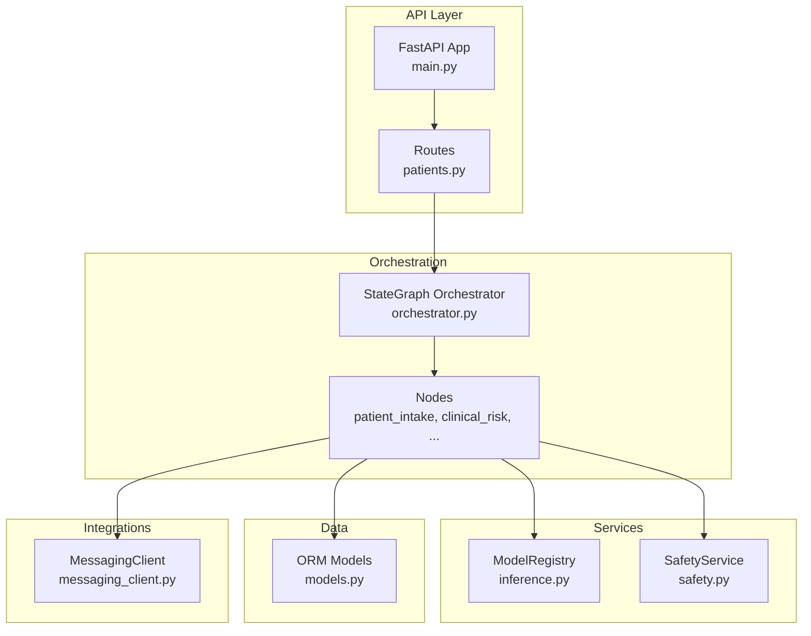
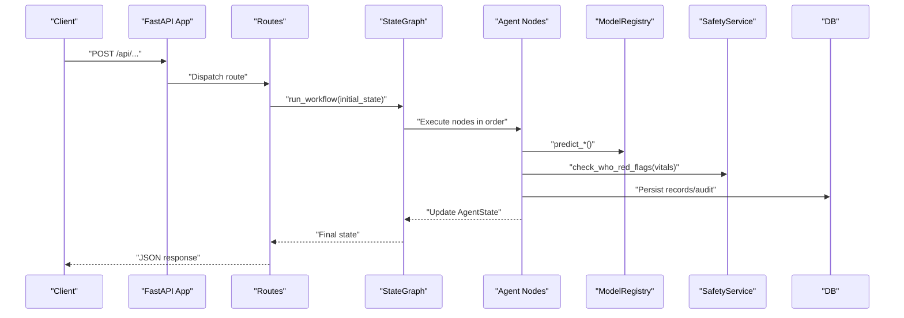
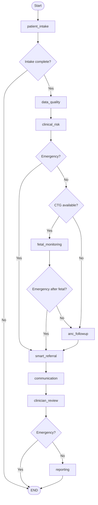
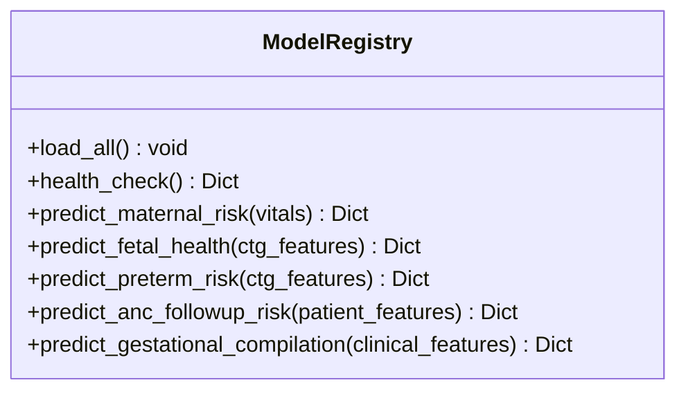
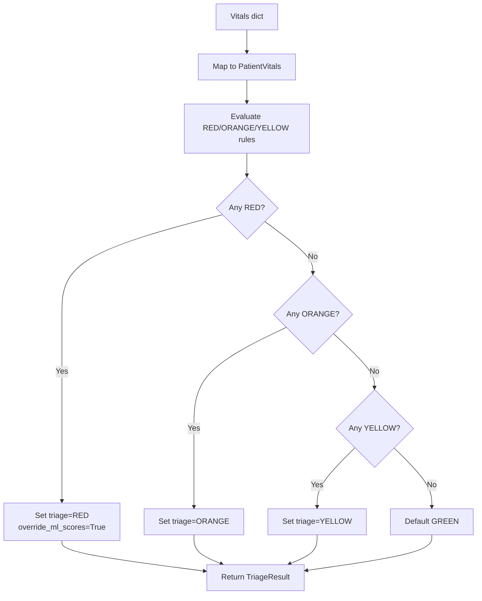
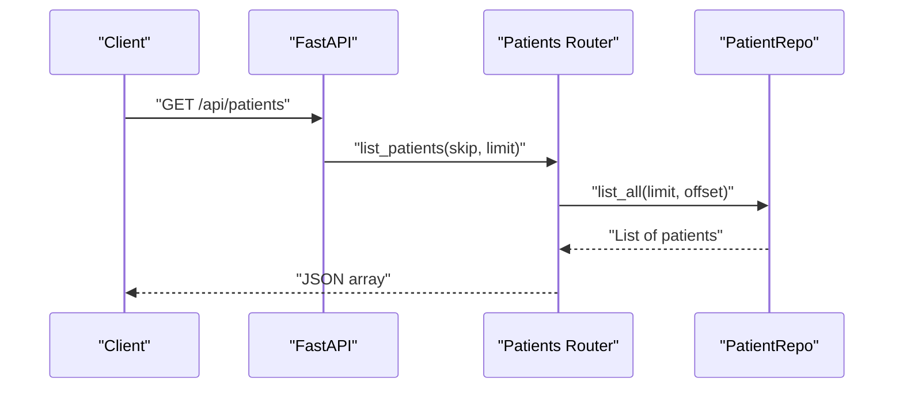
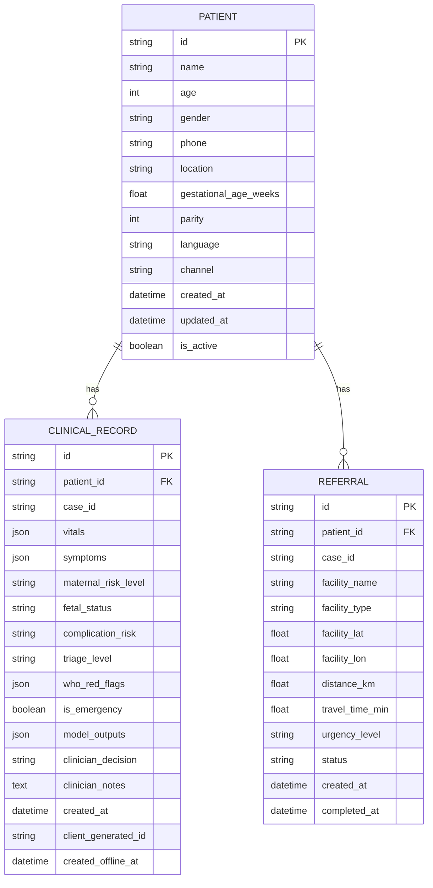
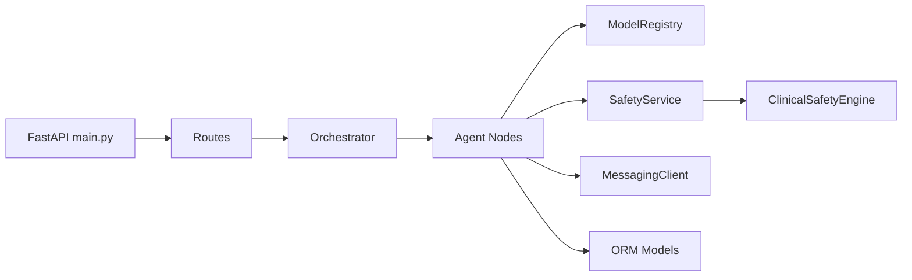

# Developer Guide

<cite>
**Referenced Files in This Document**
- [backend/config.py](file://backend/config.py)
- [backend/api/main.py](file://backend/api/main.py)
- [backend/agents/orchestrator.py](file://backend/agents/orchestrator.py)
- [backend/services/inference.py](file://backend/services/inference.py)
- [backend/db/models.py](file://backend/db/models.py)
- [backend/schemas/state.py](file://backend/schemas/state.py)
- [backend/services/safety.py](file://backend/services/safety.py)
- [safety_rules.py](file://safety_rules.py)
- [backend/integrations/messaging_client.py](file://backend/integrations/messaging_client.py)
- [backend/api/routes/patients.py](file://backend/api/routes/patients.py)
- [src/models/fetal_watch.py](file://src/models/fetal_watch.py)
- [src/models/maternal_guard.py](file://src/models/maternal_guard.py)
- [requirements.txt](file://requirements.txt)
- [requirements-backend.txt](file://requirements-backend.txt)
</cite>

## Table of Contents
1. Introduction
2. Project Structure
3. Core Components
4. Architecture Overview
5. Detailed Component Analysis
6. Dependency Analysis
7. Performance Considerations
8. Troubleshooting Guide
9. Conclusion
10. Appendices

## Introduction
This guide explains how to contribute to MaaHifazat AI, a maternal and fetal health platform that combines an agent orchestration system with ML-based risk prediction, WHO safety rules, and multi-channel communication. It covers code organization, architectural patterns, coding standards, development workflow (setup, debugging, profiling), testing requirements, contribution process, and healthcare-specific best practices for ethical AI and clinical validation.

## Project Structure
The repository is organized into clear layers:
- Backend API (FastAPI): entry point, routers, auth, CORS, global error handling
- Agent Orchestration (LangGraph StateGraph): 9 nodes implementing clinical workflows
- Services: inference registry for ML models, safety service wrapping WHO rules, LLM integration
- Data Layer: SQLAlchemy ORM models and async DB engine
- Integrations: messaging, voice, routing, facility locator
- Schemas: shared state and request/response types
- ML Models: training scripts and artifacts under src/models and artifacts
- Configuration: Pydantic settings for paths, secrets, and external APIs

**Diagram sources**
- [backend/api/main.py:52-134](file://backend/api/main.py#L52-L134)
- [backend/agents/orchestrator.py:62-138](file://backend/agents/orchestrator.py#L62-L138)
- [backend/services/inference.py:51-141](file://backend/services/inference.py#L51-L141)
- [backend/services/safety.py:18-67](file://backend/services/safety.py#L18-L67)
- [backend/db/models.py:11-115](file://backend/db/models.py#L11-L115)
- [backend/integrations/messaging_client.py:9-78](file://backend/integrations/messaging_client.py#L9-L78)

**Section sources**
- [backend/api/main.py:1-135](file://backend/api/main.py#L1-L135)
- [backend/agents/orchestrator.py:1-167](file://backend/agents/orchestrator.py#L1-L167)
- [backend/services/inference.py:1-435](file://backend/services/inference.py#L1-L435)
- [backend/db/models.py:1-115](file://backend/db/models.py#L1-L115)
- [backend/integrations/messaging_client.py:1-78](file://backend/integrations/messaging_client.py#L1-L78)

## Core Components
- FastAPI application lifecycle: initializes database and loads ML models at startup; exposes health check and routes.
- Agent orchestration: LangGraph StateGraph wiring nine nodes with conditional routing based on intake completeness, emergency flags, and data availability.
- Inference service: singleton ModelRegistry loading five models and providing typed prediction helpers with fallbacks when models are missing.
- Safety service: deterministic WHO triage rule engine that can override ML scores in emergencies.
- Data layer: async SQLAlchemy models for patients, clinical records, referrals, audit logs, model versions, and files.
- Integrations: messaging client stubs for SMS/WhatsApp and emergency alerts.

Key responsibilities and interactions:
- Routes call services and repositories; services call the orchestrator or inference/safety modules; nodes update shared AgentState.
- Configuration centralizes paths, secrets, and external endpoints.

**Section sources**
- [backend/api/main.py:22-115](file://backend/api/main.py#L22-L115)
- [backend/agents/orchestrator.py:22-138](file://backend/agents/orchestrator.py#L22-L138)
- [backend/services/inference.py:51-141](file://backend/services/inference.py#L51-L141)
- [backend/services/safety.py:18-67](file://backend/services/safety.py#L18-L67)
- [backend/db/models.py:11-115](file://backend/db/models.py#L11-L115)
- [backend/config.py:7-54](file://backend/config.py#L7-L54)

## Architecture Overview
The system follows a layered architecture:
- API Layer: HTTP endpoints with auth, CORS, and global exception handling.
- Orchestration Layer: LangGraph workflow coordinates clinical steps and branching logic.
- Service Layer: ML inference, safety rules, and integrations abstracted behind clean interfaces.
- Data Layer: Async ORM models and repositories for persistence.
- Config: Centralized settings via Pydantic BaseSettings.

**Diagram sources**
- [backend/api/main.py:52-134](file://backend/api/main.py#L52-L134)
- [backend/agents/orchestrator.py:62-147](file://backend/agents/orchestrator.py#L62-L147)
- [backend/services/inference.py:51-141](file://backend/services/inference.py#L51-L141)
- [backend/services/safety.py:18-67](file://backend/services/safety.py#L18-L67)
- [backend/db/models.py:11-115](file://backend/db/models.py#L11-L115)

## Detailed Component Analysis

### Agent Orchestration System
- The orchestrator defines a StateGraph with nine nodes: patient_intake, data_quality, clinical_risk, fetal_monitoring, anc_followup, smart_referral, communication, clinician_review, reporting.
- Conditional edges implement clinical decision logic:
  - After intake: END if incomplete, else proceed to data_quality.
  - After clinical_risk: emergency → smart_referral; CTG present → fetal_monitoring; else anc_followup.
  - After fetal_monitoring: emergency → smart_referral; else anc_followup.
  - After clinician_review: normal → reporting; emergency → END.
- run_workflow executes the compiled graph; run_single_node enables node-level testing.

**Diagram sources**
- [backend/agents/orchestrator.py:22-138](file://backend/agents/orchestrator.py#L22-L138)

**Section sources**
- [backend/agents/orchestrator.py:1-167](file://backend/agents/orchestrator.py#L1-L167)
- [backend/schemas/state.py:7-43](file://backend/schemas/state.py#L7-L43)

### Inference Service (ModelRegistry)
- Singleton pattern ensures models are loaded once at startup.
- load_all reads configured artifact paths and optional extras (encoders/preprocessors).
- Prediction helpers:
  - predict_maternal_risk: expects maternal features, returns risk_level, probabilities, confidence.
  - predict_fetal_health: expects CTG features, returns fetal_status, probabilities, confidence.
  - predict_preterm_risk: uses CTG features for preterm risk.
  - predict_anc_followup_risk: CareReach model with optional preprocessor; returns missed_risk_score and priority thresholds.
  - predict_gestational_complication: GestationInsight model with label encoder mapping.
- Health check reports which models are available; fallback responses ensure robustness.

**Diagram sources**
- [backend/services/inference.py:51-435](file://backend/services/inference.py#L51-L435)

**Section sources**
- [backend/services/inference.py:1-435](file://backend/services/inference.py#L1-L435)
- [backend/config.py:13-21](file://backend/config.py#L13-L21)

### Safety Service and WHO Rules
- SafetyService wraps ClinicalSafetyEngine from safety_rules.py.
- check_who_red_flags maps vitals dict to PatientVitals and evaluates RED/ORANGE/YELLOW/GREEN triage levels.
- If any RED flag triggers, override_ml_scores is set True and triage level becomes HIGH_RISK_EMERGENCY.
- is_emergency provides a quick boolean check for RED triage.

**Diagram sources**
- [safety_rules.py:72-167](file://safety_rules.py#L72-L167)
- [backend/services/safety.py:18-67](file://backend/services/safety.py#L18-L67)

**Section sources**
- [safety_rules.py:1-555](file://safety_rules.py#L1-L555)
- [backend/services/safety.py:1-83](file://backend/services/safety.py#L1-L83)

### API Layer and Routing
- FastAPI app sets up lifespan for DB init and model loading, adds CORS middleware, global exception handler, and health endpoint.
- Routers include authentication and core clinical routes (patients, risks, referrals, agents, alerts, audit, analytics).
- Example route: patients CRUD operations using async session and repository.

**Diagram sources**
- [backend/api/main.py:52-134](file://backend/api/main.py#L52-L134)
- [backend/api/routes/patients.py:56-66](file://backend/api/routes/patients.py#L56-L66)

**Section sources**
- [backend/api/main.py:1-135](file://backend/api/main.py#L1-L135)
- [backend/api/routes/patients.py:1-97](file://backend/api/routes/patients.py#L1-L97)

### Data Models
- ORM models define entities for patients, clinical records, referrals, agent states, audit logs, model versions, and files.
- Relationships link records to patients; JSON columns store rich payloads like vitals and model outputs.

**Diagram sources**
- [backend/db/models.py:11-115](file://backend/db/models.py#L11-L115)

**Section sources**
- [backend/db/models.py:1-115](file://backend/db/models.py#L1-L115)

### Integrations (Messaging)
- MessagingClient provides SMS and WhatsApp sending methods and emergency alert broadcasting.
- Stub implementation always returns success; includes delivery tracking and reminder templates.

**Section sources**
- [backend/integrations/messaging_client.py:1-78](file://backend/integrations/messaging_client.py#L1-L78)

### ML Model Training Pipelines
- FetalWatch: three-class classifier (Normal/Suspect/Pathological) trained with LightGBM (Optuna HPO), Random Forest baseline, and XGBoost comparison; saves best model and metrics.
- MaternalGuard: maternal risk classification using LightGBM (Optuna HPO) and Logistic Regression baseline; saves best model and label encoder.

**Section sources**
- [src/models/fetal_watch.py:1-469](file://src/models/fetal_watch.py#L1-L469)
- [src/models/maternal_guard.py:1-303](file://src/models/maternal_guard.py#L1-L303)

## Dependency Analysis
- External dependencies:
  - Backend: FastAPI, Uvicorn, LangGraph, LangChain Core, SQLAlchemy async, aiosqlite, python-jose, passlib, httpx, pydantic-settings, Groq, pytest.
  - ML/Data: ucimlrepo, wfdb, pandas, numpy, scikit-learn, imbalanced-learn, lightgbm, xgboost, optuna, matplotlib, seaborn, shap, openpyxl, jupyter.
- Internal coupling:
  - API depends on routers and services; orchestrator depends on nodes and schemas; nodes depend on inference and safety services; services depend on config and external clients.

**Diagram sources**
- [backend/api/main.py:52-134](file://backend/api/main.py#L52-L134)
- [backend/agents/orchestrator.py:62-138](file://backend/agents/orchestrator.py#L62-L138)
- [backend/services/inference.py:51-141](file://backend/services/inference.py#L51-L141)
- [backend/services/safety.py:18-67](file://backend/services/safety.py#L18-L67)
- [backend/integrations/messaging_client.py:9-78](file://backend/integrations/messaging_client.py#L9-L78)
- [backend/db/models.py:11-115](file://backend/db/models.py#L11-L115)

**Section sources**
- [requirements-backend.txt:1-15](file://requirements-backend.txt#L1-L15)
- [requirements.txt:1-15](file://requirements.txt#L1-L15)

## Performance Considerations
- Model loading:
  - Use ModelRegistry singleton to avoid repeated disk I/O; load all models during startup.
  - Ensure artifact paths exist; handle missing models gracefully with fallback responses.
- Concurrency:
  - Run synchronous LLM calls in worker threads to avoid blocking the event loop (as implemented in nodes).
- Data processing:
  - Normalize feature presence and fill missing values before inference to prevent errors.
- Database:
  - Use async sessions and efficient queries; paginate list endpoints to reduce payload size.
- Logging and monitoring:
  - Leverage structured logging and audit trails to track performance bottlenecks.

[No sources needed since this section provides general guidance]

## Troubleshooting Guide
Common issues and resolutions:
- Model not found:
  - Verify artifact paths in configuration; check ModelRegistry health_check output.
  - Inspect warnings logged during load_all.
- LLM unavailability:
  - Nodes fall back to template questions and summaries; verify environment variables for API keys.
- Database initialization failure:
  - Non-fatal in dev; check DATABASE_URL and file permissions; inspect startup logs.
- Global exceptions:
  - Use the global exception handler to capture path and error details; log stack traces for debugging.
- Messaging failures:
  - Confirm base_url and timeout; review sent messages log for delivery status.

**Section sources**
- [backend/api/main.py:22-115](file://backend/api/main.py#L22-L115)
- [backend/services/inference.py:68-141](file://backend/services/inference.py#L68-L141)
- [backend/agents/nodes/patient_intake.py:14-55](file://backend/agents/nodes/patient_intake.py#L14-L55)
- [backend/integrations/messaging_client.py:9-78](file://backend/integrations/messaging_client.py#L9-L78)

## Conclusion
MaaHifazat AI integrates a robust agent orchestration system with deterministic safety rules and ML predictions to support maternal and fetal health workflows. By following the outlined architecture, coding standards, and development practices, contributors can extend capabilities safely and effectively while maintaining clinical reliability and performance.

[No sources needed since this section summarizes without analyzing specific files]

## Appendices

### Development Workflow
- Local setup:
  - Install backend dependencies: fastapi, uvicorn, langgraph, sqlalchemy async, httpx, pydantic-settings, groq, pytest.
  - Install ML/data dependencies: pandas, numpy, scikit-learn, lightgbm, xgboost, optuna, wfdb, etc.
  - Configure environment variables (e.g., .env) for paths, secrets, and external APIs.
- Running the app:
  - Start Uvicorn server; confirm health endpoint and model availability.
- Debugging:
  - Enable debug mode; use structured logs and global exception handler; inspect audit trails.
- Profiling:
  - Profile slow nodes and inference calls; measure duration_ms in audit entries; optimize hot paths.
- Testing:
  - Use pytest and pytest-asyncio; test API routes, orchestrator flows, and single nodes via run_single_node.

**Section sources**
- [requirements-backend.txt:1-15](file://requirements-backend.txt#L1-L15)
- [requirements.txt:1-15](file://requirements.txt#L1-L15)
- [backend/api/main.py:108-115](file://backend/api/main.py#L108-L115)
- [backend/agents/orchestrator.py:150-167](file://backend/agents/orchestrator.py#L150-L167)

### Extending the Agent Orchestration System
- Add a new node:
  - Implement an async function accepting AgentState and returning updates.
  - Register the node in the orchestrator and add conditional edges as needed.
- Modify routing:
  - Update conditional functions to branch based on state fields (e.g., emergency, vitals, ctg_data).
- Testing:
  - Use run_single_node to validate behavior; assert expected state transitions.

**Section sources**
- [backend/agents/orchestrator.py:62-138](file://backend/agents/orchestrator.py#L62-L138)
- [backend/schemas/state.py:7-43](file://backend/schemas/state.py#L7-L43)

### Adding New ML Models
- Train and save artifacts:
  - Follow existing pipelines (e.g., FetalWatch/MaternalGuard) to produce best_model.joblib and encoders/preprocessors.
- Register in ModelRegistry:
  - Add model path(s) to Settings and load_all; implement a typed prediction helper with feature validation and fallbacks.
- Validate:
  - Use health_check and unit tests to ensure correct feature shapes and label decoding.

**Section sources**
- [backend/config.py:13-21](file://backend/config.py#L13-L21)
- [backend/services/inference.py:68-141](file://backend/services/inference.py#L68-L141)
- [src/models/fetal_watch.py:282-432](file://src/models/fetal_watch.py#L282-L432)
- [src/models/maternal_guard.py:71-260](file://src/models/maternal_guard.py#L71-L260)

### Implementing Custom Integrations
- Create a client module:
  - Define async methods for send/receive; configure base_url and timeouts via Settings.
  - Include retry and error handling; log outcomes for observability.
- Wire into nodes:
  - Call integration methods within nodes; handle failures gracefully and continue workflow.

**Section sources**
- [backend/integrations/messaging_client.py:9-78](file://backend/integrations/messaging_client.py#L9-L78)
- [backend/config.py:31-35](file://backend/config.py#L31-L35)

### Modifying Clinical Workflows
- Adjust routing logic:
  - Update conditional functions to reflect new clinical pathways (e.g., additional triage criteria).
- Enforce safety:
  - Always call SafetyService to evaluate WHO red flags; respect override_ml_scores for emergencies.
- Audit and trace:
  - Record actions, inputs, outputs, and durations in audit_trail for compliance and debugging.

**Section sources**
- [backend/agents/orchestrator.py:22-138](file://backend/agents/orchestrator.py#L22-L138)
- [backend/services/safety.py:18-67](file://backend/services/safety.py#L18-L67)
- [backend/db/models.py:81-93](file://backend/db/models.py#L81-L93)

### Creating New API Endpoints
- Add a router:
  - Define endpoints with request/response models; use Depends for DB sessions and auth.
  - Implement CRUD operations via repositories; return standardized profiles.
- Secure and document:
  - Apply role-based access control; expose OpenAPI docs for discovery.

**Section sources**
- [backend/api/routes/patients.py:44-97](file://backend/api/routes/patients.py#L44-L97)
- [backend/api/main.py:122-134](file://backend/api/main.py#L122-L134)

### Healthcare AI Best Practices
- Ethical considerations:
  - Prioritize patient safety; ensure transparency in decisions and provide human-in-the-loop review.
- Bias mitigation:
  - Evaluate models across demographic groups; monitor calibration and fairness metrics; retrain with representative data.
- Clinical validation:
  - Align with WHO guidelines; maintain deterministic safety overrides; conduct prospective validation in clinical settings.

[No sources needed since this section provides general guidance]