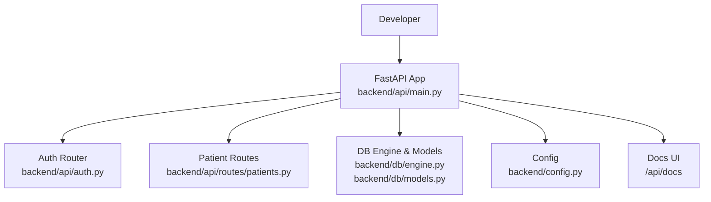
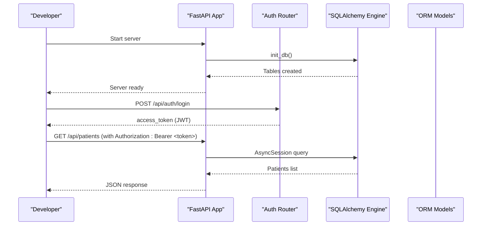
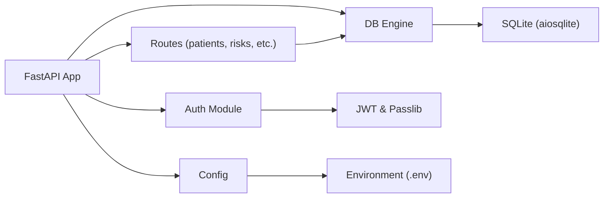

# Getting Started

<cite>
**Referenced Files in This Document**
- [requirements.txt](file://requirements.txt)
- [requirements-backend.txt](file://requirements-backend.txt)
- [backend/config.py](file://backend/config.py)
- [backend/api/main.py](file://backend/api/main.py)
- [backend/db/engine.py](file://backend/db/engine.py)
- [backend/db/models.py](file://backend/db/models.py)
- [backend/api/auth.py](file://backend/api/auth.py)
- [backend/api/routes/patients.py](file://backend/api/routes/patients.py)
- [backend/tests/test_api.py](file://backend/tests/test_api.py)
- [DATASET_REGISTRY.md](file://DATASET_REGISTRY.md)
</cite>

## Table of Contents
1. Introduction
2. Project Structure
3. Core Components
4. Architecture Overview
5. Detailed Component Analysis
6. Dependency Analysis
7. Performance Considerations
8. Troubleshooting Guide
9. Conclusion
10. Appendices

## Introduction
This guide helps new developers set up and run the MaaHifazat AI platform locally for development and production. It covers Python environment setup, installing dependencies from requirements files, configuring environment variables, starting the backend server, accessing API documentation at /api/docs, and making your first authenticated API calls (authentication and patient registration). It also includes verification steps and troubleshooting tips for common setup issues.

## Project Structure
The project is organized into a FastAPI backend under backend/, shared configuration and models, and supporting scripts/notebooks. Key areas for getting started:
- Configuration and environment: backend/config.py
- Application entrypoint and routes: backend/api/main.py
- Database engine and ORM models: backend/db/engine.py, backend/db/models.py
- Authentication and authorization: backend/api/auth.py
- Patient endpoints: backend/api/routes/patients.py
- Dependencies: requirements.txt, requirements-backend.txt
- Optional datasets reference: DATASET_REGISTRY.md

**Diagram sources**
- [backend/api/main.py:52-64](file://backend/api/main.py#L52-L64)
- [backend/api/auth.py:122-146](file://backend/api/auth.py#L122-L146)
- [backend/api/routes/patients.py:44-53](file://backend/api/routes/patients.py#L44-L53)
- [backend/db/engine.py:10-18](file://backend/db/engine.py#L10-L18)
- [backend/db/models.py:11-29](file://backend/db/models.py#L11-L29)
- [backend/config.py:7-54](file://backend/config.py#L7-L54)

**Section sources**
- [backend/api/main.py:52-64](file://backend/api/main.py#L52-L64)
- [backend/config.py:7-54](file://backend/config.py#L7-L54)

## Core Components
- FastAPI application with lifespan hooks to initialize the database and load ML models on startup.
- JWT-based authentication with role checks for protected endpoints.
- Async SQLAlchemy engine with SQLite for local development; tables created from ORM models.
- REST endpoints for patients, risks, referrals, agents, alerts, audit, analytics.
- OpenAPI docs served at /api/docs and /api/redoc.

Key behaviors:
- On startup, the app initializes the DB and attempts to load models; failures are logged but do not block startup in development.
- Health endpoint returns status and model availability.
- CORS is permissive in development.

**Section sources**
- [backend/api/main.py:22-44](file://backend/api/main.py#L22-L44)
- [backend/api/main.py:108-115](file://backend/api/main.py#L108-L115)
- [backend/db/engine.py:33-36](file://backend/db/engine.py#L33-L36)
- [backend/db/models.py:11-29](file://backend/db/models.py#L11-L29)

## Architecture Overview
High-level flow:
- Client requests hit FastAPI routes.
- Auth middleware validates JWT tokens for protected endpoints.
- Routes interact with repositories via async DB sessions.
- Startup lifecycle initializes DB and loads models.

**Diagram sources**
- [backend/api/main.py:22-44](file://backend/api/main.py#L22-L44)
- [backend/db/engine.py:33-36](file://backend/db/engine.py#L33-L36)
- [backend/api/auth.py:125-146](file://backend/api/auth.py#L125-L146)
- [backend/api/routes/patients.py:56-66](file://backend/api/routes/patients.py#L56-L66)

## Detailed Component Analysis

### Environment Setup and Installation
- Python version: Use a recent Python 3.x interpreter available as py or python.
- Create and activate a virtual environment.
- Install dependencies:
  - Backend runtime: install from requirements-backend.txt.
  - Data science tools (optional): install from requirements.txt if you plan to run notebooks or training scripts.
- Configure environment:
  - The application reads settings from .env using Pydantic BaseSettings.
  - Default values include paths, database URL, JWT secrets, external API URLs, and Groq LLM settings. Override these by setting environment variables or editing .env.

Verification:
- After installation, start the server and check the health endpoint and docs.

**Section sources**
- [requirements-backend.txt:1-15](file://requirements-backend.txt#L1-L15)
- [requirements.txt:1-15](file://requirements.txt#L1-L15)
- [backend/config.py:7-54](file://backend/config.py#L7-L54)

### Running the Backend Server
- Start the FastAPI server using uvicorn (included in requirements-backend.txt).
- Once running:
  - Open API docs at http://localhost:8000/api/docs
  - Check health at http://localhost:8000/api/health

Notes:
- The app mounts routers under /api prefix.
- Docs are enabled at /api/docs and /api/redoc.

**Section sources**
- [backend/api/main.py:52-64](file://backend/api/main.py#L52-L64)
- [backend/api/main.py:108-115](file://backend/api/main.py#L108-L115)

### Authentication Flow
- Login endpoint: POST /api/auth/login with form fields username and password.
- Hardcoded MVP users exist for quick testing.
- Successful login returns an access token (bearer).
- Protected endpoints require Authorization: Bearer <token>.

Example workflow:
- Log in to obtain a token.
- Use the token in subsequent requests to create/list patients.

**Section sources**
- [backend/api/auth.py:25-58](file://backend/api/auth.py#L25-L58)
- [backend/api/auth.py:125-146](file://backend/api/auth.py#L125-L146)
- [backend/tests/test_api.py:22-33](file://backend/tests/test_api.py#L22-L33)

### Patient Registration and Management
- Create a patient: POST /api/patients with a JSON body containing required fields such as name, age, gender, phone, location, gestational_age_weeks, parity, language, channel.
- List patients: GET /api/patients with optional skip and limit parameters.
- Get patient by ID: GET /api/patients/{patient_id}.
- Update patient: PUT /api/patients/{patient_id}.

All patient endpoints require a valid JWT token.

**Section sources**
- [backend/api/routes/patients.py:44-97](file://backend/api/routes/patients.py#L44-L97)
- [backend/tests/test_api.py:35-85](file://backend/tests/test_api.py#L35-L85)

### Database and Models
- Async SQLAlchemy engine configured with DATABASE_URL from settings.
- On startup, tables are created from ORM models.
- Core entities include Patient, ClinicalRecord, Referral, AgentStateRecord, AuditLog, ModelVersion, FileRecord.

**Section sources**
- [backend/db/engine.py:10-18](file://backend/db/engine.py#L10-L18)
- [backend/db/engine.py:33-36](file://backend/db/engine.py#L33-L36)
- [backend/db/models.py:11-115](file://backend/db/models.py#L11-L115)

### Optional External Services
- Voice, facility locator, routing, and messaging APIs are stubbed in configuration.
- If you enable these services, configure their URLs via environment variables.
- Groq LLM integration uses GROQ_API_KEY and GROQ_MODEL from settings.

**Section sources**
- [backend/config.py:31-42](file://backend/config.py#L31-L42)

## Dependency Analysis
Runtime dependencies include FastAPI, Uvicorn, SQLAlchemy async support, JWT libraries, Pydantic Settings, HTTP client, and test frameworks. Data-science dependencies are separate and optional for notebooks/training.

**Diagram sources**
- [backend/api/main.py:52-64](file://backend/api/main.py#L52-L64)
- [backend/api/auth.py:18-20](file://backend/api/auth.py#L18-L20)
- [backend/db/engine.py:10-18](file://backend/db/engine.py#L10-L18)
- [backend/config.py:7-54](file://backend/config.py#L7-L54)

**Section sources**
- [requirements-backend.txt:1-15](file://requirements-backend.txt#L1-L15)
- [requirements.txt:1-15](file://requirements.txt#L1-L15)

## Performance Considerations
- Use a production-grade ASGI server (e.g., Uvicorn with workers) behind a reverse proxy in production.
- Tighten CORS settings for production.
- Ensure model artifacts exist at configured paths to avoid runtime loading warnings.
- Monitor DB connection usage and consider connection pooling for higher concurrency.

[No sources needed since this section provides general guidance]

## Troubleshooting Guide
Common issues and resolutions:
- Missing dependencies:
  - Ensure both requirements-backend.txt and requirements.txt are installed if you need data tools.
- Environment variables not applied:
  - Confirm .env exists and contains required keys like DATABASE_URL, JWT_SECRET, and any external service URLs.
- Database errors:
  - Verify DATABASE_URL points to a writable path and that the directory exists.
  - Check logs during startup for DB initialization messages.
- Authentication failures:
  - Use the provided MVP accounts for testing.
  - Ensure Authorization header format is correct: Bearer <token>.
- Model loading warnings:
  - Non-fatal in development; ensure artifact paths exist if you rely on predictions.

Verification steps:
- Health check: GET /api/health should return status ok and model info.
- Docs: Visit /api/docs to browse endpoints and try them out.
- First call example:
  - Authenticate: POST /api/auth/login with username/password.
  - Create patient: POST /api/patients with JSON payload and Authorization header.

**Section sources**
- [backend/config.py:23-42](file://backend/config.py#L23-L42)
- [backend/api/main.py:108-115](file://backend/api/main.py#L108-L115)
- [backend/api/auth.py:125-146](file://backend/api/auth.py#L125-L146)
- [backend/tests/test_api.py:22-57](file://backend/tests/test_api.py#L22-L57)

## Conclusion
You now have the essentials to set up, run, and verify the MaaHifazat AI platform locally. Use /api/docs to explore endpoints, authenticate with built-in test accounts, and perform basic operations like patient registration. For production, secure secrets, tighten CORS, and deploy with a proper server and reverse proxy.

[No sources needed since this section summarizes without analyzing specific files]

## Appendices

### Prerequisites
- Python 3.x interpreter (use py or python command).
- pip for package management.
- Git (optional) for cloning the repository.

**Section sources**
- [requirements-backend.txt:1-15](file://requirements-backend.txt#L1-L15)
- [requirements.txt:1-15](file://requirements.txt#L1-L15)

### Development Workflow
- Install backend dependencies: requirements-backend.txt.
- Optionally install data tools: requirements.txt.
- Start the server with uvicorn pointing to the FastAPI app module.
- Access docs at /api/docs and health at /api/health.
- Use tests to validate behavior end-to-end.

**Section sources**
- [backend/api/main.py:52-64](file://backend/api/main.py#L52-L64)
- [backend/tests/test_api.py:12-20](file://backend/tests/test_api.py#L12-L20)

### Production Notes
- Set strong JWT_SECRET and appropriate JWT_EXPIRE_MINUTES.
- Configure DATABASE_URL to a persistent, secured database.
- Provide real external service URLs for voice, facility, routing, and messaging if used.
- Disable DEBUG mode and restrict CORS origins.

**Section sources**
- [backend/config.py:23-47](file://backend/config.py#L23-L47)

### Optional Data Sources
- Dataset registry describes optional datasets for model training and evaluation. These are not required to run the API but can be used for research and experimentation.

**Section sources**
- [DATASET_REGISTRY.md:1-107](file://DATASET_REGISTRY.md#L1-L107)