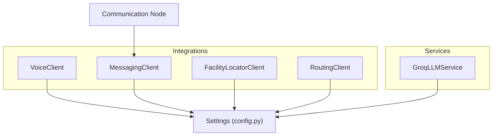
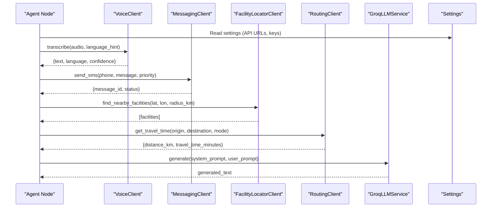
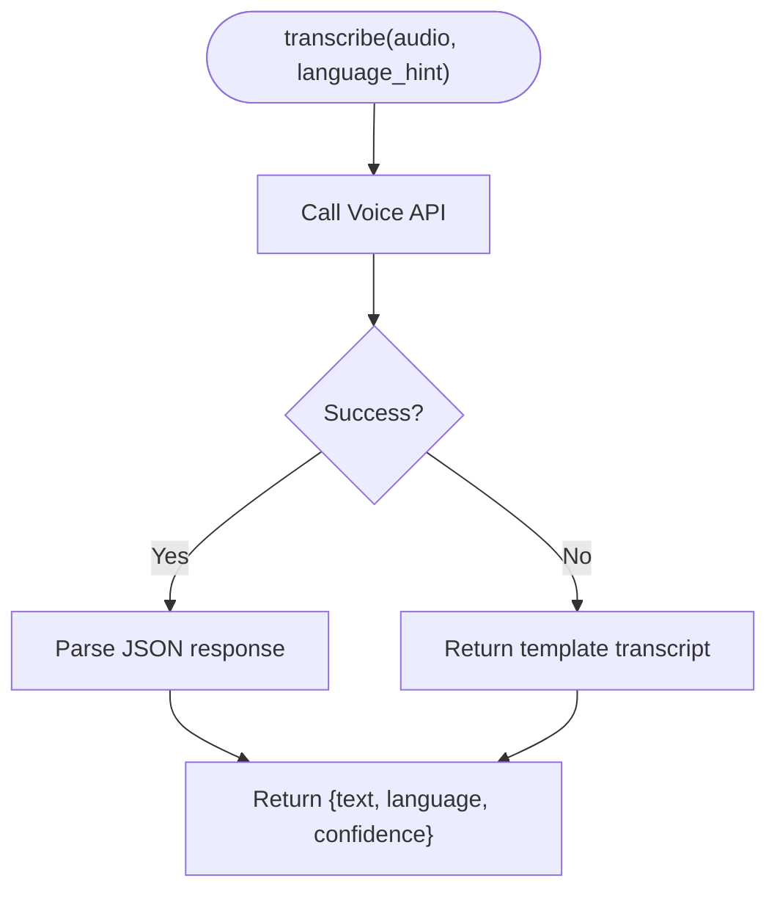
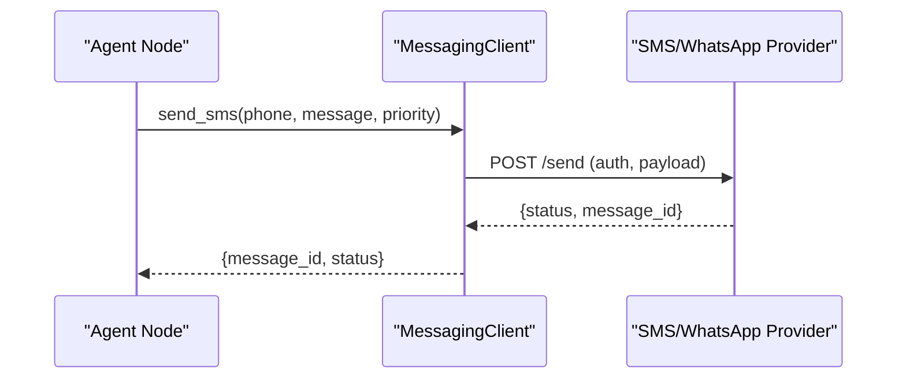
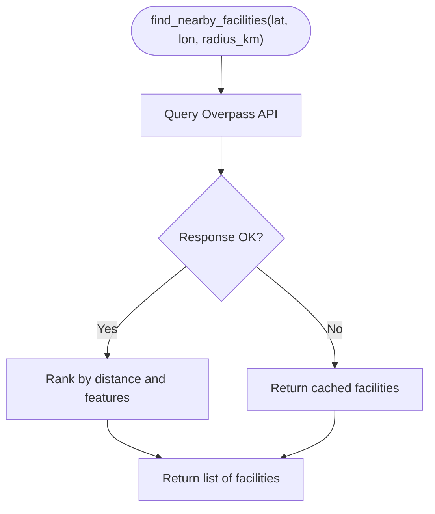
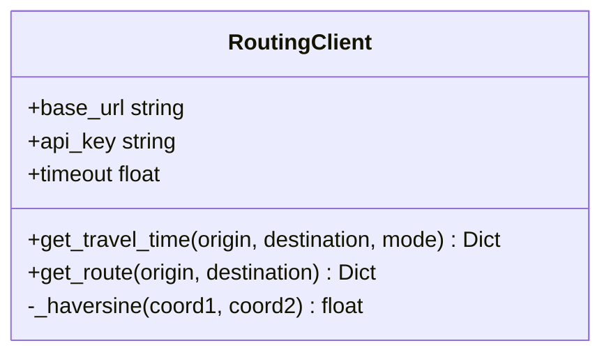
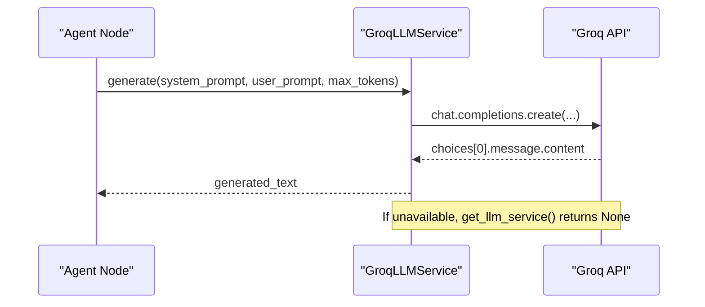
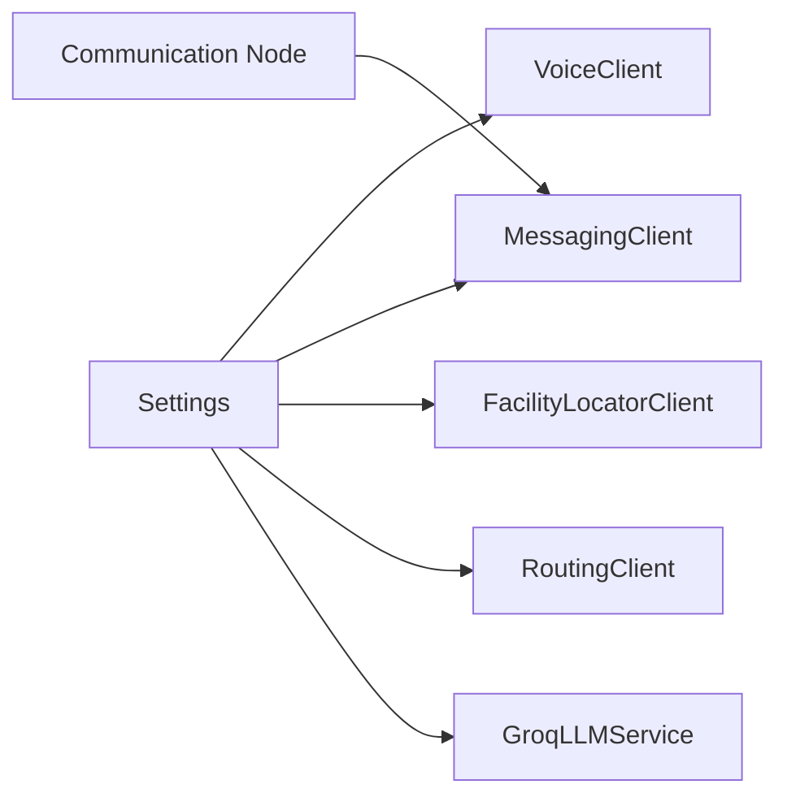

# Integration Services

<cite>
**Referenced Files in This Document**
- [voice_client.py](file://backend/integrations/voice_client.py)
- [messaging_client.py](file://backend/integrations/messaging_client.py)
- [facility_locator.py](file://backend/integrations/facility_locator.py)
- [routing_client.py](file://backend/integrations/routing_client.py)
- [llm.py](file://backend/services/llm.py)
- [config.py](file://backend/config.py)
- [communication.py](file://backend/agents/nodes/communication.py)
- [test_api.py](file://backend/tests/test_api.py)
</cite>

## Table of Contents
1. Introduction
2. Project Structure
3. Core Components
4. Architecture Overview
5. Detailed Component Analysis
6. Dependency Analysis
7. Performance Considerations
8. Troubleshooting Guide
9. Conclusion
10. Appendices

## Introduction
This document explains how MaaHifazat AI integrates with external services to provide voice capabilities, messaging notifications, location and routing assistance, and advanced reasoning via a large language model (LLM). It covers connection protocols, authentication methods, rate limiting considerations, error handling strategies, configuration options, environment variables, fallback mechanisms, testing approaches, monitoring health endpoints, security and privacy considerations for healthcare data, and performance optimization techniques for low-connectivity environments.

## Project Structure
The integration layer is organized under backend/integrations, with each service encapsulated in its own client class. The LLM integration lives under backend/services. Configuration for all external endpoints and keys is centralized in backend/config.py. Agent nodes consume these integrations as needed; for example, the communication node uses the messaging client to send alerts and reminders.

**Diagram sources**
- [voice_client.py:7-12](file://backend/integrations/voice_client.py#L7-L12)
- [messaging_client.py:9-15](file://backend/integrations/messaging_client.py#L9-L15)
- [facility_locator.py:7-12](file://backend/integrations/facility_locator.py#L7-L12)
- [routing_client.py:8-14](file://backend/integrations/routing_client.py#L8-L14)
- [llm.py:31-47](file://backend/services/llm.py#L31-L47)
- [config.py:31-42](file://backend/config.py#L31-L42)
- [communication.py:38-61](file://backend/agents/nodes/communication.py#L38-L61)

**Section sources**
- [config.py:31-42](file://backend/config.py#L31-L42)
- [communication.py:38-61](file://backend/agents/nodes/communication.py#L38-L61)

## Core Components
- VoiceClient: Provides speech-to-text transcription, language detection, and symptom extraction from text. Currently implemented as a stub returning mock results.
- MessagingClient: Sends SMS and WhatsApp messages, supports emergency alerts and reminders, and tracks delivery status in memory for tests.
- FacilityLocatorClient: Finds nearby healthcare facilities using Overpass API concepts; currently returns mock facility lists.
- RoutingClient: Estimates travel time and routes between coordinates using OpenRouteService concepts; includes a haversine distance calculation.
- GroqLLMService: Wraps Groq’s chat completions API for generating clinical summaries, follow-up questions, communications, and reports. Includes guarded import and fallback behavior when unavailable.

Key configuration values include base URLs for voice, facility, routing, and messaging APIs, plus Groq API key and model name.

**Section sources**
- [voice_client.py:7-48](file://backend/integrations/voice_client.py#L7-L48)
- [messaging_client.py:9-78](file://backend/integrations/messaging_client.py#L9-L78)
- [facility_locator.py:7-69](file://backend/integrations/facility_locator.py#L7-L69)
- [routing_client.py:8-71](file://backend/integrations/routing_client.py#L8-L71)
- [llm.py:31-144](file://backend/services/llm.py#L31-L144)
- [config.py:31-42](file://backend/config.py#L31-L42)

## Architecture Overview
The system composes multiple external services behind clean client interfaces. Agents call these clients to perform tasks such as transcribing audio, sending alerts, locating facilities, estimating travel times, and generating text via LLMs. All external endpoints are configured centrally and can be overridden via environment variables.

**Diagram sources**
- [voice_client.py:14-22](file://backend/integrations/voice_client.py#L14-L22)
- [messaging_client.py:17-43](file://backend/integrations/messaging_client.py#L17-L43)
- [facility_locator.py:14-60](file://backend/integrations/facility_locator.py#L14-L60)
- [routing_client.py:16-59](file://backend/integrations/routing_client.py#L16-L59)
- [llm.py:48-65](file://backend/services/llm.py#L48-L65)
- [config.py:31-42](file://backend/config.py#L31-L42)

## Detailed Component Analysis

### Voice Client (Text-to-Speech / Speech Recognition)
- Purpose: Transcribe audio to text, detect language, and extract symptoms from free-form text.
- Connection protocol: HTTP-based client using httpx; base URL comes from settings.VOICE_API_URL.
- Authentication: Not implemented in stub; would typically use API key or bearer token passed via headers.
- Rate limiting: Not implemented; add retry/backoff and request throttling when integrating real provider.
- Error handling: Stub always succeeds; production should handle network errors, timeouts, and invalid responses.
- Fallback: If voice API is down, return cached or template-based transcripts and continue pipeline.
- Testing: Use unit tests that assert expected fields in response; mock httpx calls for real providers.

**Diagram sources**
- [voice_client.py:14-22](file://backend/integrations/voice_client.py#L14-L22)

**Section sources**
- [voice_client.py:7-48](file://backend/integrations/voice_client.py#L7-L48)
- [config.py:31-35](file://backend/config.py#L31-L35)

### Messaging Client (SMS and WhatsApp)
- Purpose: Send SMS and WhatsApp messages, emergency alerts, and reminders; track delivery status.
- Connection protocol: HTTP-based client using httpx; base URL from settings.MESSAGING_API_URL.
- Authentication: Not implemented in stub; integrate provider-specific auth (e.g., Twilio credentials).
- Rate limiting: Not implemented; implement per-channel quotas and backoff on 429 responses.
- Error handling: Stub always returns delivered; production should handle failures and retries.
- Fallback: If messaging is unavailable, queue messages locally and retry later; log failures.
- Testing: In-memory message log allows assertions on sent messages and statuses.

**Diagram sources**
- [messaging_client.py:17-43](file://backend/integrations/messaging_client.py#L17-L43)

**Section sources**
- [messaging_client.py:9-78](file://backend/integrations/messaging_client.py#L9-L78)
- [config.py:31-35](file://backend/config.py#L31-L35)

### Facility Locator (Overpass API)
- Purpose: Find nearby healthcare facilities within a radius; return ranked list with attributes like emergency, maternity, NICU availability, and current load.
- Connection protocol: HTTP GET to Overpass API endpoint defined by settings.FACILITY_API_URL.
- Authentication: Typically none for public Overpass; may require rate-limiting headers or tokens depending on deployment.
- Rate limiting: Respect provider limits; implement exponential backoff and caching of frequent queries.
- Error handling: Handle malformed responses and timeouts; return empty list and log errors.
- Fallback: Provide cached facility list if offline; prioritize high-capacity facilities with emergency services.

**Diagram sources**
- [facility_locator.py:14-60](file://backend/integrations/facility_locator.py#L14-L60)

**Section sources**
- [facility_locator.py:7-69](file://backend/integrations/facility_locator.py#L7-L69)
- [config.py:31-35](file://backend/config.py#L31-L35)

### Routing Client (OpenRouteService)
- Purpose: Estimate travel time and route between origin and destination; support driving, walking, ambulance modes.
- Connection protocol: HTTP-based client using httpx; base URL from settings.ROUTING_API_URL.
- Authentication: Supports optional api_key parameter; pass provider-specific key when integrating.
- Rate limiting: Implement request throttling and retry on 429; cache frequent routes.
- Error handling: Handle network errors and invalid coordinates; return minimal route info and log issues.
- Fallback: Use straight-line distance and average speeds to estimate travel time when provider is down.

**Diagram sources**
- [routing_client.py:8-71](file://backend/integrations/routing_client.py#L8-L71)

**Section sources**
- [routing_client.py:8-71](file://backend/integrations/routing_client.py#L8-L71)
- [config.py:31-35](file://backend/config.py#L31-L35)

### LLM Service (Groq API)
- Purpose: Generate clinical risk summaries, follow-up questions, patient/staff messages, case summaries, and analytics reports.
- Connection protocol: Uses Groq SDK to call chat completions; timeout set in client initialization.
- Authentication: Reads GROQ_API_KEY from settings; model selected via GROQ_MODEL.
- Rate limiting: Not implemented; add request pacing and retry logic respecting provider quotas.
- Error handling: Guarded import ensures app continues without groq package; raises ValueError on empty completion; get_llm_service returns None if unavailable.
- Fallback: Callers must treat LLM generation as optional; fall back to templates when service is unavailable.

**Diagram sources**
- [llm.py:48-65](file://backend/services/llm.py#L48-L65)
- [llm.py:129-143](file://backend/services/llm.py#L129-L143)

**Section sources**
- [llm.py:20-65](file://backend/services/llm.py#L20-L65)
- [llm.py:129-143](file://backend/services/llm.py#L129-L143)
- [config.py:37-42](file://backend/config.py#L37-L42)

## Dependency Analysis
External clients depend on central configuration for endpoints and keys. Agent nodes consume these clients to orchestrate workflows. The communication node demonstrates usage of MessagingClient to send alerts and reminders based on state context.

**Diagram sources**
- [config.py:31-42](file://backend/config.py#L31-L42)
- [communication.py:38-61](file://backend/agents/nodes/communication.py#L38-L61)

**Section sources**
- [config.py:31-42](file://backend/config.py#L31-L42)
- [communication.py:38-61](file://backend/agents/nodes/communication.py#L38-L61)

## Performance Considerations
- Caching: Cache frequent facility lookups and route estimates to reduce latency and provider costs.
- Timeouts: Configure reasonable timeouts per client to avoid blocking long-running requests.
- Retries: Implement exponential backoff for transient errors (network timeouts, 5xx responses).
- Concurrency: Use async calls where possible to parallelize independent operations (e.g., facility search and routing).
- Low-connectivity: Prefer local fallbacks (templates, cached data) when external services are unreachable.
- Monitoring: Track success rates and latencies for each integration to identify bottlenecks.

[No sources needed since this section provides general guidance]

## Troubleshooting Guide
- LLM unavailability: If groq package is missing or API key is invalid, get_llm_service returns None; callers should fall back to templates.
- Messaging failures: Check base URL and credentials; verify delivery status via get_delivery_status; queue failed messages for retry.
- Facility lookup errors: Validate coordinates and radius; handle malformed Overpass responses; use cached facility list as fallback.
- Routing errors: Ensure valid coordinate pairs; handle provider rate limits; fall back to estimated travel time using haversine distance and average speeds.
- Health checks: Use application health endpoints to verify overall system status; tests demonstrate health and model health endpoints.

**Section sources**
- [llm.py:20-28](file://backend/services/llm.py#L20-L28)
- [llm.py:129-143](file://backend/services/llm.py#L129-L143)
- [messaging_client.py:61-66](file://backend/integrations/messaging_client.py#L61-L66)
- [routing_client.py:61-71](file://backend/integrations/routing_client.py#L61-L71)
- [test_api.py:12-19](file://backend/tests/test_api.py#L12-L19)
- [test_api.py:115-128](file://backend/tests/test_api.py#L115-L128)

## Conclusion
MaaHifazat AI’s integration layer abstracts external services behind consistent interfaces, enabling robust workflows for voice processing, messaging, location discovery, routing, and LLM-powered reasoning. Centralized configuration simplifies environment setup, while stub implementations allow development and testing without live providers. Production deployments should add authentication, rate limiting, retries, caching, and comprehensive error handling to ensure reliability and compliance in healthcare contexts.

[No sources needed since this section summarizes without analyzing specific files]

## Appendices

### Environment Variables and Configuration
- External API URLs:
  - VOICE_API_URL
  - FACILITY_API_URL
  - ROUTING_API_URL
  - MESSAGING_API_URL
- LLM Settings:
  - GROQ_API_KEY
  - GROQ_MODEL
- App Settings:
  - APP_NAME
  - APP_VERSION
  - DEBUG

These are defined in Settings and loaded from .env file.

**Section sources**
- [config.py:31-42](file://backend/config.py#L31-L42)
- [config.py:49-51](file://backend/config.py#L49-L51)

### Security and Privacy Considerations
- API Keys: Store secrets in environment variables; never hardcode keys in code.
- Data Privacy: Minimize transmission of PHI; encrypt payloads in transit; redact sensitive fields in logs.
- Compliance: Follow healthcare regulations (e.g., HIPAA) for data handling, consent, and auditability.
- Access Control: Restrict access to integration endpoints; validate inputs; enforce least privilege.

[No sources needed since this section provides general guidance]

### Testing Third-Party Connections
- Unit Tests: Assert client methods return expected structures; mock HTTP calls for providers.
- Integration Tests: Use test DB and mocked external services to validate end-to-end flows.
- Health Checks: Verify application health endpoints and model health endpoints in tests.

**Section sources**
- [test_api.py:12-19](file://backend/tests/test_api.py#L12-L19)
- [test_api.py:115-128](file://backend/tests/test_api.py#L115-L128)

### Monitoring Service Health
- Expose health endpoints to report status of models and integrations.
- Log errors and warnings for each integration; track metrics like latency and success rate.
- Alert on critical failures (e.g., LLM unavailable, messaging failures).

**Section sources**
- [test_api.py:12-19](file://backend/tests/test_api.py#L12-L19)
- [test_api.py:115-128](file://backend/tests/test_api.py#L115-L128)