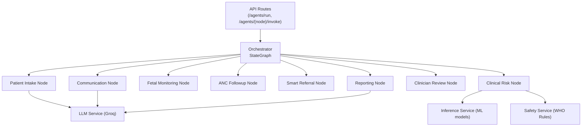
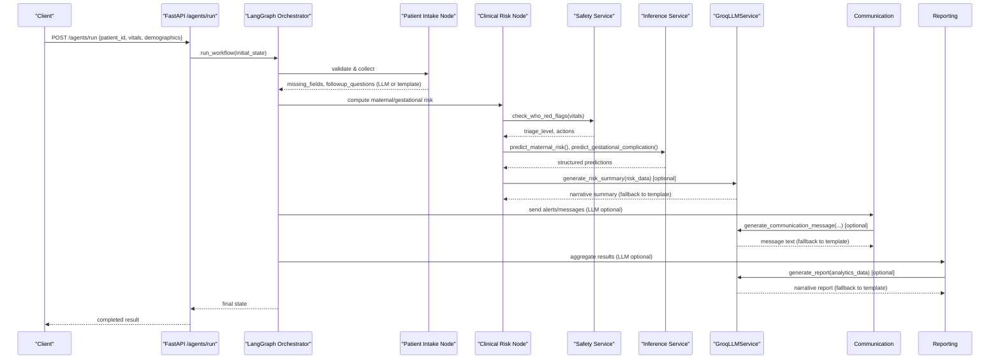
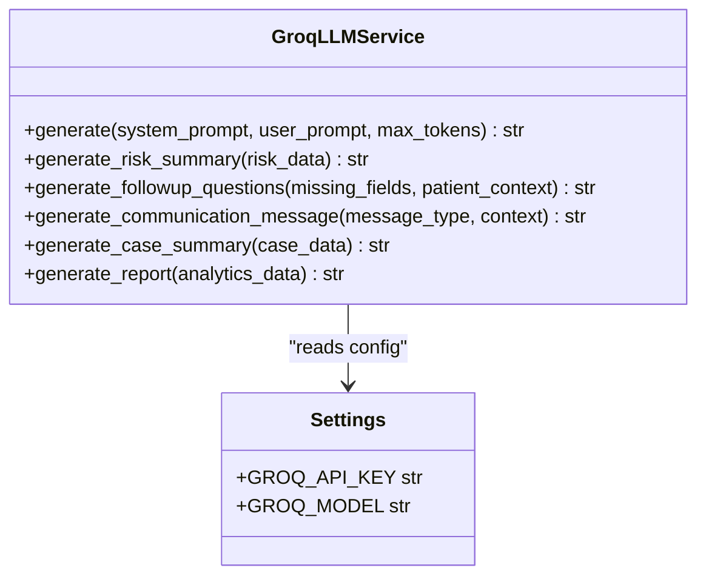
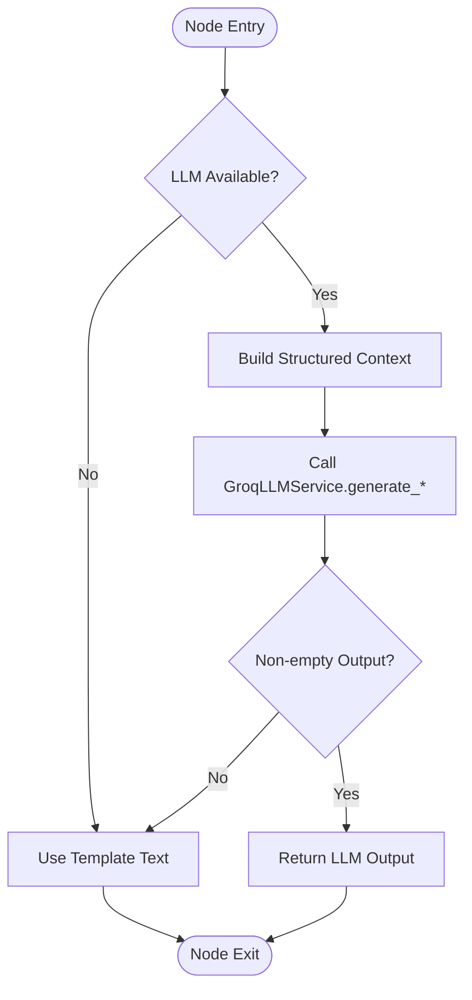
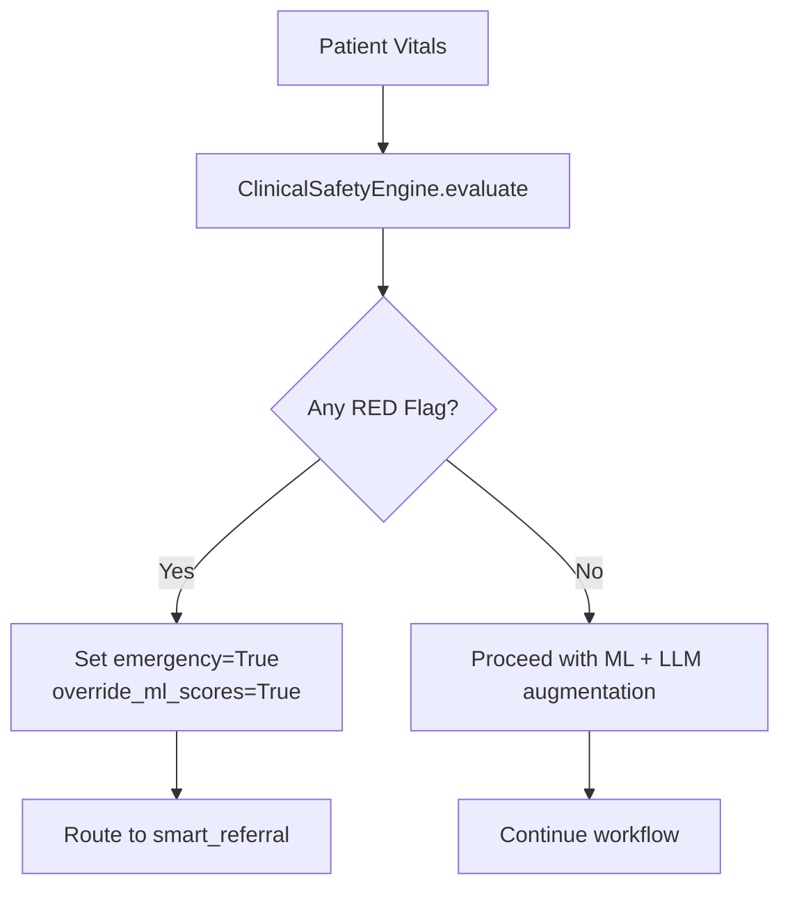
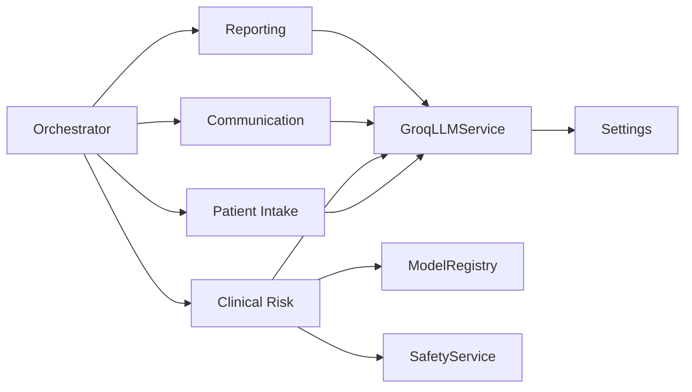

# Large Language Model Integration

<cite>
**Referenced Files in This Document**
- [llm.py](file://backend/services/llm.py)
- [config.py](file://backend/config.py)
- [inference.py](file://backend/services/inference.py)
- [safety_rules.py](file://safety_rules.py)
- [safety.py](file://backend/services/safety.py)
- [orchestrator.py](file://backend/agents/orchestrator.py)
- [patient_intake.py](file://backend/agents/nodes/patient_intake.py)
- [clinical_risk.py](file://backend/agents/nodes/clinical_risk.py)
- [communication.py](file://backend/agents/nodes/communication.py)
- [reporting.py](file://backend/agents/nodes/reporting.py)
- [agents.py](file://backend/api/routes/agents.py)
- [state.py](file://backend/schemas/state.py)
</cite>

## Table of Contents
1. [Introduction](#introduction)
2. [Project Structure](#project-structure)
3. [Core Components](#core-components)
4. [Architecture Overview](#architecture-overview)
5. [Detailed Component Analysis](#detailed-component-analysis)
6. [Dependency Analysis](#dependency-analysis)
7. [Performance Considerations](#performance-considerations)
8. [Troubleshooting Guide](#troubleshooting-guide)
9. [Conclusion](#conclusion)
10. [Appendices](#appendices)

## Introduction
This document explains how MaaHifazat AI integrates Large Language Models via the Groq API to support clinical decision support, medical literature-informed prompts, and treatment recommendation generation within a multi-agent workflow. The system uses a robust LLM service layer that is optional: if Groq is unavailable, all nodes fall back to deterministic templates while preserving safety-critical logic. The integration emphasizes safety guardrails (WHO-based triage), hallucination prevention (structured inputs, bounded outputs), and performance optimization (non-blocking calls, minimal tokens).

## Project Structure
The LLM integration spans configuration, a dedicated LLM service, agent nodes that consume it, and an orchestrator that wires the workflow. Key areas:
- Configuration for model selection and API keys
- LLM service wrapper around Groq chat completions
- Agent nodes using LLM for follow-up questions, risk summaries, communication messages, and reports
- Safety engine ensuring deterministic red-flag detection overrides ML and LLM outputs when needed
- Orchestrator routing based on safety and model results

**Diagram sources**
- [agents.py:62-114](file://backend/api/routes/agents.py#L62-L114)
- [orchestrator.py:62-138](file://backend/agents/orchestrator.py#L62-L138)
- [llm.py:31-65](file://backend/services/llm.py#L31-L65)
- [inference.py:51-141](file://backend/services/inference.py#L51-L141)
- [safety.py:18-67](file://backend/services/safety.py#L18-L67)

**Section sources**
- [agents.py:62-114](file://backend/api/routes/agents.py#L62-L114)
- [orchestrator.py:62-138](file://backend/agents/orchestrator.py#L62-L138)

## Core Components
- GroqLLMService: Thin wrapper over Groq chat completions with guarded import, temperature control, reasoning effort for specific model prefixes, and specialized helpers for risk summaries, follow-up questions, communication messages, case summaries, and analytics reports.
- Settings: Centralized configuration including GROQ_API_KEY and GROQ_MODEL; supports environment overrides via .env.
- SafetyService + ClinicalSafetyEngine: Deterministic WHO-based triage rules that always run and can override ML scores and escalate emergencies.
- Inference Service: Loads and runs ML models (MaternalGuard, GestationInsight, FetalWatch, PretermGuard, CareReach) and provides structured predictions used as context for LLM prompts.
- Agent Nodes: Use LLM optionally for text generation; each node has fallback templates and logs whether output was LLM-generated.
- Orchestrator: LangGraph StateGraph wiring nodes and conditional routing based on intake completeness, emergency flags, and data presence.

**Section sources**
- [llm.py:31-144](file://backend/services/llm.py#L31-L144)
- [config.py:7-55](file://backend/config.py#L7-L55)
- [safety_rules.py:72-167](file://safety_rules.py#L72-L167)
- [inference.py:51-435](file://backend/services/inference.py#L51-L435)
- [patient_intake.py:14-55](file://backend/agents/nodes/patient_intake.py#L14-L55)
- [clinical_risk.py:15-127](file://backend/agents/nodes/clinical_risk.py#L15-L127)
- [communication.py:14-35](file://backend/agents/nodes/communication.py#L14-L35)
- [reporting.py:13-173](file://backend/agents/nodes/reporting.py#L13-L173)
- [orchestrator.py:22-55](file://backend/agents/orchestrator.py#L22-L55)

## Architecture Overview
The architecture combines deterministic safety and ML inference with optional LLM text generation. The flow ensures patient safety first (WHO rules), then augments outputs with LLM narratives where appropriate. All LLM calls are wrapped to avoid blocking the event loop and to gracefully degrade to templates.

**Diagram sources**
- [agents.py:62-114](file://backend/api/routes/agents.py#L62-L114)
- [orchestrator.py:62-138](file://backend/agents/orchestrator.py#L62-L138)
- [patient_intake.py:14-55](file://backend/agents/nodes/patient_intake.py#L14-L55)
- [clinical_risk.py:15-127](file://backend/agents/nodes/clinical_risk.py#L15-L127)
- [communication.py:14-35](file://backend/agents/nodes/communication.py#L14-L35)
- [reporting.py:132-152](file://backend/agents/nodes/reporting.py#L132-L152)
- [llm.py:48-119](file://backend/services/llm.py#L48-L119)

## Detailed Component Analysis

### LLM Service (GroqLLMService)
- Guarded import of groq package; raises informative error if not installed.
- Uses Settings to initialize client with API key and timeout; selects model from config.
- generate method builds system/user messages, sets max_tokens and temperature, and adds reasoning_effort for specific model prefixes.
- Specialized methods:
  - generate_risk_summary: plain-language clinical risk summaries in English and Roman Urdu.
  - generate_followup_questions: culturally-sensitive questions for missing fields.
  - generate_communication_message: empathetic patient/staff messages.
  - generate_case_summary: structured clinician review summaries.
  - generate_report: concise analytics/dashboard summaries.
- Shared accessor get_llm_service returns a singleton or None if unavailable.

**Diagram sources**
- [llm.py:31-119](file://backend/services/llm.py#L31-L119)
- [config.py:37-42](file://backend/config.py#L37-L42)

**Section sources**
- [llm.py:20-65](file://backend/services/llm.py#L20-L65)
- [llm.py:67-119](file://backend/services/llm.py#L67-L119)
- [llm.py:126-144](file://backend/services/llm.py#L126-L144)
- [config.py:37-42](file://backend/config.py#L37-L42)

### Prompt Engineering Strategies
- System prompts define role and tone (e.g., maternal health assistant, healthcare communication assistant).
- User prompts inject structured context (vitals, demographics, model outputs, triage results).
- Temperature set to 0.3 for consistency; max_tokens tuned per use case (e.g., 512 for questions, 1500 for case summaries).
- Reasoning effort parameter enabled for specific model prefixes to balance speed and quality.
- Outputs validated by checking non-empty content; empty responses raise errors to trigger fallbacks.

**Section sources**
- [llm.py:48-65](file://backend/services/llm.py#L48-L65)
- [llm.py:67-119](file://backend/services/llm.py#L67-L119)

### Response Processing Pipelines
- Patient Intake:
  - If voice audio present, transcribe and extract symptoms.
  - Validate required vital fields; generate follow-up questions via LLM or template.
  - Track llm_generated flag for auditability.
- Clinical Risk:
  - Always run WHO safety rules; set emergency flag if RED triage.
  - Run ML predictions (maternal, gestational) and combine into structured risk_data.
  - Optionally generate human-readable risk summary via LLM; fallback to template.
- Communication:
  - Determine message type (emergency alert, referral notification, ANC reminder, status update).
  - Generate message via LLM with context; fallback to template if LLM unavailable.
  - Send via MessagingClient (SMS/WhatsApp/emergency) and log delivery status.
- Reporting:
  - Aggregate structured results into case_summary and dashboard_data.
  - Optionally generate narrative report via LLM; fallback to template.

**Diagram sources**
- [patient_intake.py:14-55](file://backend/agents/nodes/patient_intake.py#L14-L55)
- [clinical_risk.py:67-92](file://backend/agents/nodes/clinical_risk.py#L67-L92)
- [communication.py:14-35](file://backend/agents/nodes/communication.py#L14-L35)
- [reporting.py:132-152](file://backend/agents/nodes/reporting.py#L132-L152)

**Section sources**
- [patient_intake.py:58-168](file://backend/agents/nodes/patient_intake.py#L58-L168)
- [clinical_risk.py:15-127](file://backend/agents/nodes/clinical_risk.py#L15-L127)
- [communication.py:38-231](file://backend/agents/nodes/communication.py#L38-L231)
- [reporting.py:13-173](file://backend/agents/nodes/reporting.py#L13-L173)

### Safety Guardrails and Hallucination Prevention
- WHO ClinicalSafetyEngine evaluates red/yellow/orange/green triage levels deterministically.
- If any red flag triggers, override_ml_scores is set and emergency escalation occurs.
- LLM outputs are supplementary; core decisions rely on safety rules and ML predictions.
- Structured prompts minimize hallucinations by providing precise context and bounded outputs.

**Diagram sources**
- [safety_rules.py:89-167](file://safety_rules.py#L89-L167)
- [clinical_risk.py:39-58](file://backend/agents/nodes/clinical_risk.py#L39-L58)
- [orchestrator.py:34-41](file://backend/agents/orchestrator.py#L34-L41)

**Section sources**
- [safety_rules.py:72-167](file://safety_rules.py#L72-L167)
- [safety.py:18-67](file://backend/services/safety.py#L18-L67)
- [clinical_risk.py:39-58](file://backend/agents/nodes/clinical_risk.py#L39-L58)

### Configuration Options
- Model selection: GROQ_MODEL defaults to openai/gpt-oss-120b; can be overridden via environment.
- API key: GROQ_API_KEY configured in Settings; loaded from .env file.
- Temperature: Fixed at 0.3 for stable outputs.
- Max tokens: Tuned per method (e.g., 512 for questions, 1500 for case summaries).
- Reasoning effort: Enabled for specific model prefixes to optimize latency.

**Section sources**
- [config.py:37-42](file://backend/config.py#L37-L42)
- [llm.py:48-65](file://backend/services/llm.py#L48-L65)

### Examples of Implementation Scenarios
- Clinical note summarization:
  - Use generate_case_summary with structured case_data including vitals, model outputs, and triage results.
  - Path reference: [llm.py:101-110](file://backend/services/llm.py#L101-L110)
- Drug interaction checking:
  - Not directly implemented; recommended approach: construct user prompt with drug list and clinical context, call generate with domain-specific system prompt, and validate output against known references before presenting to clinicians.
- Evidence-based treatment suggestions:
  - Use generate_risk_summary or generate_communication_message with evidence-backed context; ensure LLM outputs are reviewed by clinicians and never replace safety rules.

[No sources needed since this section provides general guidance without analyzing specific files]

## Dependency Analysis
- Orchestrator depends on agent nodes; nodes depend on LLM service, inference service, and safety service.
- LLM service depends on Settings for configuration.
- Safety service wraps ClinicalSafetyEngine for deterministic triage.
- Inference service loads ML models and provides structured predictions used as LLM context.

**Diagram sources**
- [orchestrator.py:62-138](file://backend/agents/orchestrator.py#L62-L138)
- [llm.py:31-65](file://backend/services/llm.py#L31-L65)
- [inference.py:51-141](file://backend/services/inference.py#L51-L141)
- [safety.py:18-67](file://backend/services/safety.py#L18-L67)

**Section sources**
- [orchestrator.py:62-138](file://backend/agents/orchestrator.py#L62-L138)
- [llm.py:31-65](file://backend/services/llm.py#L31-L65)
- [inference.py:51-141](file://backend/services/inference.py#L51-L141)
- [safety.py:18-67](file://backend/services/safety.py#L18-L67)

## Performance Considerations
- Non-blocking LLM calls: Each node uses asyncio.to_thread to run synchronous Groq calls without blocking the event loop.
- Minimal token budgets: max_tokens tuned per use case to reduce latency and cost.
- Optional LLM: Nodes continue functioning with templates if LLM is unavailable.
- Structured context: Providing precise inputs reduces retries and improves response quality.
- Caching: No explicit LLM response caching is implemented; consider adding memoization for repeated queries in high-throughput scenarios.
- Streaming: Not currently implemented; could be added by leveraging Groq streaming APIs for real-time updates.
- Batch processing: Not implemented; consider batching multiple queries to reduce overhead.

[No sources needed since this section provides general guidance]

## Troubleshooting Guide
- LLM unavailable:
  - Symptom: llm_generated=False across nodes; fallback templates used.
  - Action: Verify groq package installation and GROQ_API_KEY/GROQ_MODEL settings.
  - Reference: [llm.py:20-28](file://backend/services/llm.py#L20-L28), [llm.py:126-144](file://backend/services/llm.py#L126-L144)
- Empty LLM output:
  - Symptom: ValueError raised for empty completion.
  - Action: Ensure prompt structure and context; adjust max_tokens or temperature.
  - Reference: [llm.py:62-65](file://backend/services/llm.py#L62-L65)
- Safety override:
  - Symptom: Emergency flagged despite low ML risk.
  - Action: Review WHO triage rules; ensure vitals are accurate.
  - Reference: [safety_rules.py:119-122](file://safety_rules.py#L119-L122), [clinical_risk.py:39-58](file://backend/agents/nodes/clinical_risk.py#L39-L58)
- Message delivery failures:
  - Symptom: Delivery status not "delivered".
  - Action: Check messaging client configuration and recipient numbers.
  - Reference: [communication.py:180-194](file://backend/agents/nodes/communication.py#L180-L194)

**Section sources**
- [llm.py:20-28](file://backend/services/llm.py#L20-L28)
- [llm.py:62-65](file://backend/services/llm.py#L62-L65)
- [safety_rules.py:119-122](file://safety_rules.py#L119-L122)
- [clinical_risk.py:39-58](file://backend/agents/nodes/clinical_risk.py#L39-L58)
- [communication.py:180-194](file://backend/agents/nodes/communication.py#L180-L194)

## Conclusion
MaaHifazat AI’s LLM integration via Groq enhances clinical workflows with flexible, context-aware text generation while maintaining safety through deterministic WHO-based triage and structured ML predictions. The design ensures resilience by making LLM usage optional and providing robust fallbacks. Future enhancements may include response caching, streaming, and batch processing to improve scalability and responsiveness.

[No sources needed since this section summarizes without analyzing specific files]

## Appendices

### Security Considerations
- Patient data privacy: Avoid embedding sensitive identifiers in prompts; use anonymized IDs where possible.
- Prompt injection prevention: Sanitize user inputs before constructing prompts; validate and constrain allowed fields.
- Compliance: Ensure LLM outputs are reviewed by qualified clinicians; maintain audit trails for all generated content.
- Access control: API routes enforce authentication and role-based access for workflow execution.

**Section sources**
- [agents.py:62-114](file://backend/api/routes/agents.py#L62-L114)
- [state.py:7-43](file://backend/schemas/state.py#L7-L43)