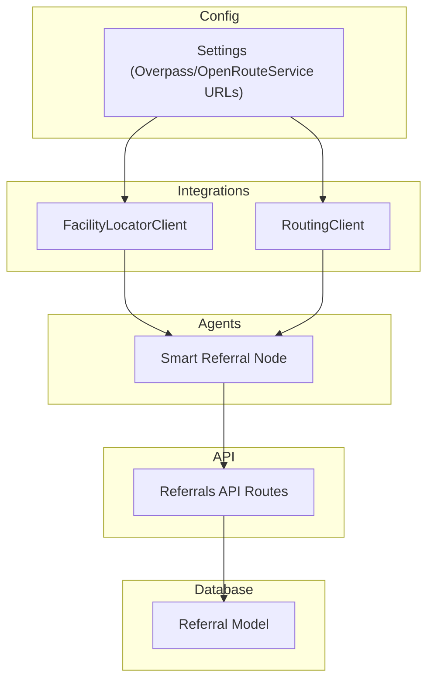
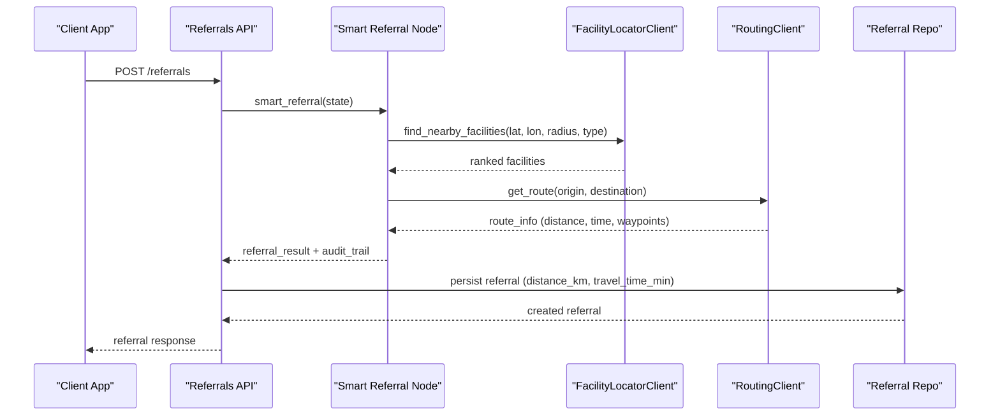
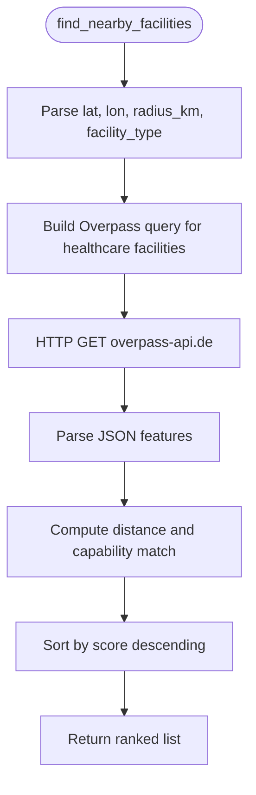
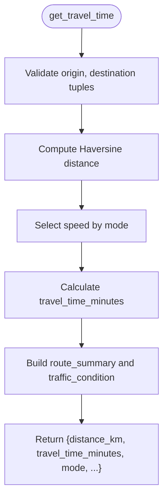
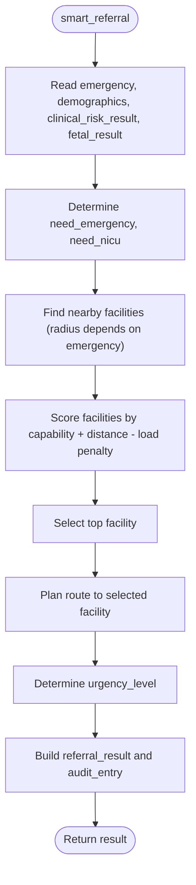
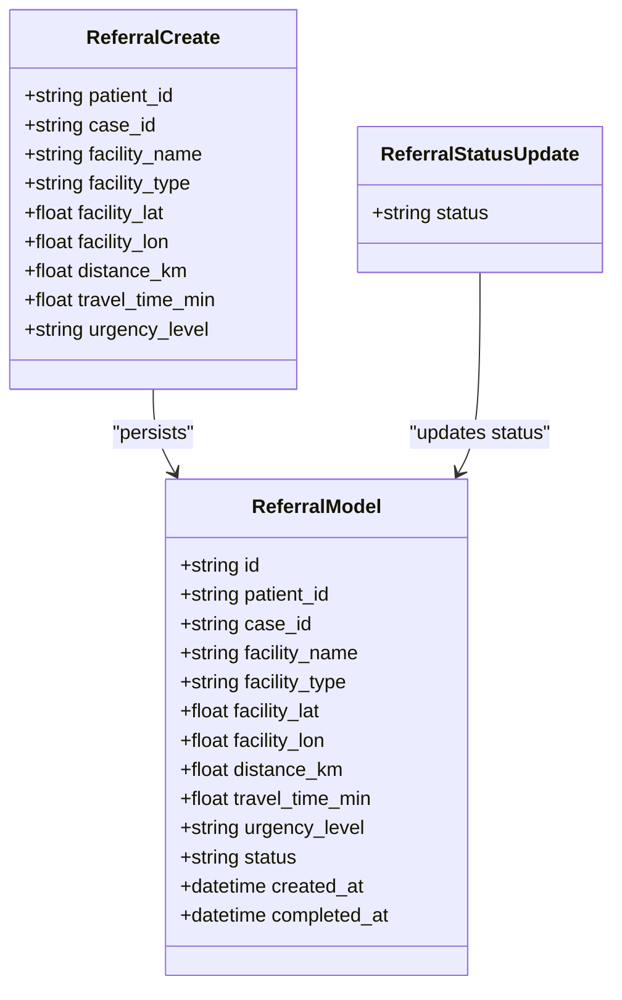
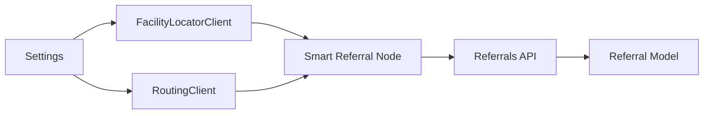

# Location & Routing Services

<cite>
**Referenced Files in This Document**
- [facility_locator.py](file://backend/integrations/facility_locator.py)
- [routing_client.py](file://backend/integrations/routing_client.py)
- [config.py](file://backend/config.py)
- [smart_referral.py](file://backend/agents/nodes/smart_referral.py)
- [referrals.py](file://backend/api/routes/referrals.py)
- [models.py](file://backend/db/models.py)
</cite>

## Table of Contents
1. [Introduction](#introduction)
2. [Project Structure](#project-structure)
3. [Core Components](#core-components)
4. [Architecture Overview](#architecture-overview)
5. [Detailed Component Analysis](#detailed-component-analysis)
6. [Dependency Analysis](#dependency-analysis)
7. [Performance Considerations](#performance-considerations)
8. [Troubleshooting Guide](#troubleshooting-guide)
9. [Conclusion](#conclusion)
10. [Appendices](#appendices)

## Introduction
This document explains how MaaHifazat AI integrates location and routing services to support healthcare facility discovery, smart referrals, and route planning for emergency and routine care in Pakistan. It covers:
- Facility discovery using Overpass API (planned integration) with a current stub implementation
- Distance calculations and route planning via OpenRouteService (current stub with Haversine-based estimates)
- The facility locator architecture, geocoding concepts, and search algorithms for matching patient needs to facilities
- Routing algorithms for optimal path calculation considering road conditions, traffic patterns, and accessibility factors
- Configuration options for map providers, coordinate systems, and geographic boundaries specific to Pakistan
- Examples of implementing smart referral routing, travel time estimation, and navigation instructions
- Caching strategies for frequently accessed locations, offline map support, and fallback routing options
- Accuracy considerations, coordinate transformation, and integration with GPS devices used by healthcare workers

## Project Structure
The location and routing functionality is implemented as modular integrations that are consumed by the smart referral agent and exposed through API routes. Key files:
- Integrations layer: facility discovery and routing clients
- Agent node: smart referral orchestration combining facility search, ranking, and routing
- API routes: referral management endpoints
- Configuration: external service URLs and environment settings
- Database models: storing referral outcomes including distance and travel time

**Diagram sources**
- [facility_locator.py:7-68](file://backend/integrations/facility_locator.py#L7-L68)
- [routing_client.py:8-70](file://backend/integrations/routing_client.py#L8-L70)
- [smart_referral.py:11-118](file://backend/agents/nodes/smart_referral.py#L11-L118)
- [referrals.py:60-126](file://backend/api/routes/referrals.py#L60-L126)
- [config.py:31-35](file://backend/config.py#L31-L35)
- [models.py:52-68](file://backend/db/models.py#L52-L68)

**Section sources**
- [facility_locator.py:1-69](file://backend/integrations/facility_locator.py#L1-L69)
- [routing_client.py:1-71](file://backend/integrations/routing_client.py#L1-L71)
- [smart_referral.py:1-136](file://backend/agents/nodes/smart_referral.py#L1-L136)
- [referrals.py:1-126](file://backend/api/routes/referrals.py#L1-L126)
- [config.py:1-55](file://backend/config.py#L1-L55)
- [models.py:1-115](file://backend/db/models.py#L1-L115)

## Core Components
- FacilityLocatorClient: Provides nearby healthcare facility discovery. Currently returns mock data near Peshawar, KP; configured to use Overpass API URL from settings.
- RoutingClient: Estimates travel time and generates route summaries. Uses Haversine distance and mode-specific speeds; configured to use OpenRouteService URL from settings.
- Smart Referral Node: Orchestrates facility search, capability-based ranking, urgency determination, and route planning; produces referral results and audit entries.
- Referrals API: Exposes endpoints to create, list, retrieve, and update referral status; stores distance_km and travel_time_min alongside facility coordinates.
- Settings: Centralized configuration for external APIs (Overpass, OpenRouteService), paths, and app metadata.

**Section sources**
- [facility_locator.py:7-68](file://backend/integrations/facility_locator.py#L7-L68)
- [routing_client.py:8-70](file://backend/integrations/routing_client.py#L8-L70)
- [smart_referral.py:11-118](file://backend/agents/nodes/smart_referral.py#L11-L118)
- [referrals.py:60-126](file://backend/api/routes/referrals.py#L60-L126)
- [config.py:31-35](file://backend/config.py#L31-L35)

## Architecture Overview
The system composes facility discovery and routing into a smart referral workflow:
- Patient demographics include latitude/longitude (defaulting to Peshawar region if missing).
- Capability requirements are derived from emergency flags and fetal risk outputs.
- Nearby facilities are retrieved and scored based on capabilities and distance.
- The top-ranked facility is selected and routed to via the routing client.
- Results include urgency level, ranked facilities, selected facility, route info, and estimated travel time.

**Diagram sources**
- [smart_referral.py:11-118](file://backend/agents/nodes/smart_referral.py#L11-L118)
- [facility_locator.py:14-68](file://backend/integrations/facility_locator.py#L14-L68)
- [routing_client.py:16-59](file://backend/integrations/routing_client.py#L16-L59)
- [referrals.py:60-126](file://backend/api/routes/referrals.py#L60-L126)
- [models.py:52-68](file://backend/db/models.py#L52-L68)

## Detailed Component Analysis

### Facility Locator (Overpass API Integration)
- Purpose: Discover nearby healthcare facilities within a configurable radius and type filter.
- Current behavior: Returns mock facilities near Peshawar, KP with attributes like has_emergency, has_maternity, has_nicu, current_load, and precomputed distance_km.
- Configuration: Base URL set to Overpass API interpreter endpoint via settings.
- Extensibility: Replace mock return with actual Overpass queries to fetch real facilities; compute distances server-side or client-side; add caching for frequent searches.

**Diagram sources**
- [facility_locator.py:14-68](file://backend/integrations/facility_locator.py#L14-L68)
- [config.py:33](file://backend/config.py#L33)

**Section sources**
- [facility_locator.py:1-69](file://backend/integrations/facility_locator.py#L1-L69)
- [config.py:31-35](file://backend/config.py#L31-L35)

### Routing Client (OpenRouteService Integration)
- Purpose: Estimate travel time and generate route summaries between origin and destination.
- Current behavior: Uses Haversine formula to compute straight-line distance; applies mode-specific average speeds (driving, walking, ambulance) calibrated for KP road conditions; returns distance_km, travel_time_minutes, mode, route_summary, traffic_condition.
- Route generation: get_route wraps get_travel_time and adds start/end waypoints.
- Configuration: Base URL set to OpenRouteService API via settings; supports optional api_key and timeout.

**Diagram sources**
- [routing_client.py:16-44](file://backend/integrations/routing_client.py#L16-L44)
- [routing_client.py:61-70](file://backend/integrations/routing_client.py#L61-L70)
- [config.py:34](file://backend/config.py#L34)

**Section sources**
- [routing_client.py:1-71](file://backend/integrations/routing_client.py#L1-L71)
- [config.py:31-35](file://backend/config.py#L31-L35)

### Smart Referral Orchestration
- Inputs: Emergency flag, demographics (including lat/lon), clinical risk result, fetal result.
- Capability detection: Determines need for emergency and NICU based on fetal status and risk levels.
- Facility search: Calls FacilityLocatorClient with dynamic radius (larger for emergencies).
- Ranking algorithm: Scores facilities by capability match and distance; penalizes high-load facilities.
- Route planning: Calls RoutingClient for top-ranked facility; includes travel time and waypoints.
- Urgency determination: Based on emergency flag and maternal risk level.
- Output: referral_result with ranked facilities, selected facility, route_info, estimated travel time, capabilities_needed, timestamp; audit trail entries.

**Diagram sources**
- [smart_referral.py:11-118](file://backend/agents/nodes/smart_referral.py#L11-L118)

**Section sources**
- [smart_referral.py:1-136](file://backend/agents/nodes/smart_referral.py#L1-L136)

### Referrals API
- Endpoints: Create, list, get by ID, update status.
- Data model: Stores facility_name, facility_type, facility_lat, facility_lon, distance_km, travel_time_min, urgency_level, status timestamps.
- Usage: Supports manual referral creation and tracking; integrates with smart referral outputs.

**Diagram sources**
- [referrals.py:21-35](file://backend/api/routes/referrals.py#L21-L35)
- [models.py:52-68](file://backend/db/models.py#L52-L68)

**Section sources**
- [referrals.py:1-126](file://backend/api/routes/referrals.py#L1-L126)
- [models.py:52-68](file://backend/db/models.py#L52-L68)

## Dependency Analysis
- FacilityLocatorClient depends on Settings for FACILITY_API_URL; currently stubbed but designed for Overpass API integration.
- RoutingClient depends on Settings for ROUTING_API_URL; uses Haversine for distance and mode-specific speeds; designed for OpenRouteService integration.
- Smart Referral Node depends on both clients and orchestrates logic; consumes state inputs and produces referral results.
- Referrals API depends on database models to store referral details including distance and travel time.

**Diagram sources**
- [config.py:31-35](file://backend/config.py#L31-L35)
- [facility_locator.py:7-12](file://backend/integrations/facility_locator.py#L7-L12)
- [routing_client.py:8-14](file://backend/integrations/routing_client.py#L8-L14)
- [smart_referral.py:6-8](file://backend/agents/nodes/smart_referral.py#L6-L8)
- [referrals.py:60-126](file://backend/api/routes/referrals.py#L60-L126)
- [models.py:52-68](file://backend/db/models.py#L52-L68)

**Section sources**
- [config.py:31-35](file://backend/config.py#L31-L35)
- [facility_locator.py:7-12](file://backend/integrations/facility_locator.py#L7-L12)
- [routing_client.py:8-14](file://backend/integrations/routing_client.py#L8-L14)
- [smart_referral.py:6-8](file://backend/agents/nodes/smart_referral.py#L6-L8)
- [referrals.py:60-126](file://backend/api/routes/referrals.py#L60-L126)
- [models.py:52-68](file://backend/db/models.py#L52-L68)

## Performance Considerations
- Distance computation: Haversine is O(1) per pair; suitable for small sets of facilities. For large datasets, consider spatial indexing or server-side geospatial queries.
- Mode-specific speeds: Calibrated for KP road conditions; can be tuned based on observed traffic patterns and seasonal variations.
- Timeout handling: Clients accept timeout parameters; ensure appropriate values for network resilience.
- Caching opportunities: Cache facility lists by location and radius to reduce repeated queries; cache route summaries for common origins/destinations.
- Offline support: Store last known good facility and route data locally; fallback to cached results when online services are unavailable.

[No sources needed since this section provides general guidance]

## Troubleshooting Guide
- Missing or invalid coordinates: Ensure demographics include valid latitude/longitude; defaults to Peshawar region if absent. Validate input ranges and types.
- External API failures: If Overpass or OpenRouteService endpoints are unreachable, the stubs will still return mock data; implement retries and fallbacks in production.
- Incorrect urgency determination: Verify emergency flag and clinical risk result inputs; adjust scoring thresholds if necessary.
- Database persistence errors: Check referral model fields and repository methods; ensure async session usage and proper error handling.

**Section sources**
- [smart_referral.py:20-28](file://backend/agents/nodes/smart_referral.py#L20-L28)
- [smart_referral.py:74-83](file://backend/agents/nodes/smart_referral.py#L74-L83)
- [referrals.py:60-126](file://backend/api/routes/referrals.py#L60-L126)
- [models.py:52-68](file://backend/db/models.py#L52-L68)

## Conclusion
MaaHifazat AI’s location and routing services provide a foundation for smart healthcare referrals in Pakistan. The current implementation uses stubs for facility discovery and routing, with clear extension points for Overpass API and OpenRouteService integration. The smart referral node combines capability-based facility ranking with route planning to produce actionable referral outcomes. Future enhancements should focus on real API integration, robust caching, offline support, and GPS device integration to improve accuracy and reliability in field deployments.

[No sources needed since this section summarizes without analyzing specific files]

## Appendices

### Configuration Options for Map Providers and Geographic Boundaries
- Overpass API URL: Configured via FACILITY_API_URL; intended for querying OpenStreetMap features for healthcare facilities.
- OpenRouteService URL: Configured via ROUTING_API_URL; intended for route planning and travel time estimation.
- Coordinate systems: Inputs are latitude/longitude pairs; ensure consistent WGS84 coordinates for accuracy.
- Geographic boundaries: Defaults target Peshawar region; expand radius for emergencies; customize facility types and capability filters as needed.

**Section sources**
- [config.py:31-35](file://backend/config.py#L31-L35)
- [smart_referral.py:26-28](file://backend/agents/nodes/smart_referral.py#L26-L28)
- [facility_locator.py:14-20](file://backend/integrations/facility_locator.py#L14-L20)

### Examples: Smart Referral Routing, Travel Times, Navigation Instructions
- Smart referral routing: The smart referral node selects the top-ranked facility and calls the routing client to obtain route info including distance and travel time.
- Travel time calculation: The routing client computes travel time using Haversine distance and mode-specific speeds; extend to OpenRouteService for real-world routing.
- Navigation instructions: Extend route output to include turn-by-turn instructions; integrate with mapping libraries for visualization.

**Section sources**
- [smart_referral.py:65-73](file://backend/agents/nodes/smart_referral.py#L65-L73)
- [routing_client.py:16-59](file://backend/integrations/routing_client.py#L16-L59)

### Caching Strategies, Offline Map Support, Fallback Routing
- Caching: Implement in-memory or persistent caches for facility lists and route summaries keyed by location and radius; invalidate on updates.
- Offline support: Store last known good facility and route data locally; allow users to proceed with cached data when offline.
- Fallback routing: If external routing fails, fall back to Haversine-based estimates; log errors and alert operators.

[No sources needed since this section provides general guidance]

### Accuracy Considerations, Coordinate Transformation, GPS Integration
- Accuracy: Use precise coordinates from GPS devices; validate against known facility locations; account for measurement errors.
- Coordinate transformation: Ensure all coordinates are in WGS84; transform if necessary before queries or display.
- GPS integration: Integrate with mobile GPS to capture real-time patient location; handle permission prompts and background location updates; debounce location changes to avoid excessive queries.

[No sources needed since this section provides general guidance]