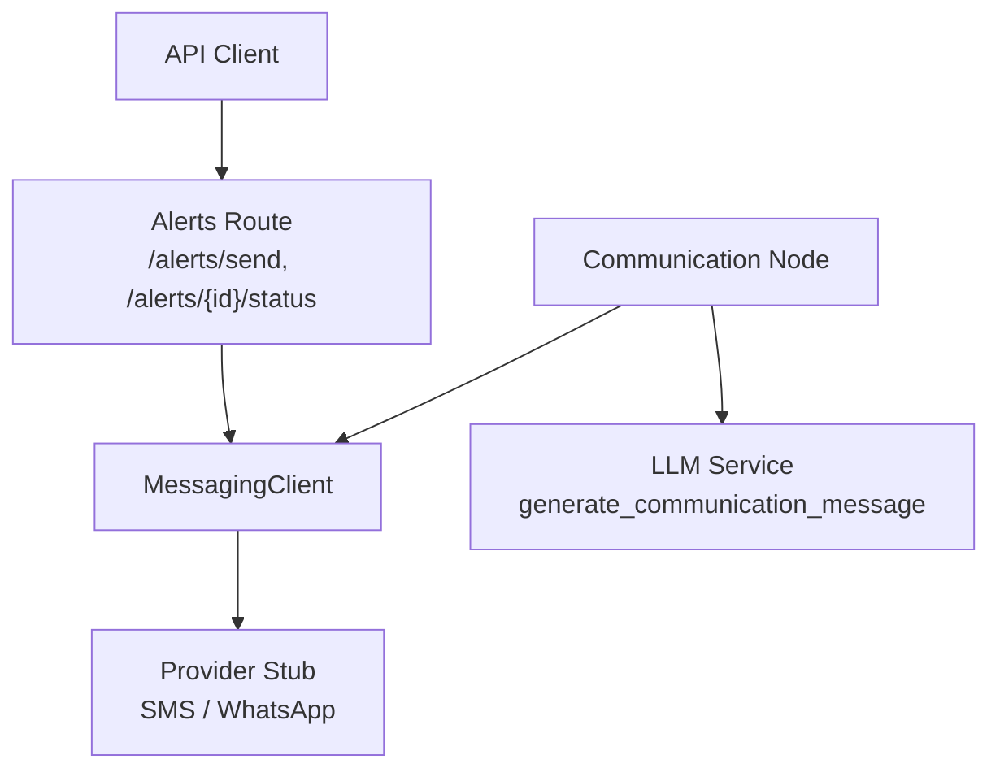
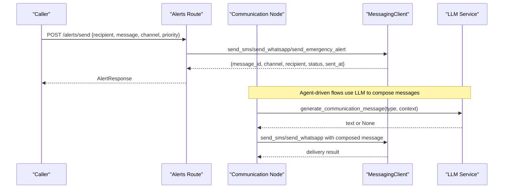
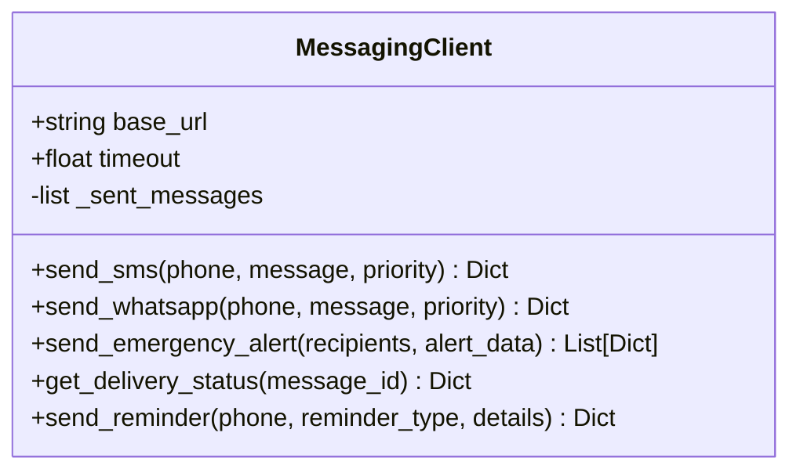
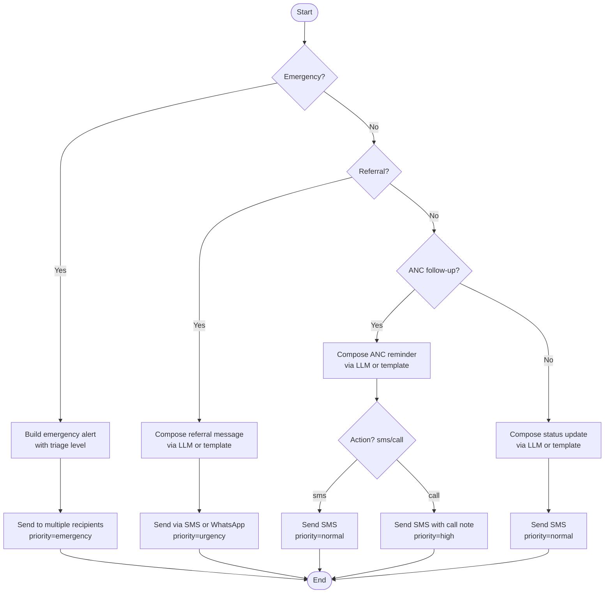
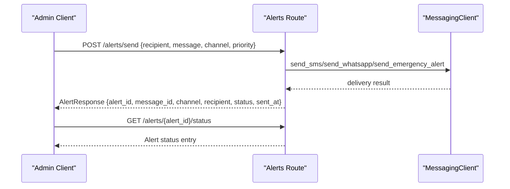
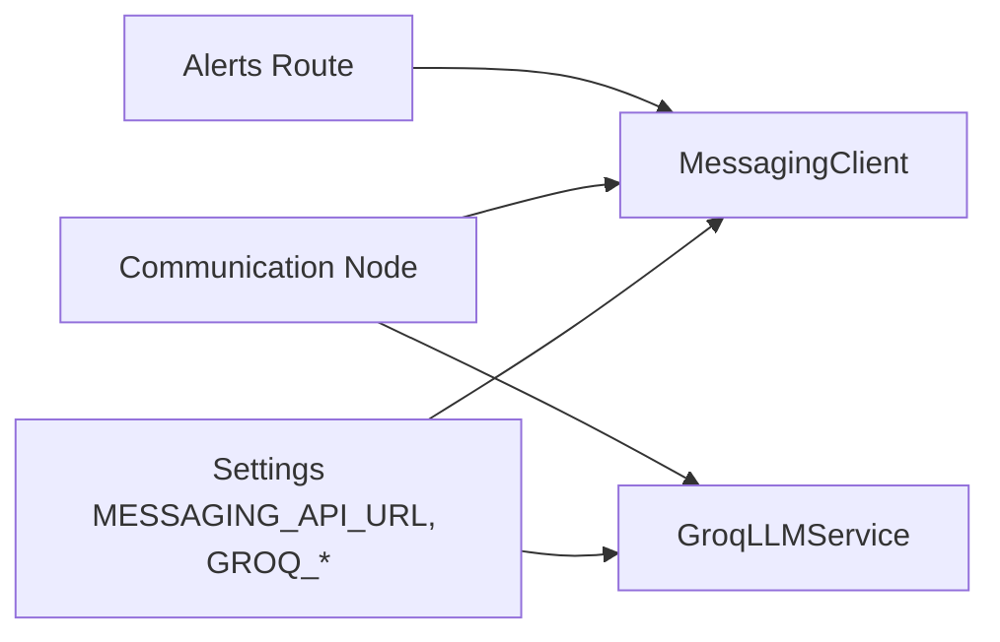

# Messaging Services

<cite>
**Referenced Files in This Document**
- [messaging_client.py](file://backend/integrations/messaging_client.py)
- [communication.py](file://backend/agents/nodes/communication.py)
- [alerts.py](file://backend/api/routes/alerts.py)
- [llm.py](file://backend/services/llm.py)
- [config.py](file://backend/config.py)
</cite>

## Table of Contents
1. [Introduction](#introduction)
2. [Project Structure](#project-structure)
3. [Core Components](#core-components)
4. [Architecture Overview](#architecture-overview)
5. [Detailed Component Analysis](#detailed-component-analysis)
6. [Dependency Analysis](#dependency-analysis)
7. [Performance Considerations](#performance-considerations)
8. [Troubleshooting Guide](#troubleshooting-guide)
9. [Conclusion](#conclusion)
10. [Appendices](#appendices)

## Introduction
This document explains the messaging services integration in MaaHifazat AI for patient communication and healthcare worker coordination. It covers SMS and WhatsApp capabilities, message routing strategies, templates, multi-language support, configuration options, delivery status tracking, and operational considerations such as retries, queuing, offline storage, cost optimization, prioritization, and compliance. The implementation currently uses a stubbed messaging client suitable for development and testing; production integrations can be layered on top using the same interfaces.

## Project Structure
The messaging subsystem spans three layers:
- API layer: exposes endpoints to send alerts and check delivery status.
- Agent layer: orchestrates message composition and dispatch based on clinical context (emergency, referral, ANC follow-up, status updates).
- Integration layer: abstracts provider calls (SMS/WhatsApp) and provides utilities like reminders and emergency broadcasts.

**Diagram sources**
- [alerts.py:49-124](file://backend/api/routes/alerts.py#L49-L124)
- [communication.py:38-213](file://backend/agents/nodes/communication.py#L38-L213)
- [messaging_client.py:9-77](file://backend/integrations/messaging_client.py#L9-L77)
- [llm.py:91-99](file://backend/services/llm.py#L91-L99)

**Section sources**
- [alerts.py:1-125](file://backend/api/routes/alerts.py#L1-L125)
- [communication.py:1-231](file://backend/agents/nodes/communication.py#L1-L231)
- [messaging_client.py:1-78](file://backend/integrations/messaging_client.py#L1-L78)
- [llm.py:1-144](file://backend/services/llm.py#L1-L144)

## Core Components
- MessagingClient: Provides async methods to send SMS, WhatsApp, emergency alerts, reminders, and query delivery status. Maintains an in-memory log of sent messages for testing.
- Communication node: Determines message type from agent state, composes content via LLM with fallback templates, selects channel (SMS or WhatsApp), sets priority, and logs delivery outcomes.
- Alerts API: Exposes authenticated endpoints to send alerts across channels and retrieve delivery status by alert ID.
- LLM service: Generates empathetic, multilingual messages (English and Roman Urdu) with robust fallback when unavailable.

Key responsibilities:
- Channel selection: SMS vs WhatsApp based on state or caller preference.
- Priority handling: normal, high, emergency.
- Message composition: LLM-generated with safe fallbacks.
- Delivery tracking: per-message IDs and statuses stored in memory.

**Section sources**
- [messaging_client.py:9-77](file://backend/integrations/messaging_client.py#L9-L77)
- [communication.py:38-213](file://backend/agents/nodes/communication.py#L38-L213)
- [alerts.py:49-124](file://backend/api/routes/alerts.py#L49-L124)
- [llm.py:91-99](file://backend/services/llm.py#L91-L99)

## Architecture Overview
The system follows a clear separation of concerns:
- API routes accept requests and delegate to MessagingClient.
- Agent nodes decide what to communicate based on clinical data and call MessagingClient.
- MessagingClient encapsulates provider interactions and returns standardized results.
- LLM service is optional and used to enhance message quality while ensuring reliability through fallbacks.

**Diagram sources**
- [alerts.py:49-124](file://backend/api/routes/alerts.py#L49-L124)
- [communication.py:38-213](file://backend/agents/nodes/communication.py#L38-L213)
- [messaging_client.py:17-77](file://backend/integrations/messaging_client.py#L17-L77)
- [llm.py:91-99](file://backend/services/llm.py#L91-L99)

## Detailed Component Analysis

### MessagingClient
Responsibilities:
- Send SMS and WhatsApp messages with unique IDs and timestamps.
- Broadcast emergency alerts to multiple recipients.
- Provide reminder templates for ANC appointments, medications, and follow-ups.
- Track delivery status in memory for testability.

Design notes:
- Uses a configurable base URL from settings for future provider wiring.
- Returns consistent result structures including message_id, channel, recipient, status, sent_at, and priority.
- Emergency alerts default to SMS with emergency priority.

**Diagram sources**
- [messaging_client.py:9-77](file://backend/integrations/messaging_client.py#L9-L77)

**Section sources**
- [messaging_client.py:9-77](file://backend/integrations/messaging_client.py#L9-L77)

### Communication Node
Responsibilities:
- Decide message type from agent state (emergency, referral, ANC follow-up, status update).
- Compose messages via LLM with safe fallback templates.
- Select channel (SMS or WhatsApp) and set appropriate priority.
- Log delivery outcomes and produce audit entries.

Flow highlights:
- Emergency: builds alert data and sends to both patient and health worker numbers.
- Referral: includes facility name, urgency, and estimated travel time.
- ANC follow-up: supports sms/call actions; call action augments SMS with a note about a follow-up call.
- Default: sends screening status update.

**Diagram sources**
- [communication.py:38-213](file://backend/agents/nodes/communication.py#L38-L213)

**Section sources**
- [communication.py:38-213](file://backend/agents/nodes/communication.py#L38-L213)

### Alerts API
Responsibilities:
- Provide authenticated endpoints to send alerts via SMS, WhatsApp, or emergency broadcast.
- Store alert metadata in memory for status lookup.
- Return structured responses with message_id, channel, recipient, status, and timestamp.

Endpoints:
- POST /alerts/send: Sends an alert and returns AlertResponse.
- GET /alerts/{alert_id}/status: Retrieves delivery status for a previously sent alert.

**Diagram sources**
- [alerts.py:49-124](file://backend/api/routes/alerts.py#L49-L124)

**Section sources**
- [alerts.py:1-125](file://backend/api/routes/alerts.py#L1-L125)

### LLM Service Integration
Responsibilities:
- Generate empathetic, concise messages for communication scenarios.
- Support bilingual output (English and Roman Urdu) via prompts.
- Provide robust fallback when the LLM is unavailable or returns empty content.

Usage:
- Called asynchronously within a thread to avoid blocking the event loop.
- Always falls back to predefined templates if LLM generation fails.

**Section sources**
- [llm.py:1-144](file://backend/services/llm.py#L1-L144)
- [communication.py:14-35](file://backend/agents/nodes/communication.py#L14-L35)

## Dependency Analysis
- Configuration:
  - Messaging API base URL is read from settings.
  - LLM model and key are configured centrally.
- Coupling:
  - Communication node depends on MessagingClient and LLM service.
  - Alerts route depends on MessagingClient and authentication.
- External dependencies:
  - HTTP client libraries are imported but not actively used in the current stub implementations.
  - LLM integration uses Groq SDK when available.

**Diagram sources**
- [config.py:31-42](file://backend/config.py#L31-L42)
- [messaging_client.py:12-15](file://backend/integrations/messaging_client.py#L12-L15)
- [llm.py:39-46](file://backend/services/llm.py#L39-L46)
- [communication.py:38-213](file://backend/agents/nodes/communication.py#L38-L213)
- [alerts.py:49-124](file://backend/api/routes/alerts.py#L49-L124)

**Section sources**
- [config.py:1-55](file://backend/config.py#L1-L55)
- [messaging_client.py:1-78](file://backend/integrations/messaging_client.py#L1-L78)
- [llm.py:1-144](file://backend/services/llm.py#L1-L144)
- [communication.py:1-231](file://backend/agents/nodes/communication.py#L1-L231)
- [alerts.py:1-125](file://backend/api/routes/alerts.py#L1-L125)

## Performance Considerations
- Asynchronous design: All messaging operations are async, enabling non-blocking dispatch.
- LLM calls run in a worker thread to prevent event loop contention.
- In-memory delivery log keeps lookups fast during development; replace with persistent storage in production.
- Short timeouts on clients help fail fast under network issues.

Recommendations:
- Introduce rate limiting at the MessagingClient layer before calling providers.
- Add exponential backoff and retry policies for transient failures.
- Use connection pooling and keep-alive for HTTP clients.
- Cache frequently used templates and reduce LLM calls where possible.

[No sources needed since this section provides general guidance]

## Troubleshooting Guide
Common issues and resolutions:
- LLM unavailable:
  - Symptom: Messages fall back to templates; llm_generated flag is False.
  - Resolution: Ensure groq package is installed and credentials are valid; verify network connectivity.
- Unknown channel:
  - Symptom: API returns 400 Bad Request for unsupported channel values.
  - Resolution: Use sms, whatsapp, or emergency.
- Missing alert status:
  - Symptom: 404 Not Found when querying alert status.
  - Resolution: Confirm alert_id exists in the in-memory store; in production, ensure persistence.
- Delivery always shows delivered:
  - Symptom: Status always “delivered”.
  - Resolution: This is expected in the stub; integrate real provider webhooks to update actual status.

Operational checks:
- Validate settings.MESSAGING_API_URL points to a working endpoint in production.
- Monitor logs for LLM warnings and exceptions.
- Audit delivery logs and implement persistent storage for alert history.

**Section sources**
- [llm.py:20-28](file://backend/services/llm.py#L20-L28)
- [alerts.py:84-94](file://backend/api/routes/alerts.py#L84-L94)
- [alerts.py:112-124](file://backend/api/routes/alerts.py#L112-L124)
- [messaging_client.py:17-43](file://backend/integrations/messaging_client.py#L17-L43)

## Conclusion
MaaHifazat AI’s messaging subsystem provides a flexible foundation for SMS and WhatsApp communications with strong fallbacks and clear separation between orchestration, composition, and provider integration. The current stub enables rapid development and testing while offering well-defined interfaces for integrating real providers, adding rate limiting, retries, persistent storage, and advanced routing strategies.

[No sources needed since this section summarizes without analyzing specific files]

## Appendices

### Message Templates and Multi-Language Support
- Built-in reminder templates:
  - Appointment reminders: include date and facility placeholders.
  - Medication reminders: include medicine placeholder.
  - Follow-up reminders: include visit date.
- LLM-generated messages:
  - Prompts instruct bilingual output (English and Roman Urdu).
  - Fallback templates ensure continuity when LLM is unavailable.
- Character encoding:
  - UTF-8 environment file encoding is configured for settings.
  - Ensure downstream providers handle UTF-8 for Urdu and regional languages.

**Section sources**
- [messaging_client.py:68-77](file://backend/integrations/messaging_client.py#L68-L77)
- [llm.py:91-99](file://backend/services/llm.py#L91-L99)
- [config.py:49-51](file://backend/config.py#L49-L51)

### Configuration Options
- Messaging API base URL:
  - Configured via settings.MESSAGING_API_URL.
- LLM model and key:
  - GROQ_MODEL and GROQ_API_KEY control model selection and authentication.
- App-level flags:
  - DEBUG mode toggles verbose behavior.

**Section sources**
- [config.py:31-42](file://backend/config.py#L31-L42)
- [config.py:44-47](file://backend/config.py#L44-L47)

### Example Scenarios
- Appointment reminders:
  - Use send_reminder with reminder_type="appointment" and details containing date and facility.
- Test results notifications:
  - Compose message via LLM or template and send via SMS or WhatsApp with priority depending on result severity.
- Medication alerts:
  - Use send_reminder with reminder_type="medication" and details containing medicine name.
- Emergency notifications:
  - Use send_emergency_alert with recipients list and alert_data including patient_id and reason; defaults to emergency priority.

**Section sources**
- [messaging_client.py:45-59](file://backend/integrations/messaging_client.py#L45-L59)
- [messaging_client.py:68-77](file://backend/integrations/messaging_client.py#L68-L77)
- [communication.py:64-92](file://backend/agents/nodes/communication.py#L64-L92)

### Retry Mechanisms, Queuing, and Offline Storage
Current state:
- No built-in retry or queueing; all operations are synchronous from the caller’s perspective and return immediately.
- Delivery status tracked in memory only.

Recommended enhancements:
- Implement retry with exponential backoff for transient errors.
- Add a message queue (e.g., Redis or database-backed) to persist messages and enable replay.
- Persist delivery logs and webhook callbacks to update statuses reliably.
- Integrate provider-specific webhooks to capture true delivery states.

[No sources needed since this section provides general guidance]

### Cost Optimization Strategies
- Prefer WhatsApp for rich media and longer messages when feasible; SMS for critical short alerts.
- Batch reminders where possible to reduce per-message overhead.
- Use LLM sparingly; cache generated messages for similar contexts.
- Set appropriate priorities to deprioritize non-critical messages during peak usage.

[No sources needed since this section provides general guidance]

### Message Prioritization
- Priority levels supported: normal, high, emergency.
- Emergency alerts automatically use emergency priority and target multiple recipients.
- ANC call actions elevate priority to high to ensure timely follow-up.

**Section sources**
- [messaging_client.py:17-43](file://backend/integrations/messaging_client.py#L17-L43)
- [communication.py:147-158](file://backend/agents/nodes/communication.py#L147-L158)

### Compliance with Telecommunications Regulations
- Ensure consent management for SMS/WhatsApp messaging per local regulations.
- Honor opt-out requests and maintain do-not-call lists.
- Secure sensitive health information in transit and at rest.
- Maintain audit trails for all outbound messages and access controls for sending alerts.

[No sources needed since this section provides general guidance]