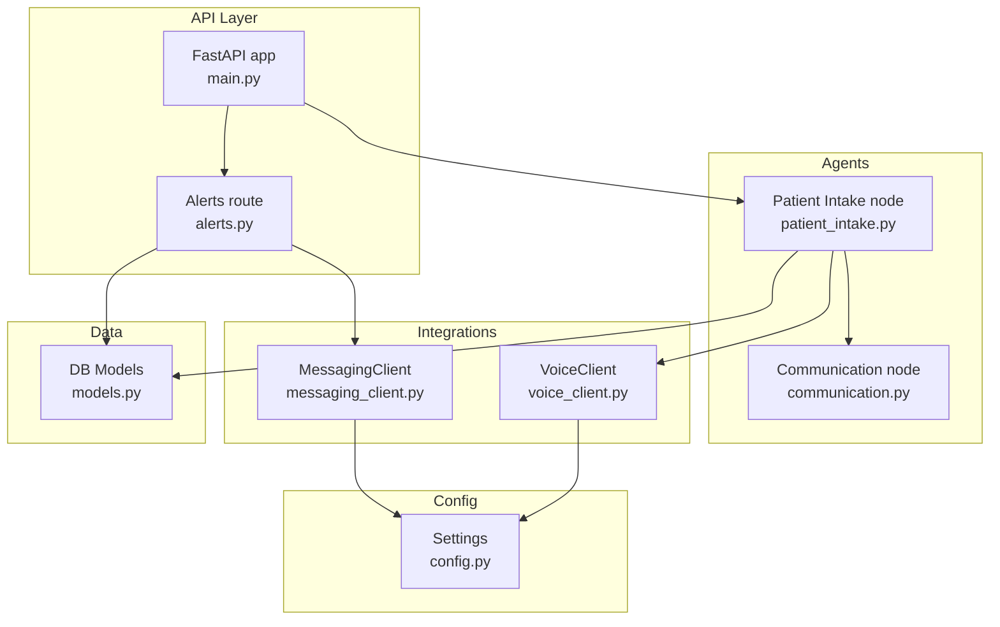
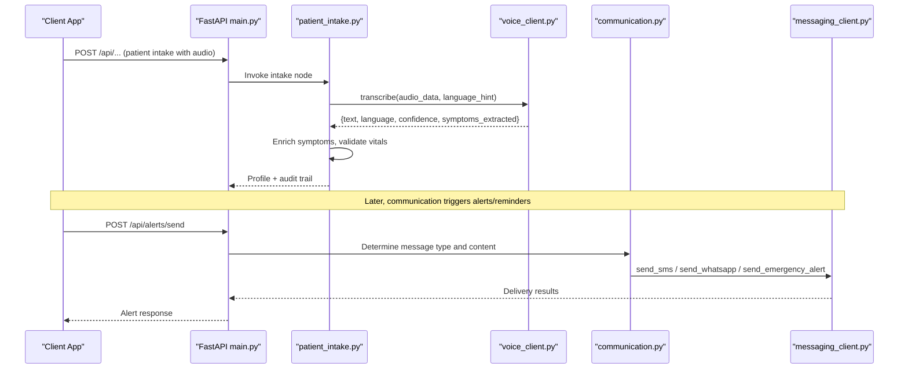
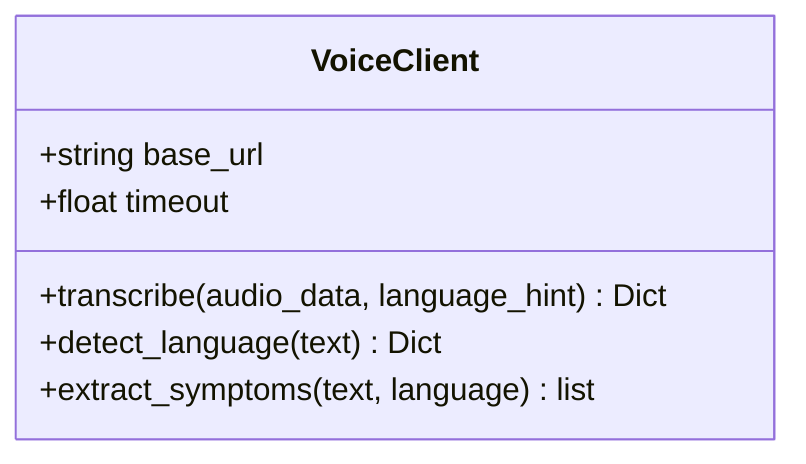
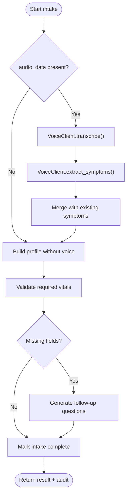
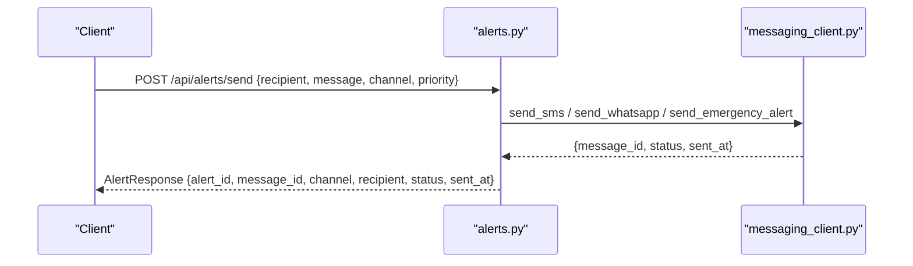
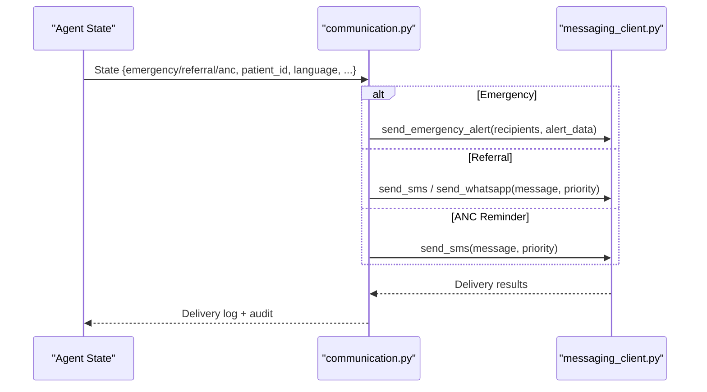
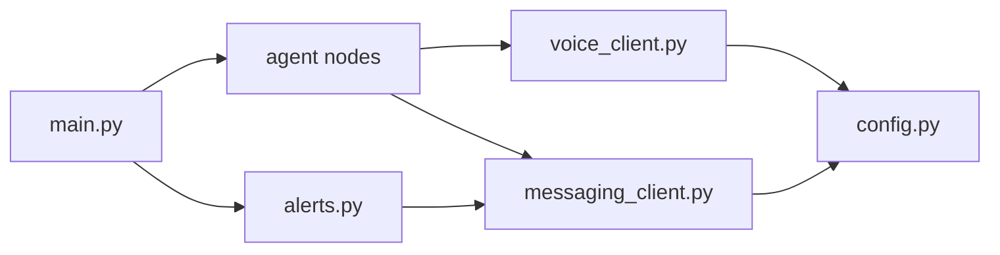

# Voice API Integration

<cite>
**Referenced Files in This Document**
- [voice_client.py](file://backend/integrations/voice_client.py)
- [config.py](file://backend/config.py)
- [main.py](file://backend/api/main.py)
- [alerts.py](file://backend/api/routes/alerts.py)
- [messaging_client.py](file://backend/integrations/messaging_client.py)
- [patient_intake.py](file://backend/agents/nodes/patient_intake.py)
- [communication.py](file://backend/agents/nodes/communication.py)
- [models.py](file://backend/db/models.py)
</cite>

## Table of Contents
1. [Introduction](#introduction)
2. [Project Structure](#project-structure)
3. [Core Components](#core-components)
4. [Architecture Overview](#architecture-overview)
5. [Detailed Component Analysis](#detailed-component-analysis)
6. [Dependency Analysis](#dependency-analysis)
7. [Performance Considerations](#performance-considerations)
8. [Troubleshooting Guide](#troubleshooting-guide)
9. [Conclusion](#conclusion)
10. [Appendices](#appendices)

## Introduction
This document explains the voice API integration system in MaaHifazat AI for rural healthcare communication. It covers how voice input is captured, transcribed, and used to extract symptoms; how text-to-speech and speech recognition are integrated via a client abstraction; and how voice-derived messages flow into patient notifications, appointment reminders, and emergency alerts. It also documents configuration options, error handling strategies, performance considerations for low-connectivity environments, and security considerations for voice data privacy and compliance.

## Project Structure
The voice integration spans several modules:
- Voice client abstraction for transcription, language detection, and symptom extraction
- Configuration for external voice API endpoints
- Agent nodes that consume voice input during patient intake
- Messaging clients for SMS/WhatsApp and emergency alerts
- API routes for sending alerts and checking delivery status
- Database models for storing clinical records and file metadata (including audio)

**Diagram sources**
- [main.py:52-64](file://backend/api/main.py#L52-L64)
- [alerts.py:49-109](file://backend/api/routes/alerts.py#L49-L109)
- [patient_intake.py:58-149](file://backend/agents/nodes/patient_intake.py#L58-L149)
- [communication.py:38-150](file://backend/agents/nodes/communication.py#L38-L150)
- [voice_client.py:7-47](file://backend/integrations/voice_client.py#L7-L47)
- [messaging_client.py:9-78](file://backend/integrations/messaging_client.py#L9-L78)
- [config.py:31-35](file://backend/config.py#L31-L35)
- [models.py:106-115](file://backend/db/models.py#L106-L115)

**Section sources**
- [main.py:52-64](file://backend/api/main.py#L52-L64)
- [config.py:31-35](file://backend/config.py#L31-L35)
- [models.py:106-115](file://backend/db/models.py#L106-L115)

## Core Components
- VoiceClient: Provides methods for transcription, language detection, and symptom extraction from voice transcripts. Currently implemented as a stub with mock responses and keyword-based symptom extraction.
- MessagingClient: Sends SMS, WhatsApp, and emergency alerts; supports reminder templates and delivery status lookup.
- Patient Intake Node: Integrates voice processing by transcribing optional audio input and enriching symptoms before validation.
- Alerts Route: Exposes an endpoint to send alerts across channels and retrieve delivery status.
- Communication Node: Orchestrates message generation and dispatch based on state context (emergency, referral, ANC follow-up).
- Settings: Centralized configuration including VOICE_API_URL and other service endpoints.

**Section sources**
- [voice_client.py:7-47](file://backend/integrations/voice_client.py#L7-L47)
- [messaging_client.py:9-78](file://backend/integrations/messaging_client.py#L9-L78)
- [patient_intake.py:58-149](file://backend/agents/nodes/patient_intake.py#L58-L149)
- [alerts.py:49-109](file://backend/api/routes/alerts.py#L49-L109)
- [communication.py:38-150](file://backend/agents/nodes/communication.py#L38-L150)
- [config.py:31-35](file://backend/config.py#L31-L35)

## Architecture Overview
The voice pipeline integrates at two key points:
- During patient intake, optional audio is transcribed and used to augment symptoms.
- During communication, generated or templated messages are sent via messaging channels, including emergency broadcasts.

**Diagram sources**
- [patient_intake.py:75-85](file://backend/agents/nodes/patient_intake.py#L75-L85)
- [voice_client.py:14-22](file://backend/integrations/voice_client.py#L14-L22)
- [alerts.py:49-109](file://backend/api/routes/alerts.py#L49-L109)
- [communication.py:64-122](file://backend/agents/nodes/communication.py#L64-L122)
- [messaging_client.py:17-59](file://backend/integrations/messaging_client.py#L17-L59)

## Detailed Component Analysis

### VoiceClient
Responsibilities:
- Transcription: Accepts audio bytes and returns text, detected language, confidence, and extracted symptoms.
- Language detection: Returns language and script information for input text.
- Symptom extraction: Keyword-based mapping from free text to structured symptoms with severity and source tagging.

Implementation notes:
- Uses a configurable base URL from settings for external voice API calls.
- Timeout parameter allows tuning latency expectations.
- Current implementation is a stub returning mock data; replace with real HTTP calls when integrating a production voice provider.

**Diagram sources**
- [voice_client.py:7-47](file://backend/integrations/voice_client.py#L7-L47)

**Section sources**
- [voice_client.py:7-47](file://backend/integrations/voice_client.py#L7-L47)
- [config.py:31-35](file://backend/config.py#L31-L35)

### Patient Intake Node
Responsibilities:
- Collect demographics, vitals, and symptoms.
- If audio is present, transcribe and integrate extracted symptoms.
- Validate completeness and generate follow-up questions if needed.

Integration points:
- Calls VoiceClient to transcribe and extract symptoms.
- Builds a profile including voice transcript when available.
- Emits audit entries and returns structured results for downstream agents.

**Diagram sources**
- [patient_intake.py:58-149](file://backend/agents/nodes/patient_intake.py#L58-L149)
- [voice_client.py:14-47](file://backend/integrations/voice_client.py#L14-L47)

**Section sources**
- [patient_intake.py:58-149](file://backend/agents/nodes/patient_intake.py#L58-L149)

### Alerts Route
Responsibilities:
- Provide an authenticated endpoint to send alerts via SMS, WhatsApp, or emergency broadcast.
- Track alert IDs and return delivery status.

Behavior:
- Routes channel-specific logic to MessagingClient methods.
- Wraps exceptions and returns structured errors.
- Stores alert metadata in-memory for status queries.

**Diagram sources**
- [alerts.py:49-109](file://backend/api/routes/alerts.py#L49-L109)
- [messaging_client.py:17-59](file://backend/integrations/messaging_client.py#L17-L59)

**Section sources**
- [alerts.py:49-109](file://backend/api/routes/alerts.py#L49-L109)

### Communication Node
Responsibilities:
- Decide message type based on state context (emergency, referral, ANC follow-up).
- Generate or select appropriate messages, then dispatch via MessagingClient.
- Log delivery outcomes and handle errors gracefully.

Key flows:
- Emergency alerts to multiple recipients with high priority.
- Referral notifications with urgency and travel time details.
- ANC reminders tailored to recommended actions.

**Diagram sources**
- [communication.py:38-150](file://backend/agents/nodes/communication.py#L38-L150)
- [messaging_client.py:45-78](file://backend/integrations/messaging_client.py#L45-L78)

**Section sources**
- [communication.py:38-150](file://backend/agents/nodes/communication.py#L38-L150)

### Configuration
Centralized settings include:
- External API URLs: VOICE_API_URL, MESSAGING_API_URL, routing/facility APIs.
- JWT parameters for authentication.
- LLM provider keys and model selection.

Usage:
- VoiceClient reads VOICE_API_URL to configure its base endpoint.
- MessagingClient reads MESSAGING_API_URL for outbound messaging.

**Section sources**
- [config.py:23-42](file://backend/config.py#L23-L42)

### Data Models
Relevant models for voice-related data:
- ClinicalRecord stores symptoms and model outputs, enabling linkage between voice-extracted symptoms and clinical decisions.
- FileRecord can store uploaded audio files with metadata such as MIME type and size.

**Section sources**
- [models.py:30-50](file://backend/db/models.py#L30-L50)
- [models.py:106-115](file://backend/db/models.py#L106-L115)

## Dependency Analysis
High-level dependencies:
- FastAPI app includes routers for alerts and core features.
- Patient intake depends on VoiceClient and optionally LLM services for follow-up questions.
- Alerts route depends on MessagingClient for outbound communications.
- All integrations read configuration from Settings.

**Diagram sources**
- [main.py:122-134](file://backend/api/main.py#L122-L134)
- [alerts.py:49-109](file://backend/api/routes/alerts.py#L49-L109)
- [patient_intake.py:58-149](file://backend/agents/nodes/patient_intake.py#L58-L149)
- [voice_client.py:7-47](file://backend/integrations/voice_client.py#L7-L47)
- [messaging_client.py:9-78](file://backend/integrations/messaging_client.py#L9-L78)
- [config.py:31-35](file://backend/config.py#L31-L35)

**Section sources**
- [main.py:122-134](file://backend/api/main.py#L122-L134)
- [config.py:31-35](file://backend/config.py#L31-L35)

## Performance Considerations
- Timeouts: VoiceClient accepts a timeout parameter to control request latency; tune based on network conditions.
- Stub behavior: Current transcription returns immediate mock responses; replacing with real HTTP calls will introduce network latency—implement retries and timeouts accordingly.
- Bandwidth adaptation: For low-connectivity environments, consider compressing audio before upload and using lightweight codecs supported by your voice provider.
- Caching: Cache frequent language detections or symptom extractions locally to reduce redundant calls.
- Message batching: When sending emergency alerts to multiple recipients, batch requests where possible to minimize overhead.

[No sources needed since this section provides general guidance]

## Troubleshooting Guide
Common issues and strategies:
- Network failures: Wrap external calls in try/except blocks; implement retries with exponential backoff; surface user-friendly errors.
- Service unavailability: Use fallback mechanisms (e.g., template messages when LLM or voice services fail); maintain health checks for critical services.
- Audio processing errors: Validate audio format and size before upload; log detailed error contexts; provide graceful degradation to text-only intake.
- Delivery failures: Track message IDs and statuses; expose endpoints to query delivery status; retry failed sends with appropriate priorities.

Evidence in code:
- Global exception handler returns structured JSON errors for unhandled exceptions.
- Alerts route wraps messaging calls in try/except and raises HTTPException with details.
- Agent nodes capture errors in audit trails and return structured error summaries.

**Section sources**
- [main.py:83-100](file://backend/api/main.py#L83-L100)
- [alerts.py:88-94](file://backend/api/routes/alerts.py#L88-L94)
- [patient_intake.py:151-167](file://backend/agents/nodes/patient_intake.py#L151-L167)
- [communication.py:215-230](file://backend/agents/nodes/communication.py#L215-L230)

## Conclusion
MaaHifazat AI’s voice integration provides a flexible foundation for rural healthcare communication. The current VoiceClient stub enables rapid development and testing while allowing straightforward replacement with production-grade providers. Patient intake leverages voice to enrich symptoms, and communication pathways ensure timely alerts and reminders. With careful attention to error handling, performance tuning, and security, the system can scale to support reliable, privacy-preserving voice interactions in low-resource settings.

[No sources needed since this section summarizes without analyzing specific files]

## Appendices

### Supported Audio Formats and Providers
- The repository does not define explicit audio format constraints; adopt formats compatible with your chosen voice provider (e.g., WAV, MP3, FLAC) and ensure proper MIME types when storing audio metadata.
- Configure VOICE_API_URL to point to your provider’s endpoint and adjust timeouts per provider SLAs.

**Section sources**
- [config.py:31-35](file://backend/config.py#L31-L35)
- [models.py:106-115](file://backend/db/models.py#L106-L115)

### Language Models and Accent Optimization
- Language hint defaults to Urdu; detect_language can be extended to identify scripts and dialects.
- Symptom extraction uses keyword matching; expand the keyword set for Pakistani dialects and regional variations to improve accuracy.

**Section sources**
- [voice_client.py:14-47](file://backend/integrations/voice_client.py#L14-L47)

### Configuration Options
- VOICE_API_URL: Base URL for voice transcription and language services.
- MESSAGING_API_URL: Base URL for SMS/WhatsApp services.
- JWT settings: Secure API access and session management.
- LLM settings: Model selection and keys for generating follow-up questions and messages.

**Section sources**
- [config.py:23-42](file://backend/config.py#L23-L42)

### Examples: Implementing Voice Messages
- Patient notifications: Use Communication node to generate and send personalized messages based on clinical risk and ANC recommendations.
- Appointment reminders: Leverage MessagingClient templates for scheduled visits and medication reminders.
- Emergency alerts: Trigger high-priority broadcasts to multiple recipients with concise, actionable content.

**Section sources**
- [communication.py:64-150](file://backend/agents/nodes/communication.py#L64-L150)
- [messaging_client.py:45-78](file://backend/integrations/messaging_client.py#L45-L78)

### Security Considerations
- Encrypt audio payloads in transit and at rest; restrict access to sensitive voice data.
- Enforce authentication for all API endpoints using JWT; validate tokens and scopes.
- Comply with healthcare regulations by auditing access to voice data and ensuring minimal retention policies.
- Sanitize inputs and outputs to prevent injection attacks; validate phone numbers and message content.

[No sources needed since this section provides general guidance]