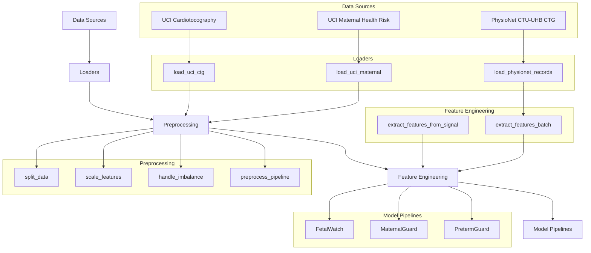
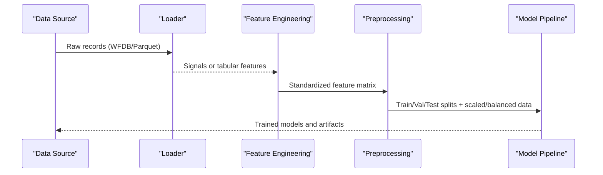
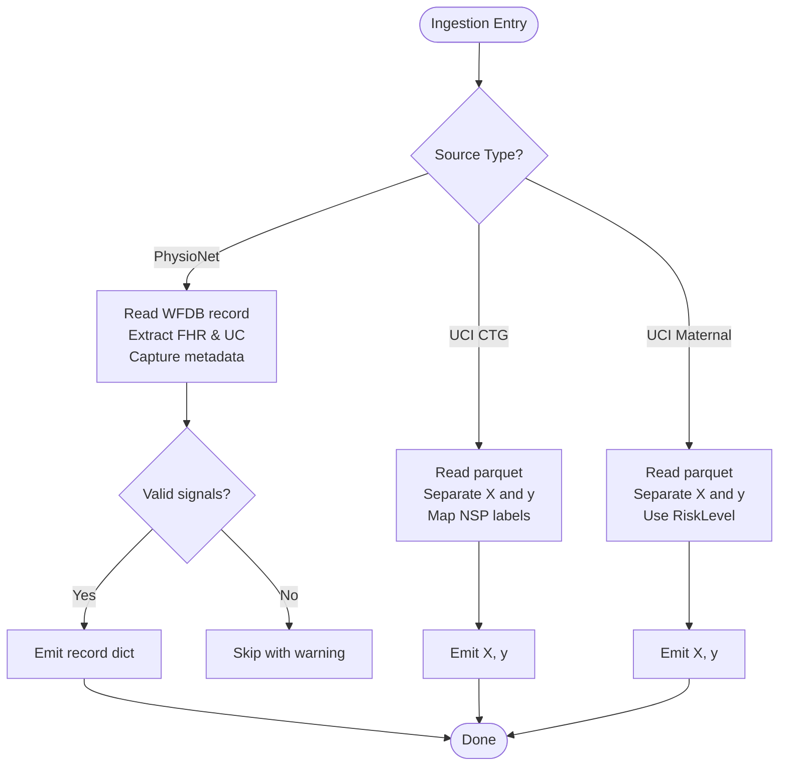
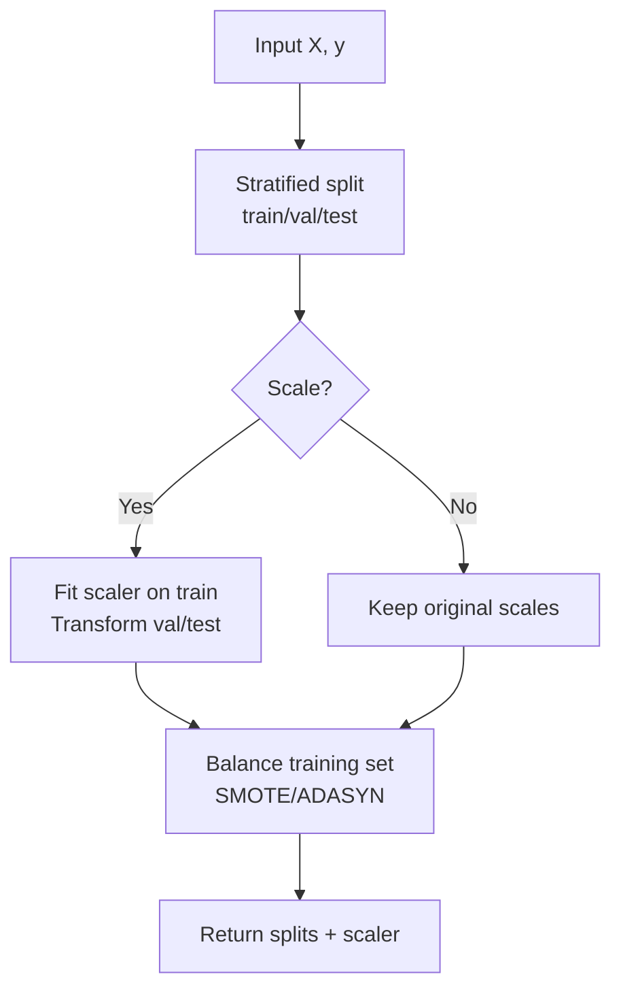
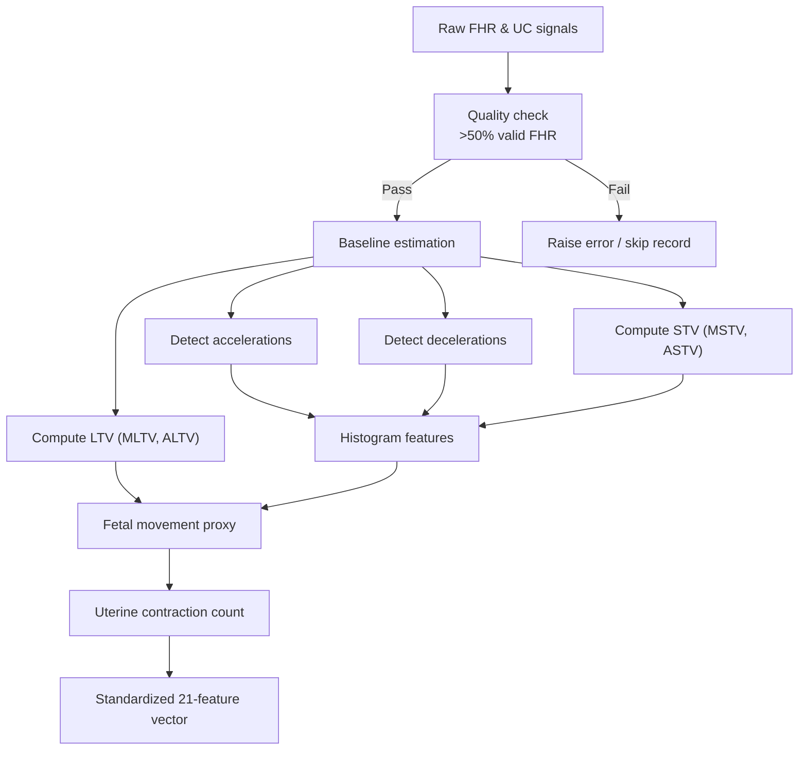
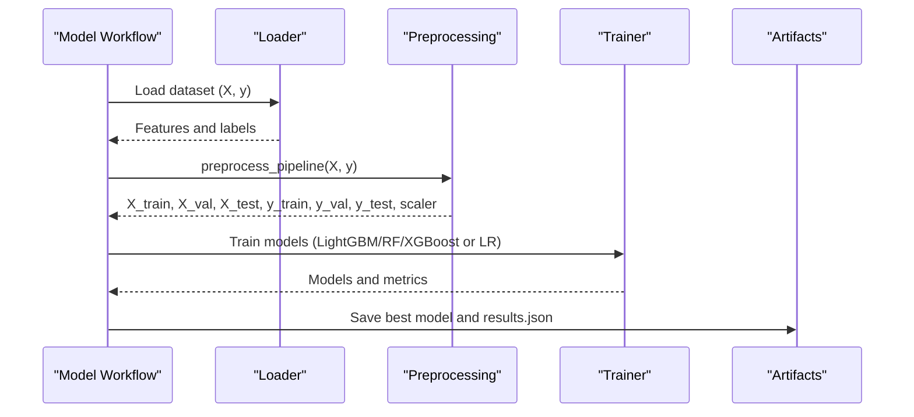
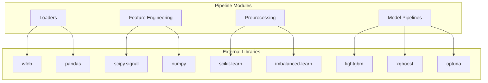

# Data Processing Pipeline

<cite>
**Referenced Files in This Document**
- [physionet_ctg.py](file://src/data/loaders/physionet_ctg.py)
- [uci_ctg.py](file://src/data/loaders/uci_ctg.py)
- [uci_maternal.py](file://src/data/loaders/uci_maternal.py)
- [preprocessing.py](file://src/data/preprocessing.py)
- [ctg_features.py](file://src/features/ctg_features.py)
- [download_physionet.py](file://scripts/download_physionet.py)
- [download_uci.py](file://scripts/download_uci.py)
- [run_eda.py](file://scripts/run_eda.py)
- [fetal_watch.py](file://src/models/fetal_watch.py)
- [maternal_guard.py](file://src/models/maternal_guard.py)
- [preterm_guard.py](file://src/models/preterm_guard.py)
- [02_pipeline_demo.ipynb](file://notebooks/02_pipeline_demo.ipynb)
</cite>

## Table of Contents
1. [Introduction](#introduction)
2. [Project Structure](#project-structure)
3. [Core Components](#core-components)
4. [Architecture Overview](#architecture-overview)
5. [Detailed Component Analysis](#detailed-component-analysis)
6. [Dependency Analysis](#dependency-analysis)
7. [Performance Considerations](#performance-considerations)
8. [Troubleshooting Guide](#troubleshooting-guide)
9. [Conclusion](#conclusion)
10. [Appendices](#appendices)

## Introduction
This document describes the end-to-end data processing pipeline that feeds all ML models in MaaHifazat AI. It covers ingestion from multiple sources (PhysioNet CTG, UCI Cardiotocography, and UCI Maternal Health Risk), preprocessing workflows for signal cleaning, noise handling, artifact management, and standardization; feature engineering including domain-specific extraction, temporal features, and automated selection; data quality checks, outlier handling, and missing value strategies; and guidance for extending the pipeline to new sources while maintaining lineage and audit trails for regulatory compliance.

## Project Structure
The pipeline is organized into modular components:
- Data loaders for each source
- Shared preprocessing utilities for splitting, scaling, and class balancing
- Feature engineering for CTG signals to a standardized 21-feature schema
- Model training pipelines that consume preprocessed features
- Scripts for downloading datasets and running EDA

**Diagram sources**
- [physionet_ctg.py:13-102](file://src/data/loaders/physionet_ctg.py#L13-L102)
- [uci_ctg.py:14-52](file://src/data/loaders/uci_ctg.py#L14-L52)
- [uci_maternal.py:11-47](file://src/data/loaders/uci_maternal.py#L11-L47)
- [preprocessing.py:22-261](file://src/data/preprocessing.py#L22-L261)
- [ctg_features.py:506-683](file://src/features/ctg_features.py#L506-L683)
- [fetal_watch.py:282-432](file://src/models/fetal_watch.py#L282-L432)
- [maternal_guard.py:71-260](file://src/models/maternal_guard.py#L71-L260)
- [preterm_guard.py:208-363](file://src/models/preterm_guard.py#L208-L363)

**Section sources**
- [physionet_ctg.py:13-102](file://src/data/loaders/physionet_ctg.py#L13-L102)
- [uci_ctg.py:14-52](file://src/data/loaders/uci_ctg.py#L14-L52)
- [uci_maternal.py:11-47](file://src/data/loaders/uci_maternal.py#L11-L47)
- [preprocessing.py:22-261](file://src/data/preprocessing.py#L22-L261)
- [ctg_features.py:506-683](file://src/features/ctg_features.py#L506-L683)

## Core Components
- Data ingestion:
  - PhysioNet CTU-UHB CTG: loads WFDB records (.dat/.hea), extracts FHR and UC channels with metadata.
  - UCI Cardiotocography: reads parquet, separates features and target labels mapped to human-readable classes.
  - UCI Maternal Health Risk: reads parquet, separates features and risk-level labels.
- Preprocessing:
  - Stratified train/validation/test split (70/15/15).
  - Scaling via RobustScaler, StandardScaler, or MinMaxScaler.
  - Class imbalance handling via SMOTE or ADASYN on training set only.
  - Convenience pipeline orchestrating split → scale → balance.
- Feature engineering:
  - Domain-specific CTG features aligned to the UCI 21-feature schema (baseline, accelerations, decelerations, variability, histogram descriptors, fetal movement proxy, uterine contractions).
  - Batch extraction across recordings with quality checks and optional Parquet output.
- Model integration:
  - FetalWatch uses UCI CTG features and targets NSP/CLASS.
  - MaternalGuard uses UCI Maternal features and RiskLevel.
  - PretermGuard uses UCI CTG features with CLASS target.

**Section sources**
- [physionet_ctg.py:13-102](file://src/data/loaders/physionet_ctg.py#L13-L102)
- [uci_ctg.py:14-52](file://src/data/loaders/uci_ctg.py#L14-L52)
- [uci_maternal.py:11-47](file://src/data/loaders/uci_maternal.py#L11-L47)
- [preprocessing.py:22-261](file://src/data/preprocessing.py#L22-L261)
- [ctg_features.py:506-683](file://src/features/ctg_features.py#L506-L683)
- [fetal_watch.py:282-432](file://src/models/fetal_watch.py#L282-L432)
- [maternal_guard.py:71-260](file://src/models/maternal_guard.py#L71-L260)
- [preterm_guard.py:208-363](file://src/models/preterm_guard.py#L208-L363)

## Architecture Overview
The pipeline ingests raw data, standardizes formats, engineers features, and feeds model training. For CTG signals, raw waveforms are transformed into a consistent 21-feature vector compatible with UCI-trained models. For tabular clinical datasets, loaders separate features and targets, then apply shared preprocessing before modeling.

**Diagram sources**
- [physionet_ctg.py:13-102](file://src/data/loaders/physionet_ctg.py#L13-L102)
- [uci_ctg.py:14-52](file://src/data/loaders/uci_ctg.py#L14-L52)
- [uci_maternal.py:11-47](file://src/data/loaders/uci_maternal.py#L11-L47)
- [ctg_features.py:506-683](file://src/features/ctg_features.py#L506-L683)
- [preprocessing.py:22-261](file://src/data/preprocessing.py#L22-L261)
- [fetal_watch.py:282-432](file://src/models/fetal_watch.py#L282-L432)
- [maternal_guard.py:71-260](file://src/models/maternal_guard.py#L71-L260)
- [preterm_guard.py:208-363](file://src/models/preterm_guard.py#L208-L363)

## Detailed Component Analysis

### Data Ingestion
- PhysioNet CTU-UHB CTG:
  - Reads .hea/.dat pairs using wfdb, validates presence of at least two signals, extracts FHR and UC channels, and preserves metadata (sampling frequency, length, comments).
  - Gracefully skips corrupt or incomplete records with warnings.
- UCI Cardiotocography:
  - Loads parquet, removes label columns (NSP, CLASS) from features, maps NSP to readable labels.
- UCI Maternal Health Risk:
  - Loads parquet, separates RiskLevel as target, keeps other columns as features.

**Diagram sources**
- [physionet_ctg.py:13-102](file://src/data/loaders/physionet_ctg.py#L13-L102)
- [uci_ctg.py:14-52](file://src/data/loaders/uci_ctg.py#L14-L52)
- [uci_maternal.py:11-47](file://src/data/loaders/uci_maternal.py#L11-L47)

**Section sources**
- [physionet_ctg.py:13-102](file://src/data/loaders/physionet_ctg.py#L13-L102)
- [uci_ctg.py:14-52](file://src/data/loaders/uci_ctg.py#L14-L52)
- [uci_maternal.py:11-47](file://src/data/loaders/uci_maternal.py#L11-L47)

### Preprocessing Workflows
- Splitting:
  - Two-stage stratified split to produce train (70%), validation (15%), test (15%) sets preserving class distributions.
- Scaling:
  - Fit scaler on training set; transform validation and test sets. Supports robust, standard, min-max scaling.
- Imbalance handling:
  - Apply SMOTE or ADASYN only to training set to address class imbalance.
- Convenience pipeline:
  - Orchestrates split → scale → balance and returns ready-to-use splits plus fitted scaler.

**Diagram sources**
- [preprocessing.py:22-261](file://src/data/preprocessing.py#L22-L261)

**Section sources**
- [preprocessing.py:22-261](file://src/data/preprocessing.py#L22-L261)

### Feature Engineering Pipeline
- Domain-specific CTG features:
  - Baseline detection via iterative median filtering excluding accelerations/decelerations.
  - Acceleration detection: sustained rises ≥15 bpm above baseline for ≥15 seconds.
  - Deceleration detection: drops ≥15 bpm below baseline for ≥15 seconds; classified as light, severe, prolonged.
  - Short-term variability (STV): mean absolute difference between consecutive valid samples in 1-minute windows; yields MSTV and ASTV.
  - Long-term variability (LTV): amplitude per 1-minute window; yields MLTV and ALTV.
  - Histogram features: width, min, max, Nmax (peaks), Nzeros, mode, mean, median, variance, tendency (skewness indicator).
  - Fetal movement proxy: rapid short-duration FHR changes counted over sliding windows.
  - Uterine contractions: peak detection in UC signal with minimum distance and prominence thresholds.
- Standardization:
  - All extracted features are normalized per minute where applicable to match UCI CTG scale and returned as a Series indexed by the 21 UCI feature names.
- Batch processing:
  - Scans directory for .hea files, reads corresponding .dat, identifies FHR/UC channels, extracts features, handles errors gracefully, and optionally saves results to Parquet.

**Diagram sources**
- [ctg_features.py:39-76](file://src/features/ctg_features.py#L39-L76)
- [ctg_features.py:84-131](file://src/features/ctg_features.py#L84-L131)
- [ctg_features.py:139-224](file://src/features/ctg_features.py#L139-L224)
- [ctg_features.py:232-329](file://src/features/ctg_features.py#L232-L329)
- [ctg_features.py:337-409](file://src/features/ctg_features.py#L337-L409)
- [ctg_features.py:417-459](file://src/features/ctg_features.py#L417-L459)
- [ctg_features.py:467-498](file://src/features/ctg_features.py#L467-L498)
- [ctg_features.py:506-593](file://src/features/ctg_features.py#L506-L593)

**Section sources**
- [ctg_features.py:39-76](file://src/features/ctg_features.py#L39-L76)
- [ctg_features.py:84-131](file://src/features/ctg_features.py#L84-L131)
- [ctg_features.py:139-224](file://src/features/ctg_features.py#L139-L224)
- [ctg_features.py:232-329](file://src/features/ctg_features.py#L232-L329)
- [ctg_features.py:337-409](file://src/features/ctg_features.py#L337-L409)
- [ctg_features.py:417-459](file://src/features/ctg_features.py#L417-L459)
- [ctg_features.py:467-498](file://src/features/ctg_features.py#L467-L498)
- [ctg_features.py:506-593](file://src/features/ctg_features.py#L506-L593)
- [ctg_features.py:601-683](file://src/features/ctg_features.py#L601-L683)

### Data Quality Checks, Missing Values, and Outliers
- Signal quality:
  - Enforces >50% valid FHR samples; raises an error if insufficient valid data to ensure reliable feature extraction.
- Missing values:
  - Invalid FHR samples treated as zeros or NaNs during computations; functions handle gaps and finite checks.
  - Tabular datasets rely on parquet integrity; EDA scripts report missing values and distributions.
- Outliers:
  - RobustScaler used for scaling to reduce sensitivity to outliers.
  - Deceleration/acceleration detection thresholds act as domain-based filters for physiologically implausible events.

**Section sources**
- [ctg_features.py:506-545](file://src/features/ctg_features.py#L506-L545)
- [preprocessing.py:80-130](file://src/data/preprocessing.py#L80-L130)
- [run_eda.py:23-65](file://scripts/run_eda.py#L23-L65)
- [run_eda.py:70-110](file://scripts/run_eda.py#L70-L110)

### Model Integration and Training Pipelines
- FetalWatch:
  - Loads UCI CTG features/targets, applies preprocess_pipeline (split, scale, SMOTE), trains LightGBM (Optuna HPO), Random Forest baseline, and XGBoost (Optuna HPO), evaluates on test set, saves best model and results.
- MaternalGuard:
  - Loads UCI Maternal features/targets, encodes labels, applies split/scale/SMOTE, performs Optuna HPO for LightGBM, compares with Logistic Regression, evaluates and saves artifacts.
- PretermGuard:
  - Uses UCI CTG features with CLASS target, applies manual split/scale/SMOTE, trains LightGBM (Optuna HPO) and Random Forest baseline, evaluates and saves best model and results.

**Diagram sources**
- [fetal_watch.py:282-432](file://src/models/fetal_watch.py#L282-L432)
- [maternal_guard.py:71-260](file://src/models/maternal_guard.py#L71-L260)
- [preterm_guard.py:208-363](file://src/models/preterm_guard.py#L208-L363)
- [preprocessing.py:196-261](file://src/data/preprocessing.py#L196-L261)

**Section sources**
- [fetal_watch.py:282-432](file://src/models/fetal_watch.py#L282-L432)
- [maternal_guard.py:71-260](file://src/models/maternal_guard.py#L71-L260)
- [preterm_guard.py:208-363](file://src/models/preterm_guard.py#L208-L363)

### Conceptual Overview
The pipeline ensures consistency across heterogeneous data sources by converting raw signals into a standardized feature space and applying uniform preprocessing before modeling. This enables cross-dataset compatibility and simplifies model deployment and evaluation.

[No sources needed since this section provides conceptual overview]

## Dependency Analysis
Key dependencies and relationships:
- Loaders depend on external libraries (wfdb for PhysioNet, pandas for parquet).
- Feature engineering depends on scipy.signal for peak detection and numpy/pandas for computations.
- Preprocessing depends on scikit-learn and imbalanced-learn for scaling and resampling.
- Model pipelines depend on LightGBM, XGBoost, scikit-learn, and optuna for training and hyperparameter optimization.

**Diagram sources**
- [physionet_ctg.py:13-102](file://src/data/loaders/physionet_ctg.py#L13-L102)
- [preprocessing.py:22-261](file://src/data/preprocessing.py#L22-L261)
- [ctg_features.py:506-683](file://src/features/ctg_features.py#L506-L683)
- [fetal_watch.py:282-432](file://src/models/fetal_watch.py#L282-L432)
- [maternal_guard.py:71-260](file://src/models/maternal_guard.py#L71-L260)
- [preterm_guard.py:208-363](file://src/models/preterm_guard.py#L208-L363)

**Section sources**
- [physionet_ctg.py:13-102](file://src/data/loaders/physionet_ctg.py#L13-L102)
- [preprocessing.py:22-261](file://src/data/preprocessing.py#L22-L261)
- [ctg_features.py:506-683](file://src/features/ctg_features.py#L506-L683)
- [fetal_watch.py:282-432](file://src/models/fetal_watch.py#L282-L432)
- [maternal_guard.py:71-260](file://src/models/maternal_guard.py#L71-L260)
- [preterm_guard.py:208-363](file://src/models/preterm_guard.py#L208-L363)

## Performance Considerations
- Use RobustScaler to mitigate outlier impact on scaling.
- Apply SMOTE/ADASYN only to training data to avoid leakage.
- Batch feature extraction processes large numbers of recordings efficiently and writes intermediate results to Parquet for fast I/O.
- Early stopping in tree-based models reduces overfitting and training time.
- Stratified splits maintain class distribution across train/val/test sets for stable evaluation.

[No sources needed since this section provides general guidance]

## Troubleshooting Guide
Common issues and resolutions:
- Missing data files:
  - Ensure parquet files exist at expected paths; loaders raise FileNotFoundError if not found.
- Corrupt or incomplete WFDB records:
  - Loaders skip problematic records with warnings; verify directory contents and channel names.
- Insufficient valid FHR samples:
  - Feature extraction requires >50% valid FHR; consider rechecking signal quality or adjusting preprocessing.
- Class imbalance:
  - Use SMOTE or ADASYN; evaluate minority-class recall and consider alternative sampling strategies.
- Scaling mismatches:
  - Always fit scalers on training data; transform validation/test sets consistently.

**Section sources**
- [uci_ctg.py:38-42](file://src/data/loaders/uci_ctg.py#L38-L42)
- [uci_maternal.py:33-37](file://src/data/loaders/uci_maternal.py#L33-L37)
- [physionet_ctg.py:44-79](file://src/data/loaders/physionet_ctg.py#L44-L79)
- [ctg_features.py:532-545](file://src/features/ctg_features.py#L532-L545)
- [preprocessing.py:138-188](file://src/data/preprocessing.py#L138-L188)

## Conclusion
The MaaHifazat AI data processing pipeline provides a robust, modular foundation for ingesting diverse medical datasets, standardizing formats, engineering clinically meaningful features, and feeding consistent inputs to ML models. By enforcing quality checks, handling imbalance, and using scalable preprocessing, the pipeline supports reproducible training and evaluation across fetal health and maternal risk prediction tasks. Extensibility is facilitated through clear loader interfaces, reusable preprocessing utilities, and standardized feature schemas.

[No sources needed since this section summarizes without analyzing specific files]

## Appendices

### Extending the Pipeline for New Data Sources
- Add a new loader module under src/data/loaders with a function returning X and y or structured records.
- If dealing with signals, implement feature extraction aligned to the 21-feature schema or extend ctg_features.py with new domain-specific features.
- Integrate with preprocess_pipeline to ensure consistent splitting, scaling, and balancing.
- Update model pipelines to consume the new features/targets and add evaluation artifacts.

**Section sources**
- [uci_ctg.py:14-52](file://src/data/loaders/uci_ctg.py#L14-L52)
- [uci_maternal.py:11-47](file://src/data/loaders/uci_maternal.py#L11-L47)
- [ctg_features.py:506-683](file://src/features/ctg_features.py#L506-L683)
- [preprocessing.py:196-261](file://src/data/preprocessing.py#L196-L261)

### Customizing Preprocessing Steps
- Choose scaling method based on data characteristics (robust for noisy/outlier-prone data).
- Select imbalance strategy (SMOTE vs ADASYN) based on class distribution and performance.
- Adjust split sizes to reflect desired validation/test proportions while maintaining stratification.

**Section sources**
- [preprocessing.py:80-130](file://src/data/preprocessing.py#L80-L130)
- [preprocessing.py:138-188](file://src/data/preprocessing.py#L138-L188)
- [preprocessing.py:22-70](file://src/data/preprocessing.py#L22-L70)

### Maintaining Data Lineage and Audit Trails
- Record dataset provenance (source URLs, download scripts, timestamps) alongside artifacts.
- Save preprocessing parameters (random_state, scale_method, balance method) with model artifacts.
- Log skipped records and reasons during batch processing for traceability.
- Store EDA outputs and plots to support reproducibility and regulatory review.

**Section sources**
- [download_physionet.py:1-68](file://scripts/download_physionet.py#L1-L68)
- [download_uci.py:1-40](file://scripts/download_uci.py#L1-L40)
- [run_eda.py:23-188](file://scripts/run_eda.py#L23-L188)
- [ctg_features.py:601-683](file://src/features/ctg_features.py#L601-L683)