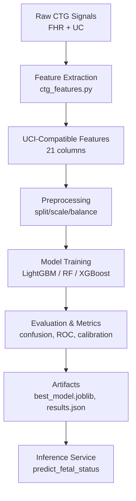
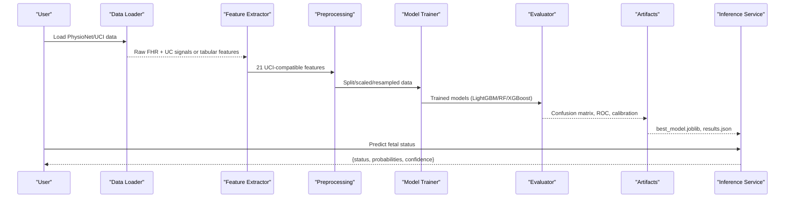
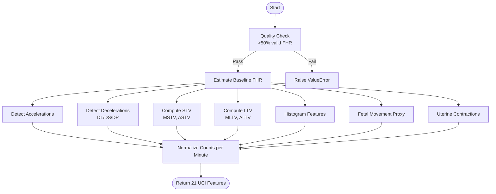
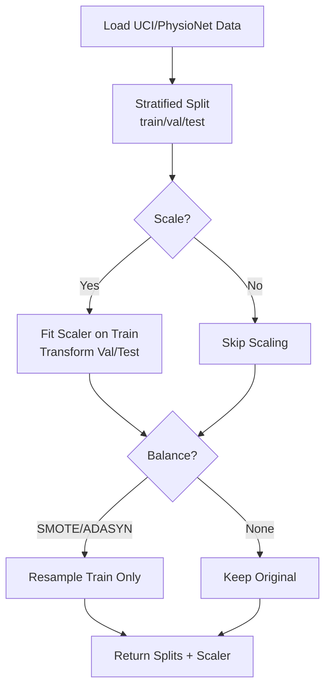
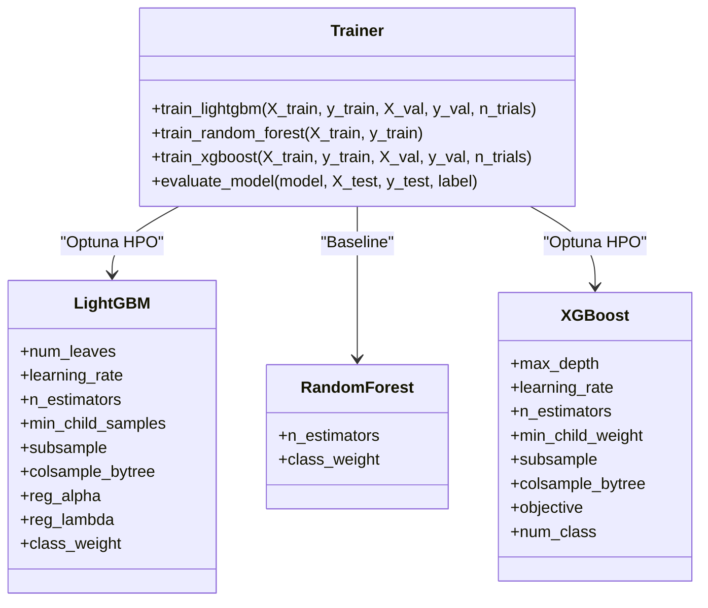
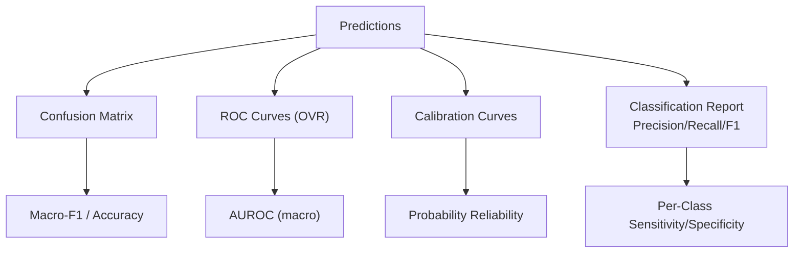
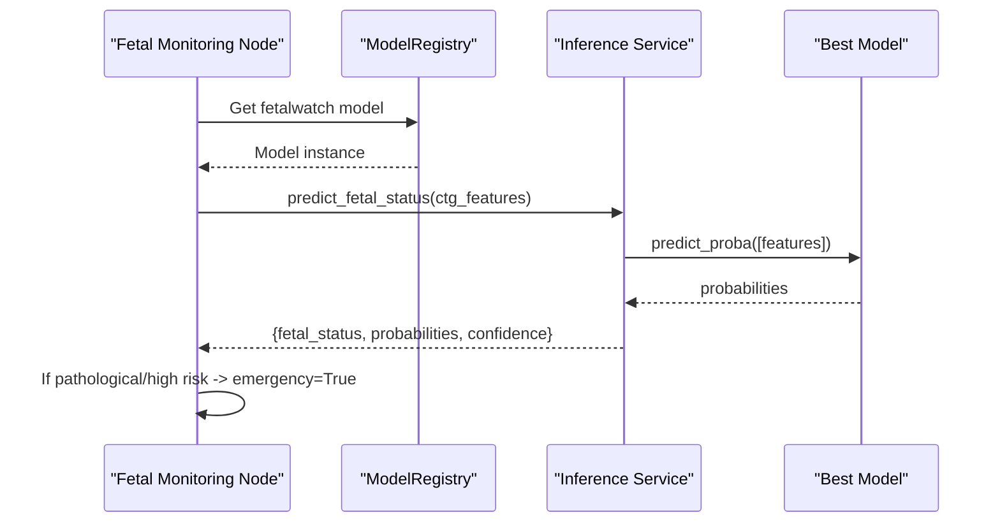
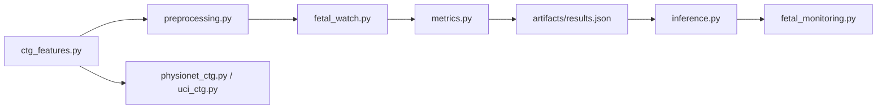

# FetalWatch Model

<cite>
**Referenced Files in This Document**
- [fetal_watch.py](file://src/models/fetal_watch.py)
- [ctg_features.py](file://src/features/ctg_features.py)
- [physionet_ctg.py](file://src/data/loaders/physionet_ctg.py)
- [uci_ctg.py](file://src/data/loaders/uci_ctg.py)
- [preprocessing.py](file://src/data/preprocessing.py)
- [metrics.py](file://src/evaluation/metrics.py)
- [run_models.py](file://scripts/run_models.py)
- [results.json](file://artifacts/fetalwatch/results.json)
- [inference.py](file://backend/services/inference.py)
- [fetal_monitoring.py](file://backend/agents/nodes/fetal_monitoring.py)
</cite>

## Table of Contents
1. [Introduction](#introduction)
2. [Project Structure](#project-structure)
3. [Core Components](#core-components)
4. [Architecture Overview](#architecture-overview)
5. [Detailed Component Analysis](#detailed-component-analysis)
6. [Dependency Analysis](#dependency-analysis)
7. [Performance Considerations](#performance-considerations)
8. [Troubleshooting Guide](#troubleshooting-guide)
9. [Conclusion](#conclusion)
10. [Appendices](#appendices)

## Introduction
FetalWatch is a three-class cardiotocography (CTG) classifier for fetal health assessment, predicting Normal, Suspect, and Pathological conditions from CTG-derived features. It trains on the UCI Cardiotocography dataset and supports feature extraction from raw PhysioNet CTU-UHB recordings to enable end-to-end processing from signals to clinical-grade predictions. The pipeline includes robust signal quality checks, heart rate variability analysis, uterine contraction detection, and engineered features aligned with the UCI schema. Models are optimized via Optuna hyperparameter search and evaluated with macro-F1, one-vs-rest AUROC, per-class precision/recall/F1, confusion matrices, and calibration diagnostics.

## Project Structure
The repository organizes data loading, feature engineering, model training, evaluation, and inference into modular components:
- Data loaders for UCI CTG and PhysioNet CTU-UHB records
- Feature extraction that maps raw FHR and UC signals to 21 UCI-compatible features
- Preprocessing pipeline for splitting, scaling, and class balancing
- Model training with LightGBM, Random Forest, and XGBoost
- Evaluation utilities for metrics and visualization
- Inference service integration for deployment

**Diagram sources**
- [ctg_features.py:506-593](file://src/features/ctg_features.py#L506-L593)
- [preprocessing.py:196-261](file://src/data/preprocessing.py#L196-L261)
- [fetal_watch.py:282-432](file://src/models/fetal_watch.py#L282-L432)
- [metrics.py:49-182](file://src/evaluation/metrics.py#L49-L182)
- [inference.py:207-248](file://backend/services/inference.py#L207-L248)

**Section sources**
- [fetal_watch.py:282-432](file://src/models/fetal_watch.py#L282-L432)
- [preprocessing.py:196-261](file://src/data/preprocessing.py#L196-L261)

## Core Components
- Classification categories: Normal, Suspect, Pathological
- Signal processing: baseline detection, accelerations/decelerations, short-term and long-term variability, histogram-based descriptors, fetal movement proxy, uterine contractions
- Data sources: UCI CTG dataset (training), PhysioNet CTU-UHB (signal ingestion)
- Preprocessing: stratified train/val/test splits, robust scaling, SMOTE/ADASYN for imbalance
- Models: LightGBM (Optuna HPO), Random Forest (baseline), XGBoost (Optuna HPO)
- Evaluation: macro-F1, OVR AUROC, per-class metrics, confusion matrix, calibration curves
- Inference: probability outputs, confidence scores, fallback handling

**Section sources**
- [uci_ctg.py:10-52](file://src/data/loaders/uci_ctg.py#L10-L52)
- [ctg_features.py:27-32](file://src/features/ctg_features.py#L27-L32)
- [ctg_features.py:39-76](file://src/features/ctg_features.py#L39-L76)
- [ctg_features.py:84-131](file://src/features/ctg_features.py#L84-L131)
- [ctg_features.py:139-224](file://src/features/ctg_features.py#L139-L224)
- [ctg_features.py:232-329](file://src/features/ctg_features.py#L232-L329)
- [ctg_features.py:337-409](file://src/features/ctg_features.py#L337-L409)
- [ctg_features.py:417-459](file://src/features/ctg_features.py#L417-L459)
- [ctg_features.py:467-498](file://src/features/ctg_features.py#L467-L498)
- [preprocessing.py:22-70](file://src/data/preprocessing.py#L22-L70)
- [preprocessing.py:80-130](file://src/data/preprocessing.py#L80-L130)
- [preprocessing.py:138-188](file://src/data/preprocessing.py#L138-L188)
- [fetal_watch.py:52-102](file://src/models/fetal_watch.py#L52-L102)
- [fetal_watch.py:109-173](file://src/models/fetal_watch.py#L109-L173)
- [fetal_watch.py:180-198](file://src/models/fetal_watch.py#L180-L198)
- [fetal_watch.py:205-275](file://src/models/fetal_watch.py#L205-L275)
- [metrics.py:49-182](file://src/evaluation/metrics.py#L49-L182)
- [inference.py:207-248](file://backend/services/inference.py#L207-L248)

## Architecture Overview
FetalWatch integrates signal processing, feature engineering, model training, and inference into a cohesive pipeline. Raw CTG recordings are loaded from PhysioNet or processed from UCI datasets; features are extracted and standardized; models are trained with balanced sampling and cross-validation; evaluation produces clinically relevant metrics; and the best model is persisted for inference.

**Diagram sources**
- [physionet_ctg.py:13-102](file://src/data/loaders/physionet_ctg.py#L13-L102)
- [ctg_features.py:506-593](file://src/features/ctg_features.py#L506-L593)
- [preprocessing.py:196-261](file://src/data/preprocessing.py#L196-L261)
- [fetal_watch.py:282-432](file://src/models/fetal_watch.py#L282-L432)
- [metrics.py:49-182](file://src/evaluation/metrics.py#L49-L182)
- [inference.py:207-248](file://backend/services/inference.py#L207-L248)

## Detailed Component Analysis

### CTG Signal Processing Pipeline
- Baseline detection: iterative median filtering removes accelerations/decelerations to estimate stable baseline FHR
- Acceleration detection: events where FHR rises ≥15 bpm above baseline for at least 15 seconds
- Deceleration detection: events where FHR drops ≥15 bpm below baseline for at least 15 seconds; classified as light (15–30 bpm), severe (>30 bpm), prolonged (>60 seconds)
- Variability analysis:
  - Short-term variability (STV): mean absolute difference between consecutive valid samples within 1-minute windows; yields MSTV and ASTV (percentage of windows with STV < 1 bpm)
  - Long-term variability (LTV): amplitude (max − min) per 1-minute window; yields MLTV and ALTV (percentage outside normal 10–30 bpm range)
- Histogram features: Width, Min, Max, Nmax (peaks), Nzeros, Mode, Mean, Median, Variance, Tendency (skewness indicator)
- Fetal movement proxy: counts rapid short-duration FHR changes (≥10 bpm within 2-second windows)
- Uterine contractions: peak detection in UC signal with minimum distance ~2 minutes and prominence threshold based on signal statistics

**Diagram sources**
- [ctg_features.py:39-76](file://src/features/ctg_features.py#L39-L76)
- [ctg_features.py:84-131](file://src/features/ctg_features.py#L84-L131)
- [ctg_features.py:139-224](file://src/features/ctg_features.py#L139-L224)
- [ctg_features.py:232-329](file://src/features/ctg_features.py#L232-L329)
- [ctg_features.py:337-409](file://src/features/ctg_features.py#L337-L409)
- [ctg_features.py:417-459](file://src/features/ctg_features.py#L417-L459)
- [ctg_features.py:467-498](file://src/features/ctg_features.py#L467-L498)
- [ctg_features.py:506-593](file://src/features/ctg_features.py#L506-L593)

**Section sources**
- [ctg_features.py:39-76](file://src/features/ctg_features.py#L39-L76)
- [ctg_features.py:84-131](file://src/features/ctg_features.py#L84-L131)
- [ctg_features.py:139-224](file://src/features/ctg_features.py#L139-L224)
- [ctg_features.py:232-329](file://src/features/ctg_features.py#L232-L329)
- [ctg_features.py:337-409](file://src/features/ctg_features.py#L337-L409)
- [ctg_features.py:417-459](file://src/features/ctg_features.py#L417-L459)
- [ctg_features.py:467-498](file://src/features/ctg_features.py#L467-L498)
- [ctg_features.py:506-593](file://src/features/ctg_features.py#L506-L593)

### Data Sources and Preprocessing
- UCI CTG loader reads a Parquet file, maps NSP codes to human-readable labels (Normal/Suspect/Pathological), and returns features without target leakage columns
- PhysioNet CTU-UHB loader reads WFDB .dat/.hea pairs, validates channels, and extracts FHR and UC signals with metadata
- Preprocessing pipeline:
  - Stratified split into train/validation/test (e.g., 70/15/15)
  - Scaling using RobustScaler (default), StandardScaler, or MinMaxScaler
  - Class imbalance handling via SMOTE or ADASYN on training set only

**Diagram sources**
- [uci_ctg.py:14-52](file://src/data/loaders/uci_ctg.py#L14-L52)
- [physionet_ctg.py:13-102](file://src/data/loaders/physionet_ctg.py#L13-L102)
- [preprocessing.py:22-70](file://src/data/preprocessing.py#L22-L70)
- [preprocessing.py:80-130](file://src/data/preprocessing.py#L80-L130)
- [preprocessing.py:138-188](file://src/data/preprocessing.py#L138-L188)
- [preprocessing.py:196-261](file://src/data/preprocessing.py#L196-L261)

**Section sources**
- [uci_ctg.py:14-52](file://src/data/loaders/uci_ctg.py#L14-L52)
- [physionet_ctg.py:13-102](file://src/data/loaders/physionet_ctg.py#L13-L102)
- [preprocessing.py:22-70](file://src/data/preprocessing.py#L22-L70)
- [preprocessing.py:80-130](file://src/data/preprocessing.py#L80-L130)
- [preprocessing.py:138-188](file://src/data/preprocessing.py#L138-L188)
- [preprocessing.py:196-261](file://src/data/preprocessing.py#L196-L261)

### Model Training and Hyperparameter Optimization
- LightGBM: Optuna HPO over leaves, learning rate, estimators, child samples, subsampling, column sampling, regularization; class_weight balanced; early stopping on validation
- Random Forest: baseline with fixed n_estimators and balanced weights; cross-validated macro-F1
- XGBoost: Optuna HPO over depth, learning rate, estimators, child weight, subsampling, column sampling; multi-class softprob objective; label mapping for integer classes
- Selection: best model by macro-F1; artifacts saved (model and results JSON)

**Diagram sources**
- [fetal_watch.py:109-173](file://src/models/fetal_watch.py#L109-L173)
- [fetal_watch.py:180-198](file://src/models/fetal_watch.py#L180-L198)
- [fetal_watch.py:205-275](file://src/models/fetal_watch.py#L205-L275)
- [fetal_watch.py:282-432](file://src/models/fetal_watch.py#L282-L432)

**Section sources**
- [fetal_watch.py:109-173](file://src/models/fetal_watch.py#L109-L173)
- [fetal_watch.py:180-198](file://src/models/fetal_watch.py#L180-L198)
- [fetal_watch.py:205-275](file://src/models/fetal_watch.py#L205-L275)
- [fetal_watch.py:282-432](file://src/models/fetal_watch.py#L282-L432)

### Evaluation Metrics and Clinical Interpretation
- Macro-F1: primary optimization metric across all classes
- One-vs-rest AUROC: multiclass separation performance
- Per-class precision/recall/F1: sensitivity (recall) critical for pathological detection; specificity inferred from precision and class prevalence
- Confusion matrix: misclassification patterns across Normal/Suspect/Pathological
- Calibration curves: reliability of predicted probabilities
- Results stored in artifacts for reproducibility and comparison

**Diagram sources**
- [metrics.py:49-182](file://src/evaluation/metrics.py#L49-L182)
- [metrics.py:238-285](file://src/evaluation/metrics.py#L238-L285)
- [metrics.py:292-341](file://src/evaluation/metrics.py#L292-L341)
- [results.json:1-249](file://artifacts/fetalwatch/results.json#L1-L249)

**Section sources**
- [metrics.py:49-182](file://src/evaluation/metrics.py#L49-L182)
- [metrics.py:238-285](file://src/evaluation/metrics.py#L238-L285)
- [metrics.py:292-341](file://src/evaluation/metrics.py#L292-L341)
- [results.json:1-249](file://artifacts/fetalwatch/results.json#L1-L249)

### Inference and Clinical Decision Support Integration
- Inference service loads the best model and predicts fetal status from 21 CTG features
- Returns fetal_status, per-class probabilities, and confidence score (highest probability)
- Handles missing features by defaulting to zero and ensures consistent column order
- Integrates with agent nodes to trigger alerts when pathological or high-risk preterm risk is detected

**Diagram sources**
- [fetal_monitoring.py:10-40](file://backend/agents/nodes/fetal_monitoring.py#L10-L40)
- [inference.py:207-248](file://backend/services/inference.py#L207-L248)

**Section sources**
- [inference.py:207-248](file://backend/services/inference.py#L207-L248)
- [fetal_monitoring.py:10-40](file://backend/agents/nodes/fetal_monitoring.py#L10-L40)

## Dependency Analysis
Key dependencies and relationships:
- Feature extraction depends on SciPy peak detection and WFDB for PhysioNet records
- Preprocessing relies on scikit-learn scalers and imbalanced-learn samplers
- Model training uses LightGBM, XGBoost, and scikit-learn ensemble methods with Optuna for HPO
- Evaluation uses scikit-learn metrics and matplotlib/seaborn for visualization
- Inference integrates with backend services and agent orchestration

**Diagram sources**
- [ctg_features.py:506-593](file://src/features/ctg_features.py#L506-L593)
- [preprocessing.py:196-261](file://src/data/preprocessing.py#L196-L261)
- [fetal_watch.py:282-432](file://src/models/fetal_watch.py#L282-L432)
- [metrics.py:49-182](file://src/evaluation/metrics.py#L49-L182)
- [physionet_ctg.py:13-102](file://src/data/loaders/physionet_ctg.py#L13-L102)
- [uci_ctg.py:14-52](file://src/data/loaders/uci_ctg.py#L14-L52)
- [inference.py:207-248](file://backend/services/inference.py#L207-L248)
- [fetal_monitoring.py:10-40](file://backend/agents/nodes/fetal_monitoring.py#L10-L40)

**Section sources**
- [ctg_features.py:506-593](file://src/features/ctg_features.py#L506-L593)
- [preprocessing.py:196-261](file://src/data/preprocessing.py#L196-L261)
- [fetal_watch.py:282-432](file://src/models/fetal_watch.py#L282-L432)
- [metrics.py:49-182](file://src/evaluation/metrics.py#L49-L182)
- [physionet_ctg.py:13-102](file://src/data/loaders/physionet_ctg.py#L13-L102)
- [uci_ctg.py:14-52](file://src/data/loaders/uci_ctg.py#L14-L52)
- [inference.py:207-248](file://backend/services/inference.py#L207-L248)
- [fetal_monitoring.py:10-40](file://backend/agents/nodes/fetal_monitoring.py#L10-L40)

## Performance Considerations
- Signal quality control: records with <50% valid FHR are rejected to ensure reliable features
- Windowed computations: STV/LTV computed over 1-minute windows to balance temporal resolution and noise robustness
- Imbalance handling: SMOTE/ADASYN applied only to training set to avoid data leakage
- Scaling strategy: RobustScaler preferred for outlier resistance in physiological signals
- Early stopping: LightGBM uses validation-based early stopping to prevent overfitting
- Computational efficiency: SHAP summaries subsample large datasets; Optuna pruner reduces wasted trials

[No sources needed since this section provides general guidance]

## Troubleshooting Guide
Common issues and resolutions:
- Missing data files: FileNotFoundError raised if UCI Parquet or PhysioNet directory not found; verify paths and permissions
- Corrupt records: Warnings logged and skipped; downstream code receives clean lists
- Low-quality signals: ValueError raised if valid FHR <50%; inspect recording integrity and preprocessing steps
- Channel mismatch: Records without FHR/UC channels are skipped; validate WFDB headers
- Inference failures: Exceptions caught and fallback returned; ensure model artifacts exist and features match expected schema

**Section sources**
- [physionet_ctg.py:44-78](file://src/data/loaders/physionet_ctg.py#L44-L78)
- [ctg_features.py:532-545](file://src/features/ctg_features.py#L532-L545)
- [ctg_features.py:631-662](file://src/features/ctg_features.py#L631-L662)
- [inference.py:220-248](file://backend/services/inference.py#L220-L248)

## Conclusion
FetalWatch provides a robust, clinically informed pipeline for CTG-based fetal health classification. By combining rigorous signal processing, engineered features aligned with established CTG standards, and carefully tuned tree-based models, it achieves strong performance across Normal, Suspect, and Pathological classes. The system supports end-to-end processing from raw signals to actionable predictions, with comprehensive evaluation metrics and integration points for clinical decision support workflows.

[No sources needed since this section summarizes without analyzing specific files]

## Appendices

### Classification Categories
- Normal: Healthy fetal condition
- Suspect: Indeterminate or borderline condition requiring monitoring
- Pathological: Abnormal fetal condition indicating potential distress

**Section sources**
- [uci_ctg.py:10-11](file://src/data/loaders/uci_ctg.py#L10-L11)

### Threshold Tuning Guidance
- Adjust decision thresholds per class to prioritize sensitivity for Pathological detection in high-stakes settings
- Use calibration curves to align predicted probabilities with observed frequencies
- Evaluate trade-offs between precision and recall using per-class metrics and confusion matrices

**Section sources**
- [metrics.py:238-285](file://src/evaluation/metrics.py#L238-L285)
- [results.json:1-249](file://artifacts/fetalwatch/results.json#L1-L249)

### Interpreting Outputs and Confidence Scores
- fetal_status: predicted class (Normal/Suspect/Pathological)
- probabilities: per-class likelihoods summing to 1
- confidence: highest probability value; lower values indicate uncertainty
- Integration: Agent nodes can trigger emergency flags when pathological or high-risk preterm risk is detected

**Section sources**
- [inference.py:207-248](file://backend/services/inference.py#L207-L248)
- [fetal_monitoring.py:10-40](file://backend/agents/nodes/fetal_monitoring.py#L10-L40)