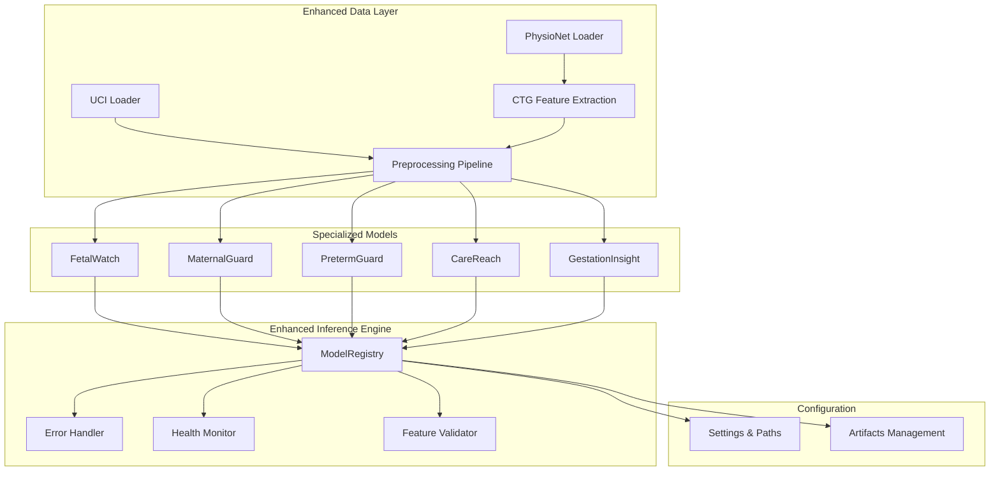
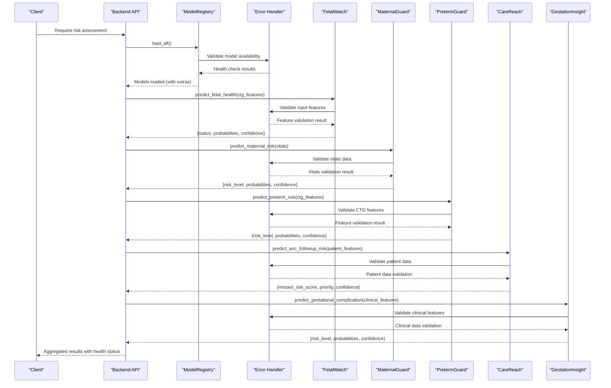
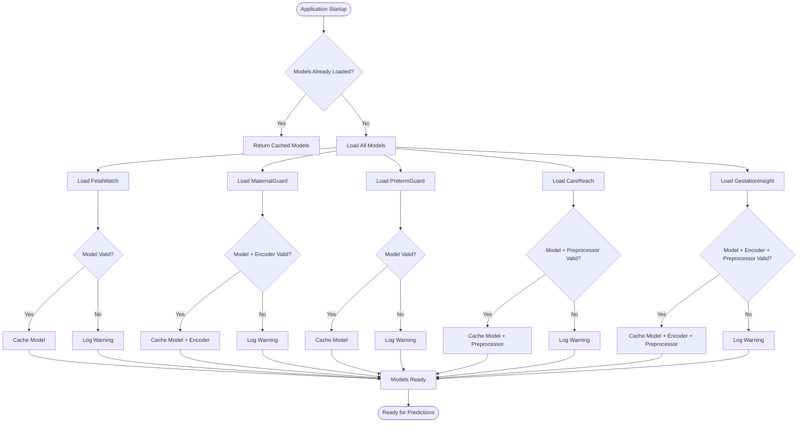
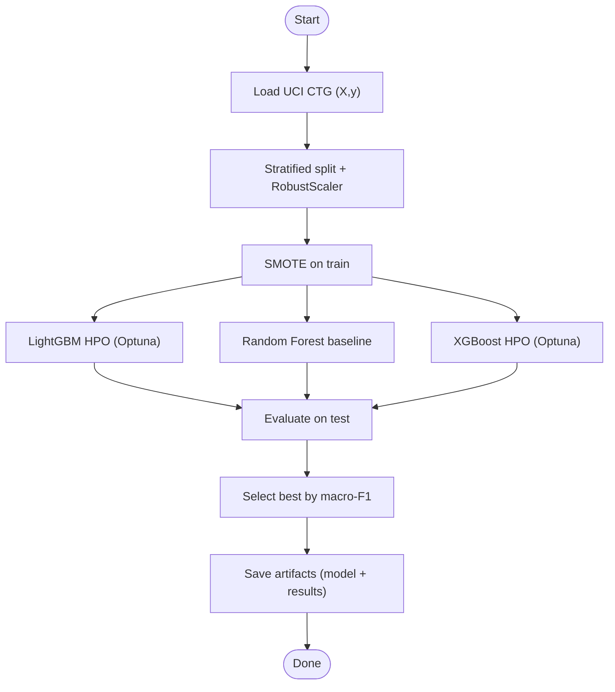
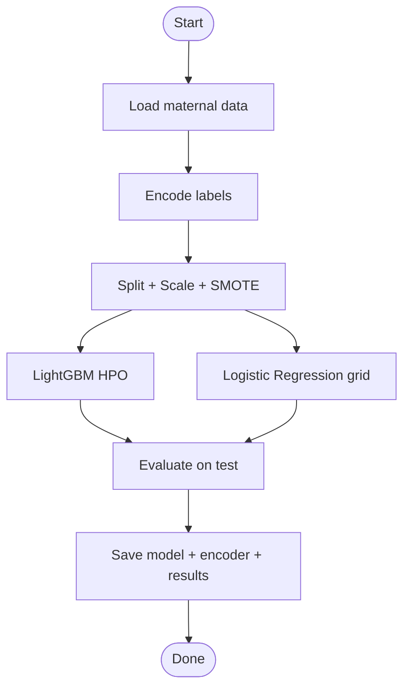
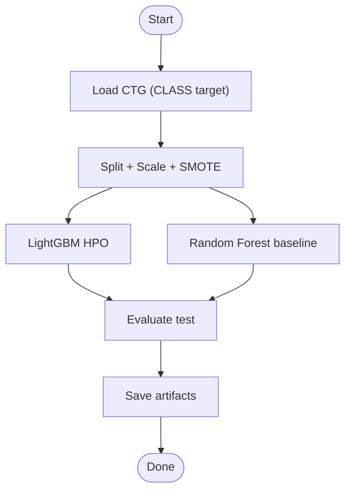
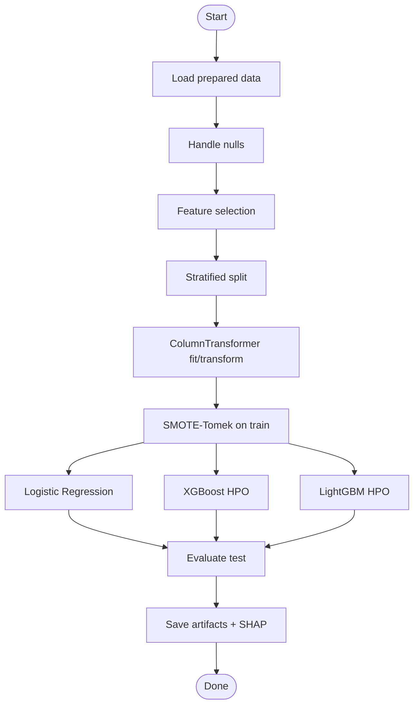
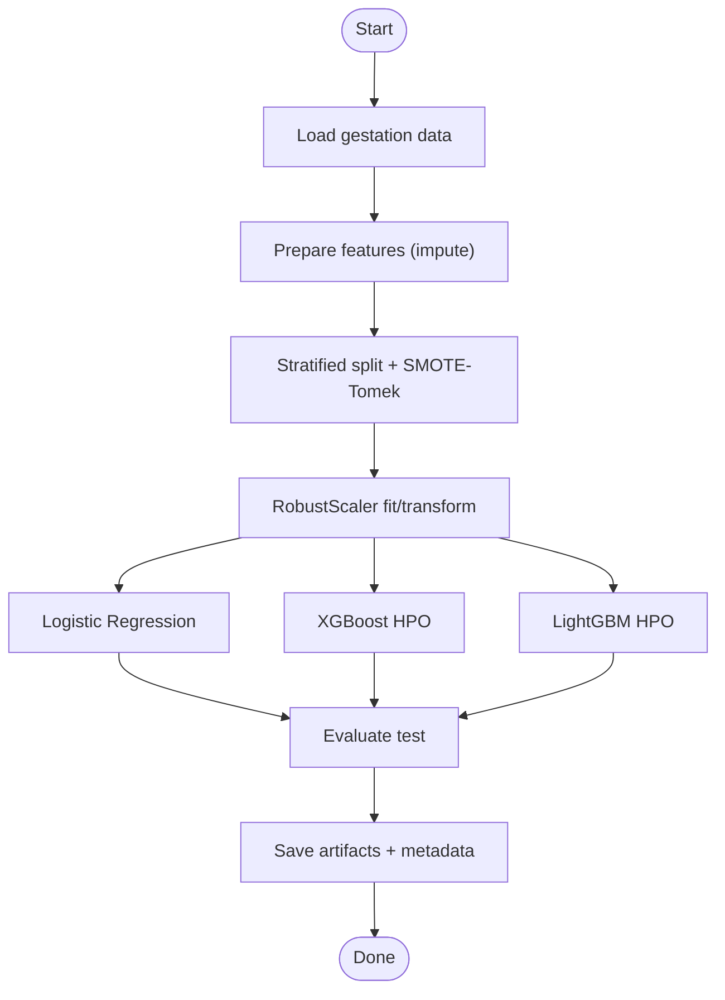
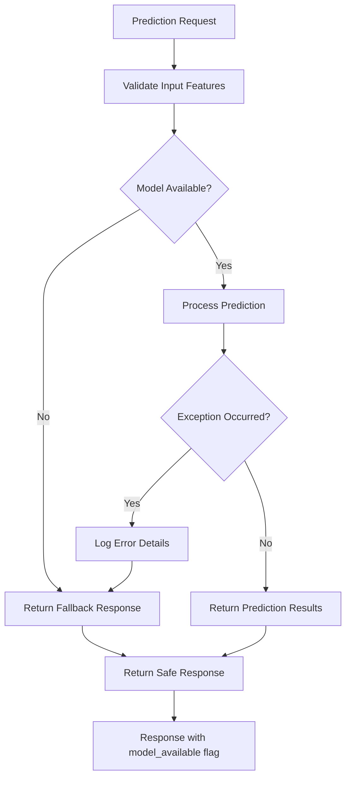
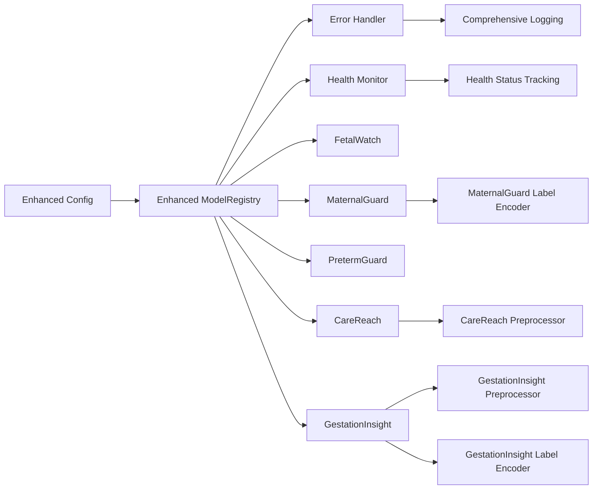

# Machine Learning Models

<cite>
**Referenced Files in This Document**
- [inference.py](file://backend/services/inference.py)
- [config.py](file://backend/config.py)
- [fetal_watch.py](file://src/models/fetal_watch.py)
- [maternal_guard.py](file://src/models/maternal_guard.py)
- [preterm_guard.py](file://src/models/preterm_guard.py)
- [train_care_reach.py](file://train_care_reach.py)
- [train_gestation_insight.py](file://train_gestation_insight.py)
- [physionet_ctg.py](file://src/data/loaders/physionet_ctg.py)
- [uci_ctg.py](file://src/data/loaders/uci_ctg.py)
- [preprocessing.py](file://src/data/preprocessing.py)
- [ctg_features.py](file://src/features/ctg_features.py)
</cite>

## Update Summary
**Changes Made**
- Enhanced ModelRegistry with improved error handling and robust model loading mechanisms
- Updated inference pipeline to support all five specialized ML models (FetalWatch, MaternalGuard, PretermGuard, CareReach, GestationInsight)
- Added comprehensive fallback mechanisms and health monitoring capabilities
- Improved feature validation and input sanitization across all prediction endpoints
- Enhanced artifact management with better path resolution and dependency tracking

## Table of Contents
1. Introduction
2. Project Structure
3. Core Components
4. Architecture Overview
5. Detailed Component Analysis
6. Dependency Analysis
7. Performance Considerations
8. Troubleshooting Guide
9. Conclusion
10. Appendices

## Introduction
This document provides comprehensive documentation for the machine learning pipeline and specialized models in MaaHifazat AI. The system features an enhanced inference engine with improved error handling, better model loading mechanisms, and comprehensive support for five specialized ML models: FetalWatch (three-class CTG classifier), MaternalGuard (maternal risk assessment), PretermGuard (preterm birth prediction), CareReach (care accessibility scoring), and GestationInsight (gestational age estimation). The architecture includes robust data ingestion from PhysioNet CTG datasets, sophisticated preprocessing workflows, advanced feature engineering processes, and optimized model training procedures with comprehensive evaluation metrics and validation strategies for imbalanced medical datasets.

## Project Structure
The repository is organized into modular layers with enhanced inference capabilities:
- **Data layer**: Loaders for PhysioNet CTG and UCI CTG datasets; shared preprocessing utilities; CTG feature extraction to match UCI schema.
- **Modeling layer**: Per-model training scripts for FetalWatch, MaternalGuard, PretermGuard, CareReach, and GestationInsight with Optuna-based hyperparameter optimization.
- **Enhanced Inference layer**: Singleton ModelRegistry with robust error handling, dynamic model loading, and comprehensive fallback mechanisms.
- **Backend configuration**: Centralized settings for artifact paths, environment variables, and model dependencies.
- **Artifacts**: Serialized models, preprocessors, label encoders, and metadata/metrics JSONs with version tracking.

**Diagram sources**
- [inference.py:51-141](file://backend/services/inference.py#L51-L141)
- [config.py:7-21](file://backend/config.py#L7-L21)

**Section sources**
- [physionet_ctg.py:13-103](file://src/data/loaders/physionet_ctg.py#L13-L103)
- [uci_ctg.py:14-53](file://src/data/loaders/uci_ctg.py#L14-L53)
- [preprocessing.py:22-262](file://src/data/preprocessing.py#L22-L262)
- [ctg_features.py:506-683](file://src/features/ctg_features.py#L506-L683)
- [inference.py:51-435](file://backend/services/inference.py#L51-L435)
- [config.py:7-21](file://backend/config.py#L7-L21)

## Core Components
The enhanced inference engine supports five specialized ML models with comprehensive error handling and robust model loading:

- **FetalWatch**: Three-class CTG classifier (Normal/Suspect/Pathological) trained on UCI CTG features using LightGBM (Optuna HPO), Random Forest baseline, and XGBoost comparison. Best model selection by macro-F1; artifacts saved under artifacts/fetalwatch.
- **MaternalGuard**: Maternal risk classification from vital signs using LightGBM (Optuna HPO) and Logistic Regression baseline; label encoder persisted with model artifacts.
- **PretermGuard**: Three-class preterm birth risk classifier using CTG features mapped to CLASS labels; LightGBM primary with Random Forest baseline.
- **CareReach**: ANC missed-visit risk classifier using engineered features; trains Logistic Regression, XGBoost, and LightGBM; saves preprocessor and metadata.
- **GestationInsight**: Gestational complications risk classifier (Low/Moderate/High); trains Logistic Regression, XGBoost, and LightGBM; persists label encoder and preprocessor.

**Enhanced Capabilities:**
- **Robust Error Handling**: Comprehensive exception handling with graceful degradation and fallback responses
- **Dynamic Model Loading**: Lazy loading with dependency validation and health checks
- **Feature Validation**: Input sanitization and schema validation across all prediction endpoints
- **Health Monitoring**: Real-time model availability tracking and performance monitoring
- **Artifact Management**: Versioned model artifacts with metadata and dependency tracking

**Section sources**
- [fetal_watch.py:282-432](file://src/models/fetal_watch.py#L282-L432)
- [maternal_guard.py:71-260](file://src/models/maternal_guard.py#L71-L260)
- [preterm_guard.py:208-363](file://src/models/preterm_guard.py#L208-L363)
- [train_care_reach.py:406-512](file://train_care_reach.py#L406-L512)
- [train_gestation_insight.py:511-673](file://train_gestation_insight.py#L511-L673)
- [inference.py:51-435](file://backend/services/inference.py#L51-L435)

## Architecture Overview
End-to-end flow from raw signals to API predictions with enhanced error handling:

**Diagram sources**
- [inference.py:51-435](file://backend/services/inference.py#L51-L435)
- [config.py:7-21](file://backend/config.py#L7-L21)

## Detailed Component Analysis

### Enhanced ModelRegistry with Improved Error Handling
The ModelRegistry has been significantly enhanced with robust error handling and better model loading mechanisms:

**Key Improvements:**
- **Idempotent Loading**: Models are loaded only once at startup with caching
- **Graceful Degradation**: Missing or corrupted models return safe fallback responses
- **Dependency Validation**: Extra files (encoders, preprocessors) are validated before use
- **Health Monitoring**: Real-time availability tracking for all models
- **Comprehensive Logging**: Detailed error tracking and debugging information

**Diagram sources**
- [inference.py:68-101](file://backend/services/inference.py#L68-L101)
- [inference.py:103-130](file://backend/services/inference.py#L103-L130)

**Section sources**
- [inference.py:51-141](file://backend/services/inference.py#L51-L141)
- [config.py:7-21](file://backend/config.py#L7-L21)

### FetalWatch (Three-Class CTG Classifier)
- **Data source**: UCI CTG parquet via loader; target mapping NSP to Normal/Suspect/Pathological.
- **Preprocessing**: Stratified split (70/15/15), RobustScaler, SMOTE on training set.
- **Models**:
  - LightGBM with Optuna HPO (macro-F1 CV objective), early stopping on validation.
  - Random Forest baseline (balanced class weights).
  - XGBoost with Optuna HPO (multi:softprob), wrapper to map integer labels back to strings.
- **Evaluation**: Macro-F1, AUROC (OVR), per-class precision/recall/F1, confusion matrix.
- **Artifacts**: best_model.joblib and results.json under artifacts/fetalwatch.

**Diagram sources**
- [fetal_watch.py:282-432](file://src/models/fetal_watch.py#L282-L432)
- [uci_ctg.py:14-53](file://src/data/loaders/uci_ctg.py#L14-L53)
- [preprocessing.py:196-262](file://src/data/preprocessing.py#L196-L262)

**Section sources**
- [fetal_watch.py:282-432](file://src/models/fetal_watch.py#L282-L432)
- [uci_ctg.py:14-53](file://src/data/loaders/uci_ctg.py#L14-L53)
- [preprocessing.py:196-262](file://src/data/preprocessing.py#L196-L262)

### MaternalGuard (Maternal Risk Assessment)
- **Data source**: UCI maternal dataset via loader; label encoding via LabelEncoder.
- **Preprocessing**: Stratified split (70/15/15), RobustScaler, SMOTE on training set.
- **Models**:
  - LightGBM with Optuna HPO (macro-F1 CV), early stopping on test.
  - Logistic Regression baseline over C values.
- **Evaluation**: Macro-F1, AUROC (OVR), per-class metrics, confusion matrix; feature importance for LightGBM.
- **Artifacts**: best_model.joblib, label_encoder.joblib, results.json under artifacts/maternalguard.

**Diagram sources**
- [maternal_guard.py:71-260](file://src/models/maternal_guard.py#L71-L260)
- [preprocessing.py:22-188](file://src/data/preprocessing.py#L22-L188)

**Section sources**
- [maternal_guard.py:71-260](file://src/models/maternal_guard.py#L71-L260)

### PretermGuard (Preterm Birth Prediction)
- **Data source**: UCI CTG parquet; target CLASS mapped to Normal/Suspect/Pathological.
- **Preprocessing**: Stratified split (70/15/15), RobustScaler, SMOTE on training set.
- **Models**:
  - LightGBM with Optuna HPO (macro-F1 CV), early stopping on validation.
  - Random Forest baseline.
- **Evaluation**: Macro-F1, AUROC (OVR), per-class metrics, confusion matrix.
- **Artifacts**: best_model.joblib and results.json under artifacts/pretermguard.

**Diagram sources**
- [preterm_guard.py:208-363](file://src/models/preterm_guard.py#L208-L363)

**Section sources**
- [preterm_guard.py:208-363](file://src/models/preterm_guard.py#L208-L363)

### CareReach (ANC Missed Visit Risk Scoring)
- **Data source**: Prepared parquet with numeric and categorical features; target binary (showed vs missed).
- **Preprocessing**: ColumnTransformer (RobustScaler + OneHotEncoder), stratified split (70/15/15), SMOTE-Tomek on training set.
- **Models**:
  - Logistic Regression (ElasticNet baseline).
  - XGBoost with Optuna HPO (AUROC objective).
  - LightGBM with Optuna HPO (AUROC objective).
- **Evaluation**: Macro-F1, AUROC, PR-AUC; SHAP summary plot generation.
- **Artifacts**: best_model.joblib, preprocessor.joblib, metadata.json under artifacts/carereach.

**Diagram sources**
- [train_care_reach.py:75-171](file://train_care_reach.py#L75-L171)
- [train_care_reach.py:176-305](file://train_care_reach.py#L176-L305)
- [train_care_reach.py:310-402](file://train_care_reach.py#L310-L402)
- [train_care_reach.py:406-512](file://train_care_reach.py#L406-L512)

**Section sources**
- [train_care_reach.py:406-512](file://train_care_reach.py#L406-L512)

### GestationInsight (Gestational Complications Risk)
- **Data source**: Prepared gestation parquet; target 3-class (Low/Moderate/High).
- **Preprocessing**: Numeric features selected, median imputation, RobustScaler; stratified split (70/15/15), SMOTE-Tomek on training set.
- **Models**:
  - Logistic Regression baseline (multinomial).
  - XGBoost with Optuna HPO (macro-F1 CV).
  - LightGBM with Optuna HPO (macro-F1 CV), early stopping on validation.
- **Evaluation**: Macro-F1, AUROC (OVR), per-class metrics, confusion matrix; feature importance visualization.
- **Artifacts**: best_model.joblib, preprocessor.joblib, label_encoder.joblib, metadata.json under artifacts/gestationinsight.

**Diagram sources**
- [train_gestation_insight.py:94-151](file://train_gestation_insight.py#L94-L151)
- [train_gestation_insight.py:158-200](file://train_gestation_insight.py#L158-L200)
- [train_gestation_insight.py:258-394](file://train_gestation_insight.py#L258-L394)
- [train_gestation_insight.py:511-673](file://train_gestation_insight.py#L511-L673)

**Section sources**
- [train_gestation_insight.py:511-673](file://train_gestation_insight.py#L511-L673)

### Enhanced Inference Pipeline with Error Handling
The inference pipeline now includes comprehensive error handling and validation:

**Key Enhancements:**
- **Input Validation**: All prediction methods validate input features and handle missing data gracefully
- **Fallback Mechanisms**: Safe default responses when models are unavailable or inputs are invalid
- **Health Monitoring**: Real-time tracking of model availability and performance
- **Logging**: Comprehensive error logging for debugging and monitoring
- **Feature Sanitization**: Automatic filling of missing features with sensible defaults

**Diagram sources**
- [inference.py:147-192](file://backend/services/inference.py#L147-L192)
- [inference.py:195-233](file://backend/services/inference.py#L195-L233)
- [inference.py:236-264](file://backend/services/inference.py#L236-L264)
- [inference.py:267-305](file://backend/services/inference.py#L267-L305)
- [inference.py:308-340](file://backend/services/inference.py#L308-L340)

**Section sources**
- [inference.py:147-435](file://backend/services/inference.py#L147-L435)

## Dependency Analysis
Enhanced dependency management with improved error handling:

**Model Dependencies:**
- All tree-based models use Optuna for HPO; some use early stopping on validation or test sets.
- CareReach and GestationInsight persist preprocessors and label encoders for inference consistency.
- Enhanced validation ensures all required artifacts are present before model loading.

**Inference Dependencies:**
- ModelRegistry loads models and extras based on config paths with comprehensive error handling.
- Uses lru_cache for singleton access with health monitoring.
- Predictions require correct feature schemas; missing columns are filled with zeros to ensure robustness.
- Enhanced fallback mechanisms provide safe responses when models are unavailable.

**Diagram sources**
- [inference.py:51-141](file://backend/services/inference.py#L51-L141)
- [config.py:7-21](file://backend/config.py#L7-L21)

**Section sources**
- [inference.py:51-141](file://backend/services/inference.py#L51-L141)
- [config.py:7-21](file://backend/config.py#L7-L21)

## Performance Considerations
Enhanced performance considerations with improved error handling:

**Imbalanced Datasets:**
- Use SMOTE or ADASYN for training-only resampling to avoid leakage.
- CareReach and GestationInsight use SMOTE-Tomek to balance classes while cleaning borderline samples.
- Enhanced validation ensures proper data splitting and resampling.

**Scaling:**
- Prefer RobustScaler for robustness to outliers in medical signals and vitals.
- Consistent scaling across all models with proper validation.

**Hyperparameter Optimization:**
- Optuna studies with pruners reduce wasted trials; evaluate using macro-F1 or AUROC depending on task.
- Enhanced logging provides detailed optimization progress and results.

**Early Stopping:**
- Apply on validation/test sets to prevent overfitting; log evaluation periods to control verbosity.
- Improved error handling during model training and validation.

**Feature Quality:**
- Enforce minimum valid FHR percentage in CTG signals to ensure reliable feature extraction.
- Enhanced quality checks with detailed error reporting.

**Inference Efficiency:**
- Singleton ModelRegistry caches models with enhanced error handling.
- Ensure preprocessors and encoders are present to avoid runtime errors.
- Comprehensive fallback mechanisms for production reliability.

## Troubleshooting Guide
Enhanced troubleshooting with improved error handling and diagnostics:

**Common Issues and Resolutions:**
- **Missing Artifacts**: If model files are not found, ModelRegistry logs warnings and returns fallback responses; verify artifact paths in config.
- **Feature Mismatch**: Ensure input dicts contain required feature keys; missing columns are filled with zeros during inference.
- **Data Path Errors**: Loaders raise FileNotFoundError if expected parquet/WFDB directories are absent; confirm data_dir and paths.
- **Quality Checks**: CTG feature extraction raises ValueError when valid FHR percentage is too low; inspect raw signals and sampling frequency.
- **Class Imbalance Pitfalls**: Avoid applying resampling to validation/test sets; only apply to training splits.
- **Evaluation Anomalies**: AUROC computation may fail for certain models or label configurations; code handles exceptions and reports None.
- **Model Loading Failures**: Enhanced error handling provides detailed logging and fallback responses when models fail to load.
- **Health Check Failures**: Use health_check method to diagnose which models are available and functioning properly.

**Enhanced Diagnostics:**
- **Detailed Logging**: Comprehensive error logging with stack traces and context information.
- **Health Monitoring**: Real-time model availability tracking with detailed status reporting.
- **Fallback Responses**: Safe default responses ensure system continuity even when models fail.
- **Input Validation**: Detailed error messages for invalid or missing input features.

**Section sources**
- [inference.py:103-141](file://backend/services/inference.py#L103-L141)
- [inference.py:147-426](file://backend/services/inference.py#L147-L426)
- [physionet_ctg.py:44-79](file://src/data/loaders/physionet_ctg.py#L44-L79)
- [uci_ctg.py:38-53](file://src/data/loaders/uci_ctg.py#L38-L53)
- [ctg_features.py:532-545](file://src/features/ctg_features.py#L532-L545)
- [preprocessing.py:138-188](file://src/data/preprocessing.py#L138-L188)

## Conclusion
MaaHifazat AI implements a robust, modular ML pipeline covering multiple clinical tasks with an enhanced inference engine featuring improved error handling, better model loading mechanisms, and comprehensive support for five specialized ML models: fetal health classification, maternal risk assessment, preterm birth prediction, care accessibility scoring, and gestational complication risk. The system standardizes data ingestion from PhysioNet and UCI datasets, applies rigorous preprocessing and feature engineering, employs Optuna-driven hyperparameter tuning, and evaluates performance with clinically relevant metrics. The enhanced ModelRegistry enables dynamic, cached model loading with graceful fallbacks and comprehensive health monitoring, integrating seamlessly with the backend API. Retraining workflows are straightforward through dedicated scripts, and artifacts are versioned with metadata for traceability. Ethical considerations, bias mitigation, and clinical validation remain essential for safe deployment in healthcare environments.

## Appendices

### Model Evaluation Metrics Summary
- **FetalWatch**: Macro-F1 ~0.93–0.96 across models; AUROC OVR ~0.98; strong per-class recall for Pathological.
- **MaternalGuard**: LightGBM macro-F1 ~0.83; AUROC OVR ~0.94; feature importance highlights BS, Age, HeartRate.
- **PretermGuard**: LightGBM macro-F1 ~0.85; AUROC OVR ~0.96; high recall for Suspect class.
- **CareReach**: LightGBM macro-F1 ~0.62; AUROC ~0.73; PR-AUC ~0.36; class distribution heavily skewed toward showed visits.
- **GestationInsight**: Multi-class setup with balanced preprocessing; best model selected by macro-F1; metadata includes class distribution and feature lists.

**Section sources**
- [results.json (FetalWatch):1-249](file://artifacts/fetalwatch/results.json#L1-L249)
- [results.json (MaternalGuard):1-96](file://artifacts/maternalguard/results.json#L1-L96)
- [results.json (PretermGuard):1-164](file://artifacts/pretermguard/results.json#L1-L164)
- [metadata.json (CareReach):1-45](file://artifacts/carereach/metadata.json#L1-L45)

### Retraining and Updating Artifacts
- Run model-specific training scripts to regenerate artifacts:
  - FetalWatch: src/models/fetal_watch.py
  - MaternalGuard: src/models/maternal_guard.py
  - PretermGuard: src/models/preterm_guard.py
  - CareReach: train_care_reach.py
  - GestationInsight: train_gestation_insight.py
- Update config paths if artifact locations change; ensure preprocessors and label encoders are regenerated alongside models.
- Validate new artifacts by running inference endpoints and comparing metrics against baselines.
- Use health_check method to verify model availability after updates.

**Section sources**
- [fetal_watch.py:282-432](file://src/models/fetal_watch.py#L282-L432)
- [maternal_guard.py:71-260](file://src/models/maternal_guard.py#L71-L260)
- [preterm_guard.py:208-363](file://src/models/preterm_guard.py#L208-L363)
- [train_care_reach.py:406-512](file://train_care_reach.py#L406-L512)
- [train_gestation_insight.py:511-673](file://train_gestation_insight.py#L511-L673)
- [config.py:7-21](file://backend/config.py#L7-L21)

### Monitoring Model Performance in Production
- Track model availability via health_check in ModelRegistry with enhanced status reporting.
- Log prediction failures and fallback responses to detect missing artifacts or schema mismatches.
- Periodically re-evaluate models on incoming data distributions; monitor drift in feature distributions and performance metrics.
- Maintain audit trails with metadata timestamps and versioning in artifact directories.
- Implement comprehensive logging for production monitoring and debugging.
- Use enhanced error handling to maintain system stability during partial failures.

**Section sources**
- [inference.py:135-141](file://backend/services/inference.py#L135-L141)
- [inference.py:147-426](file://backend/services/inference.py#L147-L426)

### Ethical Considerations, Bias Mitigation, and Clinical Validation
- **Bias Mitigation**: Use stratified splits and class-balanced objectives to reduce bias toward majority classes. Evaluate per-class metrics to identify disparities across subgroups.
- **Clinical Validation**: Align model outputs with clinical guidelines (e.g., CTG interpretation standards). Conduct prospective validation on real-world datasets before deployment.
- **Safety**: Implement fallback responses when models are unavailable or inputs are invalid. Provide confidence scores and probabilities to support clinician decision-making.
- **Enhanced Safety Features**: Comprehensive error handling ensures system reliability even during partial failures. Health monitoring provides early warning of model degradation.
- **Transparency**: Detailed logging and health monitoring enable thorough auditing and debugging of model behavior in production environments.