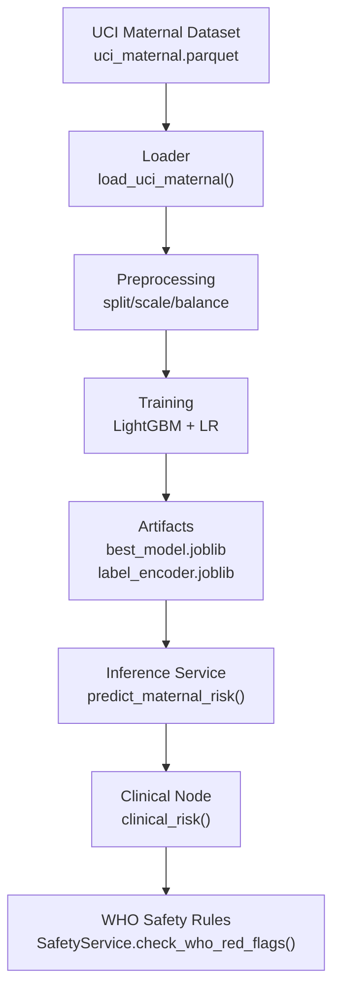
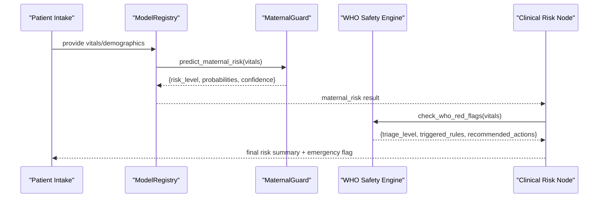
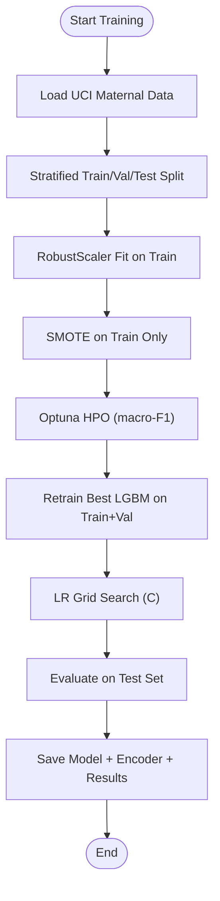
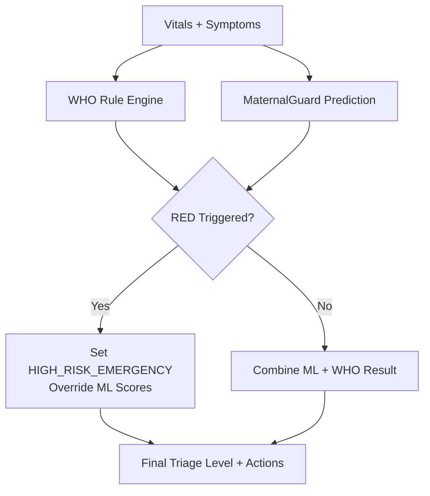
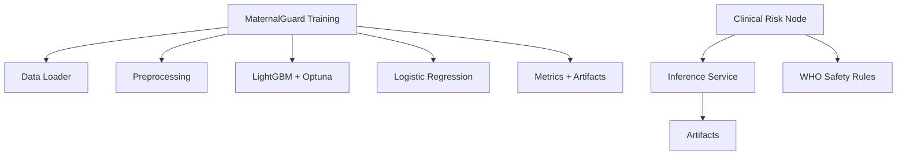

# MaternalGuard Model

<cite>
**Referenced Files in This Document**
- [maternal_guard.py](file://src/models/maternal_guard.py)
- [uci_maternal.py](file://src/data/loaders/uci_maternal.py)
- [preprocessing.py](file://src/data/preprocessing.py)
- [download_uci.py](file://scripts/download_uci.py)
- [results.json](file://artifacts/maternalguard/results.json)
- [inference.py](file://backend/services/inference.py)
- [clinical_risk.py](file://backend/agents/nodes/clinical_risk.py)
- [safety_rules.py](file://safety_rules.py)
- [DATASET_REGISTRY.md](file://DATASET_REGISTRY.md)
</cite>

## Table of Contents
1. [Introduction](#introduction)
2. [Project Structure](#project-structure)
3. [Core Components](#core-components)
4. [Architecture Overview](#architecture-overview)
5. [Detailed Component Analysis](#detailed-component-analysis)
6. [Dependency Analysis](#dependency-analysis)
7. [Performance Considerations](#performance-considerations)
8. [Troubleshooting Guide](#troubleshooting-guide)
9. [Conclusion](#conclusion)
10. [Appendices](#appendices)

## Introduction
MaternalGuard is a maternal health risk classification model that predicts whether a pregnant patient is at low, mid, or high risk based on a small set of vital signs and demographic features. It is trained on the UCI Maternal Health Risk dataset and integrated into a clinical workflow where it runs alongside deterministic WHO-based safety rules to ensure safe triage decisions. The system outputs class probabilities and confidence scores to support interpretation and thresholding for intervention pathways.

## Project Structure
The MaternalGuard pipeline spans data loading, preprocessing, training, evaluation, artifact persistence, and runtime inference:
- Data loading from UCI Maternal Health Risk dataset (Parquet)
- Preprocessing: stratified splits, scaling, and class imbalance handling
- Training: LightGBM with Optuna hyperparameter optimization and Logistic Regression baseline
- Evaluation: macro-F1, per-class metrics, AUROC (one-vs-rest), confusion matrices
- Artifacts: best model and label encoder saved for inference
- Inference service: loads artifacts, handles missing features, returns risk level and probabilities
- Clinical integration: combined with WHO red-flag rules to enforce safety overrides

**Diagram sources**
- [uci_maternal.py:11-47](file://src/data/loaders/uci_maternal.py#L11-L47)
- [preprocessing.py:22-188](file://src/data/preprocessing.py#L22-L188)
- [maternal_guard.py:71-260](file://src/models/maternal_guard.py#L71-L260)
- [inference.py:153-202](file://backend/services/inference.py#L153-L202)
- [clinical_risk.py:15-62](file://backend/agents/nodes/clinical_risk.py#L15-L62)
- [safety_rules.py:89-167](file://safety_rules.py#L89-L167)

**Section sources**
- [uci_maternal.py:11-47](file://src/data/loaders/uci_maternal.py#L11-L47)
- [preprocessing.py:22-188](file://src/data/preprocessing.py#L22-L188)
- [maternal_guard.py:71-260](file://src/models/maternal_guard.py#L71-L260)
- [inference.py:153-202](file://backend/services/inference.py#L153-L202)
- [clinical_risk.py:15-62](file://backend/agents/nodes/clinical_risk.py#L15-L62)
- [safety_rules.py:89-167](file://safety_rules.py#L89-L167)

## Core Components
- Data loader: reads UCI Maternal Health Risk Parquet file and separates features from target labels.
- Preprocessing: stratified train/validation/test split; robust scaling; SMOTE oversampling for class imbalance.
- Training: LightGBM classifier optimized via Optuna using macro-F1; Logistic Regression baseline with grid search over regularization strength.
- Evaluation: classification report, macro-F1, one-vs-rest AUROC, confusion matrix; feature importance for LightGBM.
- Inference: constructs feature vector, fills missing values with zeros, computes probabilities, decodes labels via saved encoder.
- Clinical integration: combines ML prediction with WHO rule engine; RED triage overrides ML scores.

**Section sources**
- [uci_maternal.py:11-47](file://src/data/loaders/uci_maternal.py#L11-L47)
- [preprocessing.py:22-188](file://src/data/preprocessing.py#L22-L188)
- [maternal_guard.py:41-260](file://src/models/maternal_guard.py#L41-L260)
- [inference.py:153-202](file://backend/services/inference.py#L153-L202)
- [clinical_risk.py:15-62](file://backend/agents/nodes/clinical_risk.py#L15-L62)
- [safety_rules.py:89-167](file://safety_rules.py#L89-L167)

## Architecture Overview
MaternalGuard operates within a broader clinical agent pipeline:
- Input: vitals and demographics collected during patient intake.
- Prediction: MaternalGuard returns risk level and probabilities.
- Safety: WHO rules evaluate danger signs and can override ML results to RED triage when necessary.
- Output: structured result including maternal risk, gestational risk (if available), WHO triage level, and emergency flag.

**Diagram sources**
- [inference.py:153-202](file://backend/services/inference.py#L153-L202)
- [clinical_risk.py:15-62](file://backend/agents/nodes/clinical_risk.py#L15-L62)
- [safety_rules.py:89-167](file://safety_rules.py#L89-L167)

## Detailed Component Analysis

### Input Features
MaternalGuard uses six numeric features:
- Age
- SystolicBP
- DiastolicBP
- BS (Blood Sugar)
- BodyTemp
- HeartRate

These are defined in the inference service’s feature list and align with the UCI Maternal Health Risk dataset’s feature set. Missing features are filled with zeros during inference to ensure robustness.

**Section sources**
- [inference.py:31-33](file://backend/services/inference.py#L31-L33)
- [inference.py:171-177](file://backend/services/inference.py#L171-L177)
- [DATASET_REGISTRY.md:32-49](file://DATASET_REGISTRY.md#L32-L49)

### Risk Scoring Algorithm
- Model family: LightGBM classifier (primary) and Logistic Regression (baseline).
- Hyperparameter tuning: Optuna maximizes macro-F1 via 5-fold stratified CV; parameters include tree depth, learning rate, estimators, subsample, column sampling, and regularization.
- Class imbalance: SMOTE applied to training set; class weights set to balanced in models.
- Scaling: RobustScaler fitted on training data and applied to validation/test sets.
- Probabilities: predict_proba yields per-class probabilities; confidence equals the probability of the predicted class.

**Diagram sources**
- [maternal_guard.py:71-260](file://src/models/maternal_guard.py#L71-L260)
- [preprocessing.py:22-188](file://src/data/preprocessing.py#L22-L188)

**Section sources**
- [maternal_guard.py:41-260](file://src/models/maternal_guard.py#L41-L260)
- [preprocessing.py:22-188](file://src/data/preprocessing.py#L22-L188)

### Probability Thresholds and Risk Categories
- Classes: low risk, mid risk, high risk.
- Predictions: model outputs probabilities for each class; the highest probability determines the risk level.
- Confidence: the maximum probability across classes; used downstream for quality checks.
- Intervention thresholds: not hard-coded in the model; clinicians should use the full probability distribution and confidence to decide actions. For example, elevated probability for high risk or low confidence may trigger additional assessment.

**Section sources**
- [results.json:1-96](file://artifacts/maternalguard/results.json#L1-L96)
- [inference.py:171-202](file://backend/services/inference.py#L171-L202)

### Integration with Clinical Guidelines
- WHO Red Flags: deterministic rules evaluate danger signs (e.g., severe hypertension, hemorrhage, eclampsia, sepsis indicators, reduced fetal movement, unconsciousness).
- Override behavior: if any RED rule triggers, triage level becomes HIGH_RISK_EMERGENCY and ML scores are overridden to prioritize immediate intervention.
- Combined output: clinical node aggregates MaternalGuard prediction, optional gestational complication risk, and WHO triage level, setting an emergency flag when appropriate.

**Diagram sources**
- [safety_rules.py:89-167](file://safety_rules.py#L89-L167)
- [clinical_risk.py:15-62](file://backend/agents/nodes/clinical_risk.py#L15-L62)

**Section sources**
- [safety_rules.py:89-167](file://safety_rules.py#L89-L167)
- [clinical_risk.py:15-62](file://backend/agents/nodes/clinical_risk.py#L15-L62)

### Training Dataset and Feature Engineering
- Dataset: UCI Maternal Health Risk dataset (id=863), stored as Parquet.
- Features: Age, Systolic BP, Diastolic BP, Blood Sugar, Body Temperature, Heart Rate.
- Target: RiskLevel (low/mid/high).
- Download: script fetches datasets from UCI repository and saves as Parquet files.
- Missing data handling: inference fills missing features with zeros; training relies on dataset completeness; scaling and balancing address distribution issues.

**Section sources**
- [download_uci.py:24-37](file://scripts/download_uci.py#L24-L37)
- [uci_maternal.py:11-47](file://src/data/loaders/uci_maternal.py#L11-L47)
- [DATASET_REGISTRY.md:32-49](file://DATASET_REGISTRY.md#L32-L49)
- [inference.py:171-177](file://backend/services/inference.py#L171-L177)

### Model Performance Metrics
- Best model: LightGBM.
- Macro-F1: approximately 0.8327.
- AUROC (one-vs-rest): approximately 0.9435.
- Per-class metrics: precision, recall, F1, support for high/mid/low risk.
- Confusion matrix: counts of true vs predicted classes on test set.
- Feature importance (LightGBM): BS, Age, HeartRate, DiastolicBP, SystolicBP, BodyTemp.

**Section sources**
- [results.json:1-96](file://artifacts/maternalguard/results.json#L1-L96)

### Calibration Methods
- No explicit calibration step (e.g., Platt scaling or isotonic regression) is implemented in the training pipeline.
- Probabilities come directly from model predict_proba; confidence equals the top probability.
- Recommendation: consider post-hoc calibration if probability reliability is critical for decision thresholds.

**Section sources**
- [maternal_guard.py:184-224](file://src/models/maternal_guard.py#L184-L224)
- [inference.py:171-202](file://backend/services/inference.py#L171-L202)

### Validation Against Clinical Outcomes
- Validation strategy: stratified train/validation/test split with cross-validated hyperparameter selection.
- Metrics: macro-F1 and per-class recall (sensitivity) emphasize performance across all risk levels.
- Clinical alignment: WHO rules provide outcome-aligned safety checks independent of ML predictions.

**Section sources**
- [preprocessing.py:22-70](file://src/data/preprocessing.py#L22-L70)
- [maternal_guard.py:120-154](file://src/models/maternal_guard.py#L120-L154)
- [safety_rules.py:89-167](file://safety_rules.py#L89-L167)

## Dependency Analysis
MaternalGuard depends on:
- Data loaders for UCI Maternal dataset
- Preprocessing utilities for splitting, scaling, and balancing
- LightGBM and Optuna for modeling and hyperparameter search
- scikit-learn for metrics and baselines
- Joblib for artifact serialization
- Inference service for runtime prediction
- Safety rules for clinical safety enforcement

**Diagram sources**
- [maternal_guard.py:71-260](file://src/models/maternal_guard.py#L71-L260)
- [inference.py:153-202](file://backend/services/inference.py#L153-L202)
- [clinical_risk.py:15-62](file://backend/agents/nodes/clinical_risk.py#L15-L62)
- [safety_rules.py:89-167](file://safety_rules.py#L89-L167)

**Section sources**
- [maternal_guard.py:71-260](file://src/models/maternal_guard.py#L71-L260)
- [inference.py:153-202](file://backend/services/inference.py#L153-L202)
- [clinical_risk.py:15-62](file://backend/agents/nodes/clinical_risk.py#L15-L62)
- [safety_rules.py:89-167](file://safety_rules.py#L89-L167)

## Performance Considerations
- Small feature set enables fast inference and interpretable models.
- Robust scaling reduces sensitivity to outliers in vital signs.
- SMOTE addresses class imbalance but may introduce synthetic samples; monitor for overfitting on minority classes.
- Optuna HPO focuses on macro-F1 to balance performance across risk categories.
- Missing feature handling via zero-filling ensures robustness but may reduce accuracy if many features are absent; consider imputation strategies if real-world data has frequent missingness.

[No sources needed since this section provides general guidance]

## Troubleshooting Guide
- Missing Parquet file: loader raises FileNotFoundError; ensure dataset downloaded and path configured correctly.
- Model not loaded: inference service logs warnings and returns fallback results; verify artifacts exist and paths are correct.
- Unexpected risk levels: inspect probabilities and confidence; low confidence may indicate insufficient input features or out-of-distribution cases.
- WHO override: if RED triage occurs, ML scores are overridden; review triggered rules and recommended actions for context.

**Section sources**
- [uci_maternal.py:33-37](file://src/data/loaders/uci_maternal.py#L33-L37)
- [inference.py:167-202](file://backend/services/inference.py#L167-L202)
- [safety_rules.py:119-122](file://safety_rules.py#L119-L122)

## Conclusion
MaternalGuard provides a concise, clinically aligned maternal risk classification model trained on UCI data, integrated with WHO safety rules to ensure patient safety. It delivers interpretable probabilities and confidence scores, enabling flexible thresholding and comprehensive assessment when combined with other risk factors such as gestational complications and clinical symptoms.

[No sources needed since this section summarizes without analyzing specific files]

## Appendices

### API and Workflow Summary
- Training entry point: train_maternal_guard(data_dir, n_trials)
- Inference entry point: predict_maternal_risk(vitals)
- Clinical node: clinical_risk(state) orchestrates ML and WHO rules
- Safety rules: check_who_red_flags(vitals_dict)

**Section sources**
- [maternal_guard.py:71-260](file://src/models/maternal_guard.py#L71-L260)
- [inference.py:153-202](file://backend/services/inference.py#L153-L202)
- [clinical_risk.py:15-62](file://backend/agents/nodes/clinical_risk.py#L15-L62)
- [safety_rules.py:24-62](file://safety_rules.py#L24-L62)