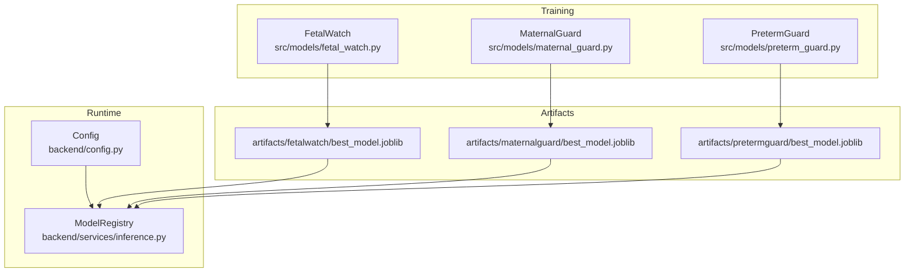
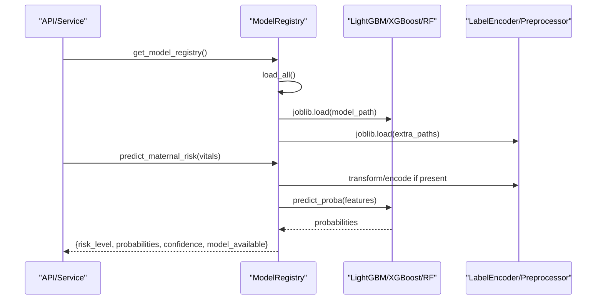
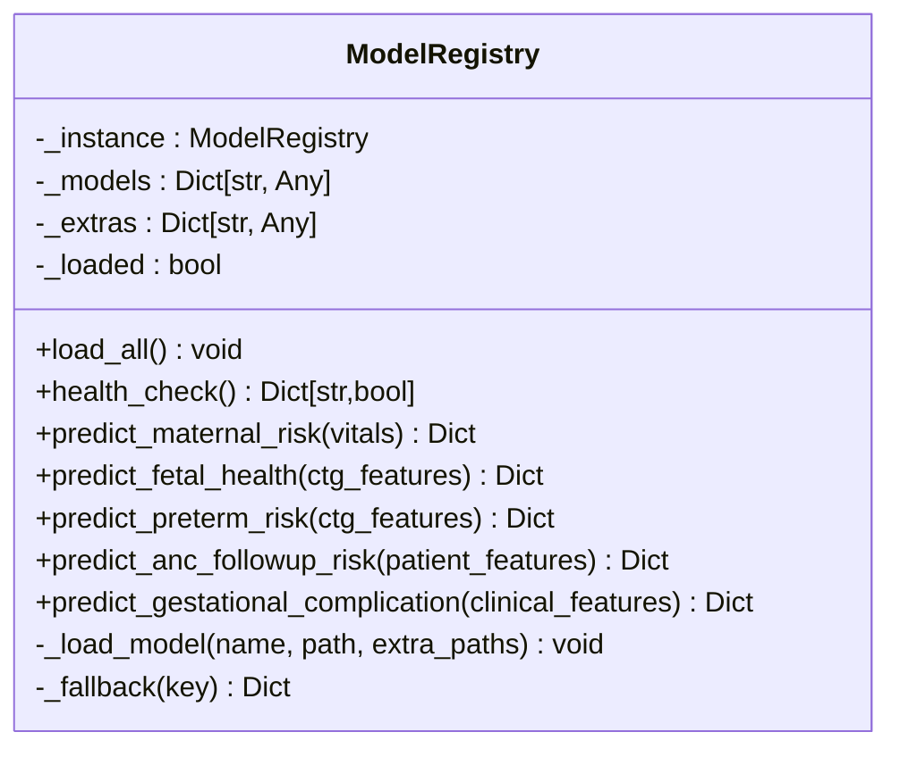
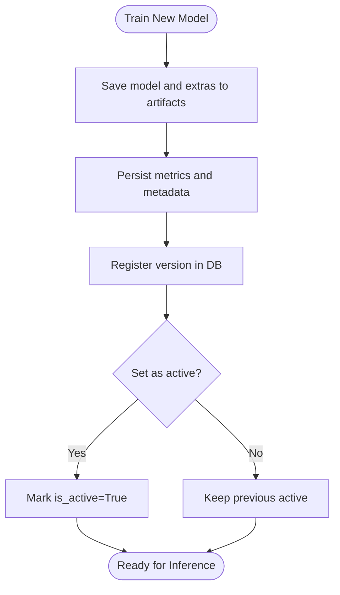
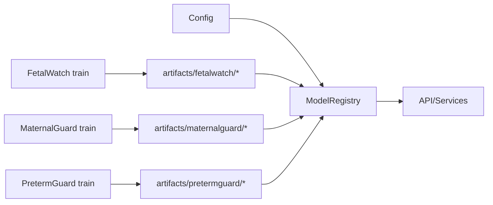

# Model Architecture & Design

<cite>
**Referenced Files in This Document**
- [inference.py](file://backend/services/inference.py)
- [config.py](file://backend/config.py)
- [fetal_watch.py](file://src/models/fetal_watch.py)
- [maternal_guard.py](file://src/models/maternal_guard.py)
- [preterm_guard.py](file://src/models/preterm_guard.py)
- [models.py](file://backend/db/models.py)
- [repositories.py](file://backend/db/repositories.py)
- [metadata.json (carereach)](file://artifacts/carereach/metadata.json)
- [metadata.json (gestationinsight)](file://artifacts/gestationinsight/metadata.json)
- [results.json (maternalguard)](file://artifacts/maternalguard/results.json)
</cite>

## Table of Contents
1. [Introduction](#introduction)
2. [Project Structure](#project-structure)
3. [Core Components](#core-components)
4. [Architecture Overview](#architecture-overview)
5. [Detailed Component Analysis](#detailed-component-analysis)
6. [Dependency Analysis](#dependency-analysis)
7. [Performance Considerations](#performance-considerations)
8. [Troubleshooting Guide](#troubleshooting-guide)
9. [Conclusion](#conclusion)
10. [Appendices](#appendices)

## Introduction
This document explains the machine learning model architecture and design patterns used by MaaHifazat AI. It focuses on:
- The ModelRegistry pattern for dynamic, singleton-based model loading and caching
- A unified inference interface that standardizes how models are called at runtime
- Base class structure and extension points for adding new models
- Configuration management for model paths, hyperparameters, and deployment settings
- Examples for registering new models, implementing custom inference logic, and handling model versioning
- Serialization, caching strategies, and performance optimization techniques across all models

## Project Structure
MaaHifazat organizes ML concerns into training scripts per model under src/models and a runtime inference service under backend/services. Models are trained independently and saved as serialized artifacts under artifacts/<model>. At runtime, the inference service loads these artifacts via a registry.

**Diagram sources**
- [fetal_watch.py:399-404](file://src/models/fetal_watch.py#L399-L404)
- [maternal_guard.py:233-240](file://src/models/maternal_guard.py#L233-L240)
- [preterm_guard.py:329-334](file://src/models/preterm_guard.py#L329-L334)
- [config.py:13-21](file://backend/config.py#L13-L21)
- [inference.py:68-101](file://backend/services/inference.py#L68-L101)

**Section sources**
- [fetal_watch.py:399-404](file://src/models/fetal_watch.py#L399-L404)
- [maternal_guard.py:233-240](file://src/models/maternal_guard.py#L233-L240)
- [preterm_guard.py:329-334](file://src/models/preterm_guard.py#L329-L334)
- [config.py:13-21](file://backend/config.py#L13-L21)
- [inference.py:68-101](file://backend/services/inference.py#L68-L101)

## Core Components
- ModelRegistry: Singleton that loads all models once at startup and caches them in memory. Provides health checks and typed prediction helpers for each model.
- Unified Inference Interface: Each model exposes a consistent response shape with fields like risk_level or fetal_status, probabilities, confidence, and model_available flags.
- Configuration Management: Centralized Pydantic settings define artifact paths, feature sets, and environment-specific overrides.
- Versioning and Metadata: Training pipelines persist results and metadata; database schema supports model version tracking.

Key responsibilities:
- Dynamic loading from configured artifact paths
- Feature normalization and missing value handling before inference
- Robust fallbacks when models or extras are unavailable
- Consistent output schemas for downstream services

**Section sources**
- [inference.py:51-141](file://backend/services/inference.py#L51-L141)
- [config.py:7-21](file://backend/config.py#L7-L21)
- [models.py:94-104](file://backend/db/models.py#L94-L104)

## Architecture Overview
The runtime uses a singleton registry to load models once and serve predictions through a unified interface. Training scripts produce serialized models and auxiliary assets (encoders, preprocessors). Configuration drives where artifacts live and which extras to load.

**Diagram sources**
- [inference.py:429-434](file://backend/services/inference.py#L429-L434)
- [inference.py:68-101](file://backend/services/inference.py#L68-L101)
- [inference.py:153-202](file://backend/services/inference.py#L153-L202)
- [config.py:13-21](file://backend/config.py#L13-L21)

## Detailed Component Analysis

### ModelRegistry Pattern
- Singleton lifecycle: Ensures only one instance exists per process.
- Idempotent loading: load_all is safe to call multiple times; it skips re-loading after first run.
- Extra assets: Supports loading label encoders and preprocessors alongside models.
- Health check: Returns availability status for each model.
- Typed prediction helpers: One method per model with explicit input/output contracts.

**Diagram sources**
- [inference.py:51-141](file://backend/services/inference.py#L51-L141)
- [inference.py:153-426](file://backend/services/inference.py#L153-L426)

**Section sources**
- [inference.py:51-141](file://backend/services/inference.py#L51-L141)
- [inference.py:153-426](file://backend/services/inference.py#L153-L426)

### Unified Inference Interface
All prediction methods return a consistent dictionary:
- Primary label: e.g., risk_level, fetal_status, missed_risk_score/priority
- Probabilities: mapping of class labels to probabilities
- Confidence: probability of the predicted class
- model_available: boolean indicating whether the model was loaded successfully

This uniformity simplifies orchestration and reporting layers.

**Section sources**
- [inference.py:153-202](file://backend/services/inference.py#L153-L202)
- [inference.py:206-248](file://backend/services/inference.py#L206-L248)
- [inference.py:252-293](file://backend/services/inference.py#L252-L293)
- [inference.py:297-361](file://backend/services/inference.py#L297-L361)
- [inference.py:365-426](file://backend/services/inference.py#L365-L426)

### Base Class Structure and Extension Points
While there is no explicit Python base class for models, the registry enforces a de facto contract:
- Input: dict of features with known column names
- Output: standardized result dict with label(s), probabilities, confidence, and availability flag
- Extras: optional encoder/preprocessor transformations applied before inference

To add a new model:
1. Train and save the model artifact and any extras under artifacts/<new_model>.
2. Add configuration entries for model and extra paths in Settings.
3. Extend ModelRegistry._load_model calls in load_all to include the new model.
4. Implement a typed prediction helper following the existing pattern.

**Section sources**
- [config.py:13-21](file://backend/config.py#L13-L21)
- [inference.py:68-101](file://backend/services/inference.py#L68-L101)
- [inference.py:103-130](file://backend/services/inference.py#L103-L130)

### Model-Specific Pipelines and Artifacts
- FetalWatch: Trains LightGBM (primary), Random Forest (baseline), XGBoost (comparison). Saves best model and results JSON.
- MaternalGuard: Trains LightGBM (primary) and Logistic Regression baseline. Saves best model and label encoder.
- PretermGuard: Trains LightGBM (primary) and Random Forest baseline. Saves best model and results JSON.

Each pipeline persists metrics and metadata to support auditing and version selection.

**Section sources**
- [fetal_watch.py:282-432](file://src/models/fetal_watch.py#L282-L432)
- [maternal_guard.py:71-260](file://src/models/maternal_guard.py#L71-L260)
- [preterm_guard.py:208-363](file://src/models/preterm_guard.py#L208-L363)
- [results.json (maternalguard):1-96](file://artifacts/maternalguard/results.json#L1-L96)
- [metadata.json (carereach):1-45](file://artifacts/carereach/metadata.json#L1-L45)
- [metadata.json (gestationinsight):1-206](file://artifacts/gestationinsight/metadata.json#L1-L206)

### Configuration Management
Centralized settings define:
- Artifact directories and model file paths
- Optional extras (label encoders, preprocessors)
- Database URL and other app-level settings

Settings are consumed by the registry to locate and load models at startup.

**Section sources**
- [config.py:7-21](file://backend/config.py#L7-L21)
- [inference.py:68-101](file://backend/services/inference.py#L68-L101)

### Model Versioning and Registration
The database schema includes a ModelVersion table to track model_name, version, file_path, metrics, features, active flag, and timestamps. Repository methods provide register and get_active operations to manage versions.

**Diagram sources**
- [models.py:94-104](file://backend/db/models.py#L94-L104)
- [repositories.py:98-110](file://backend/db/repositories.py#L98-L110)

**Section sources**
- [models.py:94-104](file://backend/db/models.py#L94-L104)
- [repositories.py:98-110](file://backend/db/repositories.py#L98-L110)

## Dependency Analysis
- Registry depends on configuration for artifact locations.
- Each model’s training script writes artifacts consumed by the registry.
- Registry optionally depends on extras (encoders/preprocessors) for feature transformation.
- Database models support versioning but are not required for basic inference.

**Diagram sources**
- [config.py:13-21](file://backend/config.py#L13-L21)
- [inference.py:68-101](file://backend/services/inference.py#L68-L101)
- [fetal_watch.py:399-404](file://src/models/fetal_watch.py#L399-L404)
- [maternal_guard.py:233-240](file://src/models/maternal_guard.py#L233-L240)
- [preterm_guard.py:329-334](file://src/models/preterm_guard.py#L329-L334)

**Section sources**
- [config.py:13-21](file://backend/config.py#L13-L21)
- [inference.py:68-101](file://backend/services/inference.py#L68-L101)

## Performance Considerations
- Singleton registry: Loads models once at startup to avoid repeated disk I/O.
- Caching: lru_cache ensures get_model_registry returns the same instance.
- Missing feature handling: Predictors fill missing columns with zeros to prevent failures.
- Early stopping and cross-validation during training reduce overfitting and improve generalization.
- Balanced class weights and SMOTE address class imbalance in training data.
- Joblib serialization provides efficient model persistence.

[No sources needed since this section provides general guidance]

## Troubleshooting Guide
Common issues and resolutions:
- Model file not found: Ensure artifact paths in config point to existing files. The registry logs warnings and continues without failing the entire service.
- Missing extras: If label encoders or preprocessors are absent, the registry falls back to using raw features or model classes.
- Prediction exceptions: Each predictor catches exceptions and returns a safe fallback with model_available=False.
- Health checks: Use health_check to verify which models loaded successfully before serving traffic.

Operational tips:
- Validate artifact presence at startup.
- Log and monitor prediction errors to detect drift or data schema changes.
- Use metadata and results JSON to audit model performance and feature sets.

**Section sources**
- [inference.py:103-130](file://backend/services/inference.py#L103-L130)
- [inference.py:135-149](file://backend/services/inference.py#L135-L149)
- [inference.py:153-202](file://backend/services/inference.py#L153-L202)
- [inference.py:206-248](file://backend/services/inference.py#L206-L248)
- [inference.py:252-293](file://backend/services/inference.py#L252-L293)
- [inference.py:297-361](file://backend/services/inference.py#L297-L361)
- [inference.py:365-426](file://backend/services/inference.py#L365-L426)

## Conclusion
MaaHifazat AI employs a robust ModelRegistry pattern to centralize model loading, caching, and inference behind a unified interface. Training pipelines produce standardized artifacts and metadata, while configuration decouples deployment paths from code. The system supports extensibility for new models, versioning via database records, and resilient operation with graceful fallbacks. These design choices enable scalable, maintainable, and reliable ML integration in production.

[No sources needed since this section summarizes without analyzing specific files]

## Appendices

### Adding a New Model to the Registry
Steps:
1. Train your model and save artifacts (model and extras) under artifacts/<your_model>.
2. Add configuration entries for model and extra paths in Settings.
3. Update ModelRegistry.load_all to call _load_model for your new model.
4. Implement a typed prediction helper following the existing pattern, returning a consistent result dict.

Reference paths:
- [config.py:13-21](file://backend/config.py#L13-L21)
- [inference.py:68-101](file://backend/services/inference.py#L68-L101)
- [inference.py:103-130](file://backend/services/inference.py#L103-L130)

### Implementing Custom Inference Logic
Follow the established pattern:
- Build a DataFrame with expected feature columns
- Apply preprocessor/encoder if available
- Call predict_proba and map indices to human-readable labels
- Return a dict with label, probabilities, confidence, and model_available

Reference paths:
- [inference.py:153-202](file://backend/services/inference.py#L153-L202)
- [inference.py:206-248](file://backend/services/inference.py#L206-L248)
- [inference.py:252-293](file://backend/services/inference.py#L252-L293)
- [inference.py:297-361](file://backend/services/inference.py#L297-L361)
- [inference.py:365-426](file://backend/services/inference.py#L365-L426)

### Handling Model Versioning
Use the database schema to register and activate model versions:
- Persist metrics and metadata during training
- Register a new version with repository methods
- Mark the desired version as active for inference

Reference paths:
- [models.py:94-104](file://backend/db/models.py#L94-L104)
- [repositories.py:98-110](file://backend/db/repositories.py#L98-L110)