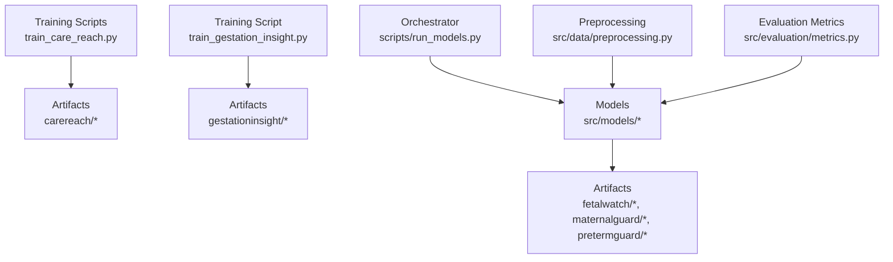
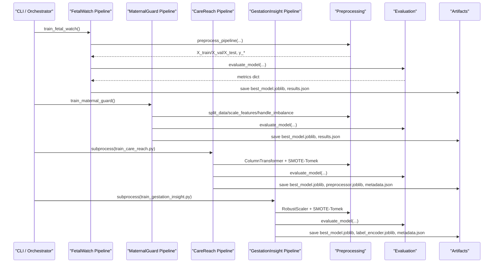
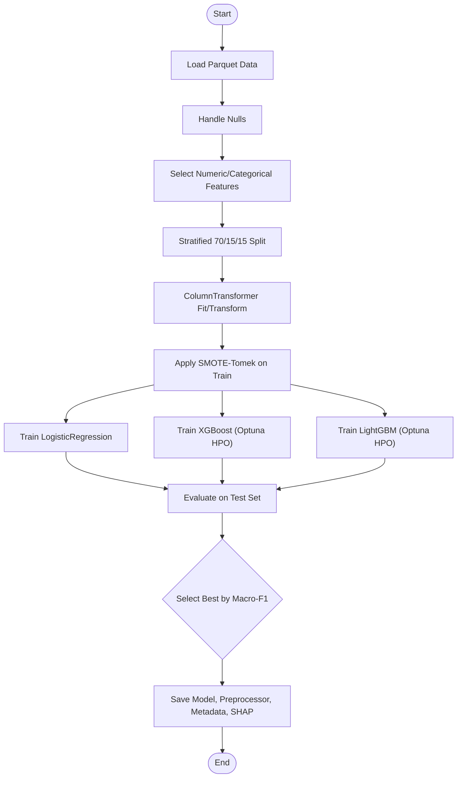
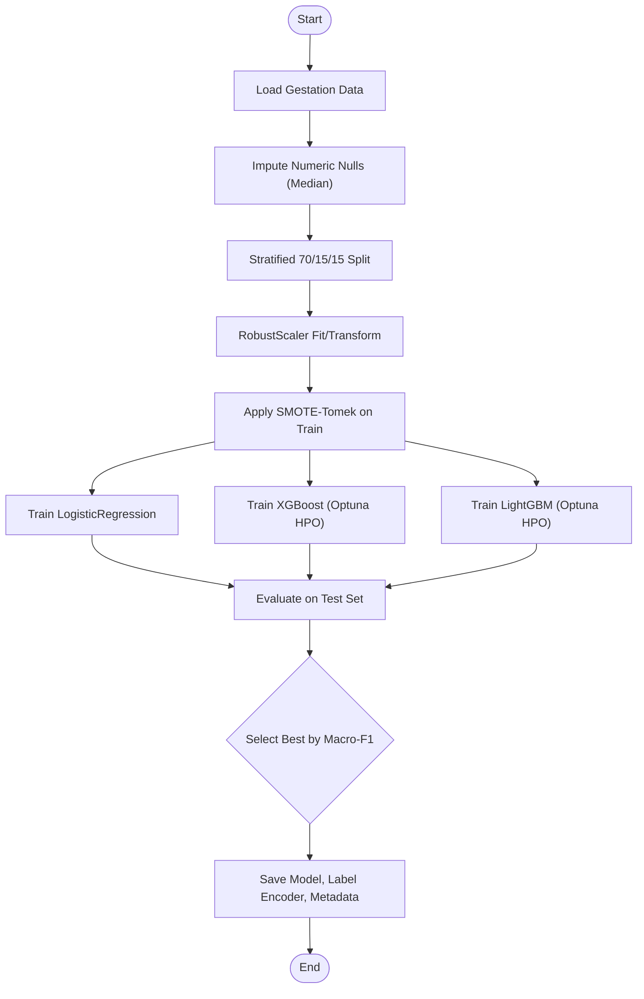
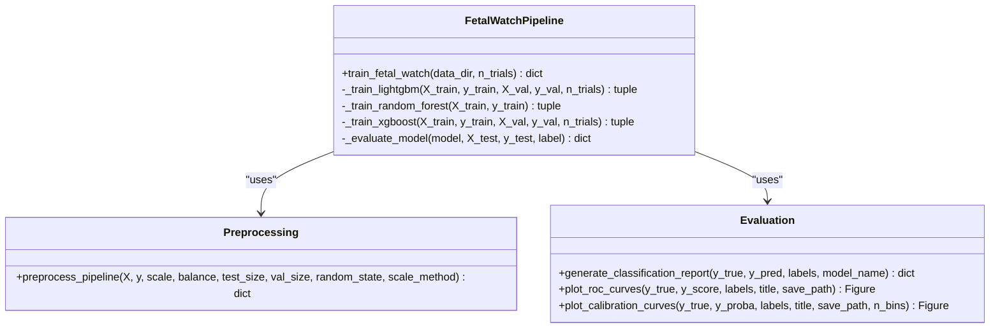
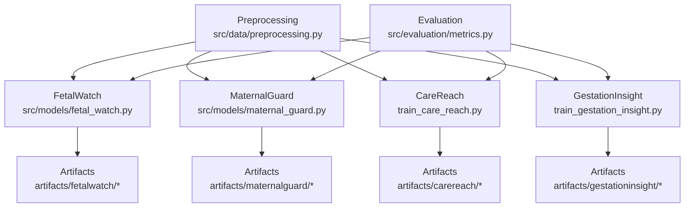

# Model Training & Evaluation

<cite>
**Referenced Files in This Document**
- [train_care_reach.py](file://train_care_reach.py)
- [train_gestation_insight.py](file://train_gestation_insight.py)
- [run_models.py](file://scripts/run_models.py)
- [fetal_watch.py](file://src/models/fetal_watch.py)
- [maternal_guard.py](file://src/models/maternal_guard.py)
- [preterm_guard.py](file://src/models/preterm_guard.py)
- [metrics.py](file://src/evaluation/metrics.py)
- [preprocessing.py](file://src/data/preprocessing.py)
- [metadata.json (CareReach)](file://artifacts/carereach/metadata.json)
- [results.json (FetalWatch)](file://artifacts/fetalwatch/results.json)
- [results.json (MaternalGuard)](file://artifacts/maternalguard/results.json)
- [metadata.json (GestationInsight)](file://artifacts/gestationinsight/metadata.json)
</cite>

## Table of Contents
1. Introduction
2. Project Structure
3. Core Components
4. Architecture Overview
5. Detailed Component Analysis
6. Dependency Analysis
7. Performance Considerations
8. Troubleshooting Guide
9. Conclusion
10. Appendices

## Introduction
This document explains the model training and evaluation framework used across MaaHifazat AI’s clinical risk models. It covers:
- End-to-end training pipelines for multiple models (CareReach, GestationInsight, FetalWatch, MaternalGuard, PretermGuard)
- Hyperparameter optimization with Optuna
- Cross-validation strategies tailored to medical data
- Handling class imbalance using SMOTE/SMOTE-Tomek/ADASYN
- Healthcare-specific evaluation metrics (sensitivity/recall, specificity, AUC-ROC, calibration curves, PR-AUC)
- Model artifact management (versioning, storage, deployment readiness)
- Guidance on retraining schedules, performance monitoring, drift detection, and continuous validation against clinical standards
- Practical examples for running scripts, interpreting results, and deploying models

## Project Structure
The repository organizes training code by model and shared utilities:
- Per-model training scripts under src/models and standalone scripts at the project root
- Shared preprocessing and evaluation utilities under src/data and src/evaluation
- Central orchestrator script to run all pipelines and verify artifacts
- Artifacts directory storing trained models, metadata, and results



**Diagram sources**
- [train_care_reach.py:406-513](file://train_care_reach.py#L406-L513)
- [train_gestation_insight.py:511-674](file://train_gestation_insight.py#L511-L674)
- [run_models.py:37-170](file://scripts/run_models.py#L37-L170)
- [fetal_watch.py:282-432](file://src/models/fetal_watch.py#L282-L432)
- [maternal_guard.py:71-260](file://src/models/maternal_guard.py#L71-L260)
- [preterm_guard.py:208-363](file://src/models/preterm_guard.py#L208-L363)
- [preprocessing.py:22-70](file://src/data/preprocessing.py#L22-L70)
- [metrics.py:49-111](file://src/evaluation/metrics.py#L49-L111)

**Section sources**
- [train_care_reach.py:406-513](file://train_care_reach.py#L406-L513)
- [train_gestation_insight.py:511-674](file://train_gestation_insight.py#L511-L674)
- [run_models.py:37-170](file://scripts/run_models.py#L37-L170)

## Core Components
- CareReach pipeline: binary classification for ANC missed visit risk; uses stratified splits, SMOTE-Tomek, Logistic Regression baseline, XGBoost and LightGBM with Optuna HPO; evaluates Macro-F1, AUROC, PR-AUC; saves best model, preprocessor, SHAP plot, and metadata.
- GestationInsight pipeline: three-class gestational complication risk; uses stratified splits, SMOTE-Tomek, RobustScaler; trains Logistic Regression baseline, XGBoost and LightGBM with Optuna HPO; evaluates Macro-F1, OVR AUROC; saves best model, label encoder, and metadata.
- FetalWatch pipeline: three-class fetal health classification from CTG features; uses shared preprocessing (split/scale/SMOTE), trains LightGBM (Optuna), Random Forest baseline, XGBoost (Optuna); evaluates Macro-F1, OVR AUROC; saves best model and results.
- MaternalGuard pipeline: maternal risk classification; uses split/scale/SMOTE, trains LightGBM (Optuna) and Logistic Regression baseline; evaluates Macro-F1, OVR AUROC; saves best model, label encoder, and results.
- PretermGuard pipeline: three-class preterm birth risk from CTG CLASS labels; uses split/scale/SMOTE; trains LightGBM (Optuna) and Random Forest baseline; evaluates Macro-F1, OVR AUROC; saves best model and results.
- Shared utilities:
  - Preprocessing: stratified train/val/test split, feature scaling (Robust/Standard/MinMax), class imbalance handling (SMOTE/ADASYN), convenience pipeline.
  - Evaluation: confusion matrix plots, ROC curves, calibration curves, classification reports, SHAP summaries, model comparison tables.

**Section sources**
- [train_care_reach.py:75-171](file://train_care_reach.py#L75-L171)
- [train_gestation_insight.py:94-200](file://train_gestation_insight.py#L94-L200)
- [fetal_watch.py:282-432](file://src/models/fetal_watch.py#L282-L432)
- [maternal_guard.py:71-260](file://src/models/maternal_guard.py#L71-L260)
- [preterm_guard.py:208-363](file://src/models/preterm_guard.py#L208-L363)
- [preprocessing.py:22-70](file://src/data/preprocessing.py#L22-L70)
- [preprocessing.py:80-130](file://src/data/preprocessing.py#L80-L130)
- [preprocessing.py:138-188](file://src/data/preprocessing.py#L138-L188)
- [preprocessing.py:196-261](file://src/data/preprocessing.py#L196-L261)
- [metrics.py:49-111](file://src/evaluation/metrics.py#L49-L111)
- [metrics.py:118-182](file://src/evaluation/metrics.py#L118-L182)
- [metrics.py:238-285](file://src/evaluation/metrics.py#L238-L285)
- [metrics.py:292-341](file://src/evaluation/metrics.py#L292-L341)
- [metrics.py:348-402](file://src/evaluation/metrics.py#L348-L402)
- [metrics.py:409-464](file://src/evaluation/metrics.py#L409-L464)

## Architecture Overview
The training architecture is modular:
- Data loaders and preprocessing are shared across models
- Each model pipeline encapsulates its own training, HPO, evaluation, and artifact saving logic
- An orchestrator script runs selected pipelines and verifies artifacts
- Evaluation utilities provide standardized metrics and visualizations



**Diagram sources**
- [run_models.py:77-135](file://scripts/run_models.py#L77-L135)
- [fetal_watch.py:301-328](file://src/models/fetal_watch.py#L301-L328)
- [maternal_guard.py:90-118](file://src/models/maternal_guard.py#L90-L118)
- [train_care_reach.py:406-513](file://train_care_reach.py#L406-L513)
- [train_gestation_insight.py:511-674](file://train_gestation_insight.py#L511-L674)
- [preprocessing.py:196-261](file://src/data/preprocessing.py#L196-L261)

## Detailed Component Analysis

### CareReach Training Pipeline
- Data handling: loads prepared parquet, drops IDs/dates, handles nulls, selects numeric/categorical features
- Preprocessing: ColumnTransformer with RobustScaler and OneHotEncoder; leak-safe fit on train only
- Splitting: 70/15/15 stratified split
- Class imbalance: SMOTE-Tomek applied to training set only
- Models:
  - Logistic Regression baseline with ElasticNet penalty and balanced class weights
  - XGBoost with Optuna HPO optimizing AUROC on validation; scale_pos_weight computed from training distribution
  - LightGBM with Optuna HPO optimizing AUROC on validation; is_unbalance flag
- Evaluation: Macro-F1, AUROC, PR-AUC; classification report; SHAP summary plot
- Artifacts: best model, preprocessor, metadata (training date, metrics, feature list, version, class distribution)



**Diagram sources**
- [train_care_reach.py:75-171](file://train_care_reach.py#L75-L171)
- [train_care_reach.py:176-305](file://train_care_reach.py#L176-L305)
- [train_care_reach.py:310-402](file://train_care_reach.py#L310-L402)
- [train_care_reach.py:406-513](file://train_care_reach.py#L406-L513)

**Section sources**
- [train_care_reach.py:75-171](file://train_care_reach.py#L75-L171)
- [train_care_reach.py:176-305](file://train_care_reach.py#L176-L305)
- [train_care_reach.py:310-402](file://train_care_reach.py#L310-L402)
- [train_care_reach.py:406-513](file://train_care_reach.py#L406-L513)
- [metadata.json (CareReach):1-45](file://artifacts/carereach/metadata.json#L1-L45)

### GestationInsight Training Pipeline
- Data handling: loads prepared gestation parquet, imputes numeric nulls with median, logs constant features
- Preprocessing: RobustScaler fit on training set only
- Splitting: 70/15/15 stratified split
- Class imbalance: SMOTE-Tomek applied to training set only
- Models:
  - Logistic Regression baseline (multinomial, balanced class weights)
  - XGBoost with Optuna HPO using cross-validated macro-F1; objective multi:softprob, num_class=3
  - LightGBM with Optuna HPO using cross-validated macro-F1; class_weight balanced
- Evaluation: Macro-F1, OVR AUROC (macro), per-class precision/recall/F1, confusion matrix
- Artifacts: best model, label encoder, metadata (dataset path, n_samples, n_features, class labels/distribution, split ratios, balancing method, feature names, training time)



**Diagram sources**
- [train_gestation_insight.py:94-200](file://train_gestation_insight.py#L94-L200)
- [train_gestation_insight.py:258-394](file://train_gestation_insight.py#L258-L394)
- [train_gestation_insight.py:511-674](file://train_gestation_insight.py#L511-L674)

**Section sources**
- [train_gestation_insight.py:94-200](file://train_gestation_insight.py#L94-L200)
- [train_gestation_insight.py:258-394](file://train_gestation_insight.py#L258-L394)
- [train_gestation_insight.py:511-674](file://train_gestation_insight.py#L511-L674)
- [metadata.json (GestationInsight):1-206](file://artifacts/gestationinsight/metadata.json#L1-L206)

### FetalWatch Training Pipeline
- Data loading: UCI CTG dataset via loader
- Preprocessing: shared pipeline (split/scale/SMOTE)
- Models:
  - LightGBM with Optuna HPO (cross-validated macro-F1)
  - Random Forest baseline (balanced class weights)
  - XGBoost with Optuna HPO (multi:softprob, num_class=3)
- Evaluation: Macro-F1, OVR AUROC (macro), per-class metrics, confusion matrix
- Artifacts: best model and results JSON



**Diagram sources**
- [fetal_watch.py:282-432](file://src/models/fetal_watch.py#L282-L432)
- [preprocessing.py:196-261](file://src/data/preprocessing.py#L196-L261)
- [metrics.py:292-341](file://src/evaluation/metrics.py#L292-L341)
- [metrics.py:118-182](file://src/evaluation/metrics.py#L118-L182)
- [metrics.py:238-285](file://src/evaluation/metrics.py#L238-L285)

**Section sources**
- [fetal_watch.py:282-432](file://src/models/fetal_watch.py#L282-L432)
- [results.json (FetalWatch):1-249](file://artifacts/fetalwatch/results.json#L1-L249)

### MaternalGuard Training Pipeline
- Data loading: UCI Maternal Health Risk dataset
- Preprocessing: split_data, scale_features (RobustScaler), handle_imbalance (SMOTE)
- Models:
  - LightGBM with Optuna HPO (cross-validated macro-F1)
  - Logistic Regression baseline (grid over C, multinomial, balanced)
- Evaluation: Macro-F1, OVR AUROC (macro), per-class metrics, confusion matrix
- Artifacts: best model, label encoder, results JSON

```mermaid
sequenceDiagram
participant MG as "MaternalGuard"
participant PRE as "Preprocessing"
participant OPT as "Optuna Study"
participant MET as "Evaluation"
participant ART as "Artifacts"
MG->>PRE : split_data/scale_features/handle_imbalance
PRE-->>MG : X_train_bal, X_val_sc, X_test_sc, y_*
MG->>OPT : create_study(objective=maximize f1_macro)
OPT-->>MG : best_params
MG->>MG : Retrain LightGBM on train+val with early stopping
MG->>MET : Evaluate on test set
MET-->>MG : metrics dict
MG->>ART : Save best_model.joblib, label_encoder.joblib, results.json
```

**Diagram sources**
- [maternal_guard.py:71-260](file://src/models/maternal_guard.py#L71-L260)
- [preprocessing.py:22-70](file://src/data/preprocessing.py#L22-L70)
- [preprocessing.py:80-130](file://src/data/preprocessing.py#L80-L130)
- [preprocessing.py:138-188](file://src/data/preprocessing.py#L138-L188)

**Section sources**
- [maternal_guard.py:71-260](file://src/models/maternal_guard.py#L71-L260)
- [results.json (MaternalGuard):1-96](file://artifacts/maternalguard/results.json#L1-L96)

### PretermGuard Training Pipeline
- Data loading: UCI CTG parquet with CLASS target mapped to Normal/Suspect/Pathological
- Preprocessing: stratified split, RobustScaler, SMOTE on training set
- Models:
  - LightGBM with Optuna HPO (cross-validated macro-F1)
  - Random Forest baseline (balanced class weights)
- Evaluation: Macro-F1, OVR AUROC (macro), per-class metrics, confusion matrix
- Artifacts: best model and results JSON

**Section sources**
- [preterm_guard.py:208-363](file://src/models/preterm_guard.py#L208-L363)

### Orchestration and Artifact Verification
- The orchestrator script can run individual or all pipelines, capturing outputs and verifying artifact existence
- It supports toggling specific pipelines and returns a consolidated results dictionary

**Section sources**
- [run_models.py:37-170](file://scripts/run_models.py#L37-L170)

## Dependency Analysis
Key dependencies and relationships:
- All model pipelines depend on shared preprocessing utilities for consistent splitting, scaling, and imbalance handling
- Evaluation utilities provide standardized metrics and visualizations used across pipelines
- Optuna is used for hyperparameter optimization in tree-based models (LightGBM, XGBoost)
- Artifacts are saved consistently per model with metadata and results for traceability



**Diagram sources**
- [preprocessing.py:196-261](file://src/data/preprocessing.py#L196-L261)
- [fetal_watch.py:282-432](file://src/models/fetal_watch.py#L282-L432)
- [maternal_guard.py:71-260](file://src/models/maternal_guard.py#L71-L260)
- [train_care_reach.py:406-513](file://train_care_reach.py#L406-L513)
- [train_gestation_insight.py:511-674](file://train_gestation_insight.py#L511-L674)
- [metrics.py:49-111](file://src/evaluation/metrics.py#L49-L111)

**Section sources**
- [preprocessing.py:196-261](file://src/data/preprocessing.py#L196-L261)
- [metrics.py:49-111](file://src/evaluation/metrics.py#L49-L111)

## Performance Considerations
- Use robust scaling to mitigate outlier effects in clinical data
- Apply SMOTE/SMOTE-Tomek/ADASYN only on training sets to avoid data leakage
- Prefer cross-validated objectives during HPO to reduce overfitting on small validation splits
- Early stopping in tree models prevents unnecessary training iterations
- Subsample for SHAP computation when datasets are large to keep analysis tractable
- Monitor training time and resource usage; adjust n_trials and n_estimators accordingly

[No sources needed since this section provides general guidance]

## Troubleshooting Guide
Common issues and resolutions:
- Missing parquet files: ensure data directories exist and contain expected files (e.g., uci_ctg.parquet, gestation_prepared.parquet)
- Encoding issues on Windows: orchestrator sets PYTHONIOENCODING and wraps stdout/stderr for UTF-8 output
- Optuna verbosity: set to WARNING to reduce noise during HPO
- SHAP generation failures: fallback to model feature importances if TreeExplainer fails
- Artifact verification: orchestrator checks existence of best_model and results/metadata files per model

**Section sources**
- [run_models.py:15-30](file://scripts/run_models.py#L15-L30)
- [run_models.py:137-168](file://scripts/run_models.py#L137-L168)
- [train_care_reach.py:368-402](file://train_care_reach.py#L368-L402)
- [train_gestation_insight.py:401-475](file://train_gestation_insight.py#L401-L475)

## Conclusion
The MaaHifazat AI training and evaluation framework provides robust, reproducible pipelines for multiple clinical risk models. It integrates Optuna-based hyperparameter optimization, cross-validation, and class imbalance handling, while delivering healthcare-relevant metrics and comprehensive artifact management. The modular design enables easy extension to new models and datasets, and the orchestrator simplifies batch training and verification.

[No sources needed since this section summarizes without analyzing specific files]

## Appendices

### Running Training Scripts
- Run all pipelines via orchestrator:
  - Example: python scripts/run_models.py
  - Toggles: train_fetalwatch=True, train_maternalguard=True, train_carereach=False, train_gestation=False
- Run individual pipelines:
  - CareReach: python train_care_reach.py
  - GestationInsight: python train_gestation_insight.py
  - FetalWatch: python src/models/fetal_watch.py
  - MaternalGuard: python src/models/maternal_guard.py
  - PretermGuard: python src/models/preterm_guard.py

**Section sources**
- [run_models.py:176-178](file://scripts/run_models.py#L176-L178)
- [train_care_reach.py:511-513](file://train_care_reach.py#L511-L513)
- [train_gestation_insight.py:672-674](file://train_gestation_insight.py#L672-L674)
- [fetal_watch.py:439-469](file://src/models/fetal_watch.py#L439-L469)
- [maternal_guard.py:267-303](file://src/models/maternal_guard.py#L267-L303)
- [preterm_guard.py:370-418](file://src/models/preterm_guard.py#L370-L418)

### Interpreting Evaluation Results
- CareReach: compare Macro-F1, AUROC, PR-AUC across models; select best by Macro-F1; review SHAP summary for feature importance
- GestationInsight: review Macro-F1 and OVR AUROC; inspect per-class precision/recall/F1; check confusion matrix for misclassifications
- FetalWatch/MaternalGuard/PretermGuard: focus on per-class recall (sensitivity) for critical classes; use OVR AUROC for overall discrimination; examine confusion matrices for error patterns

**Section sources**
- [metadata.json (CareReach):1-45](file://artifacts/carereach/metadata.json#L1-L45)
- [results.json (FetalWatch):1-249](file://artifacts/fetalwatch/results.json#L1-L249)
- [results.json (MaternalGuard):1-96](file://artifacts/maternalguard/results.json#L1-L96)
- [metadata.json (GestationInsight):1-206](file://artifacts/gestationinsight/metadata.json#L1-L206)

### Model Artifact Management
- Storage structure:
  - artifacts/<model>/best_model.joblib
  - artifacts/<model>/results.json or metadata.json
  - Optional: preprocessor.joblib, label_encoder.joblib, shap_summary.png
- Versioning:
  - CareReach includes version field in metadata
  - Timestamps recorded in metadata for traceability
- Deployment readiness:
  - Ensure preprocessor and label encoders are saved alongside models
  - Validate artifacts via orchestrator before deployment

**Section sources**
- [train_care_reach.py:333-366](file://train_care_reach.py#L333-L366)
- [train_gestation_insight.py:619-663](file://train_gestation_insight.py#L619-L663)
- [fetal_watch.py:399-425](file://src/models/fetal_watch.py#L399-L425)
- [maternal_guard.py:233-255](file://src/models/maternal_guard.py#L233-L255)
- [preterm_guard.py:329-356](file://src/models/preterm_guard.py#L329-L356)
- [run_models.py:137-168](file://scripts/run_models.py#L137-L168)

### Retraining Schedules, Monitoring, Drift Detection, and Continuous Validation
- Recommended schedule:
  - Monthly retraining for stable datasets; quarterly for rapidly changing clinical populations
  - Trigger retraining after significant data volume increases or protocol changes
- Performance monitoring:
  - Track Macro-F1, OVR AUROC, per-class recall on held-out test sets
  - Log calibration curves to monitor probability reliability over time
- Drift detection:
  - Compare feature distributions between training and production data
  - Monitor shifts in class distributions and missingness patterns
- Continuous validation:
  - Periodically re-evaluate against clinical standards (e.g., sensitivity thresholds for high-risk classes)
  - Use SHAP summaries to detect changes in feature importance that may indicate drift

[No sources needed since this section provides general guidance]