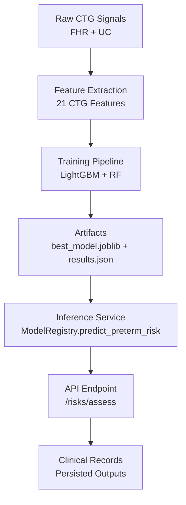
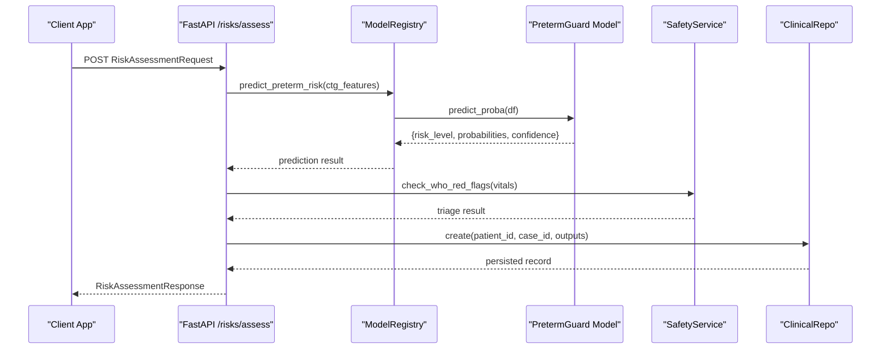
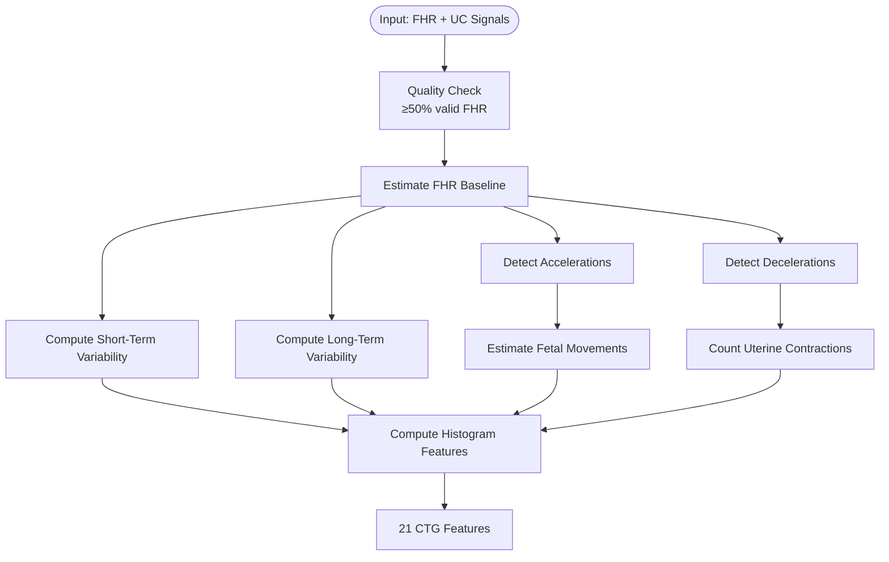
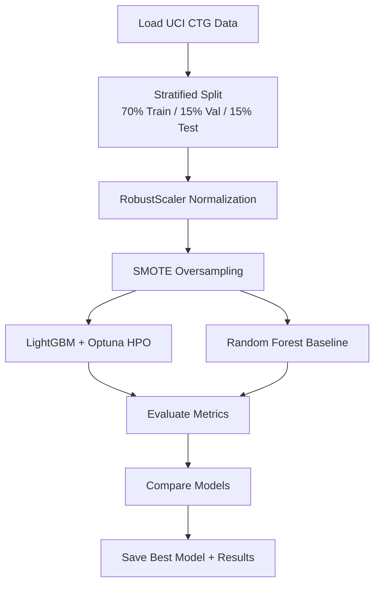
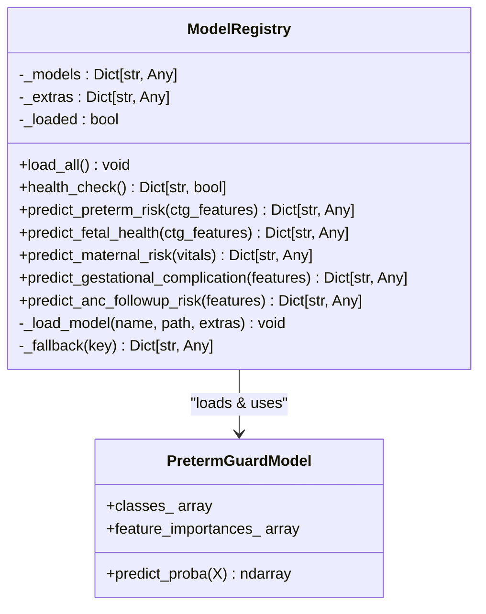
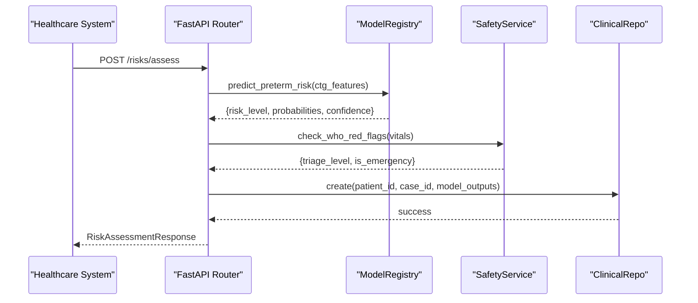
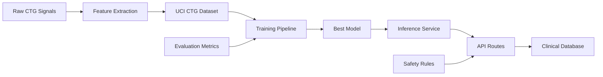

# PretermGuard Model

<cite>
**Referenced Files in This Document**
- [preterm_guard.py](file://src/models/preterm_guard.py)
- [results.json](file://artifacts/pretermguard/results.json)
- [ctg_features.py](file://src/features/ctg_features.py)
- [inference.py](file://backend/services/inference.py)
- [risks.py](file://backend/api/routes/risks.py)
- [uci_ctg.py](file://src/data/loaders/uci_ctg.py)
- [metrics.py](file://src/evaluation/metrics.py)
</cite>

## Table of Contents
1. [Introduction](#introduction)
2. [Project Structure](#project-structure)
3. [Core Components](#core-components)
4. [Architecture Overview](#architecture-overview)
5. [Detailed Component Analysis](#detailed-component-analysis)
6. [Dependency Analysis](#dependency-analysis)
7. [Performance Considerations](#performance-considerations)
8. [Troubleshooting Guide](#troubleshooting-guide)
9. [Conclusion](#conclusion)
10. [Appendices](#appendices)

## Introduction
PretermGuard is a preterm birth risk classification model that uses cardiotocography (CTG) features to predict fetal status categories relevant to preterm risk: Normal, Suspect, and Pathological. It is trained on the UCI Cardiotocography dataset using LightGBM with Optuna hyperparameter optimization and Random Forest as a baseline. The system includes feature engineering from raw fetal heart rate (FHR) and uterine contraction (UC) signals, an inference service for real-time predictions, and API endpoints to integrate into clinical workflows.

The model’s predictive features are derived from CTG recordings and include fetal heart rate baseline, accelerations, decelerations, variability measures, histogram-based descriptors, fetal movement proxies, and uterine contraction counts. These features enable time-aware signal analysis across gestational monitoring sessions. While cervical length and fetal fibronectin are not part of this implementation, the architecture supports integration of additional maternal risk factors through complementary models and APIs.

## Project Structure
The repository organizes the PretermGuard pipeline across data loading, feature extraction, model training, evaluation, and inference services:

- Data loaders provide access to the UCI CTG dataset and label mappings.
- Feature engineering converts raw 4 Hz FHR and UC signals into 21 standardized CTG features compatible with the UCI schema.
- Training scripts orchestrate preprocessing, hyperparameter search, model fitting, and result persistence.
- Inference service loads models at startup and exposes prediction methods.
- API routes expose risk assessment endpoints integrating multiple models and safety checks.
- Evaluation utilities generate metrics, plots, and comparison tables.

**Diagram sources**
- [ctg_features.py:506-593](file://src/features/ctg_features.py#L506-L593)
- [preterm_guard.py:208-363](file://src/models/preterm_guard.py#L208-L363)
- [inference.py:252-293](file://backend/services/inference.py#L252-L293)
- [risks.py:61-123](file://backend/api/routes/risks.py#L61-L123)

**Section sources**
- [preterm_guard.py:208-363](file://src/models/preterm_guard.py#L208-L363)
- [ctg_features.py:27-32](file://src/features/ctg_features.py#L27-L32)
- [inference.py:24-46](file://backend/services/inference.py#L24-L46)
- [risks.py:24-53](file://backend/api/routes/risks.py#L24-L53)

## Core Components
PretermGuard consists of four core components:

1. **Feature Engineering**: Extracts 21 CTG features from raw FHR and UC signals, including baseline heart rate, acceleration/deceleration events, short-term and long-term variability, histogram descriptors, and uterine contraction counts.
2. **Training Pipeline**: Loads UCI CTG data, preprocesses with scaling and SMOTE, trains LightGBM with Optuna HPO and Random Forest baseline, evaluates performance, and saves best model and results.
3. **Inference Service**: Singleton registry that loads models and provides prediction methods returning risk levels, probabilities, confidence scores, and availability flags.
4. **API Integration**: FastAPI endpoint that accepts patient vitals, CTG features, and clinical features, runs multiple models, applies safety triage, and persists results.

**Section sources**
- [ctg_features.py:506-593](file://src/features/ctg_features.py#L506-L593)
- [preterm_guard.py:208-363](file://src/models/preterm_guard.py#L208-L363)
- [inference.py:252-293](file://backend/services/inference.py#L252-L293)
- [risks.py:61-123](file://backend/api/routes/risks.py#L61-L123)

## Architecture Overview
The system follows a modular architecture where raw CTG signals are transformed into standardized features, trained into predictive models, and served via a unified inference layer.

**Diagram sources**
- [risks.py:61-123](file://backend/api/routes/risks.py#L61-L123)
- [inference.py:252-293](file://backend/services/inference.py#L252-L293)

## Detailed Component Analysis

### Feature Engineering Component
The feature engineering module extracts 21 CTG features from raw 4 Hz FHR and UC signals. Key features include:

- **LB (Baseline)**: Estimated fetal heart rate baseline using iterative median filtering.
- **AC (Accelerations)**: Count per minute of FHR increases ≥15 bpm above baseline lasting ≥15 seconds.
- **FM (Fetal Movements)**: Proxy count based on rapid FHR changes ≥10 bpm within 2-second windows.
- **UC (Uterine Contractions)**: Peak detection in UC signal with minimum distance and prominence thresholds.
- **DL/DS/DP (Delerations)**: Light, severe, and prolonged deceleration counts normalized per minute.
- **ASTV/MSTV**: Short-term variability percentage and mean values computed over 1-minute windows.
- **ALTV/MLTV**: Long-term variability abnormality percentage and mean amplitude.
- **Histogram Features**: Width, Min, Max, Nmax (histogram peaks), Nzeros, Mode, Mean, Median, Variance, Tendency.

**Diagram sources**
- [ctg_features.py:39-76](file://src/features/ctg_features.py#L39-L76)
- [ctg_features.py:84-131](file://src/features/ctg_features.py#L84-L131)
- [ctg_features.py:139-224](file://src/features/ctg_features.py#L139-L224)
- [ctg_features.py:232-329](file://src/features/ctg_features.py#L232-L329)
- [ctg_features.py:337-409](file://src/features/ctg_features.py#L337-L409)
- [ctg_features.py:417-499](file://src/features/ctg_features.py#L417-L499)

**Section sources**
- [ctg_features.py:27-32](file://src/features/ctg_features.py#L27-L32)
- [ctg_features.py:506-593](file://src/features/ctg_features.py#L506-L593)

### Training Pipeline Component
The training pipeline implements a complete machine learning workflow:

1. **Data Loading**: Reads UCI CTG parquet file, separates 21 features from target labels (Normal/Suspect/Pathological).
2. **Preprocessing**: Stratified train/val/test split (70/15/15), RobustScaler normalization, SMOTE oversampling for class balance.
3. **Model Training**: 
   - LightGBM with Optuna hyperparameter optimization (20 trials by default)
   - Random Forest baseline (500 estimators, balanced class weights)
4. **Evaluation**: Macro-F1, AUROC (one-vs-rest), per-class precision/recall/F1, confusion matrices.
5. **Persistence**: Saves best model (joblib) and comprehensive results (JSON) to artifacts directory.

**Diagram sources**
- [preterm_guard.py:208-363](file://src/models/preterm_guard.py#L208-L363)

**Section sources**
- [preterm_guard.py:208-363](file://src/models/preterm_guard.py#L208-L363)

### Inference Service Component
The inference service provides a singleton registry that manages model loading and prediction methods:

- **Model Loading**: Loads all models from artifacts directory with error handling and health checks.
- **PretermGuard Prediction**: Accepts 21 CTG features, ensures column completeness, computes probabilities, returns risk level, confidence, and availability status.
- **Fallback Handling**: Returns safe defaults when models are unavailable or prediction fails.
- **Integration**: Used by API routes and other components for real-time predictions.

**Diagram sources**
- [inference.py:51-149](file://backend/services/inference.py#L51-L149)
- [inference.py:252-293](file://backend/services/inference.py#L252-L293)

**Section sources**
- [inference.py:51-149](file://backend/services/inference.py#L51-L149)
- [inference.py:252-293](file://backend/services/inference.py#L252-L293)

### API Integration Component
The API provides a unified endpoint for comprehensive risk assessment:

- **RiskAssessmentRequest**: Accepts patient vitals, CTG features, clinical features, and ANC follow-up data.
- **Multi-Model Processing**: Calls MaternalGuard, FetalWatch, PretermGuard, GestationInsight, and CareReach models.
- **Safety Integration**: Applies WHO red flag checks and emergency triage.
- **Persistence**: Stores complete assessment results in database for audit and follow-up.

**Diagram sources**
- [risks.py:61-123](file://backend/api/routes/risks.py#L61-L123)

**Section sources**
- [risks.py:24-53](file://backend/api/routes/risks.py#L24-L53)
- [risks.py:61-123](file://backend/api/routes/risks.py#L61-L123)

## Dependency Analysis
The PretermGuard system has clear dependency relationships between components:

**Diagram sources**
- [ctg_features.py:506-593](file://src/features/ctg_features.py#L506-L593)
- [preterm_guard.py:208-363](file://src/models/preterm_guard.py#L208-L363)
- [inference.py:252-293](file://backend/services/inference.py#L252-L293)
- [risks.py:61-123](file://backend/api/routes/risks.py#L61-L123)

**Section sources**
- [preterm_guard.py:208-363](file://src/models/preterm_guard.py#L208-L363)
- [inference.py:252-293](file://backend/services/inference.py#L252-L293)
- [risks.py:61-123](file://backend/api/routes/risks.py#L61-L123)

## Performance Considerations
PretermGuard demonstrates strong performance with the following characteristics:

- **Model Selection**: LightGBM outperforms Random Forest with macro-F1 of 0.853 vs 0.795.
- **Class Balance**: SMOTE oversampling addresses class imbalance in training data.
- **Cross-Validation**: 5-fold stratified CV with Optuna pruning for robust hyperparameter tuning.
- **Early Stopping**: Prevents overfitting during LightGBM training with validation set monitoring.
- **Feature Scaling**: RobustScaler handles outliers better than standard scaling for CTG data.

Key performance metrics from the best model (LightGBM):
- Macro-F1: 0.853
- AUROC (OVR): 0.956
- Per-class recall: Normal (0.966), Suspect (0.943), Pathological (0.625)

**Section sources**
- [results.json:1-164](file://artifacts/pretermguard/results.json#L1-L164)
- [preterm_guard.py:114-176](file://src/models/preterm_guard.py#L114-L176)

## Troubleshooting Guide
Common issues and their solutions:

1. **Missing CTG Features**: Ensure all 21 CTG features are present; missing columns are filled with zeros during inference.
2. **Low Signal Quality**: Feature extraction requires ≥50% valid FHR samples; records below threshold are skipped.
3. **Model Loading Failures**: Check artifact paths and ensure models are properly saved during training.
4. **API Integration Issues**: Verify request format matches RiskAssessmentRequest schema and required fields.
5. **Performance Degradation**: Monitor model drift and retrain periodically with updated data.

Error handling strategies:
- Graceful fallbacks return safe defaults when models are unavailable
- Comprehensive logging for debugging and monitoring
- Health checks verify model availability before serving requests
- Validation prevents invalid inputs from causing crashes

**Section sources**
- [inference.py:147-149](file://backend/services/inference.py#L147-L149)
- [ctg_features.py:532-545](file://src/features/ctg_features.py#L532-L545)
- [risks.py:100-123](file://backend/api/routes/risks.py#L100-L123)

## Conclusion
PretermGuard provides a robust framework for preterm birth risk prediction using CTG features. The system successfully transforms raw fetal monitoring signals into clinically actionable risk assessments through sophisticated feature engineering and machine learning techniques. The modular architecture enables easy integration into existing prenatal care workflows while maintaining high performance and reliability.

The model's strength lies in its comprehensive feature set capturing fetal heart rate patterns, uterine activity, and temporal variations that are critical for identifying high-risk pregnancies. With proper monitoring and periodic retraining, PretermGuard can serve as an effective early warning system supporting timely clinical interventions.

## Appendices

### Predictive Features Summary
The 21 CTG features used by PretermGuard capture different aspects of fetal well-being:

- **Heart Rate Dynamics**: Baseline (LB), accelerations (AC), decelerations (DL/DS/DP)
- **Variability Measures**: Short-term (ASTV/MSTV) and long-term (ALTV/MLTV) variability
- **Signal Characteristics**: Histogram-based descriptors (Width, Min, Max, Nmax, etc.)
- **Activity Indicators**: Fetal movements (FM) and uterine contractions (UC)

### Clinical Interpretation
- **Normal**: Healthy CTG pattern indicating low preterm risk → Routine monitoring recommended
- **Suspect**: Ambiguous CTG pattern suggesting moderate risk → Increased surveillance and biophysical profile
- **Pathological**: Abnormal CTG pattern indicating high preterm/distress risk → Immediate clinical evaluation and potential intervention

### Temporal Modeling Approach
While the current implementation processes individual CTG recordings, the feature extraction methodology captures temporal dynamics through:
- Window-based variability calculations (1-minute segments)
- Event duration thresholds (accelerations ≥15 seconds, decelerations ≥15 seconds)
- Frequency-based measurements (events per minute)
- Signal quality assessment over recording duration

This approach enables tracking changes over gestational periods by analyzing sequential CTG recordings and identifying trends in fetal heart rate patterns and uterine activity.

**Section sources**
- [ctg_features.py:27-32](file://src/features/ctg_features.py#L27-L32)
- [preterm_guard.py:401-413](file://src/models/preterm_guard.py#L401-L413)
- [ctg_features.py:84-131](file://src/features/ctg_features.py#L84-L131)
- [ctg_features.py:139-224](file://src/features/ctg_features.py#L139-L224)