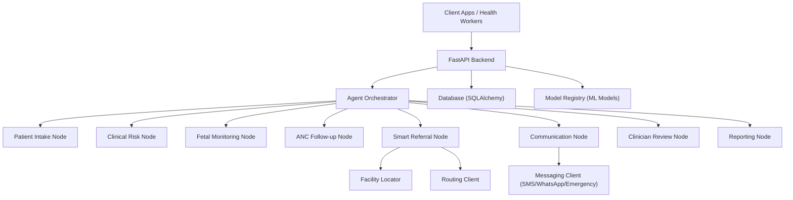
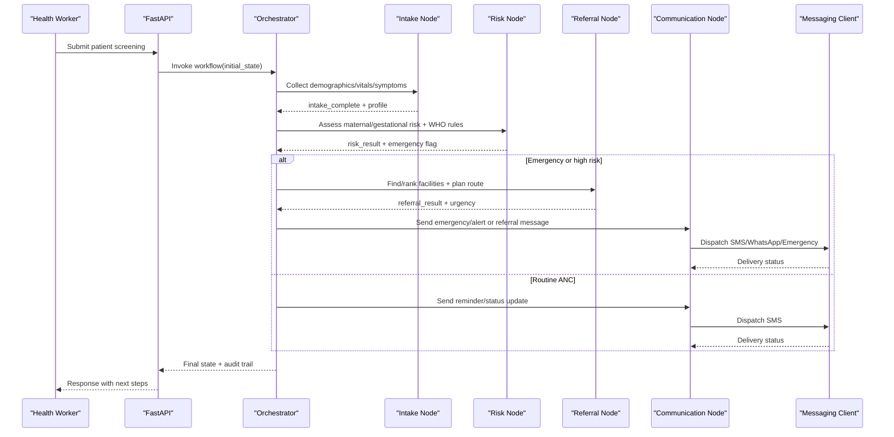
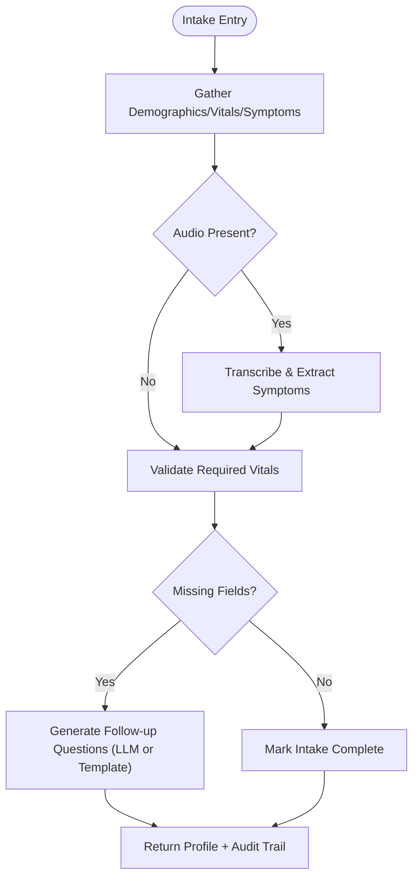
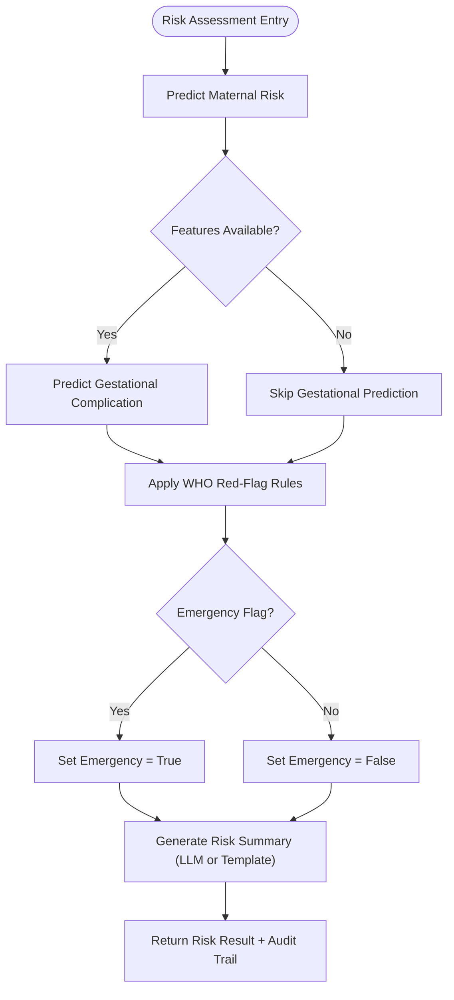
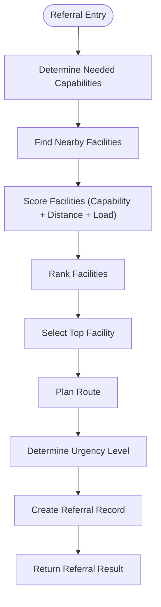
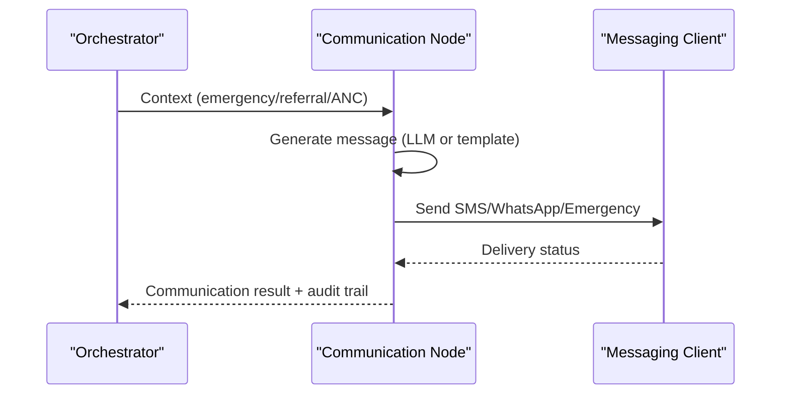
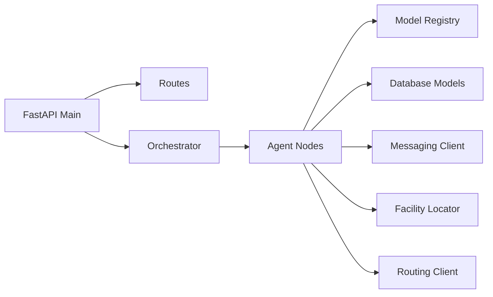

# Project Overview

<cite>
**Referenced Files in This Document**
- [backend/api/main.py](file://backend/api/main.py)
- [backend/config.py](file://backend/config.py)
- [backend/agents/orchestrator.py](file://backend/agents/orchestrator.py)
- [backend/db/models.py](file://backend/db/models.py)
- [backend/services/inference.py](file://backend/services/inference.py)
- [backend/agents/nodes/patient_intake.py](file://backend/agents/nodes/patient_intake.py)
- [backend/agents/nodes/clinical_risk.py](file://backend/agents/nodes/clinical_risk.py)
- [backend/agents/nodes/smart_referral.py](file://backend/agents/nodes/smart_referral.py)
- [backend/agents/nodes/communication.py](file://backend/agents/nodes/communication.py)
- [backend/integrations/messaging_client.py](file://backend/integrations/messaging_client.py)
- [DATASET_REGISTRY.md](file://DATASET_REGISTRY.md)
</cite>

## Table of Contents
1. [Introduction](#introduction)
2. [Project Structure](#project-structure)
3. [Core Components](#core-components)
4. [Architecture Overview](#architecture-overview)
5. [Detailed Component Analysis](#detailed-component-analysis)
6. [Dependency Analysis](#dependency-analysis)
7. [Performance Considerations](#performance-considerations)
8. [Troubleshooting Guide](#troubleshooting-guide)
9. [Conclusion](#conclusion)

## Introduction
MaaHifazat AI is an AI-powered maternal and fetal health monitoring platform designed for rural Pakistan to improve outcomes in low-resource settings. The system provides early risk detection, intelligent referrals, and multi-channel communication to support healthcare workers, clinicians, and administrators. It integrates machine learning models with a clinical workflow orchestrated by agents, enabling timely triage, actionable insights, and coordinated care pathways even when connectivity or resources are limited.

The platform’s purpose is to:
- Detect maternal and fetal risks early using validated ML models and safety rules.
- Route patients intelligently to appropriate facilities based on capability and proximity.
- Communicate alerts, referrals, and reminders via SMS, WhatsApp, and emergency channels.
- Support offline-capable workflows and robust error handling to function reliably in constrained environments.

Target users include:
- Healthcare workers at primary care centers who collect patient data and act on alerts.
- Clinicians who review cases and make final decisions.
- Administrators who monitor analytics, audit trails, and referral outcomes.

Use cases in low-resource settings:
- Community-level screening with minimal equipment (vitals, symptoms, optional CTG features).
- Automated escalation to higher-level facilities when emergencies are detected.
- Multi-language, culturally sensitive messaging to ensure adherence and continuity of care.

**Section sources**
- [backend/api/main.py:52-64](file://backend/api/main.py#L52-L64)
- [DATASET_REGISTRY.md:91-107](file://DATASET_REGISTRY.md#L91-L107)

## Project Structure
At a high level, the backend exposes a FastAPI application that initializes database connections and loads ML models at startup. Clinical workflows are implemented as LangGraph agent nodes orchestrated into a stateful graph. Data persistence uses SQLAlchemy ORM models, while integrations handle messaging, routing, and facility discovery. Configuration centralizes model paths, database URLs, and external API endpoints.

**Diagram sources**
- [backend/api/main.py:22-64](file://backend/api/main.py#L22-L64)
- [backend/agents/orchestrator.py:62-138](file://backend/agents/orchestrator.py#L62-L138)
- [backend/db/models.py:11-115](file://backend/db/models.py#L11-L115)
- [backend/services/inference.py:51-141](file://backend/services/inference.py#L51-L141)
- [backend/integrations/messaging_client.py:9-78](file://backend/integrations/messaging_client.py#L9-L78)

**Section sources**
- [backend/api/main.py:22-64](file://backend/api/main.py#L22-L64)
- [backend/config.py:7-55](file://backend/config.py#L7-L55)
- [backend/agents/orchestrator.py:62-138](file://backend/agents/orchestrator.py#L62-L138)

## Core Components
- FastAPI Application: Entry point providing REST APIs, CORS middleware, global exception handling, and health checks. Initializes database and model registry at startup.
- Agent Orchestration: LangGraph StateGraph wiring nine agent nodes to implement end-to-end clinical workflows with conditional routing.
- Inference Service: Singleton ModelRegistry loading and caching five ML models (MaternalGuard, FetalWatch, PretermGuard, CareReach, GestationInsight) with feature mapping and fallbacks.
- Database Layer: SQLAlchemy models for patients, clinical records, referrals, agent states, audit logs, model versions, and file records.
- Integrations: Messaging client for SMS/WhatsApp/emergency alerts; facility locator and routing clients for smart referrals.
- Configuration: Centralized settings for model artifacts, database URL, JWT auth, external APIs, and LLM provider.

Key features enabled by these components:
- Patient management: Create profiles, store demographics, vitals, and channel preferences.
- Clinical workflows: Structured intake, risk assessment, fetal monitoring, ANC follow-up, clinician review, reporting.
- Risk assessment: Maternal risk prediction, gestational complication prediction, WHO red-flag triage.
- Referral system: Facility ranking by capability and distance, route planning, urgency determination.
- Communication hub: Multi-channel messaging with LLM-generated messages and template fallbacks.

**Section sources**
- [backend/api/main.py:22-135](file://backend/api/main.py#L22-L135)
- [backend/agents/orchestrator.py:1-167](file://backend/agents/orchestrator.py#L1-L167)
- [backend/services/inference.py:51-435](file://backend/services/inference.py#L51-L435)
- [backend/db/models.py:11-115](file://backend/db/models.py#L11-L115)
- [backend/integrations/messaging_client.py:9-78](file://backend/integrations/messaging_client.py#L9-L78)
- [backend/config.py:7-55](file://backend/config.py#L7-L55)

## Architecture Overview
The platform follows a layered architecture:
- API Layer: FastAPI routes expose patient, risk, referral, alert, audit, and analytics endpoints.
- Workflow Layer: LangGraph orchestrates agent nodes with deterministic conditional edges based on clinical context.
- Intelligence Layer: ModelRegistry encapsulates ML inference with robust fallbacks and feature normalization.
- Data Layer: Persistent storage via SQLAlchemy models ensures traceability and offline sync support.
- Integration Layer: External services provide messaging, facility discovery, and routing capabilities.

**Diagram sources**
- [backend/api/main.py:22-64](file://backend/api/main.py#L22-L64)
- [backend/agents/orchestrator.py:62-138](file://backend/agents/orchestrator.py#L62-L138)
- [backend/agents/nodes/patient_intake.py:58-168](file://backend/agents/nodes/patient_intake.py#L58-L168)
- [backend/agents/nodes/clinical_risk.py:15-127](file://backend/agents/nodes/clinical_risk.py#L15-L127)
- [backend/agents/nodes/smart_referral.py:11-136](file://backend/agents/nodes/smart_referral.py#L11-L136)
- [backend/agents/nodes/communication.py:38-231](file://backend/agents/nodes/communication.py#L38-L231)
- [backend/integrations/messaging_client.py:9-78](file://backend/integrations/messaging_client.py#L9-L78)

## Detailed Component Analysis

### Patient Management and Intake
- Purpose: Collect and validate patient demographics, vitals, and symptoms; optionally process voice audio to extract symptoms; generate follow-up questions if fields are missing.
- Behavior: Validates required vital fields; supports language-aware processing; integrates with LLM for contextual question generation with safe fallbacks; produces structured profile and audit entries.
- Data: Stored in Patient and ClinicalRecord models; supports offline sync fields for client-generated IDs and timestamps.

**Diagram sources**
- [backend/agents/nodes/patient_intake.py:58-168](file://backend/agents/nodes/patient_intake.py#L58-L168)
- [backend/db/models.py:11-51](file://backend/db/models.py#L11-L51)

**Section sources**
- [backend/agents/nodes/patient_intake.py:58-168](file://backend/agents/nodes/patient_intake.py#L58-L168)
- [backend/db/models.py:11-51](file://backend/db/models.py#L11-L51)

### Clinical Risk Assessment
- Purpose: Run maternal risk prediction, optional gestational complication prediction, and mandatory WHO red-flag triage to determine emergency status.
- Behavior: Uses ModelRegistry for predictions; SafetyService enforces WHO rules; generates human-readable summaries with LLM fallback; sets emergency flag for downstream routing.
- Output: Includes maternal risk, gestational risk, WHO triage level, triggered rules, recommended actions, and emergency determination.

**Diagram sources**
- [backend/agents/nodes/clinical_risk.py:15-127](file://backend/agents/nodes/clinical_risk.py#L15-L127)
- [backend/services/inference.py:151-203](file://backend/services/inference.py#L151-L203)
- [backend/services/inference.py:365-426](file://backend/services/inference.py#L365-L426)

**Section sources**
- [backend/agents/nodes/clinical_risk.py:15-127](file://backend/agents/nodes/clinical_risk.py#L15-L127)
- [backend/services/inference.py:151-203](file://backend/services/inference.py#L151-L203)
- [backend/services/inference.py:365-426](file://backend/services/inference.py#L365-L426)

### Smart Referral System
- Purpose: Identify and rank nearby healthcare facilities based on capability match (emergency, NICU, maternity) and distance; plan routes; create referral records with urgency levels.
- Behavior: Determines required capabilities from clinical results; locates facilities within radius; scores and ranks facilities; computes travel time; persists referral details.
- Output: Ranked facilities, selected facility, route info, urgency level, and estimated travel time.

**Diagram sources**
- [backend/agents/nodes/smart_referral.py:11-136](file://backend/agents/nodes/smart_referral.py#L11-L136)
- [backend/db/models.py:52-68](file://backend/db/models.py#L52-L68)

**Section sources**
- [backend/agents/nodes/smart_referral.py:11-136](file://backend/agents/nodes/smart_referral.py#L11-L136)
- [backend/db/models.py:52-68](file://backend/db/models.py#L52-L68)

### Communication Hub
- Purpose: Dispatch alerts, referral notifications, and ANC reminders via SMS, WhatsApp, or emergency channels; track delivery status; use LLM-generated messages with template fallbacks.
- Behavior: Chooses message type based on context (emergency, referral, ANC); sends to configured recipients; logs delivery outcomes; supports language preferences.
- Output: Message count, delivery statuses, channel used, and whether messages were LLM-generated.

**Diagram sources**
- [backend/agents/nodes/communication.py:38-231](file://backend/agents/nodes/communication.py#L38-L231)
- [backend/integrations/messaging_client.py:9-78](file://backend/integrations/messaging_client.py#L9-L78)

**Section sources**
- [backend/agents/nodes/communication.py:38-231](file://backend/agents/nodes/communication.py#L38-L231)
- [backend/integrations/messaging_client.py:9-78](file://backend/integrations/messaging_client.py#L9-L78)

### Conceptual Overview
This platform addresses maternal and fetal health challenges in underserved communities by combining accessible data collection, reliable risk assessment, and coordinated care pathways. It emphasizes:
- Early detection through validated models and safety rules.
- Intelligent routing to appropriate facilities with capability matching.
- Multi-channel communication tailored to local contexts and languages.
- Robustness via fallbacks and offline support to maintain functionality under constraints.

[No sources needed since this section doesn't analyze specific source files]

## Dependency Analysis
The system exhibits clear separation of concerns:
- API depends on routers for domain endpoints and includes middleware for cross-origin requests.
- Orchestrator depends on agent nodes and state schema to manage workflow execution.
- Inference service depends on configuration for model paths and provides singleton access to models.
- Database layer defines persistent entities and relationships across patients, records, referrals, and audit logs.
- Integrations abstract external services for messaging, facility lookup, and routing.

**Diagram sources**
- [backend/api/main.py:10-135](file://backend/api/main.py#L10-L135)
- [backend/agents/orchestrator.py:62-138](file://backend/agents/orchestrator.py#L62-L138)
- [backend/services/inference.py:51-141](file://backend/services/inference.py#L51-L141)
- [backend/db/models.py:11-115](file://backend/db/models.py#L11-L115)
- [backend/integrations/messaging_client.py:9-78](file://backend/integrations/messaging_client.py#L9-L78)

**Section sources**
- [backend/api/main.py:10-135](file://backend/api/main.py#L10-L135)
- [backend/agents/orchestrator.py:62-138](file://backend/agents/orchestrator.py#L62-L138)
- [backend/services/inference.py:51-141](file://backend/services/inference.py#L51-L141)
- [backend/db/models.py:11-115](file://backend/db/models.py#L11-L115)

## Performance Considerations
- Model Loading: Models are loaded once at startup via singleton registry to avoid repeated I/O overhead.
- Fallbacks: Each node implements graceful degradation when external services (LLM, models) are unavailable, ensuring continuous operation.
- Concurrency: Async patterns are used throughout to prevent blocking during I/O-bound operations like messaging and routing.
- Feature Normalization: Predictions handle missing features by defaulting to zero or applying preprocessors where available, reducing errors and improving stability.
- Caching: LRU cache for model registry retrieval reduces instantiation costs.

[No sources needed since this section provides general guidance]

## Troubleshooting Guide
Common issues and resolutions:
- Model Not Found: Check artifact paths in configuration; verify model files exist before startup.
- LLM Unavailable: Nodes fall back to templates; ensure Groq API key and model name are correctly set in configuration.
- Messaging Failures: Verify messaging client base URL and network connectivity; check delivery logs for status.
- Database Initialization Errors: Confirm DATABASE_URL and SQLite availability; inspect logs for non-fatal warnings during startup.
- Workflow Stalls: Inspect agent state and current_step; validate conditional routing logic based on emergency flags and clinical results.

**Section sources**
- [backend/config.py:7-55](file://backend/config.py#L7-L55)
- [backend/api/main.py:22-45](file://backend/api/main.py#L22-L45)
- [backend/agents/nodes/patient_intake.py:151-168](file://backend/agents/nodes/patient_intake.py#L151-L168)
- [backend/agents/nodes/clinical_risk.py:111-127](file://backend/agents/nodes/clinical_risk.py#L111-L127)
- [backend/agents/nodes/smart_referral.py:120-136](file://backend/agents/nodes/smart_referral.py#L120-L136)
- [backend/agents/nodes/communication.py:215-231](file://backend/agents/nodes/communication.py#L215-L231)

## Conclusion
MaaHifazat AI provides a comprehensive, resilient solution for maternal and fetal health monitoring in rural Pakistan. By integrating AI-driven risk assessment, intelligent referrals, and multi-channel communication within a structured clinical workflow, it empowers healthcare workers and clinicians to deliver timely, effective care in low-resource environments. The system’s design prioritizes reliability, accessibility, and scalability, addressing critical gaps in underserved communities while maintaining operational continuity through robust fallbacks and offline support.

[No sources needed since this section summarizes without analyzing specific files]