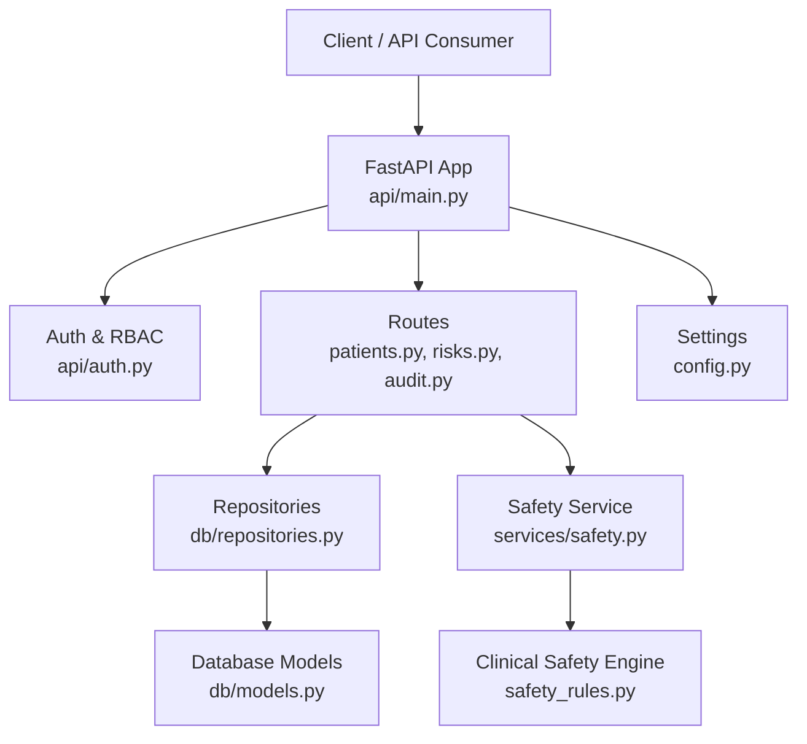
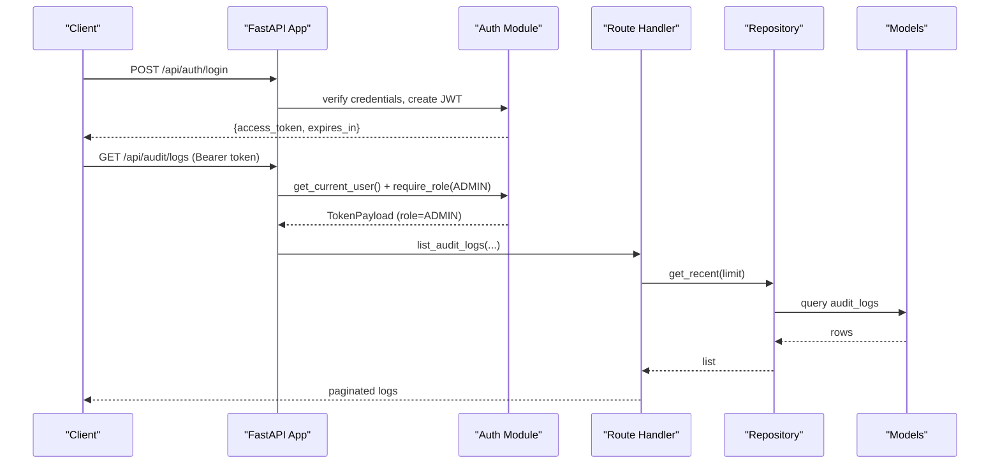
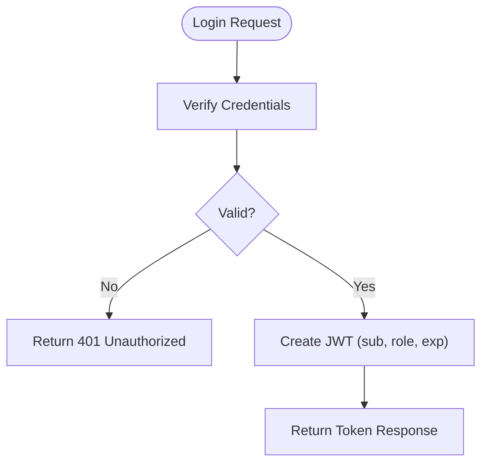
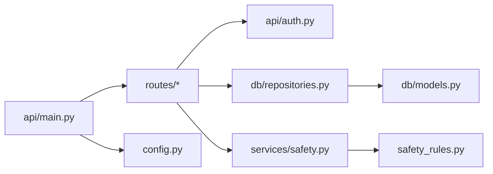

# Security and Compliance

<cite>
**Referenced Files in This Document**
- [auth.py](file://backend/api/auth.py)
- [deps.py](file://backend/api/deps.py)
- [main.py](file://backend/api/main.py)
- [config.py](file://backend/config.py)
- [models.py](file://backend/db/models.py)
- [repositories.py](file://backend/db/repositories.py)
- [audit.py](file://backend/api/routes/audit.py)
- [patients.py](file://backend/api/routes/patients.py)
- [risks.py](file://backend/api/routes/risks.py)
- [safety.py](file://backend/services/safety.py)
- [safety_rules.py](file://safety_rules.py)
</cite>

## Table of Contents
1. Introduction
2. Project Structure
3. Core Components
4. Architecture Overview
5. Detailed Component Analysis
6. Dependency Analysis
7. Performance Considerations
8. Troubleshooting Guide
9. Conclusion
10. Appendices

## Introduction
This document provides comprehensive security and compliance guidance for MaaHifazat AI, focusing on authentication and authorization (JWT-based), role-based access control, session handling, data privacy (encryption at rest and in transit), secure transmission, patient data protection, audit logging, healthcare regulatory alignment (HIPAA/GDPR), vulnerability assessment and penetration testing, monitoring, incident response, and ongoing maintenance. It maps these practices to the implemented codebase to ensure traceability and actionable recommendations.

## Project Structure
The backend is a FastAPI application with modular routes, dependency injection, SQLAlchemy async models and repositories, and a safety service that wraps deterministic clinical rules. Authentication and authorization are centralized in an auth module, while audit logs are exposed via admin-only endpoints. Configuration centralizes secrets and runtime settings.

**Diagram sources**
- [main.py:1-40](file://backend/api/main.py#L1-L40)
- [auth.py:1-156](file://backend/api/auth.py#L1-L156)
- [patients.py:1-97](file://backend/api/routes/patients.py#L1-L97)
- [risks.py:69-135](file://backend/api/routes/risks.py#L69-L135)
- [audit.py:1-88](file://backend/api/routes/audit.py#L1-L88)
- [repositories.py:1-125](file://backend/db/repositories.py#L1-L125)
- [models.py:1-115](file://backend/db/models.py#L1-L115)
- [safety.py:1-83](file://backend/services/safety.py#L1-L83)
- [safety_rules.py:1-555](file://safety_rules.py#L1-L555)
- [config.py:1-55](file://backend/config.py#L1-L55)

**Section sources**
- [main.py:1-40](file://backend/api/main.py#L1-L40)
- [config.py:1-55](file://backend/config.py#L1-L55)

## Core Components
- Authentication and Authorization: JWT issuance and validation, password hashing, role checks via FastAPI dependencies.
- Role-Based Access Control: Enforced per route using a role requirement dependency; admin-only endpoints for audit logs.
- Data Privacy: Patient and clinical data stored via SQLAlchemy models; sensitive fields persisted as structured JSON where appropriate.
- Audit Logging: Admin-only endpoint to retrieve recent audit entries with filtering and pagination.
- Safety and Clinical Guardrails: Deterministic WHO triage engine integrated into risk assessment flows.

Key implementation references:
- JWT creation, verification, and role enforcement: [auth.py:65-115](file://backend/api/auth.py#L65-L115)
- Password hashing and MVP users: [auth.py:18-58](file://backend/api/auth.py#L18-L58)
- Role-scoped endpoints (audit): [audit.py:21-31](file://backend/api/routes/audit.py#L21-L31)
- Patient CRUD requiring authentication: [patients.py:44-97](file://backend/api/routes/patients.py#L44-L97)
- Risk assessment integrating safety rules: [risks.py:69-135](file://backend/api/routes/risks.py#L69-L135)
- Safety service adapter: [safety.py:18-83](file://backend/services/safety.py#L18-L83)
- Clinical rule engine: [safety_rules.py:72-167](file://safety_rules.py#L72-L167)
- Database models (patients, clinical records, audit logs): [models.py:11-93](file://backend/db/models.py#L11-L93)
- Repository layer for persistence: [repositories.py:9-83](file://backend/db/repositories.py#L9-L83)
- Application configuration (JWT, paths, external APIs): [config.py:23-47](file://backend/config.py#L23-L47)

**Section sources**
- [auth.py:18-115](file://backend/api/auth.py#L18-L115)
- [audit.py:21-31](file://backend/api/routes/audit.py#L21-L31)
- [patients.py:44-97](file://backend/api/routes/patients.py#L44-L97)
- [risks.py:69-135](file://backend/api/routes/risks.py#L69-L135)
- [safety.py:18-83](file://backend/services/safety.py#L18-L83)
- [safety_rules.py:72-167](file://safety_rules.py#L72-L167)
- [models.py:11-93](file://backend/db/models.py#L11-L93)
- [repositories.py:9-83](file://backend/db/repositories.py#L9-L83)
- [config.py:23-47](file://backend/config.py#L23-L47)

## Architecture Overview
The system uses JWT bearer tokens for stateless authentication. Each request carries a token validated by a shared dependency. Role-based authorization restricts sensitive operations (e.g., audit log retrieval). Data flows through routes to repositories and models, with optional integration of the safety service for clinical decision support.

**Diagram sources**
- [auth.py:65-115](file://backend/api/auth.py#L65-L115)
- [audit.py:21-88](file://backend/api/routes/audit.py#L21-L88)
- [repositories.py:66-83](file://backend/db/repositories.py#L66-L83)
- [models.py:81-93](file://backend/db/models.py#L81-L93)

## Detailed Component Analysis

### Authentication and Authorization (JWT + RBAC)
- Password hashing uses bcrypt via a cryptography context; MVP user store is in-memory for development.
- JWT tokens include subject (user_id) and role, signed with HS256 and a configurable secret and expiration.
- Route-level authorization uses a dependency factory to enforce required roles; unauthorized or forbidden requests return appropriate HTTP status codes.
- Session management is stateless; no server-side sessions are maintained.

Security considerations and recommendations:
- Replace in-memory user store with a secure, audited database-backed user store before production.
- Rotate and securely manage JWT_SECRET; enforce minimum key strength and rotation policy.
- Enforce HTTPS everywhere; configure CORS explicitly for allowed origins.
- Implement token refresh flow and short-lived access tokens with refresh tokens stored securely.
- Add rate limiting and account lockout policies for login attempts.

**Diagram sources**
- [auth.py:125-146](file://backend/api/auth.py#L125-L146)
- [auth.py:65-70](file://backend/api/auth.py#L65-L70)

**Section sources**
- [auth.py:18-115](file://backend/api/auth.py#L18-L115)
- [auth.py:125-156](file://backend/api/auth.py#L125-L156)
- [config.py:26-29](file://backend/config.py#L26-L29)

### Role-Based Access Control
- Admin-only endpoints: audit log retrieval requires UserRole.ADMIN.
- Other endpoints require authentication via get_current_user; further role scoping can be applied similarly.

Operational notes:
- Ensure all sensitive endpoints enforce require_role appropriately.
- Maintain an explicit mapping of roles to capabilities and review regularly.

**Section sources**
- [audit.py:21-31](file://backend/api/routes/audit.py#L21-L31)
- [patients.py:44-97](file://backend/api/routes/patients.py#L44-L97)

### Data Privacy and Protection
- Patient and clinical data are persisted using SQLAlchemy models with UUID primary keys and timestamps.
- Sensitive inputs (vitals, symptoms, model outputs) are stored as JSON columns; consider field-level encryption for highly sensitive attributes in production.
- Audit logs capture agent actions, case identifiers, and timestamps for accountability.

Recommendations:
- Enable database-level encryption at rest (e.g., TDE or encrypted volumes).
- Encrypt sensitive fields at the application level if required by policy.
- Apply strict least-privilege database access controls and network segmentation.
- Mask or tokenize identifiers in logs and analytics outputs.

**Section sources**
- [models.py:11-93](file://backend/db/models.py#L11-L93)
- [repositories.py:9-83](file://backend/db/repositories.py#L9-L83)

### Secure Transmission and External Integrations
- External API URLs are configured centrally; ensure they use HTTPS and validate certificates.
- Integrate TLS termination at the reverse proxy/load balancer and enforce HSTS.
- Validate and sanitize all inbound data; use Pydantic schemas for input validation.

Recommendations:
- Centralize outbound calls through a single client with retry, timeout, and circuit breaker patterns.
- Log only non-sensitive metadata for integrations; avoid including PHI in logs.

**Section sources**
- [config.py:31-42](file://backend/config.py#L31-L42)

### Safety and Clinical Decision Support
- The safety service integrates a deterministic WHO triage engine that evaluates vitals and symptoms to determine triage levels and recommended actions.
- Risk assessment endpoints call both ML predictions and safety rules; emergency detection can override other scores.

Compliance note:
- Maintain versioned model artifacts and record metrics for traceability and clinical validation.

**Section sources**
- [safety.py:18-83](file://backend/services/safety.py#L18-L83)
- [safety_rules.py:72-167](file://safety_rules.py#L72-L167)
- [risks.py:69-135](file://backend/api/routes/risks.py#L69-L135)

### Audit Logging
- Admin-only endpoint retrieves recent audit logs with filters (agent name, patient/case ID, date range) and pagination.
- Logs include agent name, action, case identifiers, and optional details.

Recommendations:
- Persist logs to a tamper-evident store (e.g., append-only table or WORM storage).
- Implement log integrity checks and alerting on anomalies.
- Retain logs per regulatory requirements and define retention schedules.

**Section sources**
- [audit.py:21-88](file://backend/api/routes/audit.py#L21-L88)
- [repositories.py:66-83](file://backend/db/repositories.py#L66-L83)
- [models.py:81-93](file://backend/db/models.py#L81-L93)

## Dependency Analysis
- FastAPI app mounts routers and initializes DB and models at startup.
- Routes depend on auth dependencies for identity and authorization.
- Repositories abstract database interactions; models define schema.
- Safety service depends on the clinical rule engine; risk routes combine ML and safety outputs.

**Diagram sources**
- [main.py:1-40](file://backend/api/main.py#L1-L40)
- [auth.py:1-156](file://backend/api/auth.py#L1-L156)
- [repositories.py:1-125](file://backend/db/repositories.py#L1-L125)
- [models.py:1-115](file://backend/db/models.py#L1-L115)
- [safety.py:1-83](file://backend/services/safety.py#L1-L83)
- [safety_rules.py:1-555](file://safety_rules.py#L1-L555)
- [config.py:1-55](file://backend/config.py#L1-L55)

**Section sources**
- [main.py:1-40](file://backend/api/main.py#L1-L40)
- [auth.py:1-156](file://backend/api/auth.py#L1-L156)
- [repositories.py:1-125](file://backend/db/repositories.py#L1-L125)
- [models.py:1-115](file://backend/db/models.py#L1-L115)
- [safety.py:1-83](file://backend/services/safety.py#L1-L83)
- [safety_rules.py:1-555](file://safety_rules.py#L1-L555)
- [config.py:1-55](file://backend/config.py#L1-L55)

## Performance Considerations
- Use connection pooling and async DB sessions to reduce latency under load.
- Cache frequent reads where appropriate and implement pagination consistently.
- Offload heavy computations (e.g., LLM calls) to background tasks or worker threads to keep API responsive.
- Monitor resource usage and set timeouts for external services to prevent cascading failures.

[No sources needed since this section provides general guidance]

## Troubleshooting Guide
Common issues and mitigations:
- Invalid or expired JWT: Ensure correct secret and algorithm; handle 401 responses and prompt re-authentication.
- Missing or incorrect roles: Verify role assignments and route-level require_role decorators.
- DB connectivity errors: Check DATABASE_URL and initialization; wrap with retries and health checks.
- Safety engine exceptions: Validate input schemas; provide fallback messages and log errors without PHI.

Operational tips:
- Centralize error handling and standardize error payloads.
- Instrument logging with correlation IDs to trace requests across components.
- Use health check endpoints to monitor DB, models, and external integrations.

**Section sources**
- [auth.py:73-91](file://backend/api/auth.py#L73-L91)
- [audit.py:38-46](file://backend/api/routes/audit.py#L38-L46)
- [main.py:22-40](file://backend/api/main.py#L22-L40)

## Conclusion
MaaHifazat AI implements foundational security controls including JWT-based authentication, role-based authorization, and audit logging. To meet healthcare compliance and operational resilience, adopt encryption at rest/in transit, robust input validation, secure configuration management, comprehensive monitoring, and formal incident response procedures. Continuous validation of clinical safety rules and model governance will support regulatory approval and safe deployment.

[No sources needed since this section summarizes without analyzing specific files]

## Appendices

### HIPAA and GDPR Alignment Checklist
- Access controls: Enforce least privilege and role-based access; maintain audit trails.
- Data minimization: Collect only necessary patient data; mask or pseudonymize in logs.
- Encryption: Encrypt data at rest (database, backups) and in transit (TLS).
- Consent and rights: Provide mechanisms for consent management and data subject requests.
- Breach notification: Define timelines and processes for reporting incidents.
- Retention: Define and enforce data retention and secure disposal policies.

[No sources needed since this section provides general guidance]

### API Security Best Practices
- Input validation: Use Pydantic schemas for all inputs; reject malformed data early.
- SQL injection prevention: Use ORM queries and parameterized statements; avoid raw SQL.
- XSS protection: Sanitize outputs when rendering UI; set secure headers (CSP, X-Frame-Options).
- Rate limiting and throttling: Protect endpoints from abuse.
- Secrets management: Store secrets in environment variables or secret managers; never hardcode.

[No sources needed since this section provides general guidance]

### Vulnerability Assessment and Penetration Testing
- Automated scanning: Integrate SAST/DAST into CI/CD pipelines.
- Dependency audits: Regularly scan for known vulnerabilities in third-party libraries.
- Pen tests: Conduct periodic assessments covering authentication, authorization, data exposure, and API misuse.
- Remediation: Track findings, prioritize by risk, and verify fixes.

[No sources needed since this section provides general guidance]

### Security Monitoring and Incident Response
- Monitoring: Alert on failed logins, unusual access patterns, and safety rule overrides.
- Logging: Centralize logs with tamper-evident storage; correlate events across services.
- Incident response: Define playbooks for breaches, data leaks, and system outages; practice tabletop exercises.
- Post-incident: Perform root cause analysis and update controls accordingly.

[No sources needed since this section provides general guidance]