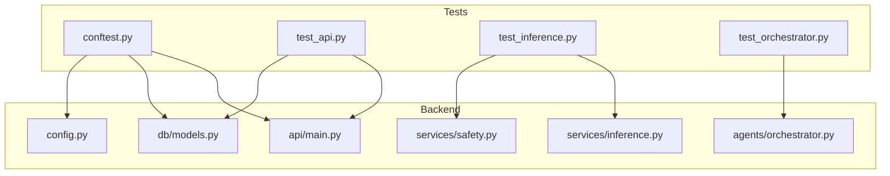
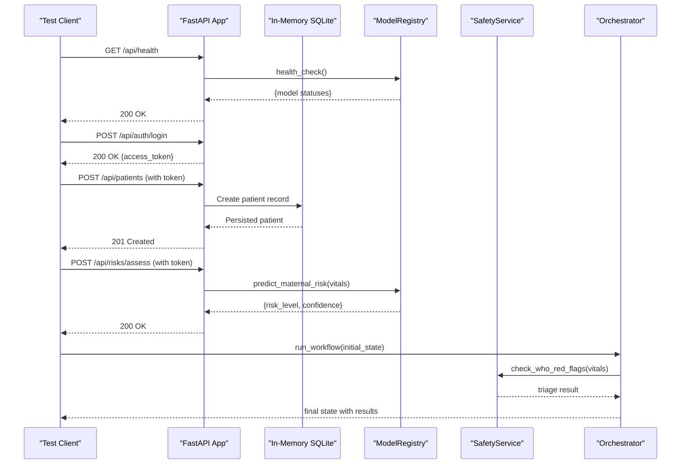
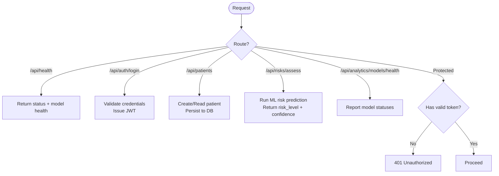
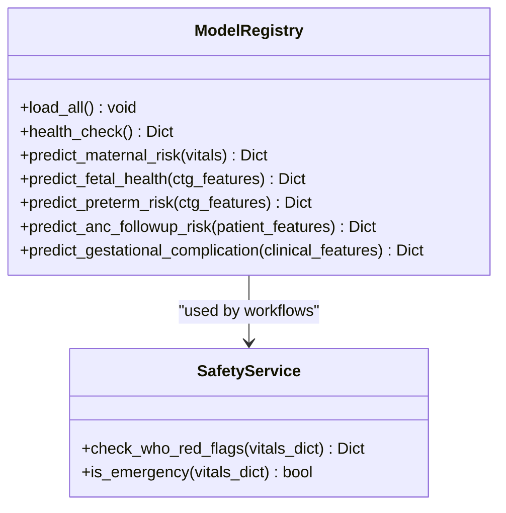
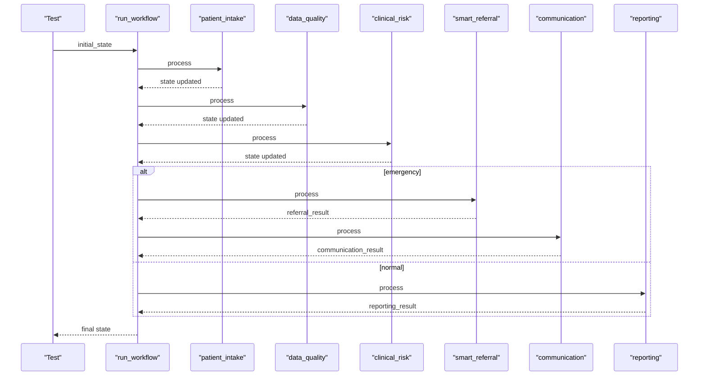
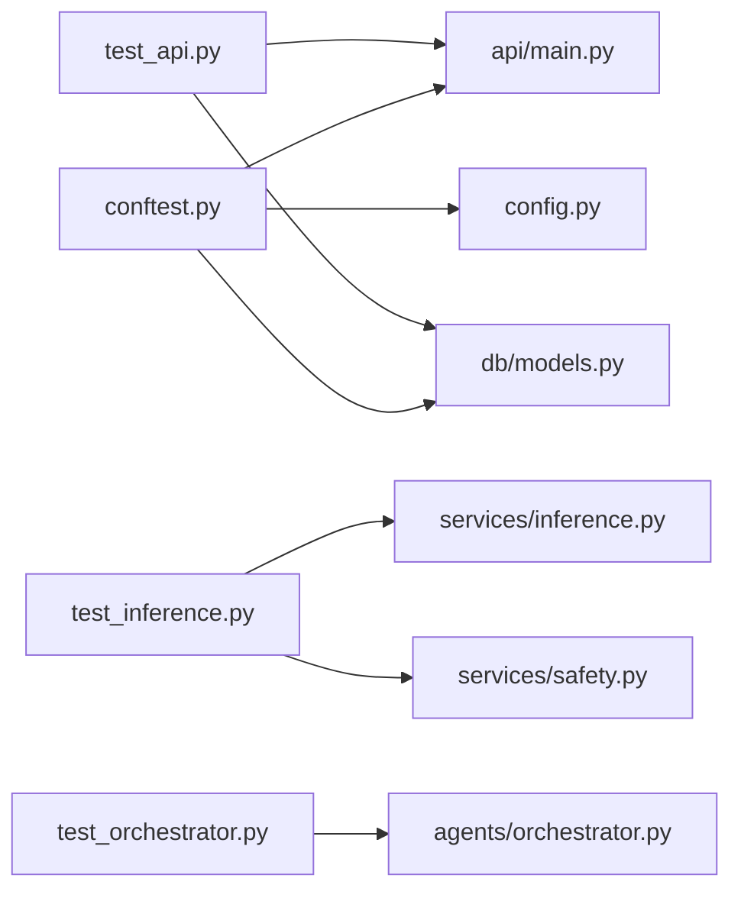

# Testing Strategy

<cite>
**Referenced Files in This Document**
- [conftest.py](file://backend/tests/conftest.py)
- [test_api.py](file://backend/tests/test_api.py)
- [test_inference.py](file://backend/tests/test_inference.py)
- [test_orchestrator.py](file://backend/tests/test_orchestrator.py)
- [main.py](file://backend/api/main.py)
- [inference.py](file://backend/services/inference.py)
- [orchestrator.py](file://backend/agents/orchestrator.py)
- [models.py](file://backend/db/models.py)
- [safety.py](file://backend/services/safety.py)
- [config.py](file://backend/config.py)
- [requirements-backend.txt](file://requirements-backend.txt)
</cite>

## Table of Contents
1. Introduction
2. Project Structure
3. Core Components
4. Architecture Overview
5. Detailed Component Analysis
6. Dependency Analysis
7. Performance Considerations
8. Troubleshooting Guide
9. Conclusion
10. Appendices

## Introduction
This document explains the testing strategy and framework for MaaHifazat AI, covering unit tests for individual components, integration tests for FastAPI endpoints and database interactions, model validation tests for ML predictions, and end-to-end tests for complete clinical workflows. It also outlines test organization, mocking strategies for external services, test data management, continuous execution setup, coverage reporting guidance, and healthcare-specific considerations such as privacy, compliance, and clinical accuracy validation.

## Project Structure
The backend uses a layered structure with clear separation between API routes, services (ML inference and safety), agents (workflow orchestration), and persistence (SQLAlchemy models). Tests are organized under backend/tests with shared fixtures and per-feature test modules:
- conftest.py: Shared async fixtures, in-memory SQLite, dependency overrides, and auth helpers
- test_api.py: Integration tests for FastAPI routes (health, auth, patients, risks, analytics)
- test_inference.py: Model registry and prediction tests plus safety rule validation
- test_orchestrator.py: End-to-end workflow tests across agent nodes

**Diagram sources**
- [conftest.py:1-68](file://backend/tests/conftest.py#L1-L68)
- [test_api.py:1-136](file://backend/tests/test_api.py#L1-L136)
- [test_inference.py:1-104](file://backend/tests/test_inference.py#L1-L104)
- [test_orchestrator.py:1-136](file://backend/tests/test_orchestrator.py#L1-L136)
- [main.py:1-135](file://backend/api/main.py#L1-L135)
- [inference.py:1-435](file://backend/services/inference.py#L1-L435)
- [orchestrator.py:1-167](file://backend/agents/orchestrator.py#L1-L167)
- [models.py:1-115](file://backend/db/models.py#L1-L115)
- [safety.py:1-83](file://backend/services/safety.py#L1-L83)
- [config.py:1-55](file://backend/config.py#L1-L55)

**Section sources**
- [conftest.py:1-68](file://backend/tests/conftest.py#L1-L68)
- [test_api.py:1-136](file://backend/tests/test_api.py#L1-L136)
- [test_inference.py:1-104](file://backend/tests/test_inference.py#L1-L104)
- [test_orchestrator.py:1-136](file://backend/tests/test_orchestrator.py#L1-L136)
- [main.py:1-135](file://backend/api/main.py#L1-L135)
- [inference.py:1-435](file://backend/services/inference.py#L1-L435)
- [orchestrator.py:1-167](file://backend/agents/orchestrator.py#L1-L167)
- [models.py:1-115](file://backend/db/models.py#L1-L115)
- [safety.py:1-83](file://backend/services/safety.py#L1-L83)
- [config.py:1-55](file://backend/config.py#L1-L55)

## Core Components
- Test configuration and fixtures:
  - In-memory SQLite engine and session factory for isolated DB state per test
  - Dependency override to inject test DB into FastAPI via get_db
  - Async HTTP client using ASGITransport against the real app
  - Auth helper that logs in and returns bearer token headers
- API integration tests:
  - Health endpoint verification including model availability
  - Authentication flow returning JWT tokens
  - Patient CRUD operations with authorization
  - Risk assessment endpoint validating risk outputs
  - Analytics model health endpoint asserting loaded model counts
  - Unauthorized access protection checks
- Model inference tests:
  - ModelRegistry load_all and health_check assertions
  - Maternal risk prediction shape and confidence bounds
  - Fetal health prediction with dummy CTG features
  - Safety service WHO red flags triggering emergency triage
- Orchestrator end-to-end tests:
  - Normal workflow through intake, data quality, clinical risk, reporting
  - Emergency workflow branching to smart referral and communication
  - Incomplete intake early termination without downstream processing

**Section sources**
- [conftest.py:12-68](file://backend/tests/conftest.py#L12-L68)
- [test_api.py:12-136](file://backend/tests/test_api.py#L12-L136)
- [test_inference.py:12-104](file://backend/tests/test_inference.py#L12-L104)
- [test_orchestrator.py:10-136](file://backend/tests/test_orchestrator.py#L10-L136)

## Architecture Overview
The application exposes FastAPI routes that depend on services for ML inference and safety rules, and an orchestrator that coordinates multi-step clinical workflows. Tests exercise these layers by:
- Using an in-memory database to validate persistence and queries
- Calling actual routes with real dependencies where appropriate
- Validating ML model loading and prediction contracts
- Driving full workflow paths to ensure correct routing and side effects

**Diagram sources**
- [main.py:108-115](file://backend/api/main.py#L108-L115)
- [inference.py:153-202](file://backend/services/inference.py#L153-L202)
- [safety.py:24-67](file://backend/services/safety.py#L24-L67)
- [orchestrator.py:144-147](file://backend/agents/orchestrator.py#L144-L147)
- [test_api.py:12-128](file://backend/tests/test_api.py#L12-L128)
- [test_orchestrator.py:52-111](file://backend/tests/test_orchestrator.py#L52-L111)

## Detailed Component Analysis

### API Integration Tests
- Health endpoint: Validates status and model availability map returned by the registry
- Authentication: Confirms login returns a bearer token used for protected routes
- Patients: Creates and retrieves patients; asserts persisted fields and IDs
- Risks: Submits vitals and verifies maternal risk output presence and structure
- Analytics: Checks model health endpoint reports all expected models and counts
- Authorization: Ensures unauthenticated requests to protected endpoints return 401

**Diagram sources**
- [test_api.py:12-136](file://backend/tests/test_api.py#L12-L136)
- [main.py:108-135](file://backend/api/main.py#L108-L135)

**Section sources**
- [test_api.py:12-136](file://backend/tests/test_api.py#L12-L136)
- [main.py:108-135](file://backend/api/main.py#L108-L135)

### Model Inference and Safety Tests
- ModelRegistry:
  - Verifies all five models load successfully and report as loaded
  - Validates prediction contracts include labels, probabilities, confidence, and availability flags
  - Ensures confidence values are floats within [0, 1]
- SafetyService:
  - Uses WHO red flag rules to determine triage level
  - Confirms dangerous vitals trigger HIGH_RISK_EMERGENCY and override ML scores

**Diagram sources**
- [inference.py:51-435](file://backend/services/inference.py#L51-L435)
- [safety.py:18-83](file://backend/services/safety.py#L18-L83)
- [test_inference.py:12-104](file://backend/tests/test_inference.py#L12-L104)

**Section sources**
- [test_inference.py:12-104](file://backend/tests/test_inference.py#L12-L104)
- [inference.py:51-435](file://backend/services/inference.py#L51-L435)
- [safety.py:18-83](file://backend/services/safety.py#L18-L83)

### Orchestrator End-to-End Tests
- Normal workflow:
  - Intake completes, data quality passes, clinical risk assessed, reporting generated
  - Audit trail populated from multiple nodes
- Emergency workflow:
  - Dangerous vitals set emergency flag
  - Smart referral triggered with urgency level
  - Communication sends emergency alert
- Incomplete intake:
  - Workflow stops after intake when required vitals missing
  - Downstream nodes not executed

**Diagram sources**
- [orchestrator.py:22-147](file://backend/agents/orchestrator.py#L22-L147)
- [test_orchestrator.py:52-136](file://backend/tests/test_orchestrator.py#L52-L136)

**Section sources**
- [test_orchestrator.py:52-136](file://backend/tests/test_orchestrator.py#L52-L136)
- [orchestrator.py:22-147](file://backend/agents/orchestrator.py#L22-L147)

## Dependency Analysis
- Test fixtures depend on FastAPI app and SQLAlchemy Base to create tables and sessions per test
- API tests depend on routes and authentication middleware
- Inference tests depend on ModelRegistry and SafetyService
- Orchestrator tests depend on compiled workflow and node functions
- Configuration influences model paths and database URL

**Diagram sources**
- [conftest.py:1-68](file://backend/tests/conftest.py#L1-L68)
- [test_api.py:1-136](file://backend/tests/test_api.py#L1-L136)
- [test_inference.py:1-104](file://backend/tests/test_inference.py#L1-L104)
- [test_orchestrator.py:1-136](file://backend/tests/test_orchestrator.py#L1-L136)
- [main.py:1-135](file://backend/api/main.py#L1-L135)
- [inference.py:1-435](file://backend/services/inference.py#L1-L435)
- [safety.py:1-83](file://backend/services/safety.py#L1-L83)
- [orchestrator.py:1-167](file://backend/agents/orchestrator.py#L1-L167)
- [models.py:1-115](file://backend/db/models.py#L1-L115)
- [config.py:1-55](file://backend/config.py#L1-L55)

**Section sources**
- [conftest.py:1-68](file://backend/tests/conftest.py#L1-L68)
- [test_api.py:1-136](file://backend/tests/test_api.py#L1-L136)
- [test_inference.py:1-104](file://backend/tests/test_inference.py#L1-L104)
- [test_orchestrator.py:1-136](file://backend/tests/test_orchestrator.py#L1-L136)
- [main.py:1-135](file://backend/api/main.py#L1-L135)
- [inference.py:1-435](file://backend/services/inference.py#L1-L435)
- [safety.py:1-83](file://backend/services/safety.py#L1-L83)
- [orchestrator.py:1-167](file://backend/agents/orchestrator.py#L1-L167)
- [models.py:1-115](file://backend/db/models.py#L1-L115)
- [config.py:1-55](file://backend/config.py#L1-L55)

## Performance Considerations
- Use in-memory SQLite for fast, isolated DB operations during tests
- Reuse the compiled workflow graph to avoid recompilation overhead
- Load models once per test process via singleton registry to minimize startup time
- Keep payloads minimal and deterministic to reduce serialization costs
- Prefer targeted assertions over broad response dumps to speed up test runs

[No sources needed since this section provides general guidance]

## Troubleshooting Guide
- Database issues:
  - Ensure tables are created before each test using the fixture’s engine context
  - Verify dependency override replaces get_db with test session
- Authentication failures:
  - Confirm login route returns access_token and use it in subsequent requests
  - Validate token format and expiration settings in configuration
- Model loading errors:
  - Check artifact paths in configuration and ensure files exist
  - Inspect health_check output to identify unloaded models
- Workflow routing problems:
  - Validate state fields like intake_complete and emergency influence routing
  - Use single-node runner to isolate failing nodes if needed

**Section sources**
- [conftest.py:16-35](file://backend/tests/conftest.py#L16-L35)
- [test_api.py:22-33](file://backend/tests/test_api.py#L22-L33)
- [inference.py:68-141](file://backend/services/inference.py#L68-L141)
- [orchestrator.py:22-56](file://backend/agents/orchestrator.py#L22-L56)
- [config.py:13-24](file://backend/config.py#L13-L24)

## Conclusion
MaaHifazat AI employs a robust testing strategy combining unit-level validations, integration tests for APIs and databases, model inference checks, and end-to-end workflow tests. The approach ensures reliability of clinical logic, safety rule enforcement, and system stability. By maintaining isolated test environments, deterministic inputs, and comprehensive assertions, the suite supports safe evolution of the codebase while addressing healthcare-specific concerns around privacy, compliance, and clinical accuracy.

[No sources needed since this section summarizes without analyzing specific files]

## Appendices

### Test Organization and Execution
- pytest and pytest-asyncio are used for asynchronous test support
- Fixtures provide reusable clients, sessions, and auth headers
- Run tests with pytest; add markers or filters as needed for subsets

**Section sources**
- [requirements-backend.txt:13-15](file://requirements-backend.txt#L13-L15)
- [conftest.py:1-68](file://backend/tests/conftest.py#L1-L68)

### Mocking Strategies for External Services
- External integrations (voice, messaging, routing, facility locator) are stubbed via configuration URLs
- For tests, prefer isolating calls behind interfaces so they can be replaced with mocks or no-ops
- When integrating with LLM providers, guard calls with feature flags or environment toggles to avoid network dependencies in CI

**Section sources**
- [config.py:31-42](file://backend/config.py#L31-L42)

### Test Data Management
- Use synthetic payloads for patients and vitals to avoid PII
- Generate unique identifiers (e.g., UUIDs) for test cases to prevent collisions
- Seed minimal required data for each scenario (e.g., incomplete vs complete intake)

**Section sources**
- [test_api.py:36-85](file://backend/tests/test_api.py#L36-L85)
- [test_orchestrator.py:10-44](file://backend/tests/test_orchestrator.py#L10-L44)

### Continuous Integration and Coverage Reporting
- Install dependencies from requirements-backend.txt
- Execute tests with pytest; consider adding coverage collection and reporting
- Gate merges on passing tests and minimum coverage thresholds

**Section sources**
- [requirements-backend.txt:1-15](file://requirements-backend.txt#L1-L15)

### Healthcare-Specific Challenges
- Data privacy:
  - Avoid storing real patient data in tests; use synthetic datasets
  - Ensure audit logs do not capture sensitive details beyond necessary summaries
- Regulatory compliance:
  - Validate safety rules and triage outcomes rigorously
  - Maintain traceability via audit trails and model versioning metadata
- Clinical accuracy:
  - Include boundary cases for vital signs and symptoms
  - Assert confidence ranges and fallback behaviors when models are unavailable

**Section sources**
- [safety.py:24-67](file://backend/services/safety.py#L24-L67)
- [models.py:81-104](file://backend/db/models.py#L81-L104)
- [inference.py:147-149](file://backend/services/inference.py#L147-L149)