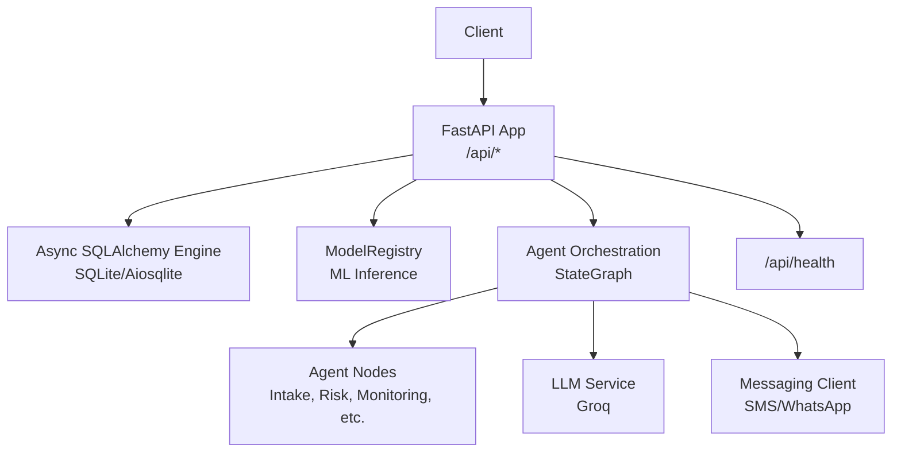
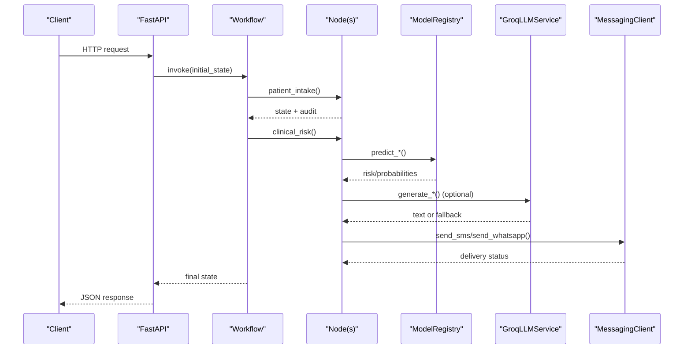
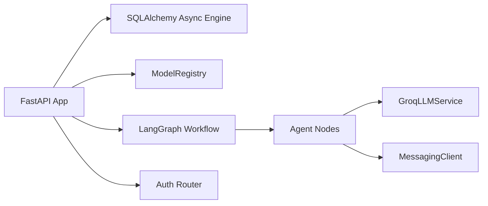

# Troubleshooting and FAQ

<cite>
**Referenced Files in This Document**
- [main.py](file://backend/api/main.py)
- [config.py](file://backend/config.py)
- [engine.py](file://backend/db/engine.py)
- [inference.py](file://backend/services/inference.py)
- [orchestrator.py](file://backend/agents/orchestrator.py)
- [auth.py](file://backend/api/auth.py)
- [llm.py](file://backend/services/llm.py)
- [messaging_client.py](file://backend/integrations/messaging_client.py)
- [patient_intake.py](file://backend/agents/nodes/patient_intake.py)
- [test_api.py](file://backend/tests/test_api.py)
- [requirements-backend.txt](file://requirements-backend.txt)
</cite>

## Table of Contents
1. Introduction
2. Project Structure
3. Core Components
4. Architecture Overview
5. Detailed Component Analysis
6. Dependency Analysis
7. Performance Considerations
8. Troubleshooting Guide
9. Conclusion
10. Appendices

## Introduction
This document provides comprehensive troubleshooting and frequently asked questions for MaaHifazat AI. It focuses on resolving API errors, database connectivity issues, model loading failures, integration service timeouts, performance bottlenecks, memory leaks, resource exhaustion, agent orchestration problems, ML inference issues, workflow execution errors, log analysis, error interpretation, system health monitoring, configuration and deployment issues, usage patterns, performance tuning, capacity planning, preventive maintenance, escalation procedures, and support contacts.

## Project Structure
MaaHifazat AI is a FastAPI backend with:
- API layer (routes, auth, global exception handling, health endpoint)
- Database layer (async SQLAlchemy engine and session management)
- ML inference service (model registry and prediction helpers)
- Agent orchestration (LangGraph StateGraph workflow)
- Integrations (messaging, voice, routing, facility locator)
- Configuration via Pydantic settings
- Tests for API endpoints

**Diagram sources**
- [main.py:22-64](file://backend/api/main.py#L22-L64)
- [engine.py:10-18](file://backend/db/engine.py#L10-L18)
- [inference.py:51-141](file://backend/services/inference.py#L51-L141)
- [orchestrator.py:62-138](file://backend/agents/orchestrator.py#L62-L138)
- [llm.py:31-65](file://backend/services/llm.py#L31-L65)
- [messaging_client.py:9-78](file://backend/integrations/messaging_client.py#L9-L78)

**Section sources**
- [main.py:1-135](file://backend/api/main.py#L1-L135)
- [config.py:7-54](file://backend/config.py#L7-L54)
- [engine.py:1-37](file://backend/db/engine.py#L1-L37)
- [inference.py:1-435](file://backend/services/inference.py#L1-L435)
- [orchestrator.py:1-167](file://backend/agents/orchestrator.py#L1-L167)
- [auth.py:1-156](file://backend/api/auth.py#L1-L156)
- [llm.py:1-144](file://backend/services/llm.py#L1-L144)
- [messaging_client.py:1-78](file://backend/integrations/messaging_client.py#L1-L78)
- [test_api.py:1-136](file://backend/tests/test_api.py#L1-L136)
- [requirements-backend.txt:1-15](file://requirements-backend.txt#L1-L15)

## Core Components
- Application entrypoint and lifecycle: initializes DB and loads models at startup; exposes /api/health.
- Database: async engine and session factory; table creation on init.
- Model Registry: singleton that loads all ML artifacts once; provides per-model prediction methods and health checks.
- Agent Orchestration: LangGraph workflow wiring nine nodes with conditional routing; helper to run full workflow or single node.
- Authentication: JWT-based login and role enforcement; test accounts for MVP.
- LLM Service: optional Groq integration with graceful fallbacks when unavailable.
- Messaging Client: stub client for SMS/WhatsApp with delivery tracking.

**Section sources**
- [main.py:22-64](file://backend/api/main.py#L22-L64)
- [engine.py:10-37](file://backend/db/engine.py#L10-L37)
- [inference.py:51-141](file://backend/services/inference.py#L51-L141)
- [orchestrator.py:62-147](file://backend/agents/orchestrator.py#L62-L147)
- [auth.py:65-115](file://backend/api/auth.py#L65-L115)
- [llm.py:31-65](file://backend/services/llm.py#L31-L65)
- [messaging_client.py:9-78](file://backend/integrations/messaging_client.py#L9-L78)

## Architecture Overview
The system follows an event-driven pipeline orchestrated by LangGraph. Requests enter the FastAPI app, which may trigger agent workflows. Each node can call ML inference, LLM generation, and messaging integrations. Errors are captured per-node and surfaced in audit trails. A global exception handler returns structured JSON errors.

**Diagram sources**
- [main.py:22-64](file://backend/api/main.py#L22-L64)
- [orchestrator.py:62-147](file://backend/agents/orchestrator.py#L62-L147)
- [inference.py:151-426](file://backend/services/inference.py#L151-L426)
- [llm.py:48-119](file://backend/services/llm.py#L48-L119)
- [messaging_client.py:17-78](file://backend/integrations/messaging_client.py#L17-L78)

## Detailed Component Analysis

### API Layer and Global Error Handling
- Startup runs DB initialization and model loading; failures are logged but do not block startup in development.
- Global exception handler logs unhandled exceptions and returns a structured JSON error with path details.
- Health endpoint reports overall status and model availability.

Common issues and resolutions:
- Unhandled exceptions returning 500: check request payload and route handlers; inspect server logs for stack traces.
- CORS errors in development: ensure browser origin matches allowed origins; tighten CORS in production.

**Section sources**
- [main.py:22-44](file://backend/api/main.py#L22-L44)
- [main.py:83-100](file://backend/api/main.py#L83-L100)
- [main.py:108-115](file://backend/api/main.py#L108-L115)

### Database Connectivity
- Async engine uses configured DATABASE_URL; tables created on init.
- Session dependency commits on success and rolls back on error.

Common issues and resolutions:
- Cannot connect to database: verify DATABASE_URL and file permissions; ensure SQLite file path exists and is writable.
- Slow queries or locked DB: reduce concurrent writes; consider connection pooling and read replicas in production.

**Section sources**
- [engine.py:10-37](file://backend/db/engine.py#L10-L37)
- [config.py:23-24](file://backend/config.py#L23-L24)

### Model Loading and Inference
- ModelRegistry loads models once at startup; missing files are logged as warnings and predictions fall back safely.
- Prediction methods return safe fallbacks when models are unavailable or inputs are invalid.

Common issues and resolutions:
- Models not loaded: confirm artifact paths exist under ARTIFACTS_DIR; re-run training or copy artifacts; check logs for “Model file not found”.
- Prediction errors: validate input feature names and types; ensure preprocessors and encoders are present where required.
- Memory pressure: avoid loading duplicate registries; rely on singleton pattern; monitor process memory.

**Section sources**
- [inference.py:51-141](file://backend/services/inference.py#L51-L141)
- [inference.py:147-149](file://backend/services/inference.py#L147-L149)
- [inference.py:151-426](file://backend/services/inference.py#L151-L426)

### Agent Orchestration and Workflow Execution
- StateGraph defines nine nodes and conditional edges; entry point is patient_intake.
- Helpers allow running the full workflow or a single node for testing.

Common issues and resolutions:
- Workflow stalls or ends early: inspect intake completeness and routing conditions; check emergency flags and CTG presence.
- Node-specific errors: each node returns errors and audit_trail entries; identify failing node from audit trail and fix data or dependencies.

**Section sources**
- [orchestrator.py:22-56](file://backend/agents/orchestrator.py#L22-L56)
- [orchestrator.py:62-138](file://backend/agents/orchestrator.py#L62-L138)
- [orchestrator.py:144-167](file://backend/agents/orchestrator.py#L144-L167)

### Authentication and Authorization
- JWT login returns access tokens; token verification enforces roles.
- Hardcoded users for MVP; replace with DB-backed store in production.

Common issues and resolutions:
- 401 Unauthorized: verify username/password and token validity; ensure correct Authorization header format.
- 403 Forbidden: user role does not meet requirement; adjust roles or endpoint requirements.

**Section sources**
- [auth.py:65-115](file://backend/api/auth.py#L65-L115)
- [auth.py:125-156](file://backend/api/auth.py#L125-L156)

### LLM Integration (Groq)
- Optional; if groq package is missing or API fails, callers fall back to templates.
- get_llm_service returns None on failure; nodes handle gracefully.

Common issues and resolutions:
- LLM unavailable: install groq package; verify GROQ_API_KEY and GROQ_MODEL; network/firewall issues; use template fallbacks.
- Empty responses: check max_tokens and prompt content; retry with adjusted parameters.

**Section sources**
- [llm.py:20-28](file://backend/services/llm.py#L20-L28)
- [llm.py:31-65](file://backend/services/llm.py#L31-L65)
- [llm.py:129-144](file://backend/services/llm.py#L129-L144)

### Messaging Integrations
- Stub client records sent messages and returns delivery statuses; supports reminders and emergency alerts.

Common issues and resolutions:
- Messages not delivered: in production, configure real provider; verify recipient phone numbers; check priority and message templates.
- Timeouts: increase timeout if using real provider; implement retries for transient failures.

**Section sources**
- [messaging_client.py:9-78](file://backend/integrations/messaging_client.py#L9-L78)

### Patient Intake Node
- Collects demographics, vitals, symptoms; optional voice transcription; validates required fields; generates follow-up questions via LLM with fallbacks.

Common issues and resolutions:
- Incomplete intake: ensure required vital fields are provided; use generated follow-up questions to collect missing data.
- Voice processing failures: verify audio_data format and language hint; fall back to manual input.

**Section sources**
- [patient_intake.py:14-55](file://backend/agents/nodes/patient_intake.py#L14-L55)
- [patient_intake.py:58-168](file://backend/agents/nodes/patient_intake.py#L58-L168)

## Dependency Analysis
Key runtime dependencies include FastAPI, SQLAlchemy async, aiosqlite, httpx, pydantic-settings, and optionally groq. Misconfiguration or missing packages will cause startup or runtime failures.

**Diagram sources**
- [requirements-backend.txt:1-15](file://requirements-backend.txt#L1-L15)
- [main.py:10-14](file://backend/api/main.py#L10-L14)
- [engine.py:6-18](file://backend/db/engine.py#L6-L18)
- [inference.py:15-16](file://backend/services/inference.py#L15-L16)
- [orchestrator.py:3-16](file://backend/agents/orchestrator.py#L3-L16)
- [llm.py:20-28](file://backend/services/llm.py#L20-L28)
- [messaging_client.py:2-6](file://backend/integrations/messaging_client.py#L2-L6)

**Section sources**
- [requirements-backend.txt:1-15](file://requirements-backend.txt#L1-L15)
- [main.py:10-14](file://backend/api/main.py#L10-L14)
- [engine.py:6-18](file://backend/db/engine.py#L6-L18)
- [inference.py:15-16](file://backend/services/inference.py#L15-L16)
- [orchestrator.py:3-16](file://backend/agents/orchestrator.py#L3-L16)
- [llm.py:20-28](file://backend/services/llm.py#L20-L28)
- [messaging_client.py:2-6](file://backend/integrations/messaging_client.py#L2-L6)

## Performance Considerations
- Model loading: performed once at startup; reuse singleton to avoid repeated loads.
- LLM calls: run in worker threads to avoid blocking the event loop; keep prompts concise and set appropriate max_tokens.
- Database: enable echo only in debug; avoid excessive logging in production; tune connection pool sizes if switching to relational DBs.
- External services: set reasonable timeouts; implement retries for transient failures; cache results where appropriate.
- Memory: monitor process memory during batch inference; avoid holding large DataFrames longer than necessary.

[No sources needed since this section provides general guidance]

## Troubleshooting Guide

### API Errors
Symptoms:
- 500 Internal Server Error with structured JSON error including path.
- 401 Unauthorized or 403 Forbidden on protected routes.

Diagnostic steps:
- Check server logs for stack traces and request paths.
- Validate authentication headers and roles.
- Use /api/health to verify system status and model availability.

Resolutions:
- Fix malformed requests or missing fields.
- Ensure JWT tokens are valid and not expired.
- Adjust CORS settings if cross-origin requests fail.

**Section sources**
- [main.py:83-100](file://backend/api/main.py#L83-L100)
- [auth.py:73-115](file://backend/api/auth.py#L73-L115)
- [main.py:108-115](file://backend/api/main.py#L108-L115)

### Database Connectivity Problems
Symptoms:
- Startup warning about DB init failure.
- Request errors due to session rollback or connection issues.

Diagnostic steps:
- Verify DATABASE_URL points to a valid SQLite file or remote DB.
- Check file permissions and disk space.
- Inspect logs for SQL errors or lock contention.

Resolutions:
- Correct DATABASE_URL and ensure directory exists.
- Reduce concurrent writes; consider migration to a robust DB for production.
- Enable connection pooling and tune timeouts.

**Section sources**
- [main.py:28-33](file://backend/api/main.py#L28-L33)
- [engine.py:10-37](file://backend/db/engine.py#L10-L37)
- [config.py:23-24](file://backend/config.py#L23-L24)

### Model Loading Failures
Symptoms:
- Warning logs indicating model files not found or load failures.
- Predictions returning unknown values with model_available false.

Diagnostic steps:
- Confirm artifact paths under ARTIFACTS_DIR exist and are readable.
- Validate model and extra files (encoders, preprocessors).
- Check logs for specific model load errors.

Resolutions:
- Re-train or copy artifacts to expected locations.
- Ensure feature columns match expectations.
- Use /api/health to confirm model statuses.

**Section sources**
- [inference.py:103-130](file://backend/services/inference.py#L103-L130)
- [inference.py:135-141](file://backend/services/inference.py#L135-L141)
- [main.py:34-39](file://backend/api/main.py#L34-L39)

### Integration Service Timeouts
Symptoms:
- LLM generation failures or empty responses.
- Messaging delays or non-delivery.

Diagnostic steps:
- For LLM: verify groq package installed, API key valid, and network reachable.
- For messaging: confirm base_url and timeout; check recipient formats.

Resolutions:
- Install missing packages; update keys; adjust timeouts and retries.
- Use template fallbacks when LLM is unavailable.
- Switch to production providers and add retry logic.

**Section sources**
- [llm.py:20-28](file://backend/services/llm.py#L20-L28)
- [llm.py:48-65](file://backend/services/llm.py#L48-L65)
- [messaging_client.py:12-14](file://backend/integrations/messaging_client.py#L12-L14)

### Agent Orchestration Issues
Symptoms:
- Workflow ends prematurely or skips steps.
- Errors recorded in audit_trail with agent name and timestamp.

Diagnostic steps:
- Inspect intake completeness and routing conditions.
- Identify failing node from audit_trail and errors list.
- Run single node via helper to isolate issues.

Resolutions:
- Provide required fields and correct data types.
- Fix node-specific dependencies (e.g., missing preprocessors).
- Adjust routing logic based on business rules.

**Section sources**
- [orchestrator.py:22-56](file://backend/agents/orchestrator.py#L22-L56)
- [orchestrator.py:144-167](file://backend/agents/orchestrator.py#L144-L167)
- [patient_intake.py:58-168](file://backend/agents/nodes/patient_intake.py#L58-L168)

### ML Model Inference Problems
Symptoms:
- Predictions return unknown or zero confidence.
- Feature mismatch errors.

Diagnostic steps:
- Validate input feature names and order.
- Ensure preprocessors and label encoders are loaded.
- Check logs for prediction failures.

Resolutions:
- Align input schema with expected features.
- Load missing extras (preprocessors, encoders).
- Retrain models if feature drift occurs.

**Section sources**
- [inference.py:151-426](file://backend/services/inference.py#L151-L426)

### Workflow Execution Errors
Symptoms:
- End-to-end request fails mid-workflow.
- Audit trail shows multiple errors across nodes.

Diagnostic steps:
- Trace workflow execution via audit_trail entries.
- Isolate problematic node using run_single_node helper.
- Review node-specific logs and inputs.

Resolutions:
- Correct input data and state structure.
- Handle optional dependencies (LLM, messaging) gracefully.
- Add retries and timeouts for external calls.

**Section sources**
- [orchestrator.py:62-138](file://backend/agents/orchestrator.py#L62-L138)
- [patient_intake.py:14-55](file://backend/agents/nodes/patient_intake.py#L14-L55)

### Log Analysis Procedures
- Centralized logs capture startup, model loading, DB init, and per-node actions.
- Look for WARNING and ERROR levels to identify issues quickly.
- Use audit_trail in workflow outputs to trace decisions and failures.

Recommended practices:
- Enable structured logging in production.
- Correlate timestamps across components.
- Export logs to a central system for querying.

**Section sources**
- [main.py:26-44](file://backend/api/main.py#L26-L44)
- [inference.py:101-130](file://backend/services/inference.py#L101-L130)
- [patient_intake.py:131-149](file://backend/agents/nodes/patient_intake.py#L131-L149)

### Error Message Interpretation
- 500 errors include detail and path; investigate stack traces in server logs.
- 401/403 indicate authentication or authorization issues; verify tokens and roles.
- Model warnings indicate missing artifacts or preprocessing steps.

**Section sources**
- [main.py:83-100](file://backend/api/main.py#L83-L100)
- [auth.py:73-115](file://backend/api/auth.py#L73-L115)
- [inference.py:103-130](file://backend/services/inference.py#L103-L130)

### System Health Monitoring
- Use /api/health to check liveness and model availability.
- Monitor startup logs for DB and model loading outcomes.
- Track audit_trail metrics for workflow success rates.

**Section sources**
- [main.py:108-115](file://backend/api/main.py#L108-L115)
- [test_api.py:12-20](file://backend/tests/test_api.py#L12-L20)

### Frequently Asked Questions

Configuration
- Where are model artifacts stored? Under ARTIFACTS_DIR; ensure paths in config point to existing files.
- How is the database configured? Via DATABASE_URL; default uses SQLite with aiosqlite.
- What environment variables are used? See Settings class; .env file supported.

Deployment
- How to run the app? Start the FastAPI server with uvicorn; ensure dependencies from requirements-backend.txt are installed.
- How to test endpoints? Use /api/docs or automated tests with pytest-asyncio.

Usage Patterns
- How to authenticate? POST /api/auth/login with username/password; use returned token in Authorization header.
- How to assess risk? POST /api/risks/assess with vitals; expect maternal_risk result.

**Section sources**
- [config.py:7-54](file://backend/config.py#L7-L54)
- [requirements-backend.txt:1-15](file://requirements-backend.txt#L1-L15)
- [auth.py:125-156](file://backend/api/auth.py#L125-L156)
- [test_api.py:88-128](file://backend/tests/test_api.py#L88-L128)

### Step-by-Step Resolution Guides

For Healthcare Workers
- Missing intake fields: provide required vitals; use generated follow-up questions to complete data collection.
- Alerts not received: verify phone number and channel; check messaging status via delivery tracking.

For Developers
- Model inference errors: validate feature names and types; ensure preprocessors and encoders are loaded.
- Workflow stalls: inspect audit_trail; run single node to isolate issues; fix routing conditions.

For System Administrators
- Database connectivity: verify DATABASE_URL and file permissions; monitor disk space and locks.
- LLM integration: install groq package; configure API key and model; handle fallbacks.

**Section sources**
- [patient_intake.py:58-168](file://backend/agents/nodes/patient_intake.py#L58-L168)
- [inference.py:151-426](file://backend/services/inference.py#L151-L426)
- [engine.py:10-37](file://backend/db/engine.py#L10-L37)
- [llm.py:20-28](file://backend/services/llm.py#L20-L28)

### Performance Tuning Recommendations
- Keep LLM calls short and bounded; use low reasoning effort where applicable.
- Cache frequent predictions if inputs repeat; avoid redundant preprocessing.
- Tune DB connection pools and timeouts; avoid synchronous I/O in hot paths.
- Profile memory usage during batch operations; release large objects promptly.

[No sources needed since this section provides general guidance]

### Capacity Planning Guidelines
- Estimate peak concurrent requests and model inference throughput.
- Size resources for LLM API rate limits and messaging provider quotas.
- Plan for horizontal scaling of API servers and shared model registry.

[No sources needed since this section provides general guidance]

### Preventive Maintenance Procedures
- Regularly verify artifact integrity and update models as needed.
- Rotate secrets and tokens; audit access logs.
- Monitor system health endpoints and alert on failures.
- Back up database and artifacts; test recovery procedures.

[No sources needed since this section provides general guidance]

### Escalation Procedures and Support Contacts
- Critical issues: escalate to platform owners with logs, health endpoint output, and audit_trail excerpts.
- Contact technical support with reproduction steps, environment details, and timestamps.
- Maintain runbooks for common failures and escalation paths.

[No sources needed since this section summarizes without analyzing specific files]

## Conclusion
This guide consolidates diagnostic procedures, error interpretations, and resolution steps for MaaHifazat AI. By leveraging health checks, structured logs, and audit trails, teams can quickly identify and resolve issues across API, database, ML inference, orchestration, and integrations. Follow the recommended performance and maintenance practices to ensure reliable operation in production environments.