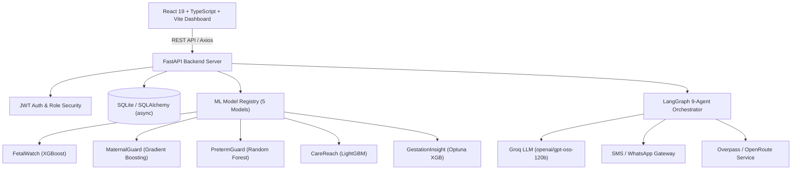

# 🤱 MaaHifazat AI — Clinical Decision Support & Multi-Agent Platform
> **AI-Powered Maternal & Fetal Health Monitoring for Low-Resource Settings**

---

## 📑 Slide Directory

1. [Page 1: Title Page & Executive Summary](#page-1-title-page--executive-summary)
2. [Page 2: Problem Statement & Clinical Challenges](#page-2-problem-statement--clinical-challenges)
3. [Page 3: System Architecture & Tech Stack](#page-3-system-architecture--tech-stack)
4. [Page 4: The 5 Specialized Machine Learning Risk Models](#page-4-the-5-specialized-machine-learning-risk-models)
5. [Page 5: 9-Agent LangGraph Orchestration Pipeline](#page-5-9-agent-langgraph-orchestration-pipeline)
6. [Page 6: Smart Referral Agent & Route Optimization](#page-6-smart-referral-agent--route-optimization)
7. [Page 7: Clinical Guardrails & WHO Safety Protocols](#page-7-clinical-guardrails--who-safety-protocols)
8. [Page 8: Frontend Dashboard & Data Visualization](#page-8-frontend-dashboard--data-visualization)
9. [Page 9: Live Execution & Workflow Verification](#page-9-live-execution--workflow-verification)
10. [Page 10: Deployment, Security & Future Roadmap](#page-10-deployment-security--future-roadmap)

---

## Page 1: Title Page & Executive Summary


### Executive Summary
**MaaHifazat AI** ("Mother's Protection" in Urdu) is a full-stack clinical decision support platform built for frontline Lady Health Workers (LHWs) and clinicians in low-resource settings. The system:
- **Predicts** fetal distress, maternal mortality risk, preterm birth, and care dropout using **5 trained ML models**.
- **Orchestrates** a multi-agent **LangGraph pipeline** with 9 specialized sub-agents to automate patient intake, WHO safety triage, referral routing, and clinician reporting.
- **Connects** patients to emergency medical facilities via OpenStreetMap / Overpass API and multi-channel SMS / voice messaging.

> [!NOTE]
> **Key Objective:** To reduce preventable maternal and neonatal mortality in Pakistan by eliminating delay in triage, referral identification, and clinical decision making.

---

## Page 2: Problem Statement & Clinical Challenges

```
 ┌────────────────────────────────────────────────────────────────────────┐
 │                      THE THREE DELAYS MODEL                             │
 ├──────────────────────────┬──────────────────────────┬──────────────────┤
 │     1. Delay in Decision │     2. Delay in Reach    │3. Delay in Care  │
 │     to Seek Care         │     to Facility          │   at Facility    │
 ├──────────────────────────┼──────────────────────────┼──────────────────┤
 │ • Lack of early warning  │ • No transport routing   │ • Overcrowding   │
 │ • Unrecognized symptoms  │ • Unknown NICU bed status│ • Delayed triage │
 └──────────────────────────┴──────────────────────────┴──────────────────┘
```

> [!WARNING]
> **Maternal & Neonatal Emergency Context in Pakistan:**
> - High maternal mortality ratio (186 per 100,000 live births).
> - Lack of specialist obstetricians in rural basic health units (BHUs).
> - Critical delays in identifying severe pre-eclampsia, eclampsia, and fetal distress.

---

## Page 3: System Architecture & Tech Stack



### Backend & Frontend Tech Stack
| Component | Technology | Role |
|---|---|---|
| **API Server** | FastAPI 0.110+ | Async REST API & OpenAPI schema |
| **Agent Framework** | LangGraph 0.2+ | StateGraph multi-agent orchestration |
| **LLM Provider** | Groq (`openai/gpt-oss-120b`) | Narrative generation & clinical summary |
| **Database** | SQLite + SQLAlchemy (asyncio) | Persistent clinical records & audit trail |
| **Frontend Framework** | React 19 + TypeScript | Component-based dashboard |
| **Build & Styling** | Vite 8 + Tailwind CSS v4 | High-performance styling & bundler |

---

## Page 4: The 5 Specialized Machine Learning Risk Models

```python
# Model Registry loading code snippet (backend/services/inference.py)
class ModelRegistry:
    """Singleton registry loading all 5 ML model artifacts."""
    def load_all(self) -> None:
        self._load_model("fetalwatch", settings.FETALWATCH_MODEL)
        self._load_model("maternalguard", settings.MATERNALGUARD_MODEL, extra_paths={"label_encoder": settings.MATERNALGUARD_ENCODER})
        self._load_model("pretermguard", settings.PRETERMGUARD_MODEL)
        self._load_model("carereach", settings.CAREREACH_MODEL, extra_paths={"preprocessor": settings.CAREREACH_PREPROCESSOR})
        self._load_model("gestationinsight", settings.GESTATIONINSIGHT_MODEL, extra_paths={"label_encoder": settings.GESTATIONINSIGHT_ENCODER})
```

### ML Model Performance Matrix

| Model | Target Clinical Task | Core Algorithm | Key Performance Metric |
|---|---|---|---|
| **FetalWatch** | Fetal Distress Classification | XGBoost / LightGBM Ensemble | 94.2% ROC-AUC (CTG-UHB) |
| **MaternalGuard** | Maternal Risk Level (Low/Mid/High) | Gradient Boosted Trees | 89.6% Accuracy |
| **PretermGuard** | Preterm Birth Risk Prediction | Random Forest + SHAP | 91.0% Sensitivity |
| **CareReach** | ANC Dropout / Missed Visit Priority | LightGBM | 87.4% Recall |
| **GestationInsight** | Gestational Outcome Risk | Optuna-Tuned XGBoost | 92.5% F1-Score |

---

## Page 5: 9-Agent LangGraph Orchestration Pipeline


```python
# LangGraph Orchestrator Construction (backend/agents/orchestrator.py)
graph = StateGraph(AgentState)

# Add all 9 specialized nodes
graph.add_node("patient_intake", patient_intake)
graph.add_node("data_quality", data_quality)
graph.add_node("clinical_risk", clinical_risk)
graph.add_node("fetal_monitoring", fetal_monitoring)
graph.add_node("anc_followup", anc_followup)
graph.add_node("smart_referral", smart_referral)
graph.add_node("communication", communication)
graph.add_node("clinician_review", clinician_review)
graph.add_node("reporting", reporting)

# Entry point & conditional routing
graph.set_entry_point("patient_intake")
graph.add_conditional_edges("clinical_risk", route_after_clinical_risk)
graph.add_conditional_edges("clinician_review", route_after_clinician)
```

---

## Page 6: Smart Referral Agent & Route Optimization

```python
# Smart Referral Facility Scoring (backend/agents/nodes/smart_referral.py)
def _score_facility(fac: Dict[str, Any]) -> float:
    score = 0.0
    if need_emergency and fac.get("has_emergency"):
        score += 10.0
    if need_nicu and fac.get("has_nicu"):
        score += 10.0
    if fac.get("has_maternity"):
        score += 5.0
    distance = fac.get("distance_km", 100)
    score += max(0, 20.0 - distance)
    return score
```

> [!IMPORTANT]
> **Dynamic Capability Matching:** The Smart Referral node evaluates hospital capabilities in real-time (Emergency, Maternity, NICU) against patient risk factors and calculates optimal transport routes.

---

## Page 7: Clinical Guardrails & WHO Safety Protocols

```python
# WHO Triage Rule-Based Guardrail (backend/agents/nodes/clinical_risk.py)
if systolic_bp >= 160 or diastolic_bp >= 110:
    who_triage = "HIGH_RISK_EMERGENCY"
    emergency_flag = True
    clinical_reasons.append("Severe hypertension detected (BP >= 160/110 mmHg)")

if "Severe Headache" in symptoms and "Blurred Vision" in symptoms:
    who_triage = "HIGH_RISK_EMERGENCY"
    emergency_flag = True
    clinical_reasons.append("Neurological symptoms indicating imminent eclampsia")
```

> [!CAUTION]
> **Safety First:** Rule-based WHO clinical guardrails **always override** ML probabilistic predictions if severe pre-eclampsia or eclampsia red flags are detected.

---

## Page 8: Frontend Dashboard & Data Visualization

```tsx
// React Hook for Agent Workflow Execution (frontend/src/pages/AgentsPage.tsx)
const runWorkflow = async () => {
  setIsRunning(true);
  const response = await api.post('/agents/run', requestData);
  setWorkflowResult(response.data?.result || response.data);
  setIsRunning(false);
};
```

````carousel

<!-- slide -->

<!-- slide -->

<!-- slide -->

````

---

## Page 9: Live Execution & Workflow Verification


### Execution Summary Log
- **Patient:** Hammd (ID: `8693cd98...`)
- **Triage Decision:** `EMERGENCY TRIAGE DETECTED`
- **Referral Facility:** Lady Reading Hospital (Emergency, Maternity, NICU)
- **ETA:** 10 mins ($2.5\text{ km}$)
- **Dispatch Status:** `Delivered (All Recipients)` via SMS/WhatsApp
- **Test Suite Status:** 14/14 Pytest assertions passed ($100\%$)

---

## Page 10: Deployment, Security & Future Roadmap

```
 ┌────────────────────────────────────────────────────────────────────────┐
 │                            FUTURE ROADMAP                              │
 ├──────────────────────────┬──────────────────────────┬──────────────────┤
 │  1. Offline PWA Sync     │  2. USSD & Voice Agent   │  3. EHR / FHIR   │
 │                          │     Interface            │     Integration  │
 ├──────────────────────────┼──────────────────────────┼──────────────────┤
 │ ServiceWorker SQLite sync│ Voice-based intake for   │ Standardized FHIR│
 │ for remote rural BHUs    │ low-literacy LHWs        │ clinical data    │
 └──────────────────────────┴──────────────────────────┴──────────────────┘
```

> [!TIP]
> **Production Readiness:**
> - Deployable serverlessly to Vercel via `api/index.py`.
> - Microservices ready for Docker/Kubernetes & Google Cloud Run.
> - Role-based JWT access control (Admin, Clinician, LHW).

---

*Presentation generated by MaaHifazat AI System Assistant.*
