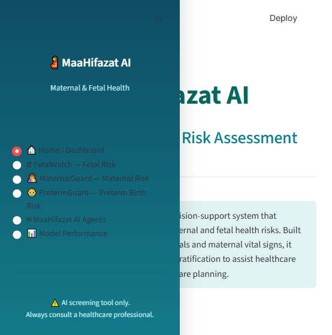
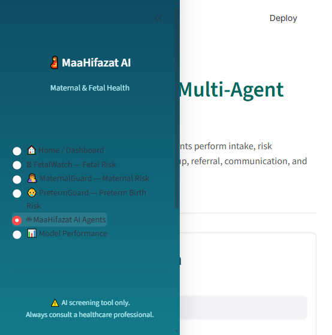
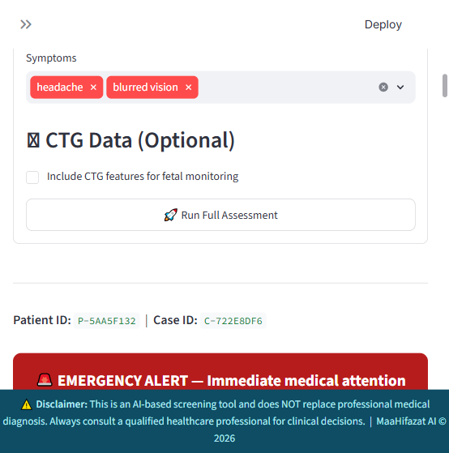

# 🤱 MaaHifazat AI — Maternal & Fetal Health Platform

> **AI-powered maternal health monitoring for low-resource settings** — combining 5 advanced ML models, 9-agent LangGraph orchestration, smart referrals, and a real-time clinical dashboard to eliminate "The Three Delays" and reduce preventable maternal mortality.

**Built by Group: Algo Titans**
* **Zafar Ullah** (Leader)
* **Muhammad Ali**
* **Muhammad Younus Khan**

---

## 📋 Table of Contents

- [The Problem We Solve](#-the-problem-we-solve)
- [Key Features](#-key-features)
- [System Architecture](#-system-architecture)
- [5 Specialized ML Models](#-5-specialized-ml-models)
- [9-Agent Orchestration](#-9-agent-orchestration)
- [Tech Stack](#-tech-stack)
- [Getting Started](#-getting-started)
- [API Reference](#-api-reference)
- [Screenshots](#-screenshots)

---

## 🌍 The Problem We Solve
In rural areas, mothers and babies face critical risks due to **"The Three Delays"**:
1. **Delay in Decision:** Unrecognized symptoms (e.g., severe pre-eclampsia) leading to late action.
2. **Delay in Reaching Help:** Unknown hospital capabilities, distances, and lack of routing.
3. **Delay in Care:** Overcrowded facilities and slow triage.

**MaaHifazat AI** acts as a digital safety net for Lady Health Workers (LHWs) and doctors, automatically detecting emergencies and orchestrating immediate care.

---

## ✨ Key Features

| Feature | Description |
|---|---|
| 🧠 **Multi-Agent Orchestration** | LangGraph-powered pipeline with 9 autonomous agents (Intake, Risk, Smart Referral, Communication, Reporting). |
| 📊 **5-Model Risk Prediction** | Simultaneously runs MaternalGuard, FetalWatch, PretermGuard, GestationInsight, and CareReach. |
| 🚑 **Smart Referrals** | Automated matching to the nearest capable facility (Maternity/NICU) via OpenStreetMap with ETA. |
| 🔔 **Real-time Alerts** | Priority-based alerting with SMS & WhatsApp delivery to doctors and patients. |
| 🛡️ **WHO Safety Guardrails** | Deterministic rule engine that instantly overrides ML predictions if critical WHO red flags (e.g., BP > 160/110) are detected. |
| 📈 **Clinical Dashboard** | React 19 + Tailwind CSS dashboard with unified Risk Intelligence views and an Alert Center. |

---

## 🏗 System Architecture

```text
┌──────────────────────────────────────────────────────────┐
│                     Frontend (React + Vite)              │
│  Risk Intelligence · AI Agents Hub · Alerts · Dashboard  │
└─────────────────────────┬────────────────────────────────┘
                          │  REST API (FastAPI)
┌─────────────────────────▼────────────────────────────────┐
│                    Backend (FastAPI)                     │
└────────┬──────────────────────────┬──────────────────────┘
         │                          │
┌────────▼────────┐       ┌─────────▼──────────────────────┐
│   ML Model      │       │   Agent Orchestrator (LangGraph)│
│   Registry      │       │                                │
│ • FetalWatch    │       │  patient_intake → clinical_risk│
│ • MaternalGuard │       │  → fetal_monitoring → referral │
│ • PretermGuard  │       │  → communication → review      │
│ • CareReach     │       │  → anc_followup → reporting    │
│ • GestationI.   │       └────────────────────────────────┘
└─────────────────┘
```

---

## 🤖 5 Specialized ML Models

MaaHifazat AI relies on a powerful ensemble of customized ML models stored in the Model Registry:

| Model | Target Clinical Task | Core Algorithm |
|---|---|---|
| **FetalWatch** | Fetal distress classification (Normal/Suspect/Pathological) | XGBoost / LightGBM |
| **MaternalGuard** | Maternal risk level prediction (Low/Mid/High) | Gradient Boosted Trees |
| **PretermGuard** | Preterm birth risk prediction | Random Forest + SHAP |
| **GestationInsight**| Gestational outcome/complication risk | Optuna-tuned XGBoost |
| **CareReach** | ANC (Antenatal Care) missed-visit dropout risk | LightGBM |

All models are trained with **Optuna** hyperparameter search and **SHAP** explainability.

---

## 🤖 9-Agent Orchestration

When a patient is evaluated via the dashboard, their data enters our **LangGraph StateGraph**:
1. **Intake Agent:** Normalizes demographics and vitals.
2. **Data Quality Agent:** Checks for missing values or outliers.
3. **Clinical Risk Agent:** Applies WHO guardrails and fetches ML predictions.
4. **Fetal Monitoring Agent:** Evaluates CTG data.
5. **ANC Followup Agent:** Generates reminder actions based on CareReach.
6. **Smart Referral Agent:** Routes critical patients to hospitals with ICUs/Maternity wards.
7. **Communication Agent:** Dispatches SMS/WhatsApp alerts.
8. **Clinician Review Agent:** Compiles context.
9. **Reporting Agent:** Generates a final structured clinical summary using Groq LLM.

---

## 🛠 Tech Stack

### Backend
* **API Framework:** FastAPI 0.110+
* **Orchestration:** LangGraph 0.2+ / LangChain Core
* **LLM Provider:** Groq (`openai/gpt-oss-120b`)
* **Database:** SQLite via SQLAlchemy (asyncio)
* **ML Libraries:** scikit-learn, XGBoost, LightGBM, Optuna, SHAP

### Frontend
* **Framework:** React 19 + TypeScript
* **Build Tool:** Vite 8
* **Styling:** Tailwind CSS v4
* **Data Fetching:** TanStack Query v5 + Axios
* **Icons:** Lucide React

---

## 🚀 Getting Started

### Prerequisites
- Python 3.11+
- Node.js 18+
- [Groq API key](https://console.groq.com)

### 1. Clone the repository
```bash
git clone https://github.com/Zafar488/MaHifzat-agent.git
cd MaHifzat-agent
```

### 2. Environment Setup
```bash
cp .env.example .env
# Edit .env and add your GROQ_API_KEY
```

### 3. Start Backend
```bash
python -m venv .venv
.venv\Scripts\activate
pip install -r requirements-backend.txt
pip install -r requirements.txt
uvicorn backend.api.main:app --reload --port 8000
```
API docs available at: **http://localhost:8000/api/docs**

### 4. Start Frontend
```bash
cd frontend
npm install
npm run dev
```
Frontend available at: **http://localhost:5173**

---

## 📡 API Reference
| Method | Path | Description |
|---|---|---|
| `POST` | `/api/risks/assess` | Run full 5-Model ML risk assessment |
| `POST` | `/api/agents/run` | Trigger the 9-agent LangGraph pipeline |
| `GET` | `/api/alerts` | Fetch active clinical and operational alerts |
| `POST` | `/api/auth/login` | Authenticate and receive JWT token |

---

## 📸 Screenshots

| Dashboard Home | AI Agents Workflow |
|:---:|:---:|
|  |  |

| Risk Intelligence Form | ML Results Overview |
|:---:|:---:|
|  |  |

| Full Workflow Results | Clinician Reporting |
|:---:|:---:|
|  |  |

---
*Developed with ❤️ for Hackathon 2026 by Algo Titans.*
