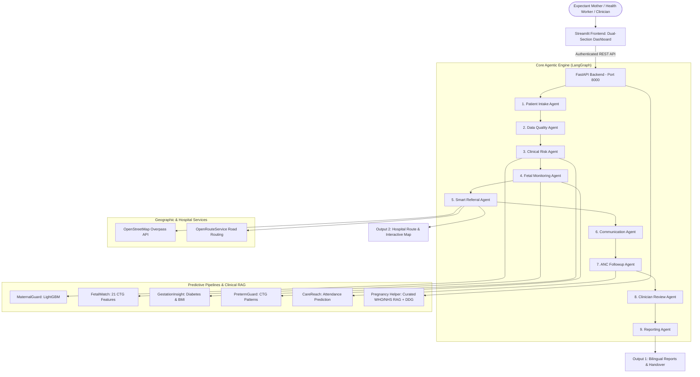
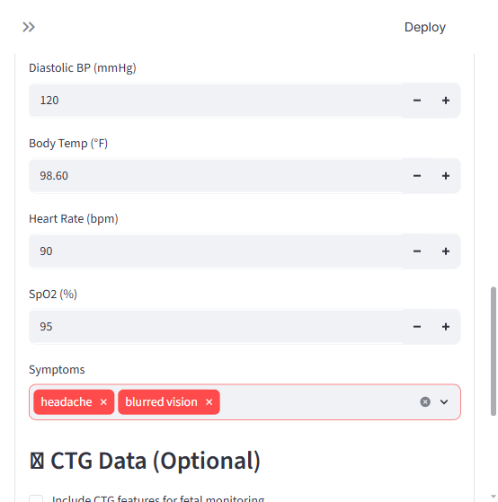
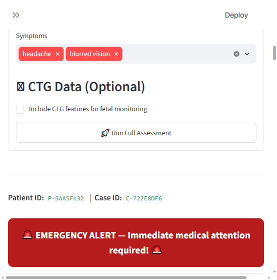
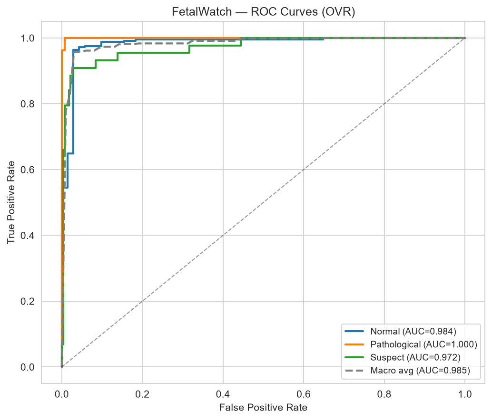
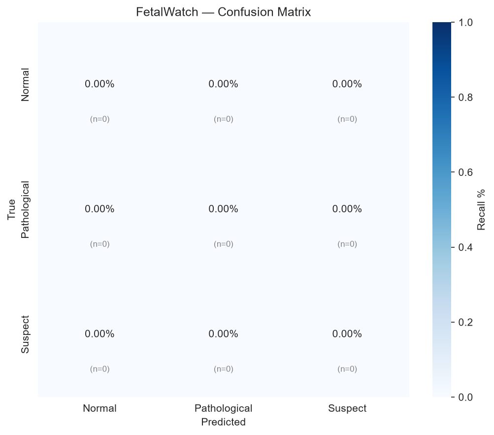
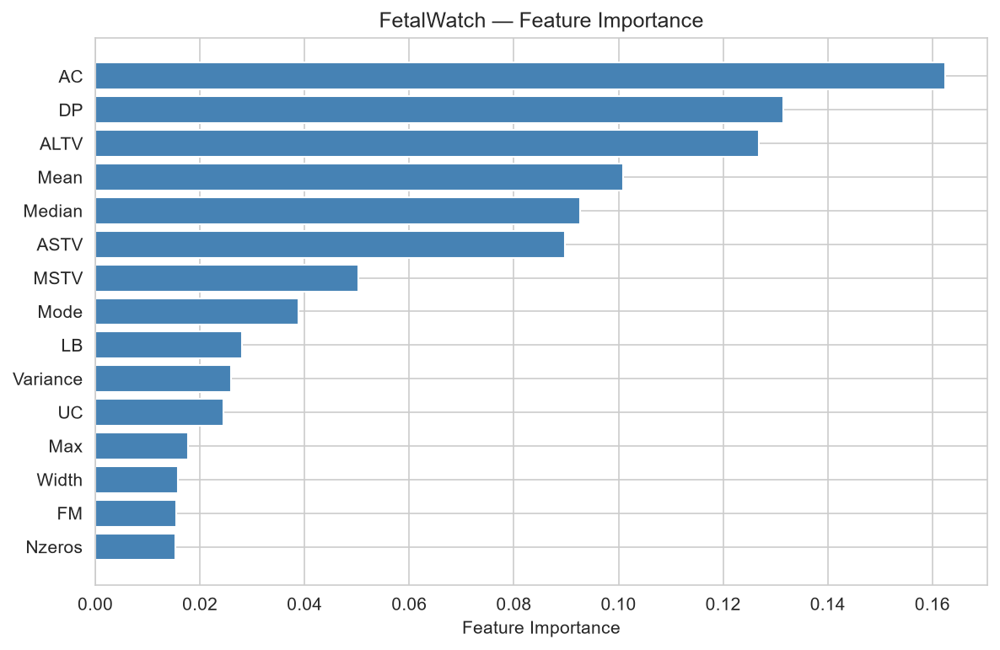
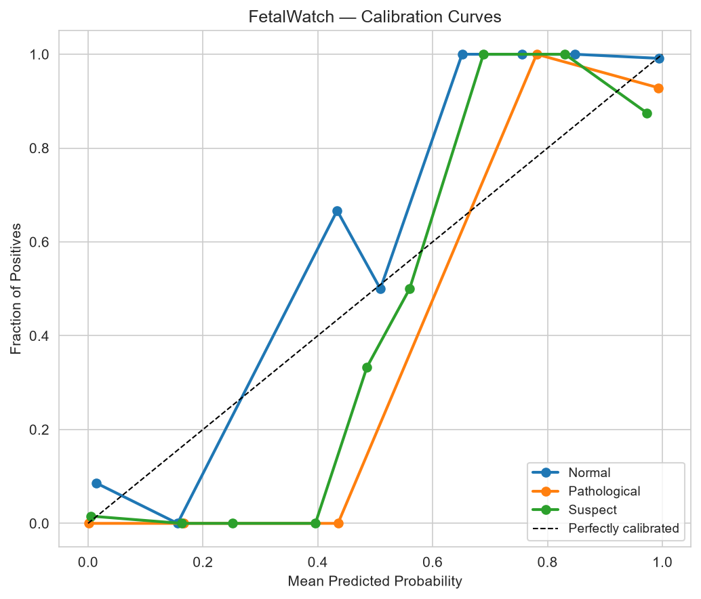

# 🤱 MaaHifazat AI (ماں حفاظت اے آئی)
### Intelligent Maternal Care Decision Support & Agentic Clinical Safety System

[](https://fastapi.tiangolo.com)
[](https://react.dev)
[](https://www.typescriptlang.org)
[](https://vitejs.dev)
[](https://github.com/langchain-ai/langgraph)
[](https://python.org)
[]()
[]()

**MaaHifazat AI** is an end-to-end clinical decision-support and maternal health intelligence platform designed for high-risk and rural healthcare environments. Backed by a **9-agent LangGraph workflow**, **5 machine learning prediction models**, **deterministic WHO safety triage rules**, and an **evidence-grounded bilingual Pregnancy Helper (RAG)**, it bridges the gap between community health workers (LHWs), expectant mothers, and tertiary maternity hospitals.

---

## 💻 React 19 Application Architecture & UI Navigation

The frontend is built with **React 19**, **TypeScript**, **Vite**, and **Tailwind CSS v4**, organized into clinical and intelligence views:

| Page / Route | Component | Key Features & Capability |
|---|---|---|
| **Dashboard** (`/dashboard`) | `DashboardPage.tsx` | Overview metrics, live risk distribution charts, and recent case queue. |
| **Risk Assessment** (`/risk-assessment`) | `RiskIntelligencePage.tsx` | Four-group clinical intake, WHO red-flag triage, heuristic fallback alerts (`FallbackNotice`), and doctor handover controls. |
| **Bilingual Case Reports** (`/reports`) | `ReportsPage.tsx` | Printable English & Urdu (اردو) care and referral report preview, HTML & Text downloads. |
| **ANC Followups** (`/followups`) | `FollowupsPage.tsx` | Priority outreach queue, task resolution modal, and direct call/SMS/WhatsApp links. |
| **Model Workbench** (`/models`) | `ModelWorkbenchPage.tsx` | Direct inference testbed with explicit `CLINICAL` vs `RESEARCH` model badges. |
| **Pregnancy Helper** (`/pregnancy-helper`) | `PregnancyHelperPage.tsx` | Conversational RAG assistant grounded in WHO/NICE guidelines with live DuckDuckGo web search fallback. |
| **Referrals & Alerts** (`/referrals`, `/alerts`) | `ReferralsPage.tsx`, `AlertsPage.tsx` | Hospital candidate ranking, road routing ETA, and clinical danger sign notifications. |

---

## 🌟 Key Capabilities & Problems Solved

| Problem | MaaHifazat AI Working Solution |
|---|---|
| **1. Late Recognition of Danger Signs** | Measured vitals (`BP`, `HR`, `Temp`, `BS`, `RR`), symptoms, deterministic WHO red-flag triage, and experimental LightGBM prediction (`MaternalGuard`, `FetalWatch`). Missing observations remain honestly unassessed. |
| **2. Unclear Hospital Capabilities & Routing** | GPS / manual coordinate capture, live **OpenStreetMap (Overpass)** facility discovery, **OpenRouteService** road routing with realistic travel time (ETA), and verified capability filtering (Maternity, Emergency, NICU). |
| **3. Incomplete Doctor Handover** | Automated bilingual reports in English and native Urdu script, structured clinician handover download, and Groq-powered AI explanations preserving triage integrity. |
| **4. Missed Checkups & Disrupted Care** | WHO-aligned 8-contact antenatal care (ANC) milestone schedule, priority task queue, and click-to-compose SMS/WhatsApp/Call outreach. |
| **5. Lack of Evidence-Grounded Education** | **Section B Pregnancy Helper**: Conversational AI grounded in WHO, NHS, and NICE guidelines, live DuckDuckGo search fallback, cardinal danger sign detection, and explicit assessment sharing. |

---

## 🏗️ System Architecture



---

## 🗂️ Application Structure: Exactly Two Main Sections

### Section A — Risk Assessment
Structured into **four expandable intake groups**:
1. **Patient and Pregnancy Details (~20 fields)**:
   - Patient ID, name, age, contact phone, preferred language, locality, GPS coordinates, location source & accuracy.
   - Pregnancy weeks and days, last menstrual period (LMP) date, expected delivery date (EDD), and pregnancy dating source.
   - **Trimester Derivation**: Documented convention (1st: 1–12w, 2nd: 13–26w, 3rd: 27w+).
   - **Visible Date Conflict Resolution**: Compares gestational age from LMP against reported weeks; alerts clinicians visibly without silent overrides.
   - Gravida, parity, singleton/multiple pregnancy, complications, and data-storage consent.
2. **Mother’s Assessment**:
   - Systolic/diastolic BP, heart rate, temperature, blood glucose, respiratory rate, test timing, and measurement source.
   - **Automatic Unit Conversion**: Supports °F thermometer entries (converts to °C) and mg/dL glucometer entries (converts to mmol/L).
   - Symptoms triage: vaginal bleeding, headache severity, vision disturbance, epigastric pain, convulsions, foul discharge, consciousness level.
   - **GestationInsight Research Subsection**: Height & weight for automatic BMI calculation, skin thickness, insulin, and pedigree score.
3. **Baby / Fetus Assessment**:
   - **Movement Information**: Fetal movement felt, pattern established, decreased/changed movements, concern duration (*explicit clinical notice: fetal movement alone does not prove fetal wellbeing*).
   - **Cardiotocography (CTG)**: 21 clinical features (`LB`, `AC`, `FM`, `UC`, `DL`, `DS`, `DP`, `ASTV`, `MSTV`, `ALTV`, `MLTV`, `Width`, `Min`, `Max`, `Nmax`, `Nzeros`, `Mode`, `Mean`, `Median`, `Variance`, `Tendency`).
   - Downloadable CSV template, single-record CSV upload, and manual entry.
   - Missing CTG safely displays *"CTG assessment not performed"*; non-CTG vitals remain fully triaged.
4. **Appointments and Follow-up Care**:
   - Booking date, scheduled appointment, last checkup, transport barrier, missed visits.
   - Configurable **WHO 8-contact ANC schedule** (milestones at 12, 20, 26, 30, 34, 36, 38, and 40 weeks).
   - **CareReach Research Subsection**: Calculates booking delay delta, appointment day-of-week, and comorbidity count.

#### Intake Form & Multi-Agent Execution



#### Output 1 — Assessment & Next-Step Report
- Generates side-by-side **English and native Urdu script** reports.
- Separates measured facts, model outputs, deterministic safety rules, and LLM explanations.
- Downloadable printable HTML and UTF-8 text formats.
- Structured doctor handover summary.

#### Output 2 — Hospital Report & Interactive Road Route


- Ranks candidate hospitals based on verified services (**Maternity**, **Emergency**, **NICU**).
- Computes straight-line distance, road distance, and estimated travel time (ETA) via OpenRouteService.
- Interactive map pinpoints patient location, hospital candidates, and road route.
- **DuckDuckGo Supplementary Hospital Search**: Searches public facility contact details and hours safely without sending any patient PII.

---

### Section B — Advanced Pregnancy Helper (Clinical RAG)
An intelligent conversational assistant grounded in authoritative clinical guidelines:

- **Curated Knowledge Base**: WHO Antenatal Care Recommendations (2016), NICE Hypertension in Pregnancy (NG133/NG229), NHS Physical Activity & Exercise Guidelines, and NICE Fetal Movement Monitoring.
- **Urgent Danger-Sign Detector**: Immediately intercepts cardinal obstetric red flags (vaginal bleeding, severe frontal headache with vision changes, convulsions, epigastric pain, absent movements) and outputs a high-visibility red emergency alert instructing the user to seek immediate hospital care.
- **Evidence Citations**: Every answer includes expandable citations with guideline titles, sections, publication dates, and source URLs.
- **Live Search Fallback**: Enriches missing or updated queries via DuckDuckGo without exposing patient data.
- **Assessment Sharing**: When the user clicks *"Share with Pregnancy Helper"* in Section A, the assistant receives verified clinical findings (gestational age, blood pressure, triage level) and tailors its explanations without inventing diagnoses.

---

## 🤖 The 9 LangGraph Workflow Agents

| # | Agent | Primary Responsibility |
|---|---|---|
| **1** | **Patient Intake** | Validates patient identity, gestation age, parity, and consent parameters. |
| **2** | **Data Quality** | Enforces unit boundaries, normalizes measurements, and detects conflicting observations. |
| **3** | **Clinical Risk** | Evaluates deterministic WHO red flags, vitals thresholds, and executes `MaternalGuard`. |
| **4** | **Fetal Monitoring** | Evaluates fetal movement flags and executes `FetalWatch` on 21 CTG features (if supplied). |
| **5** | **Smart Referral** | Discovers nearby hospitals via OSM, verifies capabilities, and plans ORS road routing. |
| **6** | **Communication** | Drafts culturally sensitive notification messages in the patient's preferred language. |
| **7** | **ANC Followup** | Plans upcoming ANC milestone contacts and logs priority outreach tasks. |
| **8** | **Clinician Review** | Generates doctor handover summary, tracks review approvals, and logs audit entries. |
| **9** | **Reporting** | Compiles complete bilingual English and Urdu clinical reports with downloadable HTML. |

---

## 📊 Machine Learning Models & Evidence

| Model | Target Task | Holdout Macro-F1 | Clinical Serving Status |
|---|---|---:|---|
| **MaternalGuard** | Maternal Risk Level (Low / Mid / High) | **0.6871** | Experimental clinical pipeline (used alongside deterministic rules) |
| **FetalWatch** | Fetal CTG Status (Normal / Suspect / Pathological) | **0.9247** | Experimental clinical pipeline (measured 21 CTG features) |
| **PretermGuard** | CTG Class Pattern Classification (10 classes) | **0.8504** | Research model (model workbench) |
| **GestationInsight** | Diabetes & Metabolic Risk Profiling | **0.7423** | Research model (derived from Pima indicators) |
| **CareReach** | Antenatal Appointment No-Show Prediction | **0.5627** | Research model (appointment attendance) |

### Model Performance Visualizations
| ROC Curves | Confusion Matrix |
|:---:|:---:|
|  |  |
| **Feature Importance** | **Calibration Curve** |
|  |  |

---

## 🔒 Authentication, Security & Privacy

- **Role-Based Access Control**: Scoped access for `patient`, `lhw` (Lady Health Worker), `clinician`, and `admin`.
- **Privilege Escalation Prevention**: Public self-registration permits only the `patient` role. Clinician and health worker access requires facility-issued verification codes.
- **Cryptographic Standards**: Passwords hashed using salted `bcrypt`. Sessions managed via expiring `JWT` tokens with server-side revocation (`token_version`).
- **Data Segregation**: Patient records, assessments, and chat histories are scoped strictly to authorized users.
- **PII Protection**: No patient names, phone numbers, or exact coordinates are ever sent to public search engines (DuckDuckGo) or external LLM APIs (Groq).

---

## 🇵🇰 Bilingual Support & Urdu RTL Typography

- **Full Right-to-Left (RTL) Layout**: Dynamically toggles between English (LTR) and Urdu (RTL) with a single click.
- **Readable Urdu Typography**: Styled using native Noto Nastaliq Urdu and Arabic fonts.
- **Numeral Normalization**: Accepts Eastern Arabic/Urdu numerals (`۰۱۲۳۴۵۶۷۸۹`) and normalizes them to standard digits (`0-9`) for clinical computations.
- **Technical Preservation**: Metrics, measurements, coordinates, and code identifiers remain formatted in clear LTR format for clinical clarity.

---

## 🚀 Quickstart & Installation

### 1. Prerequisites
- **Python 3.11** or higher
- PowerShell (Windows) or Bash (Linux / macOS)

### 2. Setup Virtual Environment & Dependencies
```powershell
# Clone the repository
git clone <your-repo-url>
cd hackthon

# Create and activate virtual environment
python -m venv .venv
.venv\Scripts\Activate.ps1

# Install application dependencies
pip install -r requirements-app.txt
```

### 3. Environment Variables
Copy `.env.example` to `.env` and configure your credentials:
```ini
APP_ENV=development
DEMO_MODE=false
ENABLE_LLM=true
REQUIRE_MODELS=true

# Groq API Key (for LLM clinical explanations & RAG helper)
GROQ_API_KEY=gsk_your_groq_api_key_here
GROQ_MODEL=llama-3.3-70b-versatile

# OpenRouteService API Key (for road routing & travel ETA)
OPENROUTESERVICE_API_KEY=your_ors_api_key_here

# OpenStreetMap Overpass Endpoint
OVERPASS_URL=https://overpass.private.coffee/api/interpreter
```

### 4. Run the Application
Start the FastAPI backend API and Vite React frontend:
```bash
# Terminal 1: Start FastAPI Backend
.venv/bin/python -m uvicorn backend.api.main:app --host 127.0.0.1 --port 8000

# Terminal 2: Start React 19 Frontend (Vite)
cd frontend && npm run dev
```
- **React Web Application**: [http://localhost:5173](http://localhost:5173)
- **FastAPI Interactive API Docs**: [http://localhost:8000/api/docs](http://localhost:8000/api/docs)

### 5. Health & Readiness Monitoring (`/api/health`)
The `/api/health` endpoint explicitly reports inference readiness across clinical decision models (`MaternalGuard`, `FetalWatch`) and research workbench models (`PretermGuard`, `GestationInsight`, `CareReach`):
```json
{
  "status": "ok",
  "inference_readiness": {
    "clinical_serving_ready": true,
    "research_workbench_ready": true
  },
  "clinical_models": {
    "maternalguard": true,
    "fetalwatch": true
  },
  "research_workbench_models": {
    "pretermguard": true,
    "gestationinsight": true,
    "carereach": true
  },
  "demo_mode": false,
  "clinical_validation": "not established"
}
```

### 6. Create an Administrator (Optional)
```bash
.venv/bin/python scripts/create_admin.py --non-interactive
```
Log in as administrator to provision team accounts for doctors, nurses, and health workers.

---

## 🧪 Verification & Test Suite

The project includes an extensive test suite covering all APIs, RAG pipelines, bilingual formatting, and machine learning components:

```powershell
# Run the complete test suite (93 tests)
.venv\Scripts\python.exe -m pytest backend/tests -v

# Run the live end-to-end integration verification
.venv\Scripts\python.exe scripts/verify_real_app.py --live-providers

# Run the reproducible model audit
.venv\Scripts\python.exe scripts/audit_models.py
```

---

## 📄 Documentation Links
- [API Configuration Guide](docs/API_SETUP.md)
- [Bilingual Report Specifications](docs/TWO_REPORTS_GUIDE.md)
- [Clinical Knowledge References](docs/CLINICAL_REFERENCES.md)
- [Model Audit Report](docs/model_audit.json)

---

## 👥 Credits
Developed by **Algo Titans** for rural maternal healthcare decision support.
*Note: Observations, triage scores, and model predictions provide decision support and require qualified clinical interpretation. Emergency medical care must never wait for software evaluation.*
